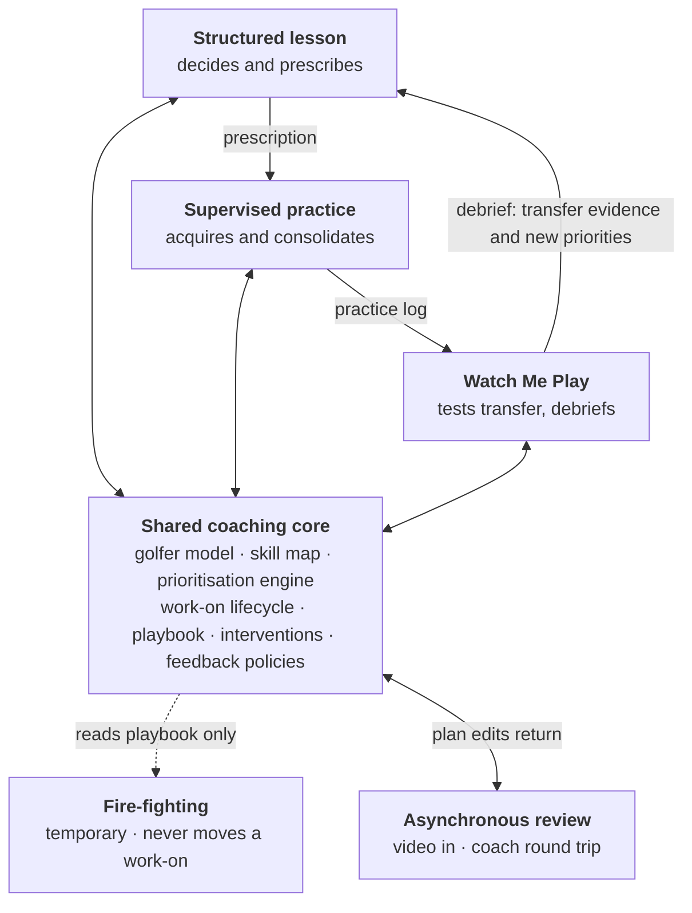

# PinPoint Studio — The Coaching Context

*Design note · 23 November 2026*

## What the Coaching context is

The Coaching context turns a diagnosis into improvement. It decides what the golfer works on, how they work on it, how much they are told while they do, and whether the change has stuck — in the bay, in practice, on the course, and between visits.

PinPoint Studio already has two contexts before this one. **Acquisition** captures FLIR video, IMU streams and launch-monitor data. **Diagnostics** (analysis and diagnosis) derives metrics, assesses them against the swing-characteristics DAG, and reports what is happening mechanically and why. That answers the question every golfer asks after a bad shot: what happened there?

It does not answer the questions a coach answers. Of everything that is wrong, which one thing matters most right now? What drill, constraint or feel will change it? Should I tell you about every swing, or only when you drift? Did last week's work survive a night's sleep, a different club, a scorecard in your pocket? And when the swing falls apart on Saturday morning, what do you do to get round?

The Coaching context answers those questions. It is modelled on what a good coach does across every kind of interaction they have with a golfer — not only the hour-long lesson. Five modalities are in scope:

1. **Structured lesson** — diagnose, prioritise, prescribe, leave the golfer with a plan.
2. **Supervised practice** — watch the golfer work on the prescription and keep them honest.
3. **Watch Me Play** — observe a round, advise during it, debrief after it.
4. **Fire-fighting** — a short-horizon fix when the game breaks before an event.
5. **Asynchronous review** — the golfer sends a session or video; a coach (human or PPS) reviews it remotely.

All five share one golfer model, one work-on lifecycle, one intervention library and one set of feedback policies. Measurement remains the substrate: PPS is still a launch monitor for the golfer, and the Coaching context is an optional context after it that the golfer — or a human coach — can engage as much or as little as they choose.

## The coaching loop

A good coach's value sits in prioritisation, intervention, feedback and follow-up — not in the diagnosis itself. The table maps each coaching behaviour to the system function that must deliver it.

| Phase | What a good coach does | System function |
| --- | --- | --- |
| Intake | Asks about goals, the current bad shot, history, injuries, time available, upcoming events | Golfer model; bad-shot picker as the opening question |
| Observe | Watches several swings cold before saying anything | Cold retention baseline before warm-up |
| Assess | Diagnoses; screens mobility where relevant | Diagnostics DAG; capacity screens from pose |
| Prioritise | Picks one thing — the highest-leverage cause the golfer can change now | Prioritisation engine |
| Explain | Ball-flight consequence first, mechanics second | Narrative from the DAG consequence path |
| Intervene | Drill, constraint, feel, exaggeration | Intervention library |
| Practise | Repetition, then variation, then a game-like test; talks less as the golfer improves | Practice orchestration; feedback policy |
| Check | Hits a few with the normal routine to a target | In-session transfer test |
| Wrap-up | One or two work-ons, how it should feel, a plan, what to ignore | Lesson card |
| Revisit | Retests cold, asks how it went on the course, advances or changes tack | Review step; work-on lifecycle gates |

Two rules follow from the motor-learning literature and govern the whole context. Improvement within a session is performance, not learning: progress is judged on retention (next visit, cold) and transfer (variable practice, play). And more feedback is not better: what the golfer is told, and when, is a designed policy, not a by-product of what the pipeline can compute.

## Shared foundations

Every modality reads and writes the same seven structures. A modality is a combination of these, not a separate subsystem.

**Golfer model.** Goals and timeframe, handicap and scoring profile, practice time available, upcoming events, capacity-screen results, work-on history, per-club carry and dispersion, Tendencies, and the range-to-course gap from play.

**Skill map.** Six domains above the swing DAG: full swing (hosts the existing DAG), short game, putting, course management, routine and mental, physical. Each skill node carries standardised tests with performance bands by handicap. Domains without producers are authored now; the model runs ahead of the implementation.

**Prioritisation engine.** Ranks candidate work-ons on leverage (DAG depth and share of bad outcomes or shots lost), confidence (session chain confirmation), changeability (capacity limits), timing (season phase, events) and dependencies (setup before motion). Output: one primary focus, at most one secondary, and a parked list with a reason for each.

**Intervention library.** Two categories. *Corrective* interventions change the movement: drills, constraints, cues, feels, physical exercises. *Compensatory* strategies help the golfer score with the swing they have: aim offsets, club choice, shot selection, quick fixes. Each entry is tagged with target conditions and measures, mechanism, environment, kit, level and a success criterion expressed as a measure moving. Authored by coaches, maintained by the community, cited, brand-free — the same governance as the diagnostics rules.

**Playbook.** The golfer's compensatory content, rebuilt from practice and play: per-club aim offsets, the miss to play for, club-selection rules, a trusted shot for each situation. It feeds the caddie in Watch Me Play, the fire-fighting fix, and the "on the course" section of every lesson card.

**Work-on lifecycle.** The durable coaching object, run as a formal state machine with measured gates:

| State | Enter when | Evidence source |
| --- | --- | --- |
| Identified | Prioritisation selects it | Diagnostics |
| Prescribed | Intervention and practice plan attached | Lesson |
| Acquiring | First supervised practice begins | Practice log |
| Consolidating | Measure inside corridor in repetition practice | Practice log |
| Transferring | Holds in variable practice and in a cold retest at the next visit | Practice log; lesson revisit |
| Graduated | Holds in play and the outcome distribution has shifted | Watch Me Play |
| Rethink | No movement after N sessions, or measure moved but outcomes did not | Any |

Rethink changes the intervention first and questions the diagnosis second. A fire-fighting fix is a separate, temporary state that sits beside the lifecycle and never moves a work-on.

**Feedback policies.** Named profiles selected by modality and stage: `lesson-acquire`, `lesson-transfer`, `practice-acquire`, `practice-variable`, `practice-integrate`, `play-silent`, `play-caddie`, `play-lesson`, `firefight`. Each defines what is shown (work-on verdict, outcome, other findings), when (every rep, bandwidth only, summary every N, on request) and in what language (external-focus cues by default).

**Two architectural rules apply across all foundations.** The core is deterministic and explainable: prioritisation, gating and feedback scheduling are structured code over the content pack. The existing AI Coach is the voice — intake conversation, narration, debrief — grounded on the structured plan object; it never decides. And a human coach can override every decision the engine proposes.

## Modality 1 — Structured lesson

The lesson is where change is decided. The golfer arrives with a bad shot and a goal; they leave with one clear work-on, an understanding of why it matters, a feel to chase, and a plan for the weeks ahead. On a return visit the lesson opens by testing last time's work before looking for anything new.

The flow follows the existing lesson model — Scope, Assess, Read, Prescribe, Practice, Re-test, Wrap-up — with the Coaching context driving each step. A human coach may run it with PPS proposing; a golfer may run it alone with PPS acting as coach.

### Use cases

| ID | Use case | Outcome |
| --- | --- | --- |
| LES-01 | First lesson: golfer states goal, timeframe and current bad shot | Golfer model seeded; diagnosis starts from the outcome |
| LES-02 | Cold observation of the first swings before warm-up | Retention baseline recorded |
| LES-03 | Capacity screen when a candidate cause has a physical dependency | Physical limit becomes a constraint or a physical work-on |
| LES-04 | PPS proposes a primary focus, a secondary and a parked list | Golfer or coach accepts, swaps or overrides with a reason |
| LES-05 | Explanation of the chosen fault, outcome first | Golfer can say what the fault does to the ball |
| LES-06 | Intervention trial within the lesson | First drill selected; alternative ready if it does not take |
| LES-07 | In-lesson transfer test: normal routine, random targets | Lesson ends knowing whether the change survives variation |
| LES-08 | Lesson card issued | Work-on in Prescribed state with practice plan and checkpoints |
| LES-09 | Return visit: cold retest of each active work-on | Lifecycle advanced, held or sent to Rethink |
| LES-10 | Return visit: review practice log and play debriefs since last lesson | Compliance and transfer inform the next priority |
| LES-11 | Human coach annotates and edits the plan | Coach decisions stored with provenance, distinct from PPS proposals |

### Requirements

1. **LES-R1** MUST capture goal, timeframe, available practice time and upcoming events at intake, and allow them to be revised at any visit.
2. **LES-R2** MUST open diagnosis from the bad-shot picker, with all outcomes selectable.
3. **LES-R3** MUST record a cold baseline of at least 3 swings before any warm-up feedback is shown.
4. **LES-R4** MUST present prioritisation as a ranked proposal with its reasons (leverage, confidence, changeability, timing, dependencies).
5. **LES-R5** MUST limit active work-ons to one primary and one secondary; everything else is parked with a stated reason.
6. **LES-R6** MUST explain each work-on as outcome, then consequence path, then mechanism.
7. **LES-R7** MUST select interventions from the library by target measure and mechanism, and offer at least one alternative.
8. **LES-R8** MUST run the `lesson-acquire` then `lesson-transfer` feedback profiles, ending with a transfer test.
9. **LES-R9** MUST issue a lesson card containing: headline, why it matters, the work-on measure with current value and target corridor, cue, before/after exemplar swings, practice prescription, checkpoints, parked items, on-course guidance from the playbook, and what will be retested next time.
10. **LES-R10** MUST retain full data for exemplar swings selected by the lesson; other swings keep the metric tier only.
11. **LES-R11** MUST open a return visit with a cold retest of every active work-on before new diagnosis.
12. **LES-R12** SHOULD export the lesson card for print and sharing.
13. **LES-R13** MUST record every coach override with who made it and why.

## Modality 2 — Supervised practice

Supervised practice is where a work-on actually moves from Acquiring to Consolidating, and it is the part most golfers do alone and badly: raking and hitting, drifting onto other faults, judging the session by ball flight. PPS plays the coach standing behind the golfer — telling them whether they did what was asked, reminding them to slow down and rehearse, moving the drill up or down a level, and swapping to a different drill when one is not working.

The session is generated from the work-on's prescription and runs in blocks: cold check, acquire, variable, integrate, exit test. Blocks advance on a quality-rep criterion, not on time. Feedback is deliberately narrow: one verdict on the work-on measure, with ball outcome secondary or hidden, and parked faults silent.

### Use cases

| ID | Use case | Outcome |
| --- | --- | --- |
| PRA-01 | Golfer starts practice on an active work-on | Session plan generated from the prescription |
| PRA-02 | Cold check before warm-up | Retention reading logged |
| PRA-03 | Each rep receives a did-it / partly / didn't verdict | Golfer knows whether they made the move, independent of the ball |
| PRA-04 | Golfer states what they felt before the verdict is shown | Feel-versus-real calibration tracked |
| PRA-05 | Golfer is raking and hitting | Voice prompt to slow down and rehearse |
| PRA-06 | Required rehearsal swings are missing | Prompt before the next ball |
| PRA-07 | Quality-rep rate above the challenge window | Drill progressed one step |
| PRA-08 | Quality-rep rate below the window | Drill regressed one step |
| PRA-09 | Measure has not moved at the easiest level after N reps | Alternative drill offered: same target, different mechanism |
| PRA-10 | Golfer is not executing the drill itself correctly | Drill-execution prompt, separate from the work-on verdict |
| PRA-11 | Quality falls or clubhead speed drops late in the session | Suggest a break or end on a good block |
| PRA-12 | Golfer asks "how was that?" by voice | Feedback on request, within the profile |
| PRA-13 | Exit test with normal routine | Practice log entry feeds lifecycle gates |

### Requirements

1. **PRA-R1** MUST generate the block structure and volume from the work-on's practice prescription.
2. **PRA-R2** MUST advance blocks on quality-rep rate within a configurable challenge window (default 60–80%), not elapsed time.
3. **PRA-R3** MUST compute a per-rep verdict against the work-on corridor; a drill MAY define its own corridor for deliberate exaggeration.
4. **PRA-R4** MUST show ball outcome separately from the verdict, and SHOULD hide it by default in the acquire block.
5. **PRA-R5** MUST suppress findings on parked and unrelated faults during practice.
6. **PRA-R6** MUST apply bandwidth and faded-frequency feedback per the active practice profile.
7. **PRA-R7** SHOULD support optional self-estimation by voice before the verdict, and track a calibration score over time.
8. **PRA-R8** MUST monitor inter-shot interval and rehearsal swings, prompting when they fall outside the prescription.
9. **PRA-R9** MUST progress and regress drills along an authored ladder (speed, length, club, target, randomness).
10. **PRA-R10** MUST offer an alternative intervention, selected by a different mechanism for the same target measure, when the stall criterion is met.
11. **PRA-R11** SHOULD evaluate drill-execution measures where the drill defines them; unproduced drill measures are authored as requirements.
12. **PRA-R12** MUST count quality reps as the headline figure, with balls hit secondary.
13. **PRA-R13** MUST enforce the prescription's volume cap and detect late-session decline.
14. **PRA-R14** MUST be operable hands-free from the hitting position: voice-first, one large verdict, rep counter, current drill and level, pace indicator.
15. **PRA-R15** MUST deliver the verdict within a latency that preserves practice rhythm (target to be set from measured pipeline timings).
16. **PRA-R16** MUST write a PracticeLog per session: quality-rep rate by block, exit-test result, calibration score, drill history.

## Modality 3 — Watch Me Play

Watch Me Play is the playing lesson: PPS walks the round with the golfer, as caddie and observer, then debriefs. It is where a work-on proves it survives consequence, and where the skills a range lesson never sees are exposed — decisions, routine under pressure, partial shots, recovery after a bad hole.

The governing rule is that **advice during a round is compensatory, never corrective**. PPS helps the golfer score with the swing they brought; mechanical findings from the round flow into the next lesson's priorities, not into swing thoughts on the next tee. The one exception is a single opted-in cue tied to the active work-on.

The round runs on three time scales: before the shot (optional caddie advice and intent capture), between shots (heavily gated pattern observations), and after the round (the debrief, where most of the value lies). Play data is always kept distinct from practice and assessment data. In v1 the play source is the simulator (GSPro, Premier); real-course rounds arrive later behind the same interface.

### Use cases

| ID | Use case | Outcome |
| --- | --- | --- |
| WMP-01 | Golfer starts a round and chooses an intervention level: Silent, Caddie or Playing lesson | Feedback profile set for the round |
| WMP-02 | Before a shot, golfer asks for a club and target | Advice from own carry, dispersion and Tendencies |
| WMP-03 | Golfer states intent by voice ("left edge, little fade") | Outcome judged against intent, never inferred |
| WMP-04 | A strong miss pattern emerges mid-round | One compensatory observation ("play for the fade, aim left") |
| WMP-05 | Routine shortens or speeds up after a bad hole | Routine prompt, if routine is a work-on or the golfer opted in |
| WMP-06 | Every shot is captured with outcome, mechanics, context and intent | PlayShot records linked to swings |
| WMP-07 | Round ends; golfer opens the debrief | Score story, costliest moments, decision review |
| WMP-08 | Debrief compares play swings with practice swings per club | Range-to-course gap: the measures that drift under consequence |
| WMP-09 | Debrief checks each active work-on in play | Held / partly held / broke down; Transferring → Graduated gate evidence |
| WMP-10 | Debrief separates decision quality from outcome | Good decisions that went wrong and bad ones that got away with it |
| WMP-11 | Debrief proposes new priorities from shots lost by domain | Candidate work-ons handed to prioritisation as proposals |
| WMP-12 | Playbook updated from the round | Next round's caddie advice and lesson card reflect it |
| WMP-13 | Golfer plays a competition course in the sim before the event | Course-specific game plan from the playbook |

### Requirements

1. **WMP-R1** MUST tag every play shot and session as play, never mixed with practice or assessment statistics unless a comparison is explicitly requested.
2. **WMP-R2** MUST abstract the play source behind a PlaySource interface with a capability declaration (mechanics, launch-monitor data, course context, hole geometry).
3. **WMP-R3** MUST enable debrief sections by capability, so a source without cameras still yields score story, decision review and playbook.
4. **WMP-R4** MUST NOT deliver corrective mechanical feedback during a round, except one opted-in cue tied to the active work-on.
5. **WMP-R5** MUST gate between-shot observations behind a conservative statistical threshold, and phrase them as compensatory advice.
6. **WMP-R6** SHOULD capture intent by voice, with configurable scope (every shot, or approach and partial shots only).
7. **WMP-R7** MUST record per PlayShot: hole, distance, lie and partial-shot flag where the source exposes them; club; intent; outcome; linked swing.
8. **WMP-R8** MUST compute shots lost by domain (tee, approach, short game, putting, penalties) against the golfer's own baseline or a published scoring baseline.
9. **WMP-R9** MUST compute the range-to-course gap per club and measure.
10. **WMP-R10** MUST assess active work-ons in play and supply evidence to the Graduated gate.
11. **WMP-R11** MUST compute carry-over effects: next-shot performance after a poor shot or hole, and drift across the round.
12. **WMP-R12** MUST rebuild the playbook after each round.
13. **WMP-R13** MUST hand debrief findings to prioritisation as proposals; they never change the plan automatically.
14. **WMP-R14** SHOULD derive club from launch-monitor data and flag partial shots under 30 yd automatically.

## Modality 4 — Fire-fighting

Fire-fighting is the emergency session: "the shanks arrived on Tuesday and I have a medal on Saturday." The horizon is days, not weeks. The coach's job is not to rebuild anything; it is to find what changed, apply the fastest reliable fix, and send the golfer out with a plan to get round. Long-term work is paused, not abandoned.

The key difference from a lesson is the reference. A lesson compares the golfer against normative corridors. Fire-fighting compares the golfer against **their own recent good swings**: an acute problem is usually a change, and the fastest way to find a change is to diff today against the golfer's own baseline. A common culprit is the active work-on itself, overdone — PPS can see when a work-on measure has overshot its corridor.

Fixes are tried in order of speed and reliability: setup reset (ball position, alignment, grip, posture), a compensatory adjustment from the playbook, a go-to reduced shot, then one simple feel. The output is a survival plan, not a lesson card. Everything about fire-fighting is temporary and carries an expiry date tied to the event.

### Use cases

| ID | Use case | Outcome |
| --- | --- | --- |
| FIR-01 | Golfer starts a fire-fighting session, naming the outcome and the event date | Temporary state opened with an expiry |
| FIR-02 | PPS diffs current swings against the golfer's last good period | The measures that changed, ranked by explanatory power for the outcome |
| FIR-03 | Active work-on measure has overshot its corridor | Golfer told the fix has been overdone; work-on dialled back |
| FIR-04 | Setup has drifted from the golfer's own baseline | Setup reset checklist, verified swing by swing |
| FIR-05 | No quick mechanical fix holds | Compensatory plan: aim offset, club choice, clubs to leave out |
| FIR-06 | Golfer needs a shot they can trust | Go-to reduced shot identified and rehearsed |
| FIR-07 | Session ends | Survival plan card for the round |
| FIR-08 | Warm-up on the day of the event | Quick check that the fix still holds; plan adjusted |
| FIR-09 | Event passes | Golfer chooses: revert to the work-on plan, or promote the finding to a full diagnosis |
| FIR-10 | The same fire recurs | Pattern flagged to prioritisation as a candidate work-on |

### Requirements

1. **FIR-R1** MUST open a temporary fire-fighting state with an event date and expiry; it MUST NOT move any work-on lifecycle state.
2. **FIR-R2** MUST pause active work-on feedback for the duration, unless the work-on is the identified cause.
3. **FIR-R3** MUST compare current swings against a per-golfer reference built from their own recent swings with good outcomes for the same club and shot type.
4. **FIR-R4** MUST rank changed measures by how well they explain the reported outcome, using the DAG's consequence paths.
5. **FIR-R5** MUST detect work-on overshoot: the work-on measure beyond the far edge of its corridor.
6. **FIR-R6** MUST try fixes in a fixed order — setup reset, compensatory adjustment, go-to shot, single feel — and verify each by its effect on outcome, not mechanics alone.
7. **FIR-R7** MUST use the `firefight` feedback profile: outcome-led, short, one instruction at a time.
8. **FIR-R8** MUST issue a survival plan: what changed, the fix, one cue, aim points per club, the go-to shot, clubs to leave out, and when to revisit.
9. **FIR-R9** SHOULD provide a pre-round check routine for the event day.
10. **FIR-R10** MUST prompt after expiry to revert or promote, and record the choice.
11. **FIR-R11** MUST flag recurring fires on the same outcome to prioritisation.
12. **FIR-R12** MUST be fast: from start to first ranked change within a handful of swings.

## Modality 5 — Asynchronous review

Asynchronous review covers everything that happens between visits, without the golfer and coach in the same place at the same time. It runs in two directions, and both matter.

**Video in.** The golfer uploads a video PPS did not capture — a phone clip filmed by a playing partner on the 7th tee, a swing from a range abroad. PPS analyses it with whatever that footage supports: one camera, unknown frame rate, no calibration, golfer-entered outcome. Every finding carries the reduced confidence that capability implies, and nothing from an upload overwrites rig-captured evidence.

**Package out.** The golfer sends a session, round debrief or practice log to a human coach. The coach reviews it in PPS, annotates swings (drawn lines, text, voice notes), edits the plan, and sends it back. This is how many coaches already keep students on track between lessons; PPS makes the evidence complete and the round trip structured. It is also the modality most likely to make teaching professionals adopt PPS.

### Use cases

| ID | Use case | Outcome |
| --- | --- | --- |
| ASY-01 | Golfer uploads a phone video of an on-course swing | Analysed with declared capability; findings marked lower confidence |
| ASY-02 | PPS detects view (face-on or down-the-line), frame rate and swing segment | Golfer confirms or corrects before analysis |
| ASY-03 | Golfer adds club, outcome and context to the upload | Upload becomes a PlayShot or practice shot with provenance |
| ASY-04 | Golfer compares an upload with a rig-captured exemplar | Side-by-side at matched swing positions |
| ASY-05 | Golfer sends a review package to their coach | Bundle with sessions, exemplar swings, debriefs, plan and questions |
| ASY-06 | Coach opens the package in PPS | Full context without the golfer present |
| ASY-07 | Coach annotates swings and records a voice note | Annotations bound to swings and positions |
| ASY-08 | Coach edits priorities, interventions or corridors in the plan | Edits returned as coach-authored changes with reasons |
| ASY-09 | Golfer imports the coach's reply | Plan updated; changes and notes visible on Home |
| ASY-10 | PPS prompts a periodic check-in | Golfer sends progress at the cadence agreed with the coach |
| ASY-11 | Coach manages several golfers | Roster with each golfer's work-ons, last activity and pending reviews |
| ASY-12 | Golfer asks PPS itself to review an upload | Self-coached review using the same pipeline and lesson-card format |

### Requirements

1. **ASY-R1** MUST ingest external video files and declare an analysis capability for each (cameras, frame rate, calibration, sensors).
2. **ASY-R2** MUST detect view, frame rate and swing segment automatically, with golfer confirmation.
3. **ASY-R3** MUST mark findings from uploads with their capability-derived confidence, and MUST NOT let them override rig-captured evidence in lifecycle gates.
4. **ASY-R4** MUST let the golfer attach club, outcome, context and intent to an upload.
5. **ASY-R5** MUST define an open, documented review-package format containing sessions, exemplar swings, metrics, debriefs, the plan and the golfer's questions.
6. **ASY-R6** MUST let the golfer choose exactly what is included in a package, with personal data minimised by default.
7. **ASY-R7** MUST support file-based exchange first (no server dependency); a hosted transport MAY follow behind an abstract interface.
8. **ASY-R8** MUST let a coach annotate swings at specific frames and positions, and attach text and voice notes.
9. **ASY-R9** MUST return coach edits as a reply package whose changes are attributed, reasoned and reviewable before the golfer accepts them.
10. **ASY-R10** MUST support a coach role in PPS that can hold several golfers without merging their data.
11. **ASY-R11** SHOULD schedule check-in prompts at a cadence set with the coach.
12. **ASY-R12** MUST let PPS act as the reviewer when no human coach is involved, producing a lesson-card-format response.

## How the modalities connect

The three main modalities form a loop through the shared core: the lesson prescribes, practice logs progress, play supplies transfer evidence and new priorities. Fire-fighting only reads from the core, and asynchronous review carries evidence out to a coach and plan edits back.

Further modalities fit the same core with little new structure: a pre-round warm-up (a temporary state like fire-fighting, setting the day's playbook), an assessment day (the full test battery and capacity screens, no interventions), pressure games (play-style feedback over practice), season planning (phases and events read by prioritisation) and home rehearsal (pose-only verdicts from phone capture).

## Governing principles

1. **Measurement is the substrate.** The Coaching context is optional and sits above measurement; every number remains available on demand.
2. **Learning, not performance.** Progress is judged on retention and transfer, never on improvement within one session.
3. **Feedback is designed.** What is shown, when and in what words is set by a named policy, not by what the pipeline can compute.
4. **One thing at a time.** One primary work-on, at most one secondary; everything else is parked with a reason.
5. **Corrective in the bay, compensatory in play.** No mechanical coaching during a round beyond one opted-in work-on cue.
6. **Never second-guess intent.** Where intent matters, PPS asks; it does not infer.
7. **Context never inverts valence.** Context changes corridors, applicability and materiality — not the sign of a finding.
8. **Deterministic core, LLM voice.** Decisions are structured and explainable; the language model narrates them.
9. **The coach decides.** Every engine decision is a proposal a human coach can override, with the override attributed.
10. **Temporary fixes never touch the plan.** Fire-fighting and warm-up states expire and never move a work-on.
11. **Content is governed like the rules.** Interventions, tests and strategies are coach-authored, community-extended, cited and brand-free.
12. **The specification runs ahead.** Skills, tests and drill measures are authored before producers exist; "no producer yet" is the expected state.

## Open decisions

- [ ] **Primary user.** The golfer coaching themselves, or a teaching professional using PPS? This decides whether prioritisation is automatic or advisory by default.
- [ ] **Per-golfer reference.** Fire-fighting (FIR-R3) needs a baseline built from the golfer's own good swings, while per-athlete norms are out of scope in diagnostics. Proposed: treat it as a comparison baseline, not a norm, so corridors and grading stay unchanged.
- [ ] **Sim course context.** Check what GSPro and Premier actually expose (hole, lie, distance to pin, geometry) before designing caddie advice. If it is shot data only, the debrief carries most of the value.
- [ ] **Withholding numbers by default.** Practice and play profiles hide most metrics. Right for learning, but a change to PPS's identity as a launch monitor for the golfer.
- [ ] **Verdict latency.** Measure end-to-end time from impact to work-on verdict on the current pipeline; set the PRA-R15 target from it.
- [ ] **Intent and self-estimation friction.** Every shot, or sampled? Voice only, or a tap as well?
- [ ] **Review-package format and privacy.** File format, what is included by default, and how a coach identity is represented without a server.
- [ ] **Release cut for January 2027.** Proposed: lesson, supervised practice and Watch Me Play (sim) first; fire-fighting next; asynchronous review last, with the package format fixed early.

## Where this meets today's product rules

Several ideas above run into rules the product already holds. None is necessarily wrong, but each one changes a settled decision, so it needs an explicit answer rather than a quiet drift. Each item names the rule, what the Coaching context would change, a possible way through, and who decides.

| # | Today's rule | What the Coaching context changes | A possible way through | Decides |
| --- | --- | --- | --- | --- |
| T1 | **Show with a warning, never hide.** Every reading is shown with its trust warning; an app that withholds is worthless[^show-never-hide] | Practice and play profiles hide most metrics; PRA-R4 hides the ball outcome in the acquire block | The profile decides what is *in front of* the golfer while they swing; every number stays one tap away, consistent with principle 1 ("every number remains available on demand"). The rule is reworded to separate *withheld* (never) from *not foregrounded* (by design) | Product Owner |
| T2 | **PPS never models shot intent.** It reports what it saw; intent is a coaching judgement, and no finding is excused by a declared intent[^no-intent] | WMP-03, WMP-R6 and principle 6 capture stated intent and judge the outcome against it | Stated intent is recorded as a *golfer fact* on the play shot, used only for the play debrief and decision review. It never excuses, suppresses or re-grades a diagnostics finding. The rule is reworded rather than silently overridden | Product Owner, with the Coaching Lead |
| T3 | **There are no warm-up shots.** Golfers warm up before a session; every shot counts in full in every reduction[^no-warm-up] | LES-R3, LES-02, PRA-02 and the warm-up modality speak of swings "before warm-up" | A cold retest is a deliberate, labelled *test* with its own record, not a status of the session's first shots. No shot-position weighting or skipping returns to any reduction. The note's wording should say "cold test", not "before warm-up" | Product Owner |
| T4 | **Speech is for instructions only.** Spoken output tells the golfer what to do next; never verdicts, readings or statuses[^tts-instructions] | PRA-03, PRA-05 and PRA-12: spoken verdicts and "how was that?" answers during hands-free practice | Either the rule widens for hands-free practice only, with verdicts spoken under a named feedback profile, or verdicts stay visual (one large verdict, as PRA-R14 already says) and speech keeps to prompts | Product Owner |
| T5 | **Analysis is session-agnostic.** Stages and metric providers gate on the data and devices available, never on the session type[^session-agnostic] | Five modalities, each with its own feedback profile; play shots kept apart from practice statistics (WMP-R1) | Modalities change only feedback, reductions and what is shown. No analysis stage or metric provider may branch on the modality. State this as a principle of the context. Ruled: R-CTX-1's no-branching-on-modality clause (IM §2, v1.10.0) | Solution Architect |

**Structure, for when the design moves beyond thinking.**
- **The name.** "Coaching layer" overlaps the existing `src/Coaching` code (a rules directory) and the Coaching Lead role. A different name, or an explicit note on the difference, avoids confusion in code and governance. Ruled: it is the Coaching context (IM §2, v1.10.0), not a layer; `src/Coaching` becomes its folder at Stage B, Part 1 of the platform refactor, when today's rules there move to `src/Diagnostics/derived/`.
- **Placement in the rings.** The information model's rings are Platform, Vocabulary, Rules, Domain model, Application and Adapters (`governance/artefacts/information_model.md` §4). Most of this context's state is domain and application: the golfer model, the work-on lifecycle, the playbook and practice logs, owned at the athlete and session levels. The intervention library, tests and feedback policies are rule data, governed like the diagnostics packs. A new ring is probably not needed. Ruled: the Coaching context is the information model's fourth context, after Diagnostics (IM §2, v1.10.0, 24 Nov 2026); it owns nothing persistent, and no new ring is needed.
- **Approval.** Every new object, file and event here (the golfer model, the work-on lifecycle, PlayShot, PracticeLog, the playbook, the review package) is an information-model change, so the Solution Architect approves it before it is built. The existing work-ons, Tendencies and session summaries are the starting point, not a parallel structure.
- **The refactor freeze.** Nothing here is built until the current refactor is complete.

## Literature to resolve before citing

These references were recalled, not looked up. Each must be resolved against CrossRef or PubMed before entering `references.json`.

| Topic | Reference | Used for |
| --- | --- | --- |
| Guidance hypothesis | Salmoni, Schmidt & Walter, 1984 | Faded feedback |
| Reduced feedback frequency | Winstein & Schmidt, 1990 | Faded feedback |
| Bandwidth feedback | Sherwood, 1988 | Practice and lesson profiles |
| Self-controlled feedback | Chiviacowsky & Wulf, 2002 | Feedback on request |
| Attentional focus | Wulf, 2013 (review) | External-focus cue wording |
| Contextual interference | Shea & Morgan, 1979 | Practice block structure |
| Increasing contextual interference in golf | Porter & Magill, 2010 | Practice block structure |
| Challenge point framework | Guadagnoli & Lee, 2004 | Drill progression and regression |
| Error estimation and knowledge of results | Guadagnoli & Kohl, 2001 | Feel-versus-real calibration |
| Learning versus performance | Soderstrom & Bjork, 2015 | Retention and transfer gates |
| Strokes gained | Broadie, 2012 | Shots lost by domain |
| Constraints-led approach | Renshaw, Davids et al. | Constraint-type interventions |

[^show-never-hide]: Product Owner, 22 Oct 2026: a product-wide principle; trust indicates how far a reading can be relied on, and nothing is hidden for being unreliable.
[^no-intent]: Product Owner, 17 Oct 2026: intent is a coaching decision, not PPS's; it stays honest and reports what it saw.
[^no-warm-up]: Product Owner, 9 Nov 2026 (and the 7 Nov ruling R13): the half-weighted first shots of the original diagnostics design were removed.
[^tts-instructions]: Product Owner, 27 Oct 2026: speech is used only for instructions, reusing the existing TTS controller.
[^session-agnostic]: Product Owner, settled before the refactor: analysis gates on data and devices, never on session type.
