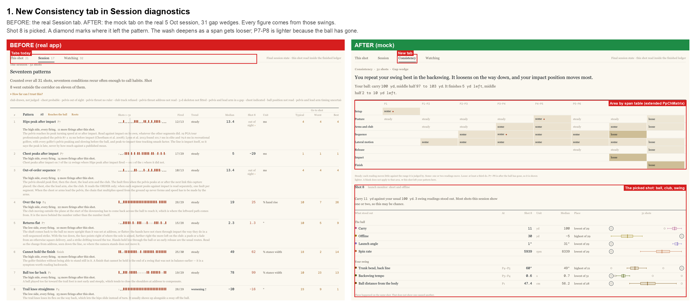
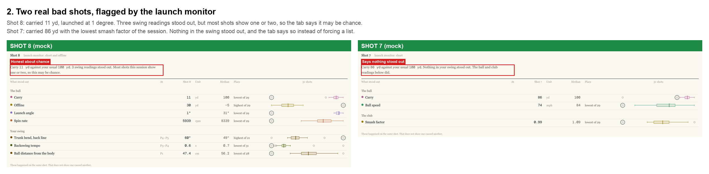
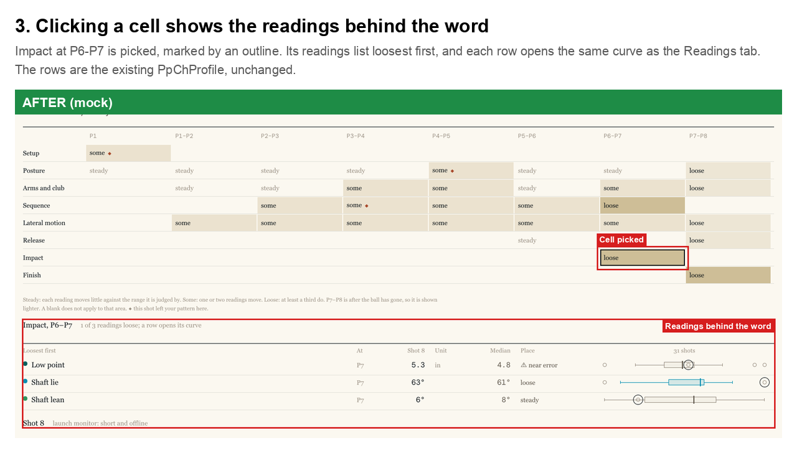
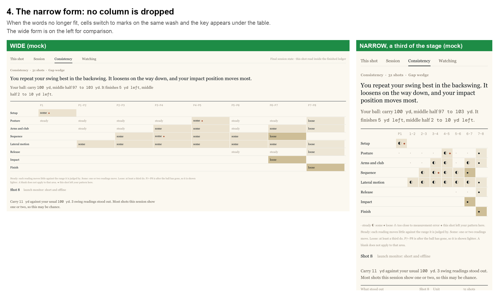
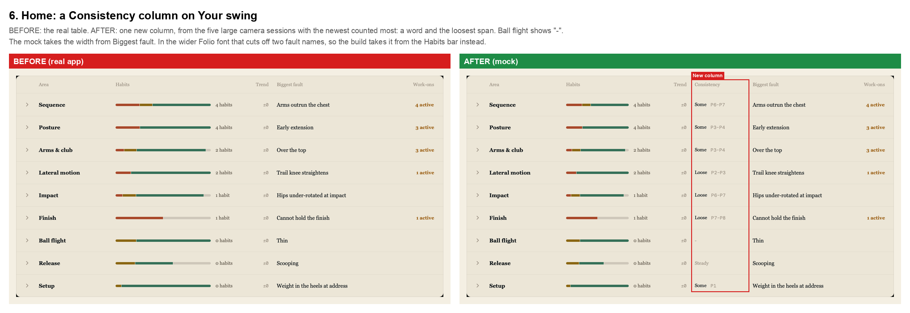

# Consistency: where your swing repeats, where it gets loose, and what stood out on a bad shot

Status: BUILT 6 Nov 2026; **retrofitted to the variability marks 7 Nov 2026** (variability marks, Session 5): the cells,
the headline, the opened rows, the stand-outs and Home now take the design system's grades, and the old verdicts, the stored
Home tables and the tally are retired (§10). The grade rules are `docs/design/system/variability.md`; Mark's rulings R1–R19
are `docs/design/variability-mark/decisions.md` §2. Where a section below still describes the 6 Nov build, it says so. Mark's brief (6 Nov): "for each area, e.g. setup, posture there are curves where there is a clear
and consistent pattern at each phase of the swing … there are also some where there is a lot of movement and
inconsistency from one swing to the next … let the non-statistical expert golfer [see] where their patterns look
consistent … and where there is variance … where does your swing keep falling out of the same pattern. Secondly, when
a bad shot is hit … what in that shot was particularly different to any other? … make sure we don't already cover this
in some other way — the last thing we need to do is build another solution to pretty much the same problem."

The figures in §2 came from three steps on 6 Nov (Appendix A): extract, `consistency_dump`, `consistency_tally.py`. The
dump tool and the tally were retired with the old verdicts on 7 Nov, so §2 and `docs/research/data/consistency/` are the
record of that tally and no longer reproduce from the code.

---

## 0. Summary

Both questions fit one table. **Areas of the swing run down the side and the spans of the swing run across the top.**
Each cell says how much that part of the swing moves from shot to shot in the Consistency words (**Grooved, Repeatable,
Settling, Variable, Scattered**; "Not enough swings", "Checking", "-"), on a one-hue wash that deepens as it loosens. Picking a shot puts a ◆ where it left the pattern, and lists what stood out on it: the ball
first, then the club, then the swing. A shot the launch monitor reads as short or offline is flagged for you.

- **Where it goes:** a new **Consistency** tab in Session diagnostics, between Session and Watching, in Analyse and
  Replay; a Consistency column on Home's Your swing table; and a Consistency page in the session report.
- **What it is:** a roll-up. No new statistics engine, chart or norm. It reuses the box statistics, the P-aligned
  time, the norms, the launch-monitor readings, `PpChProfile` and the Readings curve. The table is `PpChMatrix`, extended.
- **What it replaces:** "Compare the cleanest and worst shot" in #66, and the rule behind Charts' "Apart from the session".
- **The honest limits:** a shot can stand out by chance, and the tab says so. A reading whose spread is no larger than its
  own measurement error is measurement-limited: "Checking" on the golfer layer, the grade and "· measurement-limited" on the
  technical. Grooved does not mean good: Session diagnostics still judges the fault.

---

## 1. What we already have

Most of this exists, in pieces, and that was the risk Mark named. The gap is an overview, and a way in from the ball.
This table is the app as it stood on 6 Nov; §5 says what changed in Charts.

| Question | Already in the app | What it lacks |
|---|---|---|
| Where do I repeat? | Readings: a curve with a box at each P-position, one reading at a time | No overview; every row has to be opened. This is what Mark was reading by eye |
| | Charts Session: where the curves part (`partAt`), one instant per row | One chart at a time |
| | Posture, Wrist, Club delivery: a "tightest / loosest" line | Three areas, three rules. Posture divides by the band's σ (`session_posture.cpp`); the others quote the middle half |
| | Session diagnostics Session: how often a fault fired | Judged against the norm, not your own repeatability |
| What was different about this shot? | Charts This shot: "Apart from the session" (`apartFrom`) | Cannot tell a real stand-out from chance (§2.4); knows nothing of the ball; flat list; whole-session box |
| | Relations "Moves with": includes launch-monitor readings | A session trend, not one shot |
| | Session diagnostics This shot: what fired | Against the norm, so a bad shot can read "quiet" |
| | #66: cleanest vs worst shot side by side | Never built; replaced by this |

Not a duplicate of Kinds (which groups the shots) or of Drift (which reads a trend through the session).

---

## 2. What the library shows

**Historical (6 Nov).** This section's cells and shares are the retired verdicts (steady, some, loose, ⚠), from the retired
tally. They are kept as the record of how the table was first read; the cells now take the variability grade (§4.2).

Mark's 12 sessions, 204 shots, read on the cabin PC. Five have 15 or more camera shots and are judged here: 4 July (15),
5 Oct (31), 7 Oct (50), 8 Oct (32), 20 Oct (19). The thresholds are first guesses on him; §2.7 reads the other four
golfers.

These figures are re-issued from the rebuilt tally and differ from the 6 Nov draft, for two reasons. The draft sampled each
shot between its own P-times, in Python. The build samples on the app's real alignment. And P7–P8 now has a rule of
its own (§2.6). So on 5 Oct, P7–P8 was loose in all five of its areas and is now loose in none: some in Arms and club,
steady in the rest. Three other cells moved:
Posture P4–P5 (some to steady), Arms and club P5–P6 (steady to some), Impact (loose to some).

### 2.1 The table holds up

Which reading is loose, against which is steady, is stable when a session is split in half at random (rank correlation
0.80 to 0.89). That figure is flattered by the gap between one metric and another, so the sharper test is **within a
metric: is the same span the loosest in another session?**

| Sessions compared | Rank correlation |
|---|---|
| 5, 7, 8 Oct against each other | 0.70 to 0.79 |
| 20 Oct against those | 0.69 to 0.77 |
| 4 July against the rest | 0.52 to 0.64 |

So the pattern is real and repeats, more strongly between neighbouring sessions. Measurement noise would repeat the same
way, so this does not prove all of it is the golfer.

5 Oct, the session in the mock (⚠ never fires on a cell of it):

```
                 P1      P1-P2   P2-P3   P3-P4   P4-P5   P5-P6   P6-P7   P7-P8
Setup            some
Posture          steady  steady  steady  steady  steady  steady  steady  steady
Arms and club            steady  steady  some    some    some    some    some
Sequence                         some    some    some    some    loose
Lateral motion           some    some    some    some    some    some    steady
Release                                                  steady  steady  steady
Impact                                                           some
Finish                                                                   steady
```

Lateral motion and Release are steady at P7–P8 here, but near the line (§2.6).
Cells across the 33 in a session: steady 9 to 16, some 7 to 20, loose 0 to 9, ⚠ 0 to 2.

### 2.2 Noise is a smaller problem than it looked

Between 38 % and 53 % of readings with a σ have a spread no bigger than that σ, which looked fatal. It is not, because
**noise can only widen a spread**. A small spread is steady whatever σ says. σ only matters for a reading that would
otherwise be called loose, and those are 1 to 7 readings a session (of 233 to 373). σ may also carry fixed offsets that
do not change from shot to shot, so even that may overstate it.

### 2.3 About a quarter of readings have no norm

About 27 % of readings have no norm to judge a spread against. They are not judged, and they stay in the list behind a
cell, marked as such. Filling these in belongs to #63, not this feature.

### 2.4 "Apart from the session" cannot find a stand-out

This is the rule as it stood before the build (§5). On the trimmed 4 July fixture (15 shots, 69 readings), `apartFrom` flags
at least one reading on 12 of 15 shots. Shuffling the shots gives 3.5 a shot, and the worst real shot's 9 only matches the
shuffled session's 95th percentile. A bad shot gets a list whether or not anything stood out.

A stricter rule (§4.3) still leaves background, so **a count of one to three means nothing by itself**:

| Session | Stand-outs a shot: median · mean | Shots with none | Most on a shot | Shuffled: mean · session max (95th pct) |
|---|---|---|---|---|
| 4 July | 2 · 2.40 | 3 of 15 | 8 | 3.47 · 7.55 |
| 5 Oct | 1 · 1.65 | 8 of 31 | 6 | 2.88 · 7.55 |
| 7 Oct | 1.5 · 1.72 | 11 of 50 | 6 | 3.02 · 8 |
| 8 Oct | 1 · 1.59 | 9 of 32 | 8 | 4.26 · 10 |
| 20 Oct | 0 · 0.58 | 12 of 19 | 3 | 1.04 · 3.55 |

The shuffle moves each reading on its own, which breaks the links between readings, so it is a rough yardstick.

**Swing 3 on 8 Oct** read 37 in the draft. Its top of backswing is 0.46 s and its impact 0.61 s after address, against
0.72 s and 1.01 s on the shot before. Frames checked on 6 Nov show an ordinary swing: impact is stored at 2.17 s with the club
at the top of the backswing, and real impact is about 2.5 s. So the positions are wrong, not the swing (#158). The guard (§4.3)
catches it: its spans no longer count, and the 8 in the table are read at its positions, under that session's line of 10. Those
positions are wrong too, so the 8 mean nothing either. The other guarded shots have not been checked.

The guard takes 6 of the 147 shots here: 5 Oct swings 2 and 3, 7 Oct swings 11 and 21, 8 Oct swing 3, 20 Oct swing 14. None
on 4 July. One shot passes the chance line (§4.3): 4 July swing 3, 8 against 7.55.

### 2.5 Bad shots: only two to test on

Flagged by the launch monitor, club by club, across the library: five shots. Three have no camera data. The two that do:

- **5 Oct swing 8:** 11 yd carry, 30 yd right, launched at 1°. Four swing readings stood out, within the background.
- **5 Oct swing 7:** 86 yd, smash 0.99 and ball speed 74 mph, both the session's lowest. Nothing in the swing stood out.

Swing 7 is the useful result: the tab says nothing stood out, instead of inventing a reason. Two shots are not a
validation. 5 Oct is the only large session with cameras and a full launch monitor, and Premier sessions have carry
but no offline.

### 2.6 P7–P8 is read at the same time after impact

The time from P7 to P8 has two modes on 5, 7 and 8 Oct, about 0.09 s or about 0.4 s. So the draft compared the
follow-through at two different moments. Split at 0.2 s, with each group's median:

| Session | Shots with a P8 | About 0.09 s | About 0.4 s | P8 confidence 0.30 |
|---|---|---|---|---|
| 4 July | 15 | 15 (0.08) | 0 | 1 |
| 5 Oct | 30 | 22 (0.09) | 8 (0.37) | 19 |
| 7 Oct | 41 | 24 (0.11) | 17 (0.44) | 27 |
| 8 Oct | 32 | 23 (0.09) | 9 (0.43) | 19 |
| 20 Oct | 18 | 17 (0.09) | 1 (0.41) | 11 |

P8's confidence is 0.30 on about 60 % of shots on four of these, under the warp's gate 1 (0.35), so P8 often has no canonical
time at all. Aligned on P8, those sessions would have no P7–P8 column and Finish would be blank. Confidence does not
separate the modes either: among shots at 0.35 or over, the split is 10 and 1 on 5 Oct, 8 and 6 on 7 Oct, 6 and 7 on 8 Oct.

Hence the rule (§4.1; Mark, 6 Nov): P7–P8 is a fixed 100 ms after impact on every shot of every session
(`kConsistencyAfterImpactMs`). A length of the session's own would not do: the median of marks 40 to 200 ms after impact ran 84
to 122 ms across sessions, so no two sessions read the same window. Where P8 lands is #24.

A fixed length makes sessions comparable. It does not make every cell firm. 5 Oct's Lateral motion and Release sit near the
line at P7–P8: steady at 81 ms, loose at 91, steady at 100. Read those two as close calls. And a confident P8 is still an
alignment anchor, so it can slightly affect P6–P7 on that shot.

### 2.7 All golfers

Five golfers, 23 sessions, 285 shots, tallied with `--min-shots 7`, which judges 15 sessions. The thresholds are unchanged.
Mark kept them on 6 Nov, as first guesses. Share of a golfer's cells:

| Golfer | Sessions judged | Shots | Steady | Some | Loose | ⚠ | "-" |
|---|---|---|---|---|---|---|---|
| Mark | 6 | 154 | 43 % | 44 % | 10 % | 3 % | |
| Jess | 3 | 23 | 49 % | 32 % | 16 % | 2 % | |
| Nick | 4 | 36 | 55 % | 37 % | 8 % | | |
| Chris | 1 | 8 | 76 % | 21 % | | 3 % | |
| Paddy | 1 | 12 | 33 % | 12 % | 27 % | | 27 % |

Chris is one session of 8 shots. Paddy's "-" cells are all in the backswing, P1–P2 to P3–P4.

Stand-out counts do not beat shuffled. In all 15 sessions the real mean is below the shuffled mean. Three shots pass the
chance line: Paddy's swing 10 (15 against 14, and guarded, so those are positions alone), 4 July swing 3 (8 against 7.55) and
Nick's 20 Oct session 2 swing 3 (9 against 8.55). The last two pass by under half a reading. The words carry this: nothing
under the line is called more than chance.

The launch monitor flags 13 of the 285 shots: Mark 5, Nick 5, Paddy 2, Chris 1.

---

## 3. What the golfer sees

**Every picture here is the 6 Nov mock:** all six files in `docs/design/consistency/`, kept as they were. The mock ran on
real components and the draft's figures. The build is on the review sheets, and differs where this section says: the
headline, the P7–P8 column, the ◆, and Home's widths.



**The tab, top to bottom** (the Charts page pattern: headline, the plot, then the detail):

1. Kicker and headline in plain words, with the grade words: "Your backswing is repeatable, your downswing settling; your
   sequence moves most." (§4.2). With no camera shots: "This session has no camera shots, so only launch monitor readings
   can be judged." The sentence is built in C++; the grade words come from `ConsistencyVocabulary` in QML.
2. The ball in one line: carry and offline, each with the middle half, in whole units, and no badge (ball flight is
   ungraded, R4). Then any note: a club left out, or carry with no offline.
3. The table, then its key.
4. A cell, when picked: the readings behind the word as `PpChProfile` rows, each with a Dispersion Cell badge (technical
   layer: the word and its basis string), widest spread first, then those under 8 shots, then those with no scale. A row
   opens the same curve as Readings, in place: Session diagnostics has no way to open a reading in Charts.
5. The picked shot: what the launch monitor made of it, a sentence, then what stood out, grouped as the ball, the club
   and your swing. Each row carries this shot, the median and the box of what it was compared with (§4.3); a club or swing
   row also carries this shot's typicality badge (R8, §4.3). With two rows or more it ends: "These happened on the same
   shot. That does not show one caused another."





**Narrow.** When the words no longer fit, cells switch to the grade's figure (5 to 1, 0 for "Not enough swings"), ⚠ for
"Checking" and "-", on the same wash, and the key says which is which. No column is ever dropped. (The mock's · ◐ ● marks
are retired.)



**Home** (since 7 Nov, R5; the picture below is the retired 6 Nov roll-up). One column on Your swing, after Trend: a
golfer-layer badge grading the measure of the **Biggest fault** beside it, over that fault's last 20 readings across sessions
(`Variability.nWindow`), read from each session's `diagnostics.json` ledger, centred per club, unassessable rows left out,
every shot kept (R13). A yes/no, composite, fixed-number or outcome condition (ball flight, smash) is ungraded: "-". An
opened area lists its faults, each with its own badge over the same window, and a work-on's badge sits beside its status
(R10). The opened area's row of span words is gone. The column is `sp(136)`, still paid for by Habits (§6). Rules:
`work_ons_controller.h`, CONSISTENCY MARKS; `src/Gui/variability/variability_ledger.h`.



**Replay and Print** (a diagnostics surface goes everywhere). Replay opens on the headline, the table and the picked
shot's one sentence; a cell pressed there opens in Analyse, as other detail does. Print is a Consistency page in the
client session report, `PpConsistencyPage`, from the same presenter's words: the headline, the ball line, the table and
key, then the flagged shots, at most 6 swings and 8 rows each, ball first, with a line naming the rest; the club and swing
rows carry golfer-layer typicality badges. Nothing to press, and no ◆. The technical appendix (`PpDiagPrint`) is unchanged. Neither was mocked; see the sheets.

**The words** (since 7 Nov, R1 and R11): the Consistency vocabulary's, through `ConsistencyVocabulary` and
`MeasurementVocabulary` ("Checking"); no presenter spells one. The 6 Nov words, steady, some and loose, are retired; the
old-words table in `docs/design/system/variability.md` maps them.

---

## 4. Rules

The sampling and stand-out constants live in `src/Gui/charts/session_consistency.h`; the table's shape in
`src/Coaching/consistency_home.h`; the grades in `src/Gui/charts/consistency_grades.{h,cpp}` over the grader's constants
(`src/Metrics/variability/variability_constants.h`: `kNMin` 8, `kCellLoosestPercentile` 0.67, the scalar bands). All are
first guesses.

### 4.1 A reading

- **Like with like:** each value is taken less the median of its club at that point, the shot itself included in that
  median. A club under 3 shots, counting every shot with the label, is left out, and the head says so. A blank club
  label is a club of its own.
- **A span:** the curve is sampled at five points inside the span, at (j + ½)/5 of it, on P-aligned time, valid samples only.
  A gap in the curve gives no value there. A span whose P has no canonical time (kept on under half the shots) has no reading.
- **P7–P8** is sampled differently, on every session (§2.6). The same five points, over a fixed 100 ms after impact on the
  shot's own clock (`kConsistencyAfterImpactMs`), not between P7 and P8. The key says so. A confident P8 is still an alignment
  anchor, so it can slightly affect P6–P7 on that shot.
- **Spread:** the middle half ÷ 1.349 of the residuals at a point, needing 5 finite ones. A span's spread is the median over
  its points, needing a spread at 3 of the 5. With fewer, the reading is dropped from the table and from stand-outs. Since
  7 Nov this decides only which readings reach the table and can stand out; the grade is the grader's (below).
- **Positions, not spans, where the position is the point:** Setup reads P1, the phase sample there. Delivery reads P7 itself:
  a shaft lean halfway down is not what the Delivery area judges. An instant-only reading sits in the span ending at its
  P-position. Backswing timing (`tempoBackswing`, `tempoRatio`) is stamped at impact but sits in P3–P4. A position needs 5
  finite values.
- **The norm's σ:** for each shot with a value, the first measure of the key at the column's P (a span's end P) with a norm
  in the club's context, ½(σlo + σhi). With none there, the median of the key's measures' σ in that context, then in
  "any". The reading takes the median over its shots. This lookup moved 3 of 1260 verdicts and 1 of 284 cells against the
  draft's single figure.
- **The reading's own σ:** a position's is the median of its phase samples' σ, a span's the median over shots of the
  curve's σ.
- **The grade** (7 Nov; replaces the 6 Nov verdict, spread ÷ the norm's σ under 0.75 steady, else loose or ⚠): the scalar
  grader over the club-centred values (R2a), against the norm's σ, else the measure's `variabilityScale`. Under 8 shots:
  grade 0, "Not enough swings". No scale: not graded. The reading's own σ goes in as its propagated σ, never subtracted
  (R3): a spread no larger than it is measurement-limited. A guarded shot is left out of a reading that rests on its
  P-ladder. A span's five points are graded one by one and the reading takes the median point by ρ. The rules:
  `docs/design/system/variability.md`.

### 4.2 A cell

Since 7 Nov (R1) the cell takes the grade at its **loosest third**: the 67th-percentile ρ of its graded readings, through
the scalar bands, and shows that grade's word. No reading with a ρ, but one at grade 0: "Not enough swings". Measurement-limited:
"Checking". The heat says how much: grades 1–2 the deepest wash, grade 3 the lighter, none above. (The 6 Nov rule, a third
loose is loose, any loose is some, a third ⚠ is ⚠, else steady, is retired.) **"-" and blank are different things.** "-"
means the area is read at that column and no reading there is graded, with readings or without. A blank means the area does not apply to that span, and there is no
cell at all:

| Area | Read at |
|---|---|
| Setup | P1 |
| Posture | P1, every span |
| Lateral and balance, Turn and sequence, Arms, Wrists and release, Plane and path | every span |
| Delivery | P6–P7, reading P7 |

An area is what moves, and the phase is the column. Ball flight has no spans, and `golfer` is never an area
(`swing_areas_regroup.md`).

**P7–P8 is after the ball has gone.** It draws lighter, and it is left out of the headline, except for the readings graded
after the ball. A reading is graded there when a condition reads its measure at the `finish` anchor
(`afterBallKeysForPack`, `swing_areas_pack.h`). The set is `comOverLeadFoot` and `thoraxRotation`. A P7–P8 cell holding one is
graded on those readings alone, and only then does it reach the headline. The other readings in that cell stay on show,
lighter. A cell holding none keeps the grade of its own readings, lighter, and stays out of the headline.

**The headline** (`consistencyHead`, 7 Nov): each half, the backswing (P1–P2 to P3–P4) and the downswing (P4–P5 to P6–P7),
takes the loosest-third grade over its cells, and the area named is the one whose cells read loosest. It needs a grade in at
least 2 areas (`kConsistencyHeadlineMinAreas`). Both halves graded: "Your backswing is %1, your downswing %2; your %3 moves
most."; a half with no grade, or a surface that will not say a measurement-limited half's word: "Your %3 moves most."; no
headline but a grade 0 somewhere: the Consistency vocabulary's grade-0 line; nothing graded: "Nothing here has a range to
judge it against." P7–P8 is in neither half. A P7–P8 cell graded after the ball counts only toward the area named.

**Home's word** (6 Nov, retired): the weighted roll-up of stored cell words is gone (R5, R15). Home grades the Biggest fault's
measure itself (§3, Home).

### 4.3 A stand-out

One shot against the session's other shots, **itself left out** of the comparison. The residuals (§4.1) have already put
each shot on its own club, so the others may be of any club, and it takes at least 6 of them at a point:

- at least 3.5 robust spreads from their median, and past 2σ where the reading has a σ;
- across the whole span, not one instant in it: of the five points, the **weakest** decides, the one nearest the pattern;
- one row per metric, at its most extreme column; ordered ball, club, swing, then by size.

Only readings that reached the table count, in a column their area applies to. **Typicality (R8, 7 Nov):** a club or swing
row carries this shot's typicality badge (Your usual, A little off, Unusual) against the session's other shots of the same
club, at least 8, a guarded shot left out of a reading on its P-ladder; with fewer, none. A ball row never has one (R4). The
typicality is mean and SD while the stand-out test is the robust z, so a stood-out row can still read "Your usual" (open for
Mark, decisions.md). **A stand-out row shows the sample tested:**
the value at that weakest point, with the median and box of the other shots there, so value less median is exactly what was
judged. A span's row carries no fired mark, because a condition grades an instant. An opened cell's rows are different:
each shows the middle of its span against every shot.

The sentence says what the count means: with none, "Nothing in your swing stood out."; with a count up to what most shots show,
"Most shots this session show ..., so this may be chance."; above that, "more than most shots this session, but chance can
reach that."; above the shuffled session's 95th percentile, the chance line, "more than chance would give." A shot that could not be compared says why instead. The line is strict, and uses swing readings alone. The shuffle
moves each reading's shots on its own, 30 times, guard ignored; it is seeded (splitmix64, seed 5, shared with the tally),
memoised per snapshot and off the GUI thread.

**The P-ladder guard.** Alignment uses `session_warp`'s anchors. A shot is guarded when it has a curve and any of these holds:
it was not aligned on its P-positions; it kept under 4 of P1–P7 as anchors; or one of P1–P7 was dropped as an outlier segment
or for running backwards. **A lost P8 never counts:** it would have guarded about a third of shots, by a model at planning (9
of 31, 18 of 50, 10 of 32). A shot with no curve has nothing to mis-time and is never guarded, which is every launch-monitor-only
shot. A guarded shot keeps its readings with a ⚠ ("the timing of this swing's positions looks unusual"), and its spans and
backswing timing are not counted as stand-outs. It is shown, never hidden.

The guarded shots, 15 of 285. These numbers are the tab's shot numbers, and each matches its swing folder here; where a session
has a swing with no analysis the two differ (#157):

| Golfer | Session | Swings |
|---|---|---|
| Mark | 5 Oct | 2, 3 |
| | 7 Oct | 11, 21 |
| | 8 Oct | 3 |
| | 20 Oct | 14 |
| | 2 Nov, session 1 | 1, 2 |
| Jess | 20 Oct, sessions 2 and 3 | 2 in each |
| Nick | 13 Oct, session 2 | 1 |
| | 2 Nov | 4 |
| Paddy | 24 Oct | 2, 10, 11 |

### 4.4 A bad shot

The launch monitor, against the same club that session, needing 8 shots with the reading:

- **short:** carry below the lower Tukey fence;
- **offline:** offline past either fence.

A flag is not a row. The ball and club rows of a shot are every launch-monitor reading past either fence of its own club,
with the same 8, so a long carry is a row though only a short one is a flag.

Descriptive only: PPS does not model intent, so a shot deliberately aimed elsewhere can read offline. With carry and no
offline (Premier), it flags short only and the tab says so. With no launch monitor, nothing is flagged and every shot
can still be picked. Mark, 6 Nov: LM data for now, "we can fix it later". `review.rating` exists on every swing as a
possible later route; two of the 204 shots carry one.

### 4.5 The house rules that apply

Gate on data, never the session type. Every reading is shown with its ⚠, never withheld. "-" means no value, and a
reading with a value keeps it. Metric hues stay. Figures follow the house rounding, with σ only as the ±. Co-occurrence,
never cause. Words come from C++, and QML only places them. No reading is judged on another club's shots.

---

## 5. One stand-out rule

Charts' "Apart from the session" has moved to §4.3, so the Consistency tab and Charts cannot disagree: both take their rows from
`ConsistencyReadingRows`. Its heading and place stay. The list is now the launch monitor's rows, ball then club, each
needing 8 values of the shot's club (§4.4), then the shot's stand-outs in the rule's order, and `apartCount` counts those. A
guarded shot says so in the standfirst. `apartFrom` keeps its name for the boxes: a dot past a whisker is still drawn, and `side`
is unchanged, still meaning past a whisker. The change is what counts as apart, and it now compares within the club. This
changes what Charts shows on existing sessions; its tests and `goldens_0704.json` were updated to match.

---

## 6. Design-system changes

Mark approved these as one package on 6 Nov (§8), and the `PpChProfile` change, the last row, with his rulings that day.
Nothing else was changed.

| Change | As built | Screens |
|---|---|---|
| `PpChMatrix` extended | Two forms. Setting `columns` gives the rectangle: named columns, generic cells, optional wash, `cellActivated`, and a short form that never drops a column. Without it, the family as Relations has always had it. Page: `docs/design/system/components/PpChMatrix.md` | Consistency, report, Relations |
| Moved to `src/Gui/typeset/` | `roles.ch` existed only on PpChRoles. The cell width goes through `r.ch`, so any PpTypeset can use it | All three |
| Heat tokens | `colorHeatSome` 0.15, `colorHeatLoose` 0.40, `colorHeatAfter` 0.12: alphas on `colorAttention`, in `Theme.qml`. `make_design_system.py` computes them into `tokens.json` | Consistency, report |
| The wash rule | Design system §15.4 item 4: the corridor stays the one chart wash, with one exception, the heat of a table cell. The word, or the mark and its key, stays in the cell, so colour is never the only channel | Consistency, report |
| Rule 7 amended | §15.2 rule 7 said colour means "outside its corridor" and nothing else. It now names the same one exception. Without this the wash breaks the rule | Consistency, report |
| The outline | §15.4 item 3: a cell that can carry heat is picked with an ink outline, because the wash has taken over the 7 % column's job | Consistency |
| Print ink | `PpTypeset` gains `attention` and `heat(level, soft)`. The hue honours `fixedAesthetic`, so a printed page does not follow the app's theme, and is scaled by `tintK` | Report |
| A new Session diagnostics tab: This shot, Session, Consistency, Watching | `PpTabs` as it stands. `PpConsistencyView` is made on first show | Session diagnostics |
| A Home column | `HmSwingAreas`'s columns and `HmAreaRow`. A fixed `sp(96)` after Trend, `sp(136)` since 7 Nov for the badge. Habits alone pays for it, so Biggest fault keeps its width until Habits has gone | Home |
| A report page | `PpConsistencyPage`, like Posture, Wrist and Delivery | Report |
| `PpChProfile`, a shared component | A row with `opens` "" (a reading with no curve on this shot) takes an arrow cursor and no click, in place of a hand cursor on a click that did nothing | Every `PpChProfile` list |
| `PpChProfile` row `variability` (7 Nov, variability marks Session 5) | An optional row field: a Dispersion Cell or Typicality Icon badge on the row | Consistency, Charts Readings and Apart |

Why one hue: it says how much, not good or bad. Red and green would say a steady fault is good. `colorAttention` is "watch",
not `colorWarn`, which means a fault. A picked cell takes an outline, because the wash has taken over its old highlight.

**The ◆ is ink, not warn.** The mock drew it in warn red. Rule 7 keeps warn for "outside its corridor". A shot leaving its own
pattern is not that, and the amendment covers the wash and nothing else. So the build sets it in ink. Mark, 6 Nov: ink.

**The plain-word ⚠ reaches rows through their existing caution.** A guarded shot's readings carry "⚠ the timing of this
swing's positions looks unusual" in the row's own `caution` and `cautionText`, added to any caution already there. No new row
form.

`PpChProfile` and `PpChText` need PpChRoles, which `PpDiagRoles` is not. The tab makes its own PpChRoles, and the report page
a print one on the Folio aesthetic. No line was added to `design_system_allowlist.txt`.

---

## 7. What it does not do

- It does not say why. Two things on the same shot are not a cause.
- It does not judge good or bad: a grooved fault reads Grooved.
- It does not grade ball flight (R4): the ball line keeps its figures and has no badge.
- It does not compare one golfer with another: the spread is always the golfer's own, and the norm's σ only scales it.
- It does not read the session's order: Drift does that. Shots 1 to 3 of 4 July had the most flags.
- No new chart, no heat map on a curve, no bad-shot verdict without a launch monitor.

---

## 8. Decisions

| # | Decision | State |
|---|---|---|
| 1 | Roll up the existing maths; no second engine | Mark, 6 Nov ("this is excellent") |
| 2 | Both the session and Home | Mark, 6 Nov |
| 3 | Bad shots come from launch-monitor data for now | Mark, 6 Nov |
| 4 | Extend `PpChMatrix`, not a new component | Mark, 6 Nov ("this looks good") |
| 5 | Words: steady, some, loose | Mark, 6 Nov. **Superseded 7 Nov:** the Consistency vocabulary (R1, R11) |
| 6 | The one-hue wash, and the exception to the wash rule | Mark, 6 Nov: approved, with #8 and #9 as one package (§6) |
| 7 | The tab sits in Session diagnostics, is called Consistency and comes before Watching | Mark, 6 Nov ("move the consistency tab to before Watching") |
| 8 | P7–P8 lighter, and out of the headline and Home except Finish | Mark, 6 Nov: approved in that package |
| 9 | Narrow panels use marks on the wash | Mark, 6 Nov: approved in that package. **Superseded 7 Nov:** the grade's figure, ⚠ and "-" |
| 10 | The Home column's width comes from the Habits bar | Mark, 6 Nov: Habits gives the width. The mock took it from Biggest fault, which cut off two names in Folio |
| 11 | The 28 hand-placed readings (Appendix B) | Mark, 6 Nov: accepted as written, to be read on the sheets |
| 12 | Charts' Apart moves to the stricter rule (§5) | Mark, 6 Nov: Apart moves |
| 13 | Print | Mark, 6 Nov: a client report page only; the technical appendix (`PpDiagPrint`) is unchanged |
| 14 | The ◆ | Mark, 6 Nov: ink (§6) |
| 15 | P7–P8's length | Mark, 6 Nov: a fixed 100 ms after impact, every shot of every session (§2.6) |
| 16 | The thresholds, with all golfers read | Mark, 6 Nov: kept, as first guesses (§2.7). **Superseded 7 Nov:** the grader's bands and `kNMin` |
| 17 | A `PpChProfile` row with nothing to open | Mark, 6 Nov: approved, an arrow cursor and no click (§6) |
| 18 | The size of the committed `session_1005.json` | Mark, 6 Nov: accepted at 4.2 MB |
| 19 | The no-camera headline | Mark, 6 Nov: "This session has no camera shots, so only launch monitor readings can be judged." |


---

## 9. What shipped

All of it is in the working tree, uncommitted. Commits come after Mark has judged the sheets.

1. **The maths.** `src/Gui/charts/session_consistency.{h,cpp}`, in two layers: sampling (snapshot to readings) and rules
   (readings to cells, stand-outs, flags). `src/Gui/charts/consistency_env.{h,cpp}` is the one place those reach the shipped
   catalogue, conditions and norms. `src/Coaching/consistency_home.h` holds the table's shape and Home's word, header-only,
   so Coaching takes them without the charts maths. Reuses `box_stats.h` and `session_warp`. An optional `consistencyArea` on
   `MetricDescriptor` carries the 28 hand-placed readings, set in `metric_catalogue_manifest.cpp`; `metricAreasForPack` in
   `swing_areas_pack.h` places the rest. Five rules in `gate_catalogue_rules.h` and `gate_words.json`.
2. **The check.** `consistency_extract.py` (extract v2) and `consistency_trim_fixture.py` (cuts the committed
   `session_1005.json`) stay. `consistency_dump.cpp`, `consistency_tally.py`, `consistency_make_goldens.sh` and
   `goldens_home_consistency.json` were retired on 7 Nov; `goldens_1005_consistency.json` is frozen (replaced once, with Mark's approval, for the swing areas regroup on 8 Nov: `swing_areas_regroup.md`), and only its readings,
   stand-outs, flags and shuffle figures are still read.
3. **The shared rule.** Charts' Apart moved to the stand-out rule (§5): `charts_relations_presenter.{h,cpp}`,
   `PpChartsShotView.qml`, with `ConsistencyReadingRows` as the row builder both surfaces share.
4. **The presenter.** `src/Gui/charts/charts_consistency_presenter.{h,cpp}`: every word and figure, off the GUI thread, a
   Sentence for the head and each line, memoised per snapshot.
5. **The component.** `PpChMatrix` extended and moved, heat tokens, `PpTypeset`, design-system pages, `tokens.json`, and
   `src/Gui/charts/PpChProfile.qml` (§6).
6. **The tab.** `src/Gui/diagnostics/PpConsistencyView.qml`, in `PpDiagAnalyse.qml`, `PpDiagReplay.qml`,
   `PpSessionDiagnosticsBody.qml` and `PpSessionDiagnosticsPanel.qml`.
7. **Home** (rewritten 7 Nov, R5 and R15). `work_ons_controller.{h,cpp}` grades each fault's measure from the sessions'
   `diagnostics.json` ledgers on its own single-thread pool, fingerprinted on the rule, the content stamp, the conditions and
   each ledger's name, size and mtime; nothing is written. `HmSwingAreas.qml`, `HmAreaRow.qml` and `HmFaultDetail.qml` draw the
   badges. The stored `<session>/consistency.json`, `consistency_summary.{h,cpp}` and `consistency_home.h`'s roll-up are
   removed; the old files stay in the libraries, unread.
8. **Print.** `src/Gui/report/report_consistency.h` cuts the presenter's report payload; `PpConsistencyPage.qml`,
   `session_report_model.{h,cpp}`, `PpSessionReport.qml`.
9. **The grades** (7 Nov). `src/Gui/charts/consistency_grades.{h,cpp}` grades every reading and cell and builds the head;
   the presenter hands QML result maps and word templates (`charts_consistency_presenter.h`, THE GRADES).

**Corrections to the 6 Nov plan:**

- The area field went in `metric_catalogue_manifest.cpp`, not `metric_catalog.cpp`.
- The tab owns a `SessionSeriesModel`, as `PpTrustPanel.qml` does, because the diagnostics body has none.
- Print is a client report page, not `PpDiagPrint.qml`.
- "Goldens match the tally" could not hold for sampling, so C++ does the sampling and the tally checks the rules on it.
- `session_relations.{h,cpp}`, `swing_areas.h`, `PpChartsRelationsView.qml` and `PpDiagPrint.qml` did not change. `envelope`
  did not fit and is not used. Home's roll-up is in `consistency_home.h` and `work_ons_controller.cpp`.

**Gates passed (6 Nov, on the retired verdicts):** on the fixed 100 ms, `--check` finds 0 differences over all 23 dumps and `consistency_make_goldens.sh`
reproduces both goldens byte for byte. Before the rulings: Relations pixel-identical to its control, 4 of 4 (Folio light, Vector
dark; 4 July, 5 Oct); a real catch-up on a copy, 6 sessions and 152 shots in 29 s of jobs, worst GUI gap 358 ms, Home's words
equal to the tally's; all golfers read (§2.7).

**Done means, still to come:** the cells the rulings moved re-shown to Mark; a windowed run; then the commits, and #66's
cleanest vs worst item closed as replaced.

---

## Appendix A: reproduce (retired 7 Nov)

**Superseded.** `consistency_dump`, `consistency_tally.py` and `consistency_make_goldens.sh` were removed with the verdicts, so
steps 2 and 3 no longer run. Step 1, the extract, still makes the test fixtures and the variability calibration's input
(`variability_calibrate`). Kept as the record of how §2 was made:

```
# 1. Extract, on the cabin PC, where the share is local (read-only). One athlete at a time.
python tools\diagnostics\consistency_extract.py C:\PinPointStudio\Mark-Liversedge C:\PinPointStudio\scratch\consistency\fixtures\Mark-Liversedge

# 2. Dump, on the Mac: the C++ sampling over those compact files, on the shipped packs
~/Qt/Tools/Ninja/ninja -C build/tests -j4 consistency_dump
F=/mnt/swingdata/scratch/consistency/fixtures/Mark-Liversedge
D=/mnt/swingdata/scratch/consistency/dump/Mark-Liversedge
mkdir -p $D
for f in $F/*.json; do build/tests/Gui/consistency_dump $f $D/$(basename $f); done

# 3. Tally: the rules again, independently
python3 tools/diagnostics/consistency_tally.py $D docs/research/data/consistency --check    # exits 1 on any difference
python3 tools/diagnostics/consistency_tally.py $D docs/research/data/consistency

# All golfers (§2.7): every athlete's dumps in one directory, and keep the output out of the repo
A=/mnt/swingdata/scratch/consistency/dump-all
mkdir -p $A && cp /mnt/swingdata/scratch/consistency/dump/*/*.json $A/
python3 tools/diagnostics/consistency_tally.py $A /mnt/swingdata/scratch/consistency/all-out --min-shots 7

# The C++ goldens, into src/Gui/tests/data/charts, or anywhere else to diff them
tools/diagnostics/consistency_make_goldens.sh [out dir]
```

The tally prints every figure in §2 except the P-times of §2.4 and §2.6, the launch readings of §2.5 and the word shares of
§2.7, which come from the fixtures and from `consistency_cells.csv`. It writes `consistency_readings.csv`, `consistency_cells.csv` and `consistency_shots.csv`, and takes
about two minutes. Its seeds are fixed. The goldens are cut from the committed `session_1005.json` standing for 5 Oct, as the
tests load, with the other four sessions from `$D`. `fixtures/` and `dump/` are run output, on the share; delete them
once this design is accepted, as the CSVs hold what the doc quotes.

## Appendix B: readings placed by hand

A reading's area normally comes from the conditions that detect on it, taking the group that uses it most (50 of the 82
readings on 5 Oct). These 28 have no such condition. Mark accepted them as written on 6 Nov, to be read on the sheets:

| Area | Readings |
|---|---|
| Setup | `ballBodyDistance`, `stanceWidthMm`, `toeLineAngle`, `leadFootFlare`, `trailFootFlare` |
| Posture | `headTilt`, `trunkRise`, `hipDepthButt`, `headPitch`, `spineBackLine` |
| Lateral and balance | `plumbBobDistance` |
| Turn and sequence | `clubAngularSpeed`, `clubheadSpeed`, `handSpeed`, `leadArmAngularSpeed`, `thoraxAngularSpeed`, `xFactor`, `tempoBackswing`, `thoraxRotationSigned`, `shoulderPlaneAngle` |
| Arms | `elbowAlignment` |
| Wrists and release | `trailWristFlexExt` |
| Plane and path (`swingPlaneCurve` is placed by its conditions) | `handPlaneCurve`, `handPlaneSteepening`, `swingPlane`, `swingPlaneAngle` |
| Delivery | `attackAngle`, `lowPointFromAttack` |

`spineSideBend` is not on this list: two conditions detect on it, both in Posture, so it derives Posture. It stays in Posture
because it is the thorax relative to the pelvis, the shape of the trunk, not the whole-trunk lean `secondaryAxisTilt` reports.

Four more are unplaced and not read: `compoundMiss` (ball flight, which has no spans), `shoulderPlane`, `swingPlaneIotaBack`
and `swingPlaneIotaDown`.

The odd homes the group rule used to give are mostly gone. `thoraxRotation` derives Turn and sequence: all three conditions
that read it are there. `shaftDirection` no longer ties and derives Plane and path; `pelvisRotation` no longer ties and
derives Turn and sequence. Two readings still tie and go to the group met first in the pack: `spineForwardBend` to Setup
(two conditions in Setup, two in Posture) and `leadKneeFlexion` to Lateral and balance (one in each of Lateral and balance
and Posture). The full list of derived areas that changed is in `swing_areas_regroup.md`, Results.

## Appendix C: the mock

Superseded by the build; kept only because §3's pictures came from it. `build/run-me/consistency-mock/` (not committed):
`mock/` holds the QML and its data, `sheets.py` the review sheets. It runs on the typeset harness with no build; Home uses
its own probe, on a copy of the athlete folder.

## 10. 7 Nov 2026: the variability grades

Variability marks Session 5 put the design system's grades on this feature. The rules are
`docs/design/system/variability.md`; the rulings are `docs/design/variability-mark/decisions.md` §2.

- **Cells** take the grade at their loosest third (R1, §4.2) and show its word, "Not enough swings", "Checking" or "-". No
  marks in the table; the short form shows the grade's figure.
- **Readings** are graded within club (R2a) on the observed spread; a spread no larger than the reading's own σ is
  measurement-limited (R3). The opened cell's rows carry Dispersion Cell badges; the stand-outs carry typicality (R8).
- **Home** grades the Biggest fault's measure over its last 20 readings (R5), with a badge per opened fault and beside a
  work-on's status (R10).
- **Retired** (R15): steady / some / loose, the ⚠ error verdicts, the · ◐ ● marks, the stored `consistency.json` and
  `consistency_summary`, Home's roll-up, the dump tool, the tally and the Home goldens. Old `consistency.json` files stay on
  disk, unread.
- **Unchanged:** the sampling (§4.1), the stand-out and bad-shot rules (§4.3, §4.4), the guard, the P7–P8 window, the heat
  wash and the layout.
