# PINPOINT — QML DESIGN SYSTEM INSTRUCTIONS

This document instructs Claude Code on how to implement the Pinpoint visual design
system in QML/Qt. Read this file before writing any QML. Every UI component must
conform to the token system, typography rules, and component patterns defined here.

Four aesthetic directions have been designed and prototyped (Instrument, Editorial,
Studio, Vector). The active aesthetic is configured via a single property on the Theme
singleton. All QML must use Theme tokens — never hardcode colours, font sizes, or
spacing values.

---

## 1. FILE STRUCTURE

```
src/
  ui/
    theme/
      Theme.qml            ← singleton, exposes all tokens
      ThemeInstrument.qml  ← Instrument palette + typography
      ThemeEditorial.qml   ← Editorial palette + typography
      ThemeStudio.qml      ← Studio palette + typography
    components/
      PpRail.qml           ← left navigation rail
      PpHeader.qml         ← top header bar
      PpVideoPanel.qml     ← camera / replay panel
      PpMetricCard.qml     ← single metric display
      PpMetricRail.qml     ← right-side metrics column
      PpCarousel.qml       ← capture carousel
      PpCarouselThumb.qml  ← individual carousel tile
      PpStatusBar.qml      ← bottom status strip
      PpPill.qml           ← status pill (connection, REC, etc.)
      PpButton.qml         ← standard button
      PpDivider.qml        ← hairline rule
      PpTimeline.qml       ← P-position scrubber
    screens/
      ScreenEmpty.qml
      ScreenAthletePicker.qml
      ScreenSessionConfigure.qml
      ScreenReadiness.qml
      ScreenSwingAnalysis.qml
      ScreenWristAnalysis.qml
      ScreenGroundForces.qml
      ScreenAiCoach.qml
      ScreenSummary.qml
      ScreenAthleteDetail.qml
      ScreenSettings.qml
    MainWindow.qml
```

---

## 2. THEME SINGLETON

> **The live Theme is table-driven (October 2026) — see section 14.** The sketch below is the
> original instruction and no longer matches `src/Gui/theme/Theme.qml` line for line; the token
> names it introduces are still the ones the app uses.

Declare `Theme.qml` as a QML singleton using `pragma Singleton`. It exposes the
active palette and typography scale. All other QML files import it and reference
`Theme.colorBg` etc. — never hardcoded values.

```qml
// Theme.qml
pragma Singleton
import QtQuick

QtObject {
    id: root

    // Active aesthetic: "instrument" | "editorial" | "studio" | "vector"
    // Set from C++ via QQmlContext or from Settings at startup.
    property string aesthetic: "studio"

    // Dark mode toggle
    property bool dark: false

    // Delegate to the active sub-theme
    readonly property var _t: {
        if (aesthetic === "instrument") return dark ? InstrumentDark : InstrumentLight
        if (aesthetic === "editorial")  return dark ? EditorialDark  : EditorialLight
        if (aesthetic === "vector")     return dark ? VectorDark     : VectorLight
        return dark ? StudioDark : StudioLight
    }

    // ── Colour tokens (all components use these names) ──────────────────────
    readonly property color colorBg:           _t.bg
    readonly property color colorBg2:          _t.bg2
    readonly property color colorBg3:          _t.bg3
    readonly property color colorSurface:      _t.surface
    readonly property color colorBorder:       _t.border
    readonly property color colorBorderMid:    _t.borderMid
    readonly property color colorBorderStrong: _t.borderStrong
    readonly property color colorText:         _t.text
    readonly property color colorText2:        _t.text2
    readonly property color colorText3:        _t.text3
    readonly property color colorAccent:       _t.accent
    readonly property color colorAccentLight:  _t.accentLight
    readonly property color colorAccentMid:    _t.accentMid
    readonly property color colorGood:         _t.good
    readonly property color colorGoodLight:    _t.goodLight
    readonly property color colorWarn:         _t.warn
    readonly property color colorWarnLight:    _t.warnLight

    // ── Typography tokens ────────────────────────────────────────────────────
    // fontBody: primary UI font (menus, labels, body copy)
    // fontData: monospaced font for all numeric values, timestamps, status
    // fontDisplay: display font for headings/session titles
    //              Instrument: DM Serif Display (italic) — fontBody is Georgia, else Gelasio (serif)
    //              Editorial:  Source Serif 4 (italic)
    //              Vector:     Space Mono (upright — no italic variant)
    //              Studio:     Geist (same as fontBody, no separate display font)
    readonly property string fontBody:    _t.fontBody
    readonly property string fontData:    _t.fontData
    readonly property string fontDisplay: _t.fontDisplay   // may equal fontBody/fontData

    // ── Spacing & geometry tokens ────────────────────────────────────────────
    readonly property int railWidth:     _t.railWidth      // px
    readonly property int sidenavWidth:  _t.sidenavWidth   // all secondary side panels (settings, athletes, etc.)
    // Content column width helper — use on every centred single-column screen.
    // Returns 70% of availableWidth, floored at sp(800).
    function contentWidth(availableWidth) { ... }
    readonly property int headerHeight:  40                 // fixed across all aesthetics
    readonly property int carouselHeight: _t.carouselHeight
    readonly property int statusBarHeight: _t.statusBarHeight
    readonly property int radius:        _t.radius          // standard corner radius
    readonly property int radiusLg:      _t.radiusLg        // card-level radius

    // ── Animation durations (ms) ─────────────────────────────────────────────
    readonly property int durationFast:   120
    readonly property int durationNormal: 220
    readonly property int durationSlow:   350

    // ── Border widths ────────────────────────────────────────────────────────
    // Qt does not support sub-pixel borders natively.
    // Use 1px borders at opacity 0.5–0.6 to simulate hairline.
    readonly property real borderWidth: 1
    readonly property real borderOpacityNormal: 0.5
    readonly property real borderOpacityStrong: 0.75
}
```

---

## 3. PALETTE DEFINITIONS

### 3.1 Instrument

```qml
// ThemeInstrument.qml — light values
QtObject {
    property color bg:           "#F5F2ED"
    property color bg2:          "#EDE9E2"
    property color bg3:          "#E4DFD6"
    property color surface:      "#FDFAF6"
    property color border:       Qt.rgba(80/255, 70/255, 55/255, 0.12)
    property color borderMid:    Qt.rgba(80/255, 70/255, 55/255, 0.17)
    property color borderStrong: Qt.rgba(80/255, 70/255, 55/255, 0.22)
    property color text:         "#1C1810"
    property color text2:        "#5C5448"
    property color text3:        "#9A9087"
    property color accent:       "#2B4A3F"
    property color accentLight:  Qt.rgba(43/255, 74/255, 63/255, 0.08)
    property color accentMid:    Qt.rgba(43/255, 74/255, 63/255, 0.18)
    property color good:         "#1E4D3A"
    property color goodLight:    Qt.rgba(30/255, 77/255, 58/255, 0.09)
    property color warn:         "#7A3B1E"
    property color warnLight:    Qt.rgba(122/255, 59/255, 30/255, 0.08)
    property string fontBody:    "Georgia"   // Theme.serifFamily: Gelasio where there is no Georgia
    property string fontData:    "DM Mono"
    property string fontDisplay: "DM Serif Display"
    property int railWidth:      56
    property int carouselHeight: 120
    property int statusBarHeight: 36
    property int radius:         6
    property int radiusLg:       10
}

// Dark variant — swap these values:
// bg "#161412"  bg2 "#1E1C19"  bg3 "#252220"  surface "#1A1816"
// border Qt.rgba(255/255,248/255,235/255,0.08)
// borderMid Qt.rgba(255/255,248/255,235/255,0.11)
// borderStrong Qt.rgba(255/255,248/255,235/255,0.14)
// text "#F0EBE1"  text2 "#A09880"  text3 "#665E52"
// accent "#7EBFAA"  accentLight Qt.rgba(126/255,191/255,170/255,0.09)
// accentMid Qt.rgba(126/255,191/255,170/255,0.16)
// good "#7EBFAA"  goodLight Qt.rgba(126/255,191/255,170/255,0.09)
// warn "#D4896A"  warnLight Qt.rgba(212/255,137/255,106/255,0.09)
```

### 3.2 Editorial

```qml
// Light:
// bg "#FAFAF8"  bg2 "#F2F1ED"  bg3 "#E8E7E2"  surface "#FFFFFF"
// border Qt.rgba(0,0,0,0.07)  borderMid Qt.rgba(0,0,0,0.10)  borderStrong Qt.rgba(0,0,0,0.13)
// text "#111110"  text2 "#4A4A47"  text3 "#9B9B97"
// accent "#1A3A5C"  accentLight Qt.rgba(26/255,58/255,92/255,0.06)
// accentMid Qt.rgba(26/255,58/255,92/255,0.14)
// good "#1A4A2E"  goodLight Qt.rgba(26/255,74/255,46/255,0.07)
// warn "#8B2500"  warnLight Qt.rgba(139/255,37/255,0,0.06)
// fontBody "Instrument Sans"  fontData "JetBrains Mono"  fontDisplay "Source Serif 4"
// railWidth 58  radius 3  radiusLg 6

// Dark variant:
// bg "#141412"  bg2 "#1C1C1A"  bg3 "#242422"  surface "#181816"
// border Qt.rgba(255/255,255/255,245/255,0.07)
// text "#F0EFE8"  text2 "#9A9A92"  text3 "#5A5A55"
// accent "#A8C4E0"  accentLight Qt.rgba(168/255,196/255,224/255,0.07)
// accentMid Qt.rgba(168/255,196/255,224/255,0.14)
// good "#8ABFA0"  goodLight Qt.rgba(138/255,191/255,160/255,0.07)
// warn "#D4896A"  warnLight Qt.rgba(212/255,137/255,106/255,0.07)
```

### 3.3 Studio

```qml
// Light:
// bg "#F6F6F5"  bg2 "#EEEEED"  bg3 "#E4E4E3"  surface "#FAFAF9"
// border Qt.rgba(0,0,0,0.06)  borderMid Qt.rgba(0,0,0,0.10)  borderStrong Qt.rgba(0,0,0,0.15)
// text "#0A0A09"  text2 "#525251"  text3 "#ABABAA"
// accent "#0066FF"  accentLight Qt.rgba(0,102/255,255/255,0.05)
// accentMid Qt.rgba(0,102/255,255/255,0.12)
// good "#0A7A4A"  goodLight Qt.rgba(10/255,122/255,74/255,0.06)
// warn "#D94A00"  warnLight Qt.rgba(217/255,74/255,0,0.06)
// fontBody "Geist"  fontData "Geist Mono"  fontDisplay "Geist"  (no separate display font)
// railWidth 52  radius 5  radiusLg 8

// Dark variant:
// bg "#111110"  bg2 "#191918"  bg3 "#212120"  surface "#161615"
// border Qt.rgba(255/255,255/255,255/255,0.055)
// borderMid Qt.rgba(255/255,255/255,255/255,0.09)
// borderStrong Qt.rgba(255/255,255/255,255/255,0.13)
// text "#EDEDEC"  text2 "#878786"  text3 "#4A4A48"
// accent "#4D90FF"  accentLight Qt.rgba(77/255,144/255,255/255,0.07)
// accentMid Qt.rgba(77/255,144/255,255/255,0.15)
// good "#30C983"  goodLight Qt.rgba(48/255,201/255,131/255,0.07)
// warn "#FF6B35"  warnLight Qt.rgba(255/255,107/255,53/255,0.08)
```

### 3.4 Vector

F1 telemetry-inspired. Pure near-black grounds, all-monospace typography (Space Grotesk
body, Space Mono data/display), zero border radius, orange accent.

```qml
// Light:
// bg "#F0F1F4"  bg2 "#E4E6EB"  bg3 "#D8DBE3"  surface "#FAFBFC"
// border Qt.rgba(0,0,0,0.07)  borderMid Qt.rgba(0,0,0,0.11)  borderStrong Qt.rgba(0,0,0,0.18)
// text "#0A0B10"  text2 "#4A4E5E"  text3 "#9098B0"
// accent "#CC3300"  accentLight Qt.rgba(204/255,51/255,0,0.06)
// accentMid Qt.rgba(204/255,51/255,0,0.14)
// good "#006B45"  goodLight Qt.rgba(0,107/255,69/255,0.06)
// warn "#7A3800"  warnLight Qt.rgba(122/255,56/255,0,0.06)
// error "#8B0014"  errorLight Qt.rgba(139/255,0,20/255,0.06)
// fontBody "Space Grotesk"  fontData "Space Mono"  fontDisplay "Space Mono"
// railWidth 52  radius 0  radiusLg 0

// Dark variant:
// bg "#0A0B0D"  bg2 "#0F1114"  bg3 "#151719"  surface "#13151A"
// border Qt.rgba(255/255,255/255,255/255,0.059)
// borderMid Qt.rgba(255/255,255/255,255/255,0.102)
// borderStrong Qt.rgba(255/255,255/255,255/255,0.18)
// text "#E8EAF0"  text2 "#8B90A0"  text3 "#484E5E"
// accent "#FF5500"  accentLight Qt.rgba(255/255,85/255,0,0.07)
// accentMid Qt.rgba(255/255,85/255,0,0.14)
// good "#2EE8A0"  goodLight Qt.rgba(46/255,232/255,160/255,0.07)
// warn "#FF8C35"  warnLight Qt.rgba(255/255,140/255,53/255,0.08)
// error "#FF4455"  errorLight Qt.rgba(255/255,68/255,85/255,0.08)
```

---

## 4. FONT LOADING

Load fonts from the `assets/fonts/` directory using `FontLoader` in `main.qml`
before any UI is instantiated. Qt bundles fonts via the Qt resource system (`.qrc`).

```qml
// main.qml — load all fonts before creating the window
FontLoader { id: flDmSans;           source: "qrc:/fonts/DMSans-VariableFont.ttf" }
FontLoader { id: flDmMono;           source: "qrc:/fonts/DMMono-Regular.ttf" }
FontLoader { id: flDmMonoLight;      source: "qrc:/fonts/DMMono-Light.ttf" }
FontLoader { id: flDmSerif;          source: "qrc:/fonts/DMSerifDisplay-Regular.ttf" }
FontLoader { id: flDmSerifItalic;    source: "qrc:/fonts/DMSerifDisplay-Italic.ttf" }
FontLoader { id: flInstrumentSans;   source: "qrc:/fonts/InstrumentSans-VariableFont.ttf" }
FontLoader { id: flJetBrainsMono;    source: "qrc:/fonts/JetBrainsMono-Regular.ttf" }
FontLoader { id: flJetBrainsMonoLt;  source: "qrc:/fonts/JetBrainsMono-Light.ttf" }
FontLoader { id: flPlayfair;         source: "qrc:/fonts/PlayfairDisplay-VariableFont.ttf" }
FontLoader { id: flPlayfairItalic;   source: "qrc:/fonts/PlayfairDisplay-Italic-VariableFont.ttf" }
FontLoader { id: flGeist;            source: "qrc:/fonts/Geist-VariableFont.ttf" }
FontLoader { id: flGeistMono;        source: "qrc:/fonts/GeistMono-VariableFont.ttf" }
FontLoader { id: flSpaceGrotesk;     source: "qrc:/fonts/SpaceGrotesk-Variable.ttf" }
FontLoader { id: flSpaceMonoReg;     source: "qrc:/fonts/SpaceMono-Regular.ttf" }
FontLoader { id: flSpaceMonoBold;    source: "qrc:/fonts/SpaceMono-Bold.ttf" }
```

**Font weight mapping (QML `font.weight` values):**

| CSS weight | QML constant         | Value |
|------------|----------------------|-------|
| 200        | `Font.Thin`          | 100   |
| 300        | `Font.Light`         | 300   |
| 400        | `Font.Normal`        | 400   |
| 500        | `Font.Medium`        | 500   |
| 600        | `Font.DemiBold`      | 600   |

Use `Font.Light` and `Font.Normal` only. Never use `Font.DemiBold` or `Font.Bold`
in Pinpoint UI — it reads as too heavy against the ambient chrome.

When setting weight on a `fontBody` element, use `Theme.fontBodyWeight` instead of
`Font.Light` directly. Georgia and Gelasio (Instrument) ship no Light face; the token returns
`Font.Normal` for Instrument and `Font.Light` for all other aesthetics.

---

## 5. TYPOGRAPHY SCALE

All text in Pinpoint uses one of these roles. Reference the role, not a pixel size,
so the aesthetic switch can rescale without touching components.

| Role | Aesthetic | Size (px) | Weight | Font |
|------|-----------|-----------|--------|------|
| `display` | Instrument | 26 | Normal | DM Serif Display italic |
| `display` | Editorial  | 34 | Normal | Playfair Display italic |
| `display` | Studio     | 22 | Light  | Geist |
| `display` | Vector     | 24 | Normal | Space Mono (upright — no italic) |
| `heading` | all        | 16 | Normal | fontBody |
| `body`    | all        | 13 | Normal | fontBody |
| `body2`   | all        | 12 | `fontBodyWeight` | fontBody |
| `label`   | all        | 11 | `fontBodyWeight` | fontBody, uppercase, tracking +0.06em |
| `data`    | all        | 18–22 | Light | fontData |
| `dataSm`  | all        | 13 | Light  | fontData |
| `micro`   | all        | 10 | Normal | fontData, uppercase, tracking +0.07em |

**Implement as helper properties on Theme:**

```qml
// Add to Theme.qml

// Display — session titles, welcome heading
readonly property int fontSzDisplay: _t.fontSzDisplay   // 22–34 depending on aesthetic
readonly property bool fontDisplayItalic: _t.fontDisplayItalic  // true for Instrument + Editorial only

// Data values — metric readouts, fps, timestamps
readonly property int fontSzData:    20    // large metric values
readonly property int fontSzDataSm:  13    // small data / status
readonly property int fontSzMicro:   10    // uppercase micro labels

// Body
readonly property int fontSzBody:    13
readonly property int fontSzBody2:   12
readonly property int fontSzLabel:   11

// Letter spacing — QML uses em fractions (divide CSS em by font size if needed)
// Use font.letterSpacing property in pixels: 11px * 0.06em = 0.66px ≈ 0.7
readonly property real trackingMicro:  0.8   // uppercase micro labels
readonly property real trackingLabel:  0.6   // uppercase section labels
readonly property real trackingData:   0.3   // data values
readonly property real trackingNormal: 0.0
```

**Text component usage pattern:**

```qml
// ✅ Correct — always use Theme tokens
Text {
    text: "98.4"
    font.family: Theme.fontData
    font.pixelSize: Theme.fontSzData
    font.weight: Font.Light
    color: Theme.colorText
    font.letterSpacing: Theme.trackingData
}

// ❌ Wrong — never hardcode
Text {
    text: "98.4"
    font.family: "Geist Mono"
    font.pixelSize: 20
    color: "#0A0A09"
}
```

---

## 6. BORDER RENDERING

Qt/QML does not render sub-pixel borders. The HTML prototypes use `0.5px` borders
throughout. In QML, simulate this with 1px `Rectangle` borders at reduced opacity,
or use thin `Rectangle` elements as separators.

```qml
// Hairline border on a container — use a Rectangle with border
Rectangle {
    color: Theme.colorSurface
    border.width: 1
    border.color: Qt.rgba(
        Theme.colorBorder.r,
        Theme.colorBorder.g,
        Theme.colorBorder.b,
        Theme.colorBorder.a * 0.6   // reduce to simulate 0.5px
    )
    radius: Theme.radius
}

// Hairline divider (horizontal rule)
Rectangle {
    width: parent.width
    height: 1
    color: Theme.colorBorder
    opacity: 0.6
}

// Hairline divider (vertical separator in header)
Rectangle {
    width: 1
    height: 16
    color: Theme.colorBorderStrong
    opacity: 0.7
}
```

---

## 7. CORE COMPONENT PATTERNS

> For cards, panels and anything a golfer reads, the coaching-card look in section 13 is the
> current target and takes precedence over older patterns here.

### 7.1 Left navigation rail — `PpRail.qml`

```qml
Rectangle {
    id: rail
    width: Theme.railWidth
    color: {
        // Instrument uses bg2 for rail; Editorial and Studio use bg
        if (Theme.aesthetic === "instrument") return Theme.colorBg2
        return Theme.colorBg
    }

    // Right-edge hairline border
    Rectangle {
        anchors { top: parent.top; bottom: parent.bottom; right: parent.right }
        width: 1
        color: Theme.colorBorderMid
        opacity: 0.6
    }

    Column {
        anchors { top: parent.top; horizontalCenter: parent.horizontalCenter }
        topPadding: 14
        spacing: 4

        // Athlete avatar (initials circle)
        PpAthleteAvatar { }

        // Divider
        PpDivider { orientation: Qt.Horizontal; width: 24 }

        // Mode buttons
        Repeater {
            model: modeModel
            PpRailButton { }
        }

        Item { Layout.fillHeight: true }   // spacer

        PpDivider { orientation: Qt.Horizontal; width: 24 }

        PpRailButton { mode: "settings" }
    }
}
```

**Rail button active state — varies by aesthetic:**

```qml
// PpRailButton.qml
Rectangle {
    property bool isActive: false
    property string aesthetic: Theme.aesthetic

    color: isActive ? _activeBg : "transparent"
    radius: Theme.radius

    // Editorial + Vector: left-border accent, no background radius
    // Instrument + Studio: filled background rect with radius
    readonly property color _activeBg: {
        if (aesthetic === "editorial" || aesthetic === "vector") return Theme.colorAccentLight
        if (aesthetic === "instrument") return Theme.colorSurface
        return Theme.colorSurface   // Studio
    }

    // Editorial + Vector use a 2px left accent bar instead of a full background
    Rectangle {
        visible: isActive && (Theme.aesthetic === "editorial" || Theme.aesthetic === "vector")
        anchors { left: parent.left; top: parent.top; bottom: parent.bottom }
        width: 2
        color: Theme.colorAccent
        radius: 0
    }

    // Studio + Instrument: hairline border when active
    border.width: isActive && aesthetic !== "editorial" && aesthetic !== "vector" ? 1 : 0
    border.color: Theme.colorBorderMid
}
```

### 7.2 Header bar — `PpHeader.qml`

```qml
Rectangle {
    height: Theme.headerHeight
    color: {
        if (Theme.aesthetic === "instrument") return Theme.colorSurface
        return Theme.colorBg
    }

    // Bottom hairline
    Rectangle {
        anchors { bottom: parent.bottom; left: parent.left; right: parent.right }
        height: 1
        color: Theme.colorBorderMid
        opacity: 0.6
    }

    Row {
        anchors { verticalCenter: parent.verticalCenter; left: parent.left; leftMargin: 16 }
        spacing: 12

        // Editorial: "Pinpoint" italic serif wordmark
        // Studio: plain weight text
        // Instrument: plain weight text
        Text {
            text: "Pinpoint"
            font.family: Theme.aesthetic === "editorial" ? Theme.fontDisplay : Theme.fontBody
            font.italic: Theme.aesthetic === "editorial"
            font.pixelSize: Theme.aesthetic === "editorial" ? 16 : 13
            font.weight: Font.Normal
            color: Theme.colorText
        }

        PpHeaderSeparator { }

        Text {
            text: currentModeName    // e.g. "Swing analysis"
            font.family: Theme.fontBody
            font.pixelSize: Theme.fontSzLabel
            font.weight: Font.Light
            color: Theme.colorText3
            font.capitalization: Font.AllUppercase
            font.letterSpacing: Theme.trackingLabel
        }
    }
}
```

### 7.3 Video panel — `PpVideoPanel.qml`

```qml
Rectangle {
    color: {
        // Video area background — dark regardless of light/dark mode
        // in production this is replaced by the camera texture
        return Theme.dark ? "#0C0C0B" : Theme.colorBg3
    }

    // Panel label bar (Instrument: overlaid text; Editorial/Studio: dedicated bar)
    PpPanelBar {
        visible: Theme.aesthetic !== "instrument"
        anchors { top: parent.top; left: parent.left; right: parent.right }
        labelText: panelLabel      // e.g. "Live · cam 1 · face-on"
        metaText: panelMeta        // e.g. "158 fps"
    }

    // Instrument: floating labels directly over video
    Text {
        visible: Theme.aesthetic === "instrument"
        anchors { top: parent.top; left: parent.left; topMargin: 10; leftMargin: 12 }
        text: panelLabel
        font.family: Theme.fontData
        font.pixelSize: Theme.fontSzMicro
        font.weight: Font.Normal
        color: Theme.colorText3
        font.capitalization: Font.AllUppercase
        font.letterSpacing: Theme.trackingMicro
    }

    // Timeline strip at bottom
    PpTimeline {
        anchors { bottom: parent.bottom; left: parent.left; right: parent.right }
    }
}
```

### 7.4 Metric value display — `PpMetricCard.qml`

This is the component used in the key metrics rail and in the session summary grid.
The metric value uses `fontData`; the label uses `fontBody` (or `fontData` for Studio
and Instrument, `fontBody` light for Editorial).

```qml
Column {
    spacing: 2

    // Label — uppercase micro
    Text {
        text: metricLabel.toUpperCase()
        font.family: Theme.fontBody
        font.pixelSize: Theme.fontSzMicro
        font.weight: Font.Light
        color: Theme.colorText3
        font.letterSpacing: Theme.trackingMicro
    }

    // Value — the dominant element
    Text {
        text: metricValue
        font.family: Theme.fontData
        font.pixelSize: Theme.fontSzData
        font.weight: Font.Light
        color: Theme.colorText
        font.letterSpacing: -0.2   // slight tightening for large mono numerals
    }

    // Unit — micro, below value
    Text {
        visible: metricUnit.length > 0
        text: metricUnit
        font.family: Theme.fontData
        font.pixelSize: Theme.fontSzMicro
        font.weight: Font.Normal
        color: Theme.colorText3
        font.letterSpacing: Theme.trackingMicro
    }

    // Delta vs baseline
    Text {
        visible: metricDelta.length > 0
        text: metricDelta
        font.family: Theme.fontData
        font.pixelSize: Theme.fontSzDataSm
        font.weight: Font.Normal
        color: deltaPositive ? Theme.colorGood :
               deltaNegative ? Theme.colorWarn :
               Theme.colorText3
        font.letterSpacing: Theme.trackingData
    }
}
```

### 7.5 Metric value in Editorial — display serif override

In the Editorial aesthetic, large metric values use `fontDisplay` (Playfair Display)
rather than `fontData`. Apply this override at the `PpMetricCard` level:

```qml
Text {
    text: metricValue
    font.family: Theme.aesthetic === "editorial" ? Theme.fontDisplay : Theme.fontData
    font.italic: Theme.aesthetic === "editorial"
    font.pixelSize: Theme.fontSzData
    font.weight: Font.Normal
    color: Theme.colorText
}
```

### 7.6 Capture carousel — `PpCarousel.qml`

```qml
Rectangle {
    height: Theme.carouselHeight
    color: Theme.colorSurface

    // Top hairline
    Rectangle {
        anchors { top: parent.top; left: parent.left; right: parent.right }
        height: 1
        color: Theme.colorBorderMid
        opacity: 0.6
    }

    Row {
        anchors { verticalCenter: parent.verticalCenter; left: parent.left; leftMargin: 16 }
        spacing: 10

        Text {
            text: "Session"
            font.family: Theme.fontData
            font.pixelSize: Theme.fontSzMicro
            font.weight: Font.Normal
            color: Theme.colorText3
            font.capitalization: Font.AllUppercase
            font.letterSpacing: Theme.trackingMicro
        }

        // Thumbnails
        ListView {
            orientation: ListView.Horizontal
            model: captureModel
            delegate: PpCarouselThumb { }
            spacing: 8
        }
    }
}
```

### 7.7 Carousel thumbnail — `PpCarouselThumb.qml`

```qml
Rectangle {
    width: 70
    height: Theme.carouselHeight - 24   // vertical padding
    radius: Theme.radius
    color: isSelected ? Theme.colorAccentLight : Theme.colorBg2

    border.width: 1
    border.color: isSelected ? Theme.colorAccent : Theme.colorBorder
    // Simulate 0.5px selected border: use full width but bump opacity
    // Simulate 0.5px unselected border: full width at 0.5 opacity in colorBorder

    // Capture number
    Text {
        anchors { top: parent.top; left: parent.left; topMargin: 6; leftMargin: 7 }
        text: "#" + captureIndex.toString().padStart(2, "0")
        font.family: Theme.fontData
        font.pixelSize: Theme.fontSzMicro - 1   // 9px
        font.weight: Font.Normal
        color: isSelected ? Theme.colorAccent : Theme.colorText3
        font.letterSpacing: Theme.trackingData
    }

    // Primary metric value
    Text {
        anchors { bottom: parent.bottom; left: parent.left; bottomMargin: 6; leftMargin: 7 }
        text: primaryMetric
        font.family: Theme.aesthetic === "editorial" ? Theme.fontDisplay : Theme.fontData
        font.pixelSize: 13
        font.weight: Font.Normal
        color: isSelected ? Theme.colorAccent : Theme.colorText2
    }

    // Hover/press states
    MouseArea {
        anchors.fill: parent
        hoverEnabled: true
        onContainsMouseChanged: parent.border.color =
            containsMouse ? Theme.colorBorderStrong : (isSelected ? Theme.colorAccent : Theme.colorBorder)
        onClicked: captureSelected(index)
    }
}
```

### 7.8 Status pill — `PpPill.qml`

```qml
Rectangle {
    property string pillType: "neutral"  // "neutral" | "live" | "rec" | "warn" | "good"
    property string pillText: ""
    property bool showDot: false

    height: 22
    radius: height / 2   // always a capsule
    color: _bg
    border.width: 1
    border.color: _border

    readonly property color _bg: {
        if (pillType === "live") return Theme.colorGoodLight
        if (pillType === "rec")  return Theme.colorWarnLight
        if (pillType === "good") return Theme.colorGoodLight
        return "transparent"
    }
    readonly property color _border: {
        if (pillType === "live") return Qt.rgba(Theme.colorGood.r, Theme.colorGood.g, Theme.colorGood.b, 0.25)
        if (pillType === "rec")  return Qt.rgba(Theme.colorWarn.r, Theme.colorWarn.g, Theme.colorWarn.b, 0.25)
        if (pillType === "good") return Qt.rgba(Theme.colorGood.r, Theme.colorGood.g, Theme.colorGood.b, 0.25)
        return Theme.colorBorder
    }

    Row {
        anchors.centerIn: parent
        spacing: 5
        leftPadding: 9
        rightPadding: 9

        Rectangle {
            visible: showDot
            width: 5; height: 5
            radius: 2.5
            color: pillType === "rec" ? Theme.colorWarn : Theme.colorGood
            anchors.verticalCenter: parent.verticalCenter

            // Blinking animation for REC pill only
            SequentialAnimation on opacity {
                running: pillType === "rec"
                loops: Animation.Infinite
                NumberAnimation { to: 0.25; duration: 600; easing.type: Easing.InOutSine }
                NumberAnimation { to: 1.0;  duration: 600; easing.type: Easing.InOutSine }
            }
        }

        Text {
            text: pillText
            font.family: Theme.fontData
            font.pixelSize: Theme.fontSzMicro
            font.weight: Font.Normal
            color: {
                if (pillType === "live" || pillType === "good") return Theme.colorGood
                if (pillType === "rec")  return Theme.colorWarn
                return Theme.colorText3
            }
            font.letterSpacing: Theme.trackingData
        }
    }
}
```

### 7.9 Primary button — `PpButton.qml`

```qml
Rectangle {
    property string label: ""
    property bool primary: false
    property bool destructive: false

    height: 34
    radius: Theme.radius
    color: _bg
    border.width: 1
    border.color: _border

    readonly property color _bg: {
        if (primary) return Theme.colorAccent
        if (destructive) return Theme.colorWarnLight
        return "transparent"
    }
    readonly property color _border: {
        if (primary) return Theme.colorAccent
        if (destructive) return Qt.rgba(Theme.colorWarn.r, Theme.colorWarn.g, Theme.colorWarn.b, 0.5)
        return Theme.colorBorderStrong
    }

    Text {
        anchors.centerIn: parent
        text: parent.label
        font.family: Theme.fontBody
        font.pixelSize: Theme.fontSzBody
        font.weight: primary ? Font.Normal : Font.Light
        color: {
            if (primary) return Theme.dark ? Theme.colorBg : "#FFFFFF"
            if (destructive) return Theme.colorWarn
            return Theme.colorText2
        }
    }

    MouseArea {
        anchors.fill: parent
        hoverEnabled: true
        onContainsMouseChanged: parent.opacity = containsMouse ? 0.85 : 1.0
        onPressed: parent.scale = 0.97
        onReleased: parent.scale = 1.0
        onClicked: parent.clicked()
    }

    Behavior on opacity { NumberAnimation { duration: Theme.durationFast } }
    Behavior on scale   { NumberAnimation { duration: Theme.durationFast } }

    signal clicked()
}
```

---

## 8. SCREEN-LEVEL LAYOUT

All screens follow the same shell structure. Build it once in `MainWindow.qml`
and swap only the content area.

```qml
// MainWindow.qml
Rectangle {
    color: Theme.colorBg

    Row {
        anchors.fill: parent

        // Left navigation rail — always visible
        PpRail {
            id: rail
            height: parent.height
        }

        // Main content column
        Column {
            width: parent.width - rail.width
            height: parent.height

            // Top header bar — always visible
            PpHeader {
                width: parent.width
            }

            // Content area — swapped by screen
            Loader {
                id: screenLoader
                width: parent.width
                height: parent.height - header.height
                source: currentScreenSource
            }
        }
    }
}
```

### Session view grid

The swing analysis screen uses a three-column, three-row grid. Use a `GridLayout`
or explicit anchoring — do not use `ColumnLayout`/`RowLayout` for this layout as
the video panels must fill their cells completely.

```qml
// ScreenSwingAnalysis.qml
Item {
    anchors.fill: parent

    // Row 1: video panels + metrics rail (fills all remaining height)
    // Row 2: capture carousel (fixed height)
    // Row 3: status bar (fixed height)

    PpVideoPanel {
        id: livePanel
        anchors { top: parent.top; left: parent.left; bottom: carousel.top }
        width: parent.width * 0.47   // ~45% of content area
    }

    PpVideoPanel {
        id: replayPanel
        anchors { top: parent.top; left: livePanel.right; bottom: carousel.top }
        width: parent.width * 0.31   // ~30% of content area
    }

    PpMetricRail {
        anchors { top: parent.top; left: replayPanel.right; right: parent.right; bottom: carousel.top }
    }

    PpCarousel {
        id: carousel
        anchors { bottom: statusBar.top; left: parent.left; right: parent.right }
        height: Theme.carouselHeight
    }

    PpStatusBar {
        id: statusBar
        anchors { bottom: parent.bottom; left: parent.left; right: parent.right }
        height: Theme.statusBarHeight
    }
}
```

---

## 9. ANIMATION AND TRANSITIONS

Keep animations subtle. The design language is quiet; transitions should reinforce
that, not draw attention.

```qml
// Screen transitions — cross-fade only, no slides
Loader {
    id: screenLoader

    // Fade out old, fade in new
    onSourceChanged: {
        fadeOut.start()
    }

    NumberAnimation {
        id: fadeOut
        target: screenLoader
        property: "opacity"
        to: 0
        duration: Theme.durationNormal
        onFinished: { screenLoader.source = pendingSource; fadeIn.start() }
    }
    NumberAnimation {
        id: fadeIn
        target: screenLoader
        property: "opacity"
        to: 1
        duration: Theme.durationNormal
    }
}

// Theme switch — animate colour changes
// Bind all colors through Theme and add Behavior to the root Rectangle
Behavior on color { ColorAnimation { duration: Theme.durationSlow } }

// Hover states — opacity only, never scale for data panels
// Scale (0.97) is permitted only on PpButton
Behavior on opacity { NumberAnimation { duration: Theme.durationFast } }
```

---

## 10. WHAT TO NEVER DO

These rules are absolute. Do not break them regardless of expediency.

- **Never hardcode a colour** — always use `Theme.color*`
- **Never hardcode a font family string** — always use `Theme.font*`
- **Never hardcode a font pixel size** — always use `Theme.fontSz*`
- **Never use `font.bold: true`** — use `font.weight: Font.Medium` at most
- **Never use `font.weight: Font.Bold` or `Font.DemiBold`** — too heavy
- **Never use gradients, drop shadows, or blur effects** — the design is flat
- **Never use `Image` decoratively** — all visual elements are geometric primitives
- **Never use `border.width` greater than 1** in standard components
  (exception: the active-mode selection indicator in the left rail is 2px in Editorial and Vector)
- **Never use opaque coloured backgrounds on the rail or header** that compete
  with the content area — the structural chrome must always recede
- **Never animate `x`, `y`, `width`, or `height`** on the main layout elements —
  layout shifts are jarring; only opacity transitions are used between screens
- **Never use `Qt.rgba(r, g, b, 1.0)` when `Theme.color*` already provides the value**
- **Never set `font.capitalization: Font.AllUppercase`** except on `label` and `micro`
  role text — body copy and data values are always sentence case
- **Never hardcode a secondary side-panel width** — always use `Theme.sidenavWidth`
  (275 sp). Every secondary navigation panel (settings, athletes, or any future screen
  with a side rail) must bind to this token so all sidebars remain the same width.
- **Never hardcode a centred content column width** — always use `Theme.contentWidth(parent.width)`
  (70% of available width, floored at sp(800)). Every single-column form or wizard screen
  must use this helper so the column scales consistently with the window.

---

## 11. MULTI-MONITOR SUPPORT

The secondary monitor dashboard is a separate `QQuickWindow` instantiated from C++.
It shares the same `Theme` singleton (registered as a QML singleton via C++).
All component imports resolve from the same QML module path.

```cpp
// C++ — creating the dashboard window
auto dashWin = new QQuickWindow();
dashWin->setSource(QUrl("qrc:/ui/screens/ScreenDashboard.qml"));
dashWin->setScreen(QGuiApplication::screens().value(1));
dashWin->show();
```

The dashboard window does not have a rail or header. It fills its screen with the
metrics grid and kinematic sequence chart. It observes the same `SessionModel` as
the primary window via the C++ data layer.

---

## 12. THEME SWITCHING AT RUNTIME

Expose theme switching to QML via C++ properties on the root context:

```cpp
// main.cpp
engine.rootContext()->setContextProperty("AppSettings", &settings);
// AppSettings exposes: aesthetic (string), darkMode (bool)
```

```qml
// Theme.qml — bind to C++ settings
aesthetic: AppSettings.aesthetic
dark: AppSettings.darkMode
```

When `aesthetic` or `dark` changes, all `Theme.color*` bindings update automatically.
Because QML bindings are reactive, every component in the scene re-evaluates its
colour properties without any explicit repaint calls. Add `Behavior on color` to
the root application `Rectangle` to animate the transition.

---

## 13. THE COACHING-CARD LOOK

The home screen's YOUR SWING section and the Swing diagnostics screen (October 2026) set a
look that Mark approved for the whole app: "SO MUCH BETTER", then "it looks excellent". **It is
the target for every panel.** The Wrist session screen carries it (October 2026, 13.11), and the
rest follow it. It is built only from Theme tokens, so it works in every aesthetic. The reference
renders below are Instrument.

The pieces are shared components in `src/Gui/components/` (13.10). Use them; don't redraw them.
The code is the reference implementation. Match it, don't reinvent it:

| File | What it shows |
|---|---|
| `src/Gui/home/HmFocus.qml` | the hero card (YOUR FOCUS) |
| `src/Gui/home/HmSwingSummary.qml` | the standard card, two side by side, the link row, reading and empty states |
| `src/Gui/home/HmWorkOns.qml` | a technical card whose rows open in place (FAULTS) |
| `src/Gui/home/HmGoesTogether.qml` | the strength mark, the connector and the swing timeline |
| `src/Gui/home/ScreenSwingDiagnostics.qml` | a detail screen one link away, with "← Home" |

| Home, dark (the app) | Home, light (the approved mock) |
|---|---|
| 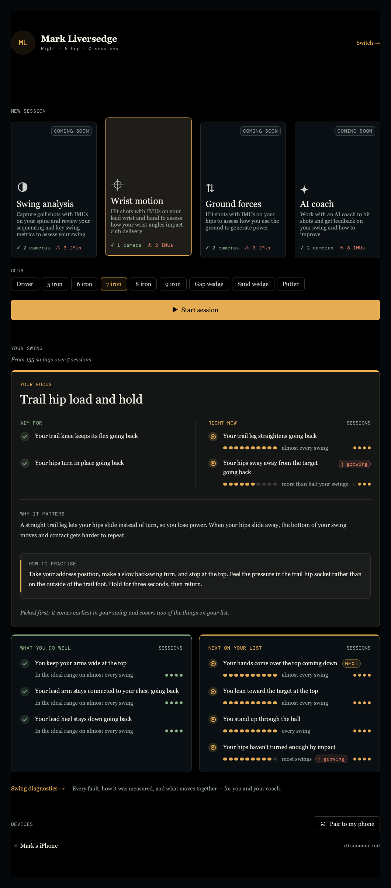 | 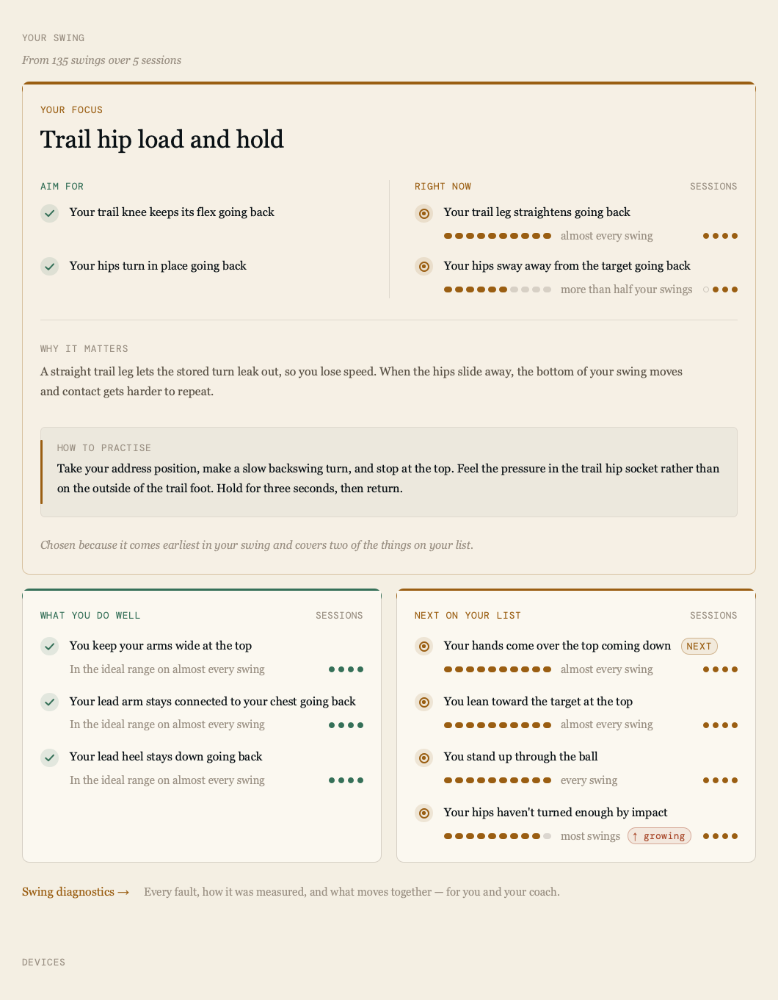 |

| Swing diagnostics, dark (the app) | A fault row opened (mock, then headed WORK ONS) |
|---|---|
| 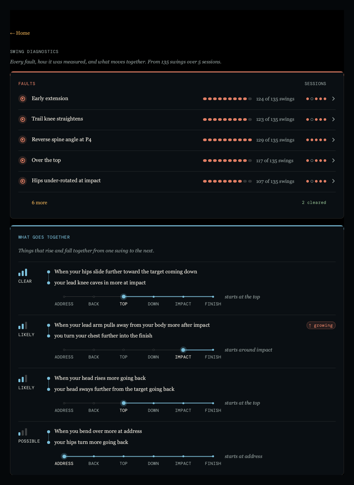 | 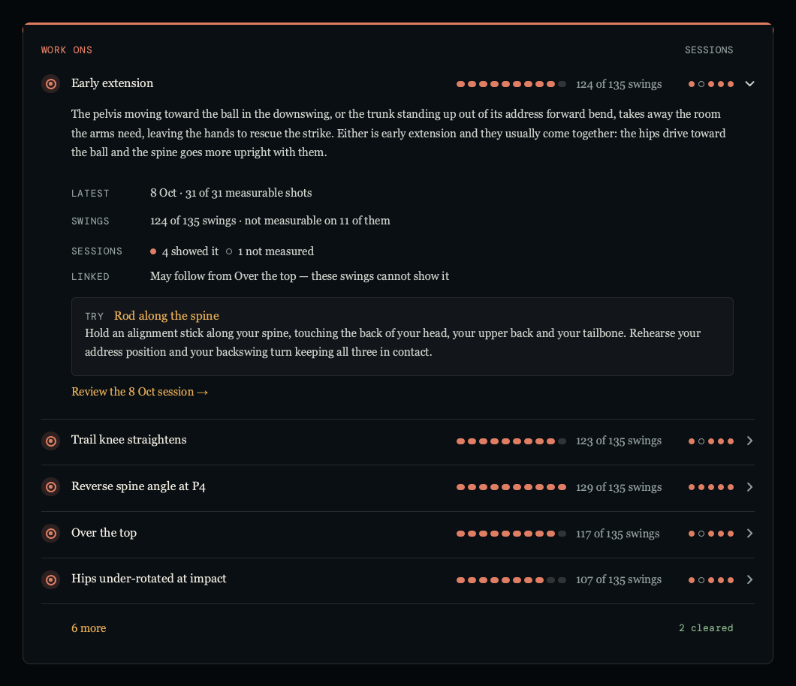 |

The light mock's last line still has the old wording "Chosen because…". The app says "Picked
first: …", because the home screen never uses causal words.

### 13.1 The principle: looked at before it is read

- **Every item has a shape as well as words.** A badge leads the line, a meter says how often and pips say which
  sessions. A glance at the shapes tells the story, and the words confirm it.
- **Colour is never the only channel.** Each tone comes with a shape (tick, target, arrow, dashed
  ring), with words ("almost every swing", "↑ growing"), or both.
- **Weight carries the hierarchy, not size.** At most one hero card per screen, then supporting cards, then a
  quiet link into the detail.
- **It stays flat** (section 10 holds). Tints are alpha washes of the card's tone over `colorSurface`,
  with no gradients, shadows or images.

### 13.2 Tone roles

A card has ONE tone. Its top rule, heading, badges, meter and pips all use it. Choose the tone by
what the content *means*, never by which panel it is in.

| Role | Token | Used for |
|---|---|---|
| Your focus, act on this | `colorAccent` | YOUR FOCUS, NEXT ON YOUR LIST, links, "NEXT" |
| Good, in the ideal range, easing | `colorGood` | WHAT YOU DO WELL, AIM FOR ticks, "↓ easing", "2 cleared" |
| A fault, named technically | `colorWarn` | FAULTS. Not `colorError`: nothing here is an alarm |
| A relation, neither praise nor fault | `gradientCool` | WHAT GOES TOGETHER |
| Quiet, unknown, headings' asides | `colorText3` | SESSIONS, captions, unconfirmed badges |
| Empty marks | `colorBorderMid` / `colorBorderStrong` | unfilled meter segments / unfilled pip rings |

There are two deliberate mixes. AIM FOR's green ticks sit inside the amber focus card, because the ideal is
praise. A trend chip takes `colorWarn` going up and `colorGood` easing, whatever the card's tone.

### 13.3 The card shell

```qml
component Card: Item {
    property color  tone: Theme.colorAccent
    property string title: ""                 // Micro, in the tone
    property string aside: ""                 // Micro, colorText3, right-aligned (e.g. "SESSIONS")
    readonly property int pad: Theme.sp(20)
    default property alias content: body.data

    Rectangle {                               // surface + hairline
        anchors.fill: parent
        radius: Theme.radiusLg
        color: Theme.colorSurface
        border.width: 1; border.color: Theme.colorBorderMid
    }
    // The top rule: a rounded tone shape with its lower part covered by the surface again,
    // so the rule follows the corners. 3 px; 4 px on the hero.
    Rectangle { width: parent.width; height: Theme.radiusLg * 2; radius: Theme.radiusLg; color: tone }
    Rectangle { x: 1; y: 3; width: parent.width - 2; height: Theme.radiusLg * 2; color: Theme.colorSurface }
    // heading row at (pad, pad + sp(2)); body Column sp(18) below it, item spacing sp(18)
}
```

- Cards sit `sp(16)` apart, with two side by side down to `sp(640)`. Below that they stack.
- The SESSIONS aside heads the pips. Every card in a row shares one pip count, so the pips line up on one right edge.

### 13.4 The hero card

There is one per screen at most. It is the card the golfer should act on (`HmFocus.qml`). It differs from the standard card in five ways:
- **The rule** is 4 px.
- **The surface** carries a wash of `Qt.alpha(tone, dark ? 0.045 : 0.05)`, and the hairline is
  `Qt.alpha(tone, dark ? 0.32 : 0.36)` instead of `colorBorderMid`.
- **A display headline** sits under the Micro label: `fontDisplay`, `fontSzDisplay`, `fontBodyWeight`, line height
  1.15. This is the only place display type appears on the page.
- **The body** is sections `sp(24)` apart with a 1 px `colorBorder` divider. Inner columns sit on the same split as the
  cards below, so the page keeps one grid. A hairline runs down the split, and each line on the left faces the
  line it answers on the right.
- **An inset panel** (HOW TO PRACTISE):
  - `radius`, with a fill of `Qt.alpha(colorText, dark ? 0.035 : 0.04)` and a 1 px `colorBorder`;
  - a 3 px bar in the tone down its left edge, inset `sp(14)` top and bottom;
  - a Micro label, then body text.
- **It closes on one italic line** (`fontSzBody2`, `colorText3`) saying honestly why this card is the one.

### 13.5 The marks

**Micro heading.** `fontData`, `fontSzMicro`, `trackingMicro`, with upper-case text in the string itself. In `colorText3`, or in the card's tone for the card title.

**Badges.** These are `sp(20)` circles filled with `Qt.alpha(tone, dark ? 0.16 : 0.12)`.
- The text indents by the badge plus `sp(12)`.
- The badge centres on the FIRST line of its text (`fontSzBody * 1.3 / 2`), not on the block.

| Badge | Drawn as | Means |
|---|---|---|
| Check | a tick (`Shape`, round caps, stroke `max(1.5, sp(1.6))`) | in the ideal, done well |
| Target | a ring (0.56 × size) and a centre dot (0.2 × size) | present, to work on |
| Easing | a down arrow, `colorGood` | getting better |
| Unconfirmed | a dashed ring, untinted grey | seen before, no recent evidence |

**Frequency meter.** Ten capsules, each `sp(9)` × `sp(6)`, spaced `sp(3)`. `round(share × 10)` of them are filled in the tone; the rest are `colorBorderMid`. It is always followed by words: "almost every swing" on the golfer layer, "124 of 135 swings" on the technical one.

**Session pips.** `sp(6)` dots spaced `sp(4)`, oldest first, showing the latest 8.
- A filled dot in the tone means seen (or, in a "do well" card, in the ideal range).
- An outlined `colorBorderStrong` ring means not seen.
- The faults card uses `PpTickRun`'s vocabulary instead: a dot is a pattern, a green dash is a clean session, and a ring means the session could not tell. There is never a gap.

**Chip.** A capsule `sp(18)` high, filled with `Qt.alpha(tone, dark ? 0.12 : 0.09)`, with a 1 px border of `Qt.alpha(tone, 0.45)` and Micro text in the tone.
- Uses: "↑ growing", "↓ easing", "NEXT", "last seen 4 Jul".
- It follows the frequency words. When the line has no room, it moves up to the right edge of the headline's line. It never overlaps the pips.

**Strength mark.** Three rising bars, filled 3, 2 or 1, with CLEAR, LIKELY or POSSIBLE beneath in Micro. It shows how firmly something holds, without a number.

**Swing timeline.** Six stops: ADDRESS, BACK, TOP, DOWN, IMPACT, FINISH.
- A 1 px base track, with a 2 px tone track from the start stop on.
- The start stop is `sp(9)` with a halo; the other stops are `sp(5)`.
- The start label is in `colorText`, the others in `colorText3`.
- The italic words to the right say where it starts ("starts at the top").

**Connector.** One dot per half, and a line between them. It joins two statements that go together.

### 13.6 Text

| Role | Font, size | Colour | Notes |
|---|---|---|---|
| Item headline | `fontBody`, `fontSzBody` | `colorText` | line height 1.3, wraps |
| Supporting words (frequency, caption) | `fontBody`, `fontSzBody2` | `colorText3` | |
| Prose (why it matters) | `fontBody`, `fontSzBody` | `colorText2` | line height 1.45, at most `sp(720)` wide |
| Subtitle, explanation, the closing reason | `fontBody`, `fontSzBody2`, italic | `colorText3` | "From 135 swings over 5 sessions" |
| Hero headline | `fontDisplay`, `fontSzDisplay` | `colorText` | the hero only |
| Link | `fontBody`, `fontSzBody2` | `colorAccent` | "Swing diagnostics →", "← Home", "Review the 8 Oct session →" |

The words are second person, plain and in sentence case.
- **The golfer layer (the home screen):** no figures, no jargon and no claims about cause.
- **The technical layer (Swing diagnostics, and the session screens):** technical names and counts are allowed.

### 13.7 Rows that open in place

A FAULTS row, closed, reads: badge, name, meter, count, pips, then a chevron that turns 90° when open. Rows are separated by 1 px `colorBorder`, and only one is open at a time. It opens in place:
- the prose;
- a label and value grid (Micro labels LATEST, SWINGS, SESSIONS, LINKED; body values);
- an inset TRY panel for the drill;
- a link into the session.

The card's foot holds "6 more" (a link) and "2 cleared" (Micro, `colorGood`).

### 13.8 States

- **Reading:** a Micro "reading your sessions…" sits on the right of the section's heading row. It appears the first time
  only; a recompute leaves the content standing and it simply changes when it lands.
- **Empty:** one quiet line (`fontSzBody2`, `colorText3`), for example "Nothing yet. …", so the card keeps its
  shape.
- **Nothing to say:** the hero is not drawn at all. It is never drawn empty.

### 13.9 Page layout

- The column is `Theme.contentWidth(parent.width)`.
- A section opens with a Micro heading and an italic subtitle, then `sp(16)`, then the hero, then the cards.
- The link row into the detail comes `sp(20)` below the cards: a link, then one line of `colorText3` saying what is behind it.
- There are two layers: the golfer's words on the front and the technical detail one link away. The detail screen opens with "← Home", a Micro heading and an italic subtitle.

### 13.10 Carrying it to other panels

- **Use the shared pieces.** They were lifted out of the `Hm*.qml` files (the home screen renders
  pixel-identical on them), so one change restyles every panel:

  | Component | What it is |
  |---|---|
  | `PpCardShell` | the shell alone: `tone`, `hero` (4 px rule + wash), `floating` (a Popup's, `colorBorderStrong`) |
  | `PpCard` | shell + Micro `title` / `aside` + a body column (`pad`, `itemGap`, `bodyGap`) |
  | `PpStageCard` | a stage panel's card: quiet by default, a `heading` Component replaces the title (tabs) |
  | `PpPopoverCard` | every `Popup`'s `background` |
  | `PpMicro`, `PpCardNote`, `PpLink`, `PpFact` | the text roles of 13.6 and the label/value row |
  | `PpInset` | the inset panel, with an optional tone `bar` |
  | `PpBadge` | `kind` check / target / easing / unconfirmed, `tone`, `size` |
  | `PpMeter`, `PpPips` / `PpPip`, `PpChip` | the meter, pips (`marks` or `ticks`), chips (`trend`, `tinted`) |
  | `PpStrengthMark`, `PpSwingTimeline` | the strength mark and the six-stop timeline |

  `Theme.qualityMark(score)` gives the badge kind that goes with `Theme.qualityColor(score)`.
- **Make each panel a card** with one tone chosen by role (13.2), a Micro title in that tone, and an
  aside where a column needs a heading. A panel inside a frame it does not own draws no frame or
  title of its own (13.11).
  *Superseded for stage panels (Mark, 11 October 2026; section 15).* A stage card always takes
  the quiet tone, and its colour comes only from its content. Home-screen cards keep their tones.
- **Keep the numbers on session screens.** They are the technical layer, so values stay in `fontData`.
  But wherever a value is judged against an ideal, give it a mark as well (a badge, meter, pips or a
  glyph) and words, so colour is never the only signal.
- **Keep video, camera tiles and the 3-D view as the dominant mass** (section 8). The card frames a
  panel and does not compete with it. Canvas panels get the quiet card: shell and heading, no marks.
- **Use at most one hero per screen,** and only when there is one thing to act on.
- **Verify by rendering** both themes, dark and light, offscreen (`--probe-qml` with `grabToImage`).
  Check that chips never overlap pips, that columns stack below `sp(640)`, and that empty and
  reading states keep the card's shape. A Popup lives in the window's overlay, so grab the window's
  root item, not its `contentItem`.

### 13.11 The Wrist session screen

| Wrist, Analyse, dark (the app) | Wrist, Analyse, light (the app) |
|---|---|
| 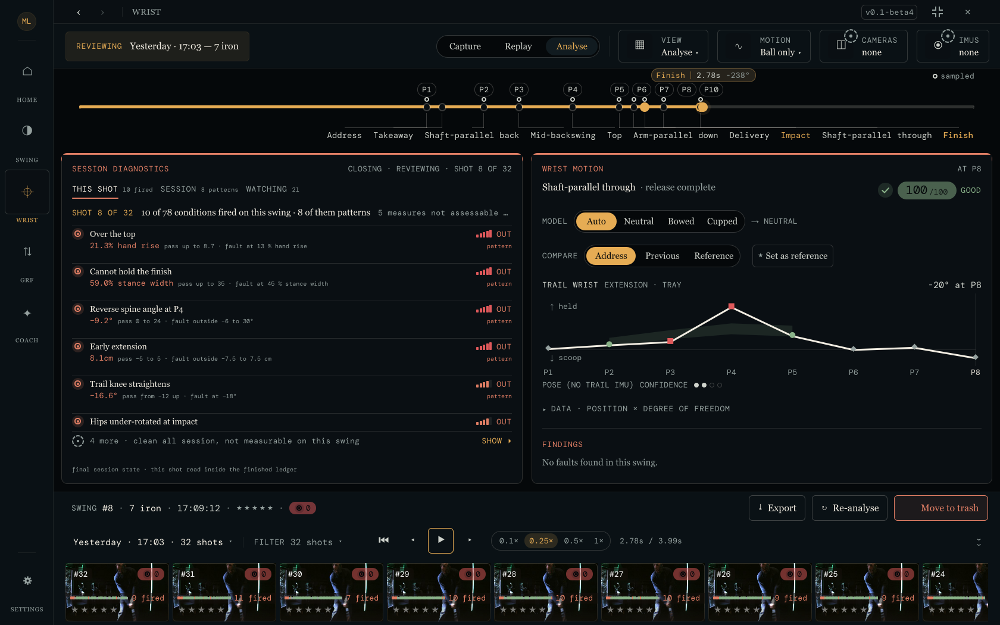 | 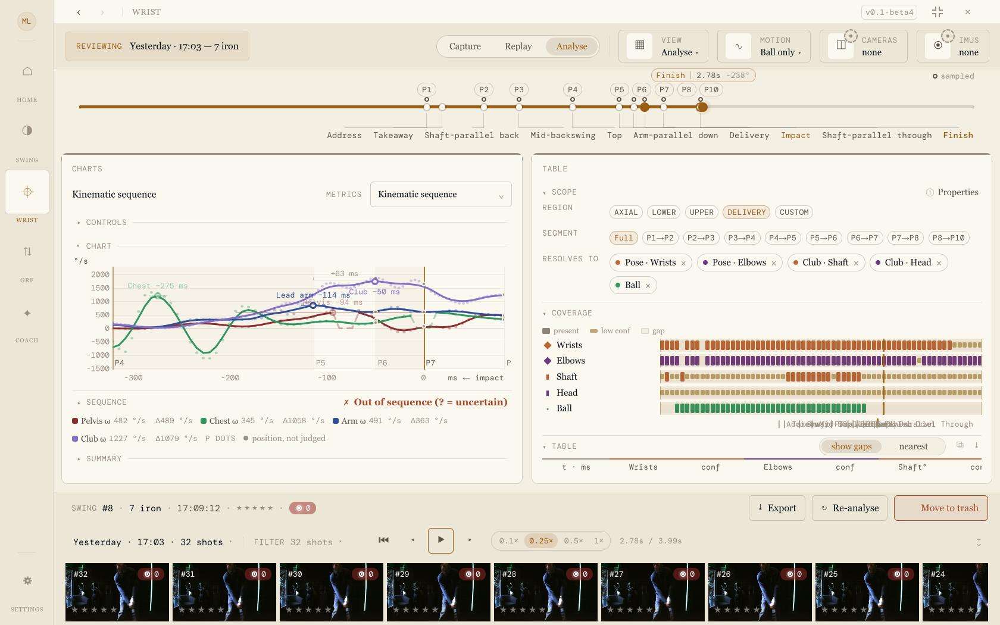 |

- **The stage owns the frame.** `PpModeStage` puts each panel it shows in a `PpStageCard`, titled
  and toned from its definitions: SESSION DIAGNOSTICS and WRIST MOTION in `colorWarn` (they name
  faults); CAMERA, 3-D SWING, LAUNCH MONITOR, CHARTS, TABLE and MARKUP quiet (`colorText3`). In the
  tabs arrangement the tab strip is the card's heading: Micro labels, the selected one in
  `colorText` over a 2 px rule in that panel's tone. A panel may put one more thing on the heading
  row through `readonly property string cardAside`; a panel also shown outside the stage carries
  `property bool framed` and is told it is framed already.

  > **Superseded by section 15 (Mark, 11 October 2026): every stage card takes the quiet tone.**
  > The warn tone on SESSION DIAGNOSTICS and WRIST MOTION is gone. On a swing with no faults it
  > made "warn" mean "this panel", not "out". Mark: *"Quiet tone please. The previous design
  > system was confused and noisy."*
  > - This build changes `PpModeStage._defs`: `sessionDiagnostics` and `wristMotion` take the quiet
  >   role, so every card title is `colorText3`.
  > - The selected tab's rule is ink, not the panel's tone.
  > - Colour inside a card comes only from content (15.4).
  >
  > The text above is kept as the October 2026 history. The renders in this section still show
  > the old warn titles.
- **No card inside a card.** Inside a panel, sections are hairlines, Micro sub-headings and insets.
- **Faults are `colorWarn` everywhere** (13.2): diagnostics tick runs and verdicts, the carousel's
  pips, the launch monitor's Action readings. The Wrist position grid keeps its ● ▲ ■ glyphs.
- **Provenance has a shape:** a measured or fitted P-position is a solid dot, a sampled one a ring,
  an unavailable one the dashed badge, always with a key in words.
- **Devices** (toolbar pills and panel rows): check = connected and fine; dashed ring = not
  connected; target in `colorAttention` = needs calibration, low battery, partly connected; target
  in `colorError` = failed. The state is always in words too.
- **The toolbar and the carousel stay flat**; their drop-downs, sheets and menus sit on
  `PpPopoverCard`. Marks drawn on footage (camera chips, the stats pill, the markup HUD) keep a dark
  scrim for legibility.

Exceptions to section 10: the top rule (3 px, or 4 px on the hero) and the inset's 3 px tone bar are
filled shapes, not borders, and the tick is a `Shape` path. Borders themselves stay 1 px.

## 14. THEMES AS DATA, AND FOLIO

October 2026. Mark liked the look of a set of repository charts: warm neutral greys, hairline grids,
no boxes, generous whitespace, one neo-grotesk for everything including the numbers, small grey
sentence-case labels, and one restrained blue. **Folio** is that look as a seventh aesthetic. To make
it possible, theming was widened. It used to cover colour, fonts and radii; it now also covers spacing,
heading case, card rules, chart furniture and the app chrome. A theme also became data instead of
code.

| Home, light | Swing diagnostics, light | Swing diagnostics, dark |
|---|---|---|
| 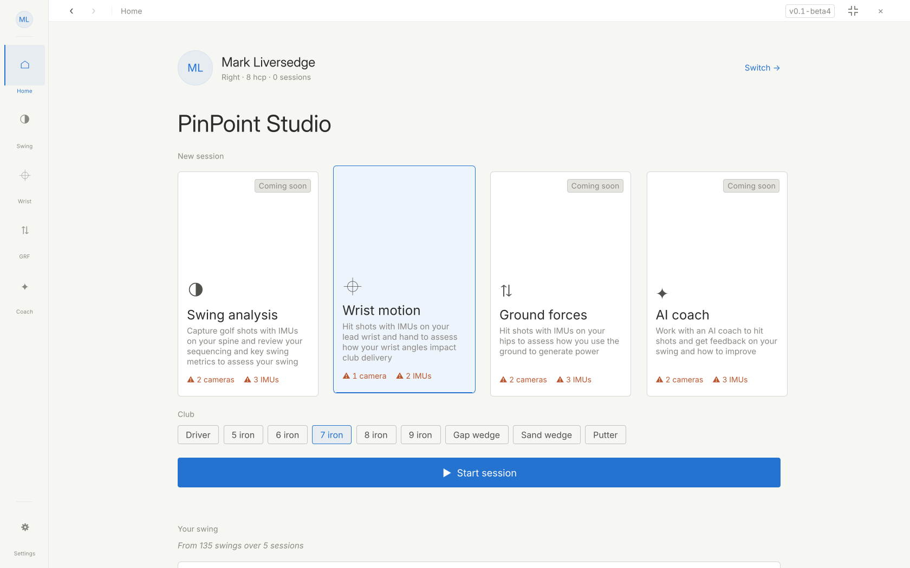 | 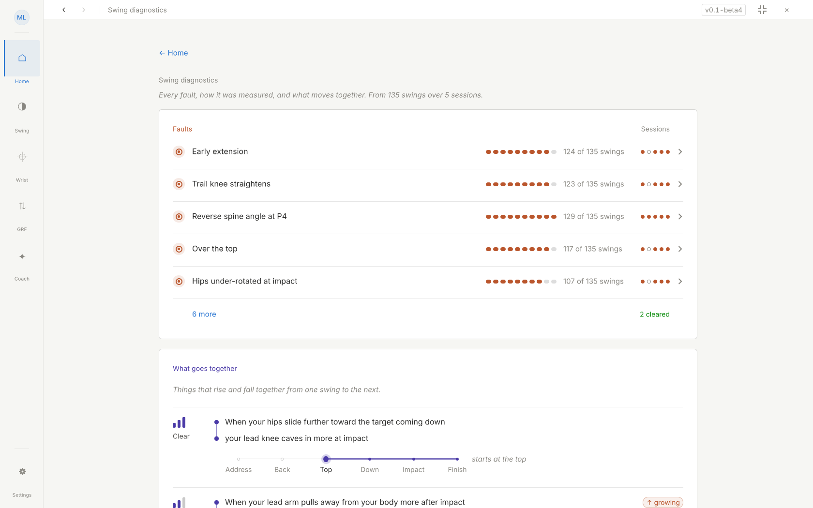 | 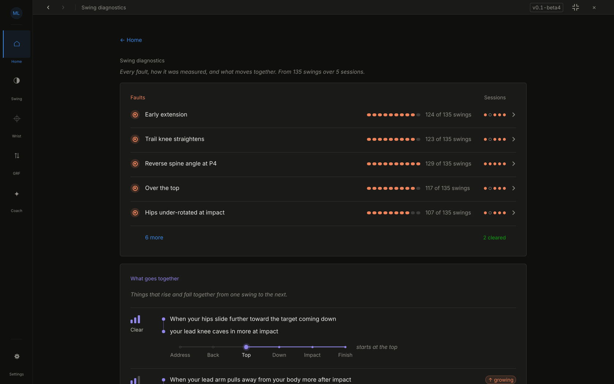 |

| Wrist → Charts, light | Wrist → Charts, dark |
|---|---|
| 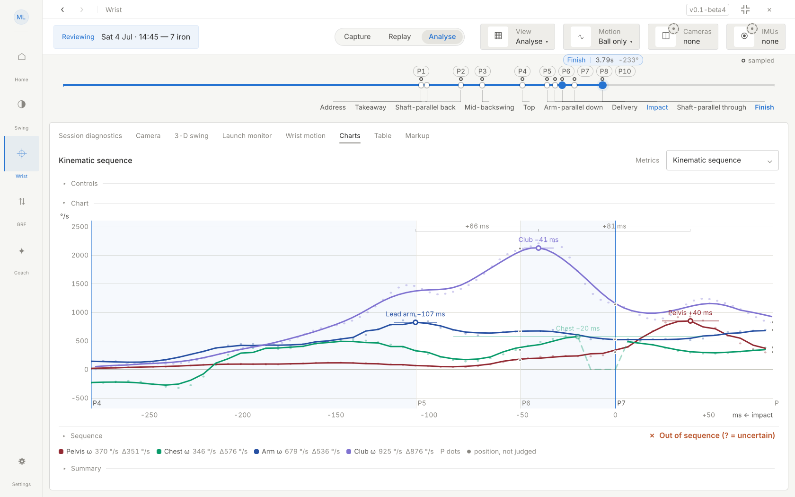 | 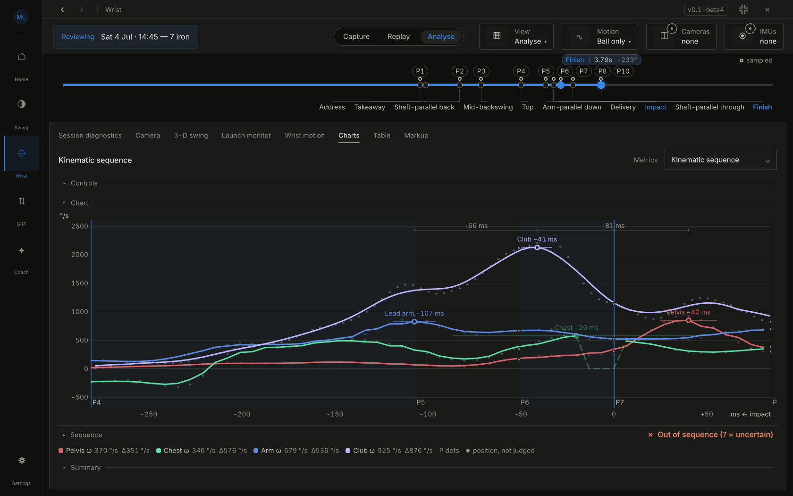 |

| Wrist → Session diagnostics, light | Settings → Appearance (14 tiles) |
|---|---|
| 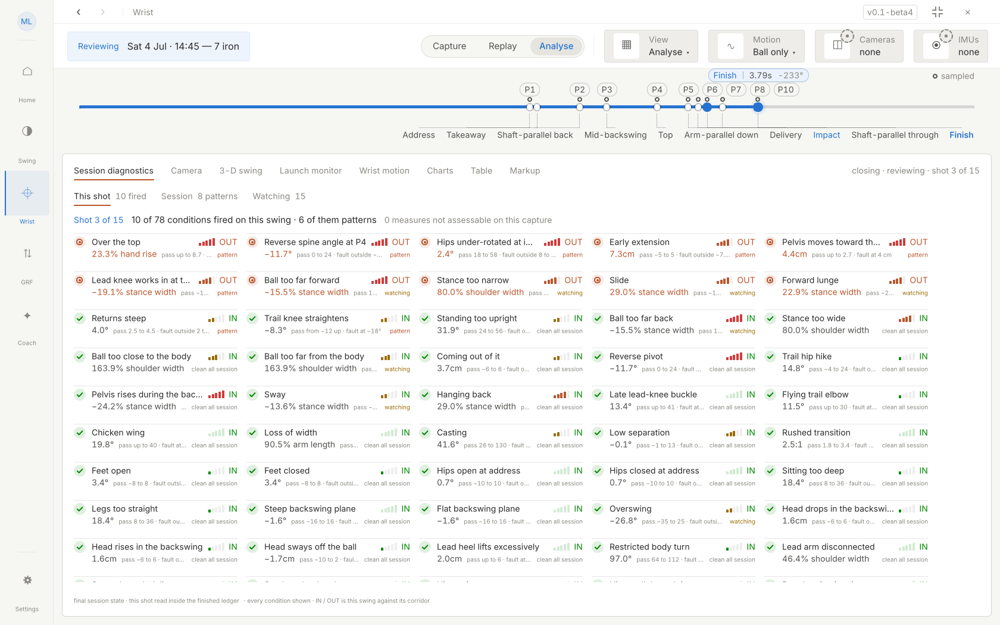 | 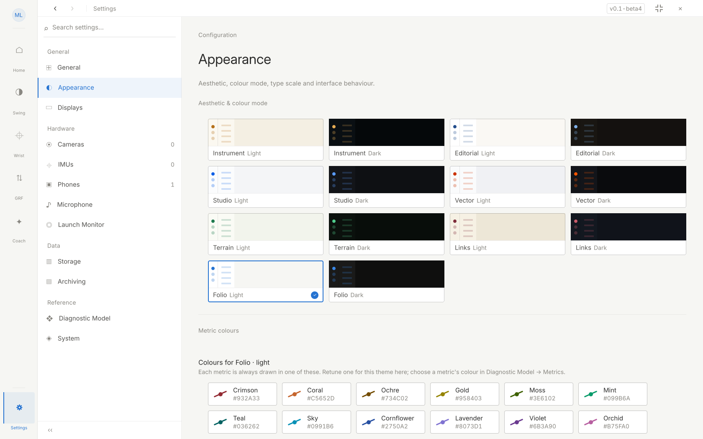 |

### 14.1 A theme is one table entry

`Theme._themes` holds one entry per aesthetic. Each entry has the keys it shares across modes and a
`light` and a `dark` block:

- **Shared keys:** `label`, `swatch` (the Appearance tile's dot), the three font families,
  `fontBodyWeight`, `displayBase`, the display italic and weight, `radius`, `radiusLg` and
  `railWidth`.
- **Mode blocks:** the 26 colours and `chartSeries`.

A token reads `_m.<name>` for a colour every theme defines, or `_v(name, default)` for an
**optional key**. The default is what the six original aesthetics always did, so a theme lists only
where it differs. An optional key may also sit in a mode block, as Folio's chart greys do.

- **themeIndex** is `2 × place in themeOrder (+1 for dark)`. Indices 0–11 never moved, so a saved
  `ui/themeIndex` keeps its meaning. Folio is 12 (light) and 13 (dark). `themeCount` and
  `cycleTheme()` follow `themeOrder`.
- **A new theme** is one entry plus its name in `themeOrder`. `themeInfo(i)` feeds the Appearance
  tiles, and the tile grid sizes itself from `themeCount`. Run `tools/theme/metric_palette.py` with
  the theme added to `THEMES` and `SURF` for its `_metricPalettes` block.
- **No component may branch on `Theme.aesthetic`.** The three that did (the rail, its buttons, the
  session toolbar) now read tokens. `grep "aesthetic ==="` over `src/Gui` is empty.
- **Proof of the restructure:** a probe dumped every token and sampled function for the 12
  original themes, from the old build and the new one. All 2,472 values matched. Whole-window
  renders of home, diagnostics and settings in all 12 themes were pixel-identical before and after.
  `tst_theme_tables.qml` pins indices, completeness, the pass-throughs and the Folio values.

### 14.2 The new token families

| Family | Tokens | Original aesthetics | Folio |
|---|---|---|---|
| Space | `gap(n)`, `spacingScale` | `gap(n)` = `sp(n)` | 1.15× the room between things, not their size |
| Heading case | `caps(s)`, `capsFont`, `capsHeadings` | CAPITALS | as written (sentence case) |
| Tracking | `trackingMicro / Label / Data`, `fontSzMicro` | 0.8 / 0.6 / 0.3, micro 10 | 0.15 / 0.1 / 0, micro 11 |
| Cards | `cardRule`, `heroRule`, `heroTinted` | 3 px / 4 px rule, tinted hero | no rule; the hero is a plain card |
| Charts | `gridColor(c)`, `gridOpacity(o)`, `baselineColor(c)`, `baselineOpacity(o)`, `curveWidth(w)`, `chartFrame`, `chartMarkerHollow` | pass-through: each chart hands in what it drew before | opaque hairlines `#E1E0D9` / `#2C2C2A`, baseline `#C3C2B7` / `#383835`, no plot box, hollow rings on `colorSurface` |
| Chrome | `colorRail`, `colorToolbar`, `railActiveBar` | instrument on `colorBg2`; editorial and vector use the bar | rail on `colorBg`, toolbar on `colorSurface`, accent bar |
| Titles | `fontSzHero`, `gradientTitlesActive` | 2 × display, gradient sweep | 34, flat ink |

The rules for using them:

- **Space vs size.** Spacing, margins, padding, and a card's pad and gaps are `Theme.gap()`. The size of
  a mark (badge, pip, meter capsule, stroke, rule) stays `Theme.sp()`. One exception: where a size is
  computed from a gutter (the resource monitor's bar row), the gutter stays `sp()`.
- **Heading case.** Headings are written in **sentence case** in the source. Set them with
  `Theme.caps(qsTr("Your focus"))`, or with `font.capitalization: Theme.capsFont` on the Text.
  - Acronyms stay capitals in the source: IMU, CPU, DTL, GRF, LM, P1…P10.
  - `.arg()` goes after the case change, `Theme.caps(qsTr("Path %1")).arg(x)`, so the argument keeps
    its own case.
  - Never capitalise inside a shared component: PpMicro carries live values as well as headings.
  - Strings that arrive from C++ already in capitals are lower-cased at the display site before
    `caps()` (`_unshout()` in the session-diagnostics panel).
  - The launch-monitor board abbreviations are sentence case in `launch_monitor_reading.cpp`.
- **Chart furniture is a pass-through.** Hand in the colour and opacity the chart used before.
  - Grid lines and the zero line wear the tokens. Meaning-carrying lines (Top, Impact, the playhead)
    and the phase-band wash do not.
  - Markers whose ring already MEANS something (watch / outside P-dots, the current shot on a
    corridor strip) keep their encoding. Only their fill moves to `colorSurface`.

### 14.3 Folio

- **Type.** Inter for body, "Inter Display" for display and the hero, and **"Inter Tabular"** for
  `fontData`. Inter Tabular is Inter with its tabular figures frozen in as the default digits and
  the family renamed. Every number in the app therefore lines up in columns in the sans, and no call
  site has to ask for `font.features`.
  - The faces are static instances, because CoreText won't interpolate a variable weight axis for an
    application font.
  - They are subset to Latin, Greek, punctuation, arrows, maths and shapes.
  - `tools/theme/make_inter_fonts.py <Inter-4.1 dir>` rebuilds them.
  - OFL-1.1; `Inter-OFL.txt` ships beside them; the licence entry is in `LICENSEDEPS.md`.
- **Colour.**
  - **Light:** ink `#2B2B2A` / `#52514E` / muted `#898781` on page `#F6F6F3`, white surfaces and
    alpha-ink hairlines.
  - **Dark:** `#EDEDEA` / `#C3C2B7` / `#8F8D86` on `#0F0F0E`, with surface `#1A1A19`.
  - **Accent:** `#2573D1` (light) / `#3987E5` (dark).
  - **Status colours** are the reference chart palette's hues, darkened where needed. Every text and
    status colour clears 4.5:1 on its surface; the muted grey, used only for captions, is the charts'
    own at 3.6:1, like the other themes' caption greys.
  - **`chartSeries`** is the validated eight-slot categorical order (blue, orange, aqua, yellow,
    magenta, green, violet, red), and the metric palette comes from the same generator rules as the
    other themes.
- **Instrument's serif is the system's Georgia, else Gelasio** (October 2026). Georgia comes with macOS
  and Windows, so `Theme.serifFamily` uses the installed face and the app never bundles it: it once did,
  without a licence to redistribute it, and `cmake/PinPointFonts.cmake` now refuses a Georgia file.
  Where there is no Georgia (Linux), the bundled Gelasio stands in. Gelasio matches Georgia's advance
  widths exactly; `tools/theme/make_gelasio_fonts.py` ships only the four style-linked faces (one family
  on every platform's font stack) and sets their line metrics to Georgia's, so Instrument lays out the
  same with either.
- **The look.** No coloured top rules: a card is a hairline box, and its tone lives in its title and
  its marks. There are no gradients, headings are small and sentence case, and there is more air
  between things. The inset keeps its 3 px tone bar (a mark, not chrome).

### 14.4 Known gaps

- A few labels arrive in capitals from data and still show that way in Folio: the metric manifest's
  read-at labels (BACKSWING, DOWNSWING, Δ LIE, Δ PLANE) and the IN/OUT state codes.
- The offscreen renderer draws no gradient titles, so in renders the original themes' page titles
  are blank. They draw in the app.

## 15. THE TYPESET SYSTEM

October 2026. After three design rounds on the Session diagnostics panel, Mark approved a second
look for the app: the **typeset** system. It sets a panel the way a typesetter sets a page, where
the old panels were dashboards of boxes. Session diagnostics is being built in it now. It is the
target for every other stage panel and, later, for whole screens. To apply it to a panel, follow
`docs/design/stage_typeset_playbook.md`.

How it fits with sections 13 and 14:

- **Section 14 still holds.** A theme is data. The typeset values are one more block in each
  `_themes` entry (15.3), and no component branches on `Theme.aesthetic`.
- **Section 13's shell still frames each stage panel** (13.11). Inside the frame, the content
  follows this section. Where the two disagree inside a stage panel, this section wins:
  - colour means only "outside its corridor", so there are no `colorGood` ticks, tone badges or
    frequency meters;
  - the selected tab's rule is ink, not the panel's tone, because a warn rule would spend "out" on
    chrome;
  - every stage card takes the quiet tone (decided by Mark, 11 October; see 15.11).
- **"Colour is never the only channel" (13.1) still holds.** Here an out-of-corridor state also has
  a position (a dot past the fault line), a shape (a bar where a clean shot has a tick) or a
  heading it sits under ("Outside the corridor").

### 15.1 Why it exists

Mark, on the old panel (11 October 2026): *"far too noisy, dense walls of text with no finesse
and fonts that are too large. I would prefer something more akin to a typeset published
document."* He liked Folio and the matplotlib growth-chart look: Inter, generous spacing,
hairlines, a professional finish. He wanted future aesthetic changes to be driven from theming.

The critique of the old panel, point by point, and the typeset answer:

| The old panel | The typeset answer |
|---|---|
| Every line the same size and nearly the same grey; in Vector, all prose in letter-spaced Space Mono | A type scale of named roles; at most four sizes and two weights on a view; prose always in the text face |
| Six lines per pattern card, most cut with "…" ("fault outside -…") | No ellipsis, ever. Rewrite, wrap, fold to a second line, or move it to Detail |
| "Fired here" said five ways: pill, 5-bar meter, orange numeral, orange value, orange tick | One encoding per fact: the value is set in warn, and nothing beside it repeats that |
| Orange and green spent on values, corridors, sentences, pills, ticks and numerals | Warn means "outside its corridor" and nothing else; clean is ink, the absence of colour |
| The 66 clean conditions in the same box as the 10 that fired (78 equal cells) | What fired leads; the clean ones are a quiet count, an index or the tail of a dot plot |
| Type scaled with the panel (up to 2.4×, on top of fontScale 1.25), while captions sat at 8–9 px | Roles keep their size at every width; spare room becomes margin and content; nothing renders under 10 px |
| No grid and no measure; lines ran 1,500 px | A column grid; figures right-aligned in tabular numerals; prose no wider than 44 em |
| Detail: saturated zone fills, three chart styles, causes as boxed cards repeating the same qualifiers | One figure grammar with a neutral corridor wash; causes as one graph or as typeset chains with footnote marks |
| Pills, dashed rings, chip outlines, "▸" arrows, link blue on every bookend title | Hairlines and whitespace; controls are quiet text |

"A typeset published document" means four things here:
- a page has a **measure**, a **grid** and a **type scale**;
- the **figures do the comparing** and the **sentences do the explaining**;
- **every fact appears once**;
- the same page can be **printed** without a second design.

The three rounds:
- **Round 1** tried three directions on the full panel: A *Ledger* (the annual-report table), B
  *Editorial* (the magazine feature) and C *Figures* (Tufte's small multiples).
- **Round 2** made each one work at four panel widths and on A4. Three agents worked separately
  and arrived at nearly the same rules. That agreement is the best evidence we have that the rules
  are right, so they became the house rules (15.2).
- **Round 3** merged the three into one aesthetic with three registers (15.6), added interaction
  (15.7) and fault-forward figures (15.8), and built a shared block library.

### 15.2 The twelve house rules

These bind every typeset panel.

**1. Measure in em, not pixels.** Size classes come from the width a component is *given*, in
units of the body type: **wide** 90 em or more, **medium** 60–90, **compact** 42–60,
**narrow** under 42. No component ever asks which layout it is in.
- *Why:* the same panel is drawn at four widths in the app, at two on paper, on the cast and on
  laptops. A layout name knows nothing about the user's fontScale or the window, and em does.
- *Example:* the half layout (734 px) is 52 em, so compact. A4 portrait's text block (674 px at a
  13 px print body) is also 52 em and compact. One set of rules lays out both.

**2. Type is fixed and space gives way.** Each type role keeps its size at every width. Gutters
step down one notch below medium before anything else changes. There are no fit factors.
- *Why:* the old panel's fit factor gave big type and tiny captions with no middle. Bigger type on
  a bigger panel says nothing more.
- *Example:* Session's body is 14 px at full and at third. At full, the extra room becomes the
  median, trend and typical / worst / best columns.
- The cast's zoom is not an exception. It scales the whole surface, like browser zoom, for viewing
  distance (15.6).

**3. Fold, don't drop.** Every element has a tier and an "else". A column that cannot fit becomes
a labelled item on its row's second line, a sentence absorbs a figure, a note moves under its
chart. Nothing is ellipsised and nothing silently disappears. Tiers live in tables, as data.
- *Why:* lost and truncated information was the loudest complaint. A tier table makes the
  decision once, where it can be reviewed.
- *Example:* at compact, This shot's corridor, out-by and tier columns become one second line under
  the condition's name: "pass ≤ 8.7 · fault 13   out by 5.1×   pattern".

**4. Flows count their own columns** from a minimum in em: prose at least 26 em and at most 44,
an index 20, a small-multiple tile 22, a chart 30, a key figure 10. Never a fixed column count.
- *Why:* a fixed count is right at exactly one width.
- *Example:* the eight Session small multiples go 4 → 3 → 2 → 1 across, and no code names a count.

**5. Rails fold.** A side rail or margin survives only while two content columns still fit
beside it. Otherwise its heading goes above the content and its notes go below.
- *Why:* a rail at half width leaves a sliver for the content it is meant to serve.
- *Example:* Editorial's left rail (kicker, head, standfirst) hangs beside the content only at
  wide. Below that, the head moves above and the bookends and footnotes move below.

**6. Pages are made of blocks.** A view is an ordered list of blocks that never split: an entry,
a row, a figure, a path. A heading travels with its first block. The screen scrolls the blocks;
print measures them and packs them onto pages. Only lists may split, and then they repeat their
heading ("continued").
- *Why:* one rule makes both scrolling and pagination honest. A row cut across two pages, or a
  heading stranded at a page foot, is the commonest print fault.
- *Example:* a cause path is one atom. The clean-conditions index may break between rows, and its
  next page opens with "Index, continued" and the column head.

**7. One encoding per fact.** Colour means "outside its corridor" and nothing else. The picked
shot gets one mark. Accent means a live control. In Vector the accent orange is too close to warn
orange, so Vector's links are ink with an underline.
- *Why:* when everything is coloured, nothing stands out.
- *Example:* a fired value is set in warn. There is no pill, meter or orange tick beside it.

**8. Charts keep their grammar at every size.** Labels keep their size, ticks thin out, panels
that share a scale stack below a stated width, and a diagram below its minimum changes form
instead of shrinking.
- *Why:* a shrunken chart can't be read, and a reader who has learnt a figure once should be able
  to read it anywhere.
- *Example:* the run chart's shot labels thin to 1, 5, 10, 15 and the picked shot when a shot gets
  less than 22 px. Below medium, the cause graph becomes typeset chains.

**9. Above the fold, every view answers its question at every width.**
- The questions: *what went wrong on this swing* (This shot), *what keeps happening* (Session),
  *what is emerging* (Watching), and *how far, how often and why* (Detail).
- As the width drops, the "why" sentence moves up.
- *Why:* the panel is glanced at between shots. An answer below the fold has not been given.
- *Example:* in Replay, all eight Session rows fit above the fold at every width. Detail at half
  opens with the head, the key figures (including the distance to travel) and the figures.

**10. Print is a medium, not a separate design.** It uses the same blocks and classes: A4
portrait is compact and landscape is medium. Print role overrides set the body at about 10 pt,
hairlines at 0.5 px, lighter tints and always the light palette. Every page gets a running head,
a folio and a footer. Affordances disappear and links become cross-references ("detail on p. 5").
Keys appear once per page and show only that page's marks.
- *Why:* a second layout drifts from the first on its first change.
- *Example:* the same ledger table prints at a 13 px body with 0.5 px rules, and its Open link
  becomes "The feature on p. 4 reads it in full."

**11. Chrome thins last and least.** At narrow, tab counts and breadcrumbs go. Back, the view
toggles and the subject's name never do.
- *Why:* losing your place costs more than a line of height.
- *Example:* at third the tabs read "This shot · Session · Watching" with no counts, and each view's
  head states its own count.

**12. Height is a resource too.** A list splits into columns only when its rows don't fit the
height. Spare height admits the next tier of content, never bigger type.
- *Why:* added in round 3, after Mark's live try-out showed a list split in two with 900 px
  empty below it.
- *Example:* Replay's This shot continues below the fired conditions with the clean ones, closest
  to their edge first, until the space runs out. Replay's Session shows the small multiples once all
  eight fit, and sparkline rows when they don't.

### 15.3 Roles as data

The mock library holds the roles in `Roles.qml`. The build moves them into Theme like this:

- **A `typeset` block in each `_themes` entry.** It is optional, and a theme lists only where it
  differs from `Theme._typesetDefault` (the "Default" column below).
  - Folio and Vector carry blocks.
  - Instrument, Editorial, Studio, Terrain and Links take the default until each one has been
    judged in renders.
- **`Theme.typeset`** is the merged table for the current aesthetic: the default, then the entry's
  block.
  - Values that depend on light or dark (the pick and hover washes) are computed from
    `Theme.dark`, not stored.
- **`Theme.typesetPrint`** is one print block, shared by every theme.
- **`PpTypeset`, the per-instance helper** (`Roles` in the mock), is created once per panel or
  register: `PpTypeset { id: ts; medium: root.medium }`.
  - It merges `Theme.typeset` with the print block when `medium` is `"print"`.
  - It exposes the fonts, inks, marks, classes, flows, tiers and text helpers.
  - Blocks take it as `roles: ts`.
  - It is an instance, not a singleton, because the medium belongs to the instance: one window can
    show a panel and lay out its printed report at the same time.
  - Never give it the id `roles`. In `roles: roles` the block's own property shadows the id, and
    the block silently uses a default.
- **Sizes are design units.** `u(n)` is `Theme.sp(n)` on screen, so the user's fontScale applies.
  In print it is `round(n × printScale × 2) / 2`, and the user's fontScale never applies. Nothing
  multiplies a size by a panel fit factor.
- **Gutters are design units through `u()` too**, as in the approved renders. They do not take
  Folio's `spacingScale` (14.2) yet; that is a judgement for a later round.

**Type roles.** Sizes are design units. "Screen px" is at the default fontScale of 1.25.

| Role (helper font) | For | Units | Screen px | Print px | Default | Folio | Vector |
|---|---|---|---|---|---|---|---|
| feature (`fFeature`, `fPull`) | the Detail head; pull figures | 21 | 26 | 25 | `fontDisplay`, Normal | serif (`Theme.serifFamily`), Regular | Space Grotesk Light |
| title (`fTitle`) | view heads: "Ten outside the corridor" | 16 | 20 | 19 | as feature | as feature | as feature |
| standfirst (`fStand`) | the one sentence under a head | 12.5 | 16 | 15 | `fontBody` | serif | Space Grotesk |
| body (`fBody`, `fBodyM`, `fBodyL`) | rows, entries, prose; `M` strong, `L` link | 11 | 14 | 13 | `fontBody` Normal / Medium | Inter | Space Grotesk, Regular (not the theme's Light) |
| small (`fSmall`, `fSmallM`, `fSmallI`, `fSmallL`) | second lines, notes, captions; `I` notes | 9.5 | 12 | 11 | `fontBody` | notes italic | notes upright |
| label (`fLabel`, `fLabelL`) | column heads, axis labels, keys | 9 (Vector 8) | 11 (10) | 11 (10) | `fontBody`, sentence case, tracking 0.1 | as default | `fontData` (Space Mono), capitals, tracking 0.8 |
| micro (`fMicro`) | the smallest furniture | 8.5 | 11 | 10 | `fontBody` | as default | as default |
| kicker (`fKicker`) | "No. 1 · P4 · hand path loop" | 9.5 | 12 | 11 | label face, DemiBold | DemiBold, sentence case | Space Mono, Normal, capitals |
| section (`fSection`) | crossheads: "What might have caused this" | 11 (Vector 9.5) | 14 (12) | 13 (11) | body face, Medium | sentence case | small size, capitals, tracking 1.2, Normal |
| figure (`fFig`, `fFigS`, `fFigLabel`, `fFigL`) | every number in a column or a chart | body / small / label / title | | | `fontData` | Inter Tabular | Space Mono |
| inline figure (`figHtml`) | a number inside a sentence | inherits | | | `fontData` | Inter Tabular | Space Grotesk (a mono figure mid-sentence breaks the line) |
| tab (`fTab`) | the view toggles | body (Vector label) | 14 (10) | | body face | as default | label face, capitals |

- **Weights:** text Normal, strong Medium. **Leading:** 1.32, small 1.25; Vector 1.28 and 1.22.
- **Limits:** a view uses at most four sizes and two weights, and nothing renders under 10 px.
- **Folio's display and standfirst are serif.** That is Georgia, else Gelasio (14.3), the
  editorial voice Mark liked.
- **Vector's display is Space Grotesk Light, not the theme's Space Mono.** Headlines are prose, and
  Space Mono at 20 px reads as a terminal, not a headline.

**Other typeset keys.** "–" means the theme keeps the default.

| Key | Default | Folio | Vector | What it does |
|---|---|---|---|---|
| `italicNotes` | false | true | – | the direction sentence (a row's second line) in italic |
| `exhibitWord` | "Fig." | – | "FIG." | figure captions |
| `leader` | ".  " | – | " ·" | index leader dots |
| `linkAccent`, `linkUnderline` | true, false | – | false, true | links in accent, or in ink with an underline where accent ≈ warn |
| `ruleAlpha` | 0.55 | 0.5 | 0.7 | the heavy rule at the top of a table or figure |
| `hairAlpha` | 0.10 | 0.09 | 0.11 | row hairlines |
| `figureRuleTop` | 1.5 | – | 2 | the top rule's weight, in px |
| `zoneTint` | 0.045 | 0.04 | 0.06 | the corridor wash, as ink alpha |
| `faultAlpha` | 0.75 | – | 0.9 | the fault line, as warn alpha |
| `passAlpha`, `passDash` | 0.55, [2, 3] | – | –, [1, 3] | the dashed pass edge |
| `stemAlpha` | 0.45 | – | – | dot-plot stems |
| `markShape` | round | round | square | ONE mark shape per theme |
| `markFired`, `markClean` | 7, 5 | – | 6, 4 | mark sizes (units) |
| `cleanHollow` | true | true | false | clean marks as rings or filled |
| `ring` | 14 | – | 12 | the picked-shot ring |
| `barRadius` | 1 | – | 0 | strip bar corners |
| `stripPitch`, `stripBar`, `stripH` | 7.5, 3.2, 9 | – | – | the 15-shot strip |
| `gutter` | wide 20, medium 20, compact 14, narrow 12 | – | – | gutters step down one notch below medium |

**The print block** (`Theme.typesetPrint`), shared by all themes:
- `printScale` 1.18, so the body is 13 px, about 10 pt;
- `hair` 0.5 px, `tintScale` 0.7, `ring` 12;
- page geometry in A4 logical px at 96 dpi: `marginX` 60 (about 16 mm), `headY` 30, `top` 76,
  `bottom` 92;
- paper is always white, with the theme's light palette.

**Ink roles**, derived by the helper from Theme colours and the keys above:

| Ink | From | Means |
|---|---|---|
| `ink`, `ink2`, `ink3` | `colorText`, `colorText2`, `colorText3` | text, secondary text, quiet text |
| `warn` | `colorWarn` | outside its corridor, and nothing else |
| `accent` | `colorAccent` | a live control, sparingly |
| `link` | `accent`, or `colorText2` underlined | a link |
| `paper` | `colorBg`; white in print | the page |
| `rule`, `hair`, `hw` | `colorText` at `ruleAlpha` / `hairAlpha`; width 1 px, 0.5 in print | the top rule; row hairlines |
| `wash` | `colorText` at `zoneTint` × `tintScale` | the corridor, the only wash in a chart |
| `fault` | `colorWarn` at `faultAlpha` | the fault line, a hairline |
| `passEdge` | `colorText3` at `passAlpha`, dashed | the pass edge |
| `pickWash` | `colorText` at 0.07 light, 0.10 dark | the picked shot as a column |
| `hoverWash`, `rowHover` | 0.035 / 0.05; 0.03 / 0.05 | a hovered shot column; a hovered row |
| `dim` | opacity 0.28 | what recedes under a highlight |
| `grid`, `baseline` | the `gridColor()` / `baselineColor()` pass-throughs (14.2) | chart furniture |
| `fast`, `normal` | `durationFast`, `durationNormal` | hover; a change of focus |

**Text helpers** live on the helper too. Figures and sentences are built from the live data
(`fig`, `unitOf`, `num`, `frac`, `word`, `corridorShort`, `trendWord`, and the standfirst and entry
sentences). Missing values show "-" and never 0. Negative numbers use the minus sign "−".

**Units are never capitalised.** A unit's case is part of its meaning ("°/S" is not "°/s", "MM" is
not "mm"), so the label roles' capitals (`fLabel`, `fKicker`, `fTab`, `Theme.caps()`) never reach
one: a label that carries a unit is set in `fLabelUnit` with its text from `labelUnit(words, unit)`
(the words in the label role's case, the unit as written), and with `Theme.caps()` only the words
are capitalised (`Theme.caps(qsTr("Loft")) + " (°)"`); a heading that is only a unit is set as written.

**Panel blocks.** Two panels keep their own design values in a sub-block of the typeset table,
merged one level deeper so a theme lists only the keys it changes: `lm{}` (the launch monitor,
`docs/design/lm_panel_fsx.md`) and `ch{}` (Charts, `docs/design/charts_panel_traces_relations.md`
§5): its curve weights and alphas (this shot 1.8, other shots α 0.3, median 1.0 at α 0.8), the
envelope wash (`{ light: 0.12, dark: 0.17 }`, the one light/dark pair stored as data), the dash set
(fit, ghost [4, 3], other facet [2, 2.5], like-this-one [5, 3], chance [4, 3]), coverage pitch,
the box cell (row 16, body 9, fill α 0.16), swatch 7, the fired tick (warn 1.5 × 4), the
knock-out, and its flows in em. Every one of them is drawn in the metric's own hue or in ink,
never a second hue. `typesetPrint.ch` holds the keys that differ on paper (box fill 0.12, the kind
curve 30 em), merged over it by the panel.

### 15.4 The shared encodings

The three variants disagreed on some encodings. These were reconciled once, in the library, and
bind every panel.

1. **Colour means "out".** Warn appears on values, fired marks, strip bars and the fault line,
   and nowhere else.

   **Except identity: a metric keeps its own colour** (Mark, 14 Oct 2026, after the Charts round 1
   drew every curve in ink). A curve, line, dot or box that stands for a METRIC is drawn in
   `Theme.metricColor(key)`: the named per-metric colours (b1c1975e), user re-pointable in Settings.
   That is identity, not judgement, and losing it made overlaid curves hard to tell apart.
   - A mark that stands for a SHOT (a scatter dot, a strip cell, the picked-shot ring) stays ink.
   - One metric across many shots stays in that one hue: other shots at low alpha, and the median,
     group fit or ghost told apart by weight and dash, never by a second hue.
   - Because a metric hue can sit near warn (pelvis is crimson), "out" is never colour alone in a
     figure: it is a warn mark (ring, tick or underline) plus a word ("late", "out by 4°"), and it
     must read in greyscale.
   - Print uses the light palette's metric colours.
2. **One strip, three marks, never a gap** (decision D5). In the shot strip:
   - a fired shot is a warn bar;
   - a clean shot is a short ink3 tick;
   - a not-measured shot is a shorter ink3 **stub on the baseline**.

   An absent measure is "unavailable", never a pass, and a gap would read as nothing there. The
   same three marks are used in the Barcode, the Sparkline and the run charts. A barcode is a stack
   of strips, and the ledger's "Shots" column is the same drawing. Missing values print "-", never
   0.
   **Nothing assumes 15 shots** (D7):
   - strips and barcodes size their pitch to the shot count and the width given;
   - below a minimum pitch they thin their labels or wrap, and never clip;
   - shot labels come from data;
   - "Shot N of M" uses the ordinal (`shotIndex + 1`), not the shot id.
3. **One mark for the picked shot.** It is an ink ring where the shot is a point, and a 7 % ink
   column where it is a cell (a strip, a barcode or a ledger column). A hovered shot takes the same
   form, lighter. A highlight dims everything else to 0.28.
4. **One chart wash, on the corridor.**
   - The corridor gets a neutral ink wash.
   - The fault line is a warn hairline, and the pass edge a dashed ink3 line.
   - A warn wash on the fault zone (proposed by two variants) was rejected, because it spends
     colour on a region rather than on data.
5. **One mark shape per theme.** Folio's marks are round, with clean marks hollow. Vector's are
   square, with clean marks filled.
6. **Links.** Folio uses the accent. Vector uses ink2 with an underline.
7. **Hairlines** are 1 px on screen and 0.5 px in print. `rule` is the heavy top of a table or a
   figure, and `hair` separates rows.
8. **Numbers** are right-aligned in tabular figures. A unit has its own column, or rides on the
   figure when it is a symbol (°, %).
9. **Words** are plain, in sentence case, with no ellipsis.
   - Qualifiers that would repeat on every row become footnote marks (\* † ‡ §), each defined
     once.
10. **Link grades keep their honesty** (D6). The model's five link grades are its core honesty
    device, so the panel draws exactly what the evidence supports:
    - each grade keeps its own stroke;
    - only the two grades that support a direction, *moved together* and *conditionally
      dependent*, get an arrowhead (they are also the strongest strokes);
    - *coherent*, *present together* and *unanchored* get no arrow, and *unanchored* is drawn at
      half opacity;
    - in text (PathChains), each grade gets its own glyph, for example ⇒ for a directional grade,
      → coherent, ∼ present together and ⋯ unanchored;
    - one key defines the strokes and glyphs once.

    Port the mapping from the old panel's `PpChainLink.qml` exactly, into both CauseGraph and
    PathChains. Never let a strong grade fall into a weak style, and never draw an arrow the
    evidence does not support.

### 15.5 Size classes, flows and tiers

**Size classes.** em is the body role's rendered size: 14 px on screen at fontScale 1.25, and
13 px in print. The table gives the measured spaces in a 1680 × 1050 window.

| Class | em | Where it occurs |
|---|---|---|
| wide | ≥ 90 | full: tabs arrangement, the panel ~1522 × 699 (109 em) |
| medium | 60–90 | stage: 62 % plus a side column, ~940 × 699 (67 em); A4 landscape text block, 1003 px (77 em) |
| compact | 42–60 | half: split with Charts, ~734 × 707 (52 em); A4 portrait text block, 674 px (52 em) |
| narrow | < 42 | third: split with Charts and Table, ~480 × 707 (34 em) |

- **Height varies too, and it is the scarcer resource.** Replay's carousel takes height, so the
  panel there is ~1522 × 603 at full and ~734 × 611 at half. With the Transit timeline and the
  carousel both on, the stage card is only **553 px (about 39 em) tall in both modes**, at every
  width: full 1562 × 553, half 774 × 553 and third 511 × 553 (the stage audit). The cast is a
  separate window of about 1040 × 760. Laptops shrink everything, so never rely on height
  (rule 12), and judge every panel at 553 px.
- **Bind to the width you are given.** `sizeClass(width)` is the only question a block asks.
  - The helper also offers `atLeast(w, cls)`, `shows(tier, w)`, `gutter(w)`,
    `columns(w, minEm)`, `measureW(w)`, `railFolds(w)` and `marginFolds(w)`.
  - A class boundary can fall inside a real layout: Folio's half sits just under 52 em, so a block
    with a 52 em minimum goes tight there in Folio and not in Vector. Choose minimums so a real
    layout does not straddle them, or fold a column on its own before the whole block changes form.

**Flows.** `columns = ⌊(available + gap) / (minimum × em + gap)⌋`. The minimums, in em:

| Flow | Min | Flow | Min |
|---|---|---|---|
| prose column | 26 | prose measure (maximum) | 44 |
| index line (name … value) | 20 | contents line with a sub-line | 22 |
| session entry | 30 (36 with a margin sparkline) | fired entry | 26 |
| small-multiple tile | 22 | key figure | 10 |
| watching table column | 46 | dot-plot block, rich / tight | 52 / 34 |
| chart | 30 | run panel inside a figure row | 14 |
| run + box and history in one row | 62 | two prose columns side by side | 62 |
| Detail opening in one row | 74 | Fig. 2 beside Fig. 3 | 66 |
| rail or sidenote margin | 18 | cause-graph column | 12 |
| sparkline | 7 | | |

Where the variants differed, the house rules' numbers win: index 20 (A had 24, B 16), tile 22,
chart 30, and prose 26 to 44.

**Tiers.** Tier 1 always shows, tier 2 from compact up, tier 3 from medium up, and tier 4 at wide
only. Every element with a tier above 1 names its **else**: where it goes when it drops.
- A block's own column tiers live as data at the top of that block's file.
- The shared element tiers (chrome, rails, margins) live on the helper.

A worked tier table: the This shot ledger ("Outside the corridor").

| Column | Tier | Below its tier it folds to |
|---|---|---|
| name, value, unit | 1 | (always on line 1) |
| shots strip, fired (15/15) | 2 | line 2, first and second |
| out by (5.1×) | 3 | line 2, labelled "out by" |
| tier (pattern / watching), corridor | 4 | line 2 |

The Session ledger keeps rank, name, fired and this shot's value always. The strip and unit drop
below compact and the median below medium; trend and typical / worst / best show only at wide.
Each folds, labelled, into a third line ("median 22 · steady · typical shot 14 · worst 9 · best 13").

Shared element tiers:

| Element | Tier | Else |
|---|---|---|
| tab counts | 2 | each view's head states its count |
| breadcrumb in Detail | 2 | the head names the condition; Back stays |
| review note in the tab row | 3 | a note at the foot of the view |
| left rail | 4 | head above; legend, bookends and footnotes below |
| sidenote margin | 4 | notes under the figure, in prose columns |
| long standfirst | 3 | the short form; the rest opens a later section |
| path 1's evidence | 2 | behind Open |
| "a high reading means …" | 2 | the fact file's "Reads" line |
| tile measure | 2 | Detail's meta line |
| tile bookends | 2 | folded into the firings line |
| barcode values | 3 | a short "On shot 8" ledger under the barcode |
| barcode names inline | 2 | names stand above their rows |
| cause graph | 3 | typeset chains (PathChains), or an indented outline |

**Fold, don't drop, mechanically.**
- A folded column joins its row's second line in a fixed order, with its label.
- A shaded picked-shot column becomes per-strip cell shading once the strips fold.
- The same rule applies above the row:
  - a rail folds to a head above and notes below;
  - a margin folds to notes under its figure;
  - a graph changes to chains;
  - a long standfirst changes to its short form, with the rest moved to the section that
    continues it.
- If you cannot say where an element went, it was dropped. Fix it.

### 15.6 The registers

A **register** is how much a panel says, and how it says it. The situation chooses it, not the
view and not the width. Every register uses the same blocks, the same type roles and the same
encodings. Moving from Replay to Analyse must feel like zooming into the same page, never like
opening a different app.

| | Replay · glance | Analyse · read | Print · report |
|---|---|---|---|
| Used in | Replay, Capture (live), the second-screen cast | Analyse | the printed report (PDF export comes later) |
| Its job | on screen for the whole replay: the answer in one look, quiet beside the video | explain, then lead into depth | stand alone, with nothing to click |
| Lead voice | figures (C) | the ledger (A), with B's sentences for the "why" | editorial (B) |
| This shot | a dot plot of the fired conditions with their values; then one quiet line ("66 clean · 2 not measurable") and a shot ruler; spare height admits the clean ones, closest to their edge first | standfirst, the fired ledger, notes, questions; then "Every condition on one scale", a dot plot of all 78 | a standfirst and the fired table; the clean conditions go to an index at the back |
| Session | one sparkline row per pattern; small multiples once all eight fit | a ledger with the direction sentence as line 2 and folded facts as line 3; a row opens Detail | numbered entries with marginal sparklines |
| Watching | the barcode, sorted by rate | the barcode with this shot's values (or an "On shot 8" ledger below medium) | the barcode |
| Detail | the glance's click opens it in place, drawn by the Analyse register (the cast never drills) | DetailBar, FeatureHead, KeyFigures, fault-forward figures, questions, causes, effects | the feature, from a fresh page |

**How a surface chooses.**
- On the stage, the session mode picks the register: Capture and Replay take Replay, and Analyse
  takes Analyse. `medium: "print"` takes Print. In the mock, `Panel.qml` reads `SessionMode.mode`.
- Within a register, the size class still comes from the width.
- **The cast is always the Replay register** (D4), with `surface: "cast"`, whatever mode the stage
  is in. It honours `body.interactive`:
  - An **auto-closing cast** (`interactive: false`) takes no clicks at all. It never switches the
    main stage's mode, and it opens on This shot when a shot is available.
    - It has no tab row, since nobody presses a tab from across the room.
    - A running head takes the tab row's place: "Shot 8 of 15 · 7 iron" on the left and the view's
      name on the right.
  - A **persistent cast** (coach or kiosk, `interactive: true`) keeps its tabs, so the coach can
    move between views. It still never offers Detail.
  - Both `surface` and `interactive` are passed to the register. Never infer one from the other.
- **The cast's zoom.** It scales the whole surface, from 1 to 1.6.
  - It is computed from the data, as an em estimate of the view's height, never measured from the
    laid-out page, so there is no layout loop.
  - It never takes the page below compact.

**A detail opened in Replay is read in place** (D9, revised 11 Oct after Mark's try-out: a click
that flipped the stage to Analyse read as a wiring fault). An open detail always loads the Analyse
register, whatever the stage's mode, so the stage stays in Replay; the Replay glance is held, hidden,
under it, and Back returns to it with its tab and scroll intact. The cast never drills: it stays on the
reader's tab, and a tab press while `body.detailOpen` is true closes the detail first. Esc closes the
detail.

**Live states** (D2, D3). Replay is the live glance, so it must read correctly between swings:
- **A quiet shot.** If nothing new surfaced, This shot says so in one calm line built from the
  model's cadence caption ("Quiet shot — nothing new surfaced on this swing"). It keeps the shot
  ruler, and the tabs stay live.
- **Live, with nothing picked.** When `readout` is null but the session is live and has shots,
  This shot reads the after-shot data (`source.afterShotDelta`, `source.thisShot`), which is the
  newest swing. It does not say "No shot yet".
- **Empty messages** are the old panel's own words, per state. "The next swing reads here"
  appears only when a swing can still come. Watching's empty sentence and the empty-filter
  explanation are kept as well.

**Port, don't drop** (D10). Everything the old panel did has a typeset home:

| Old feature | Typeset home |
|---|---|
| measure tabs in Detail | one measure at a time; the pick survives a rebuild |
| live recency, "last fired N shots ago" | kept as text |
| a condition's evidence sentence | Analyse ledger line 2, from medium width |
| the norm citation | an inline note (never a tooltip) |
| a screened root's "Run the screen" | `body.screenRequested` |
| the coverage line | the foot of Replay's Session |
| a path's Open | expands the path in place (PathChains) |
| the honesty mark on a condition that is not a card | kept |
| the cold head and expectations | a Session block, "Expectations to test, not findings" |
| the declared-miss chip and its picker | the chip sits quietly at the right of the tab row; the picker opens inline under the tabs (a list, the current one marked, "No declared miss" clears it), never as a pop-up |

**Dropped, with reasons** (D11):
- "scroll for the rest": the scroll bar says it;
- the whole-rows card grid: rows are atoms now;
- the silent tail fold: the clean conditions continue by closeness to their edge (rule 12).

**Heads give the answer.** A Replay head is the answer itself ("Ten outside the corridor",
"Eight patterns", "Fifteen watched"), with one ink3 line of context beside it, or under it when
the two don't fit.

**Why the encodings must be identical across registers.**
- A reader who learnt the strip in Replay reads it in Analyse and on paper without relearning.
- Moving between registers then feels like a change of depth, not a change of app.
- One library change restyles all three registers at once.

The registers choose blocks and voice. They never choose their own colours, marks or type.

### 15.7 Interaction

Mark asked for interactivity used *"sensitively — getting into the UX a little and guiding the
user to understand the data and ask sharper questions."*

- **Quiet by default.** Nothing moves or appears until the reader moves.
  - Hovering reveals in place, into space that was already reserved.
  - There is no layout jump, no floating tooltip, no pop-up, no menu and no native dialog.
  - **The one exception is the after-shot pulse** (D1). A new swing is the golfer moving. After a
    surfaced shot, the rows and marks whose state changed get ONE soft ink wash that fades over
    `durationSlow`, with the focused condition first.
    - It runs in both registers.
    - It is ink, never warn or accent.
    - Under reduce-motion there is no pulse at all.
- **Place-keeping** (D8). The panel keeps your place through republishes and rebuilds:
  - the card filter lives on the body (`body.cardFilter`);
  - scroll areas carry stable `objectName`s and restore from the body's saved navigation;
  - a hover survives a republish;
  - demo code runs only when `demoState` is non-empty.
- **One focus at a time (brushing).** One shared `Brush` holds `pickedShot`, `hoveredShot`,
  `pickedCondition`, `hoveredCondition` and the highlight sets.
  - Hover shot 12 in any strip, and shot 12 lights in every strip, dot plot, run chart and barcode
    on the panel.
  - The picked shot's mark (from the carousel) stays. A hovered shot is a lighter second mark.
  - Blocks write to the Brush themselves, so hover needs no wiring.
- **Every click goes somewhere real**, through the live body:

  | Click | Goes to |
  |---|---|
  | a condition (Analyse) | `body._openDetail(id)` |
  | Back | `body._closeDetail()` |
  | a shot: strip cell, mark, barcode cell, ruler column, typical / worst / best | `body.shotRequested(dir, shotId)`: the carousel picks it and the whole panel re-reads it |
  | Focus | `body._declareFocus(id, on)` |
  | a tab | `body.tab = key` (the body's own view state) |
  | a condition in Replay | `body._openDetail(id)`, then `SessionMode.enterAnalyse()` |
  | Esc (Analyse) | closes the detail |
  | Run the screen (a screened root) | `body.screenRequested` |
  | the declared-miss chip | opens the inline picker under the tabs |
  | anything, on an auto-closing cast | nothing: it takes no clicks (D4) |

  The Replay click is the glance's only door into depth. It opens the detail *first* because the
  open condition lives on the controller, and the mode switch rebuilds the stage's panels. Analyse
  then comes up on that condition, and no code calls a body the rebuild has torn down. The door is
  closed on the cast: a cast never switches the main stage's mode (D4).
- **Motion is time, not decoration.** Hover uses `durationFast`, a change of focus
  `durationNormal`, and the after-shot pulse `durationSlow`. Reduce-motion is respected, because Theme's durations already go to 0.
- **Sharper questions (Analyse only).**
  - A view may end its lead table with at most three questions the reader can ask with one click.
  - Each one is computed from the data shown and phrased as a question, with the condition's name
    first so "it" is never ambiguous.
  - Each is answered *in place*: it lights or filters what is already on the panel, or steps the
    carousel.
  - The questions sit straight after the lead table, where the primary read ends, not after a long
    figure where nobody would see them.

  | Question | Shown only when | Answer |
  |---|---|---|
  | "Trail knee straightens: which shots were clean?" | the pattern has clean shots | lights those shots; offers "step through them" |
  | "Over the top: what fired with it?" | other conditions overlap its fired shots | lights them: "fired together on 9 of its 10 shots" |
  | "Early extension: is it getting worse?" | the trend is known | lights the first and last thirds of the run |
  | "Worst against best?" | bookends exist | two clicks, each putting one shot in the carousel |
  | "Why might this happen?" (Detail) | a likely-driver path exists | expands that path in place |

- **The honesty rules.**
  - **Co-occurrence, never cause.** Every co-occurrence answer ends: "They occur together; that is
    not to say one causes another."
  - **Only ask what the data answers.** A question with no answer is not shown. Over the top
    fired on 15 of 15 shots, so its Detail has no "which shots were clean?".
  - **Never a coaching verdict.**
  - **No direction is claimed for a clean two-sided row.**
- **Interactive states must be renderable.** Each register declares `property string demoState`
  and a short list of named states (`hoverShot12`, `hoverCondition`, `question-clean`,
  `question-together`, `question-worse`) that put the panel in that state statically. Review
  renders use them, and Mark clicks the real thing.
- **Print has none of this.** Affordances become cross-references. The answers can appear as
  footnotes ("Clean on shots 2, 9 and 11"), because the answer itself is content.

### 15.8 The fault-forward figure grammar

Mark, mid-round: *"in figures the detail view has a lot of wasted space when the characteristic
is a fault (the below the line space is dead). bear in mind that users will drill into faults
not things that are going well (!)"*

The figure gives the corridor its true share of the axis only when the shots are there. For a
fault, where every shot sits past the fault line, that share would be most of the chart, and
empty.

**The rule: a data-driven broken axis.** `FigureScale` keeps a linear window over the shots plus
the pass edge they must get back to, padded 8 %.
- Everything outside the window collapses into a 16 px band at that end, behind a drawn break.
- An end collapses only if it would waste at least 12 % of the axis.
- For a fault, the band is the empty corridor. For a clean condition, it is the empty watch and
  fault zones.

Of the three options weighed, this one won:
- **(a), a broken axis, kept.** The axis stays in true units, and one rule covers high-side,
  low-side, two-sided, clean and mixed sets.
- **(b), a compressed corridor zone, rejected.** It puts two scales on one continuous axis, and
  the reader cannot see where one stops.
- **(c), distance past the fault line, rejected as the axis.** It drops the true values that the
  ledger, the captions and the coach all quote. Its insight survives as the distance label.

**Honesty.**
- The break is always drawn: `//` at both ends of every panel, and "≈" on the axis.
- Ticks appear only where the scale is true.
- A band is labelled "≈ compressed". A fault line inside a band reads "fault ≈" at its compressed
  position.
- Shots, boxes and whiskers inside a band are still drawn there, and lines break at the gap.
- The figure's note explains the break.

**The distance to travel.** The empty zone becomes the target. The run chart draws a dimension
line from the picked shot to the pass edge on its side, with a warn tick where it crosses the
fault line.
- The labels sit on a knock-out halo, at the measure's own decimals: "9 past the fault line" and
  "13 to get back inside", or "2.1° short of the fault line" for a shot in the watch zone.
- KeyFigures states the same two numbers above the fold. When both are on one screen, the build
  keeps the number in one place (`FigureRow.showTravel`).

**The cases.**

| Case | Example | What the figure does |
|---|---|---|
| high-side fault | Over the top | the corridor below 7.4 collapses; the window runs from just under the 8.7 pass edge to 25; the empty watch zone up to the fault line at 13 is the target, measured |
| low-side fault | Early extension's spine bend; Hips under-rotated in the tiles | mirrored: the band is at the top |
| two-sided corridor | ±7.5 cm pelvis thrust (its Session tile) | the window takes the pass edge on the side the shots are on; the rest of the corridor and the far side share one band, and the far fault reads "fault ≈" |
| clean condition | Stance too wide, opened from the index | the economical figure: 112 px tall instead of 170 (print 92 instead of 132); the window keeps both pass edges and collapses both fault zones; the picked shot shows its margin to each edge ("8 to 82", "28 to 118") and claims no direction |

**Every figure that has a corridor uses it:** Detail's run, box and history, the Session small
multiples and the Replay sparklines.
- Small multiples share one ladder: 0 is the middle of the corridor, 2 the pass edge and 3 the
  fault line.
  - The window is z 1.5 to 6, and −2 to 1.5 collapses into an 11 px band, labelled once.
  - Each tile adds "13 to the pass edge" for the picked shot.
  - Chart heights are 108 px at wide, 92 at medium and compact, 64 at narrow and 60 in print. About
    3½ tiles now sit above the fold at third, where there were 2.
- Sparklines use a 3 px band and a 2 px break.
  - Marks are capped at 55 % of a shot's pitch, so 15 fired shots stay 15 marks and never merge
    into one orange bar.
  - Marks are inset by the ring's radius, so nothing spills into the next row.
- Marks are snapped to half pixels. Round marks at fractional centres render as notched blobs.

**The rest of the figure grammar.**
- Fired marks are filled and in warn. Clean marks follow the theme (15.4), and the picked shot is
  ringed once per chart.
- Zone edges are labelled once, in a right-hand gutter.
- One key per view sits above its figures, never repeated per figure.
- A caption names the measure the figures read.
- Panels that share a value axis sit in one row while the run panel keeps 14 em, and stack below
  that.
- Fault figures are 170 px tall at every width.

**Detail's figure row: run + box, then history** (`PpFigureRow`).
- **Shot by shot** (`PpRunChart`) is the time series. Immediately to its right, 12 px off it,
  stands **Spread** (`PpBoxStrip`), a narrow box plot of the same session (44 px on screen, 36 in
  print): the marginal summary of the run, on the same value axis, before the zone-label gutter.
  - The box is Q1 to Q3, outlined in ink2 with a 10 % ink3 fill; the median is a 1.5 px ink rule
    (1 px in print). The quartiles are type 7, the convention of the model's `spreadQuantile`, so the
    box's median is the session median the key figures quote.
  - The whiskers run to the furthest shots within 1.5 × IQR, with short caps. A shot beyond them is
    a PpMark (fired or clean), clickable and hover-linked.
  - The picked shot is a ringed PpMark on the box's centre line at its value; the hovered shot lights
    there the same way. That is what links "this shot" to "the session".
  - Caption: "median 22", at the axis's own precision, with a symbol unit only.
  - At rest the median's value also stands just right of the box, in ink; the box steps left of
    centre when that number would otherwise reach the zone labels.
- **Hover to examine** (Mark, 12 Oct: *"labels appeared on box plots when you hovered over them —
  that way the ui is clean but you can examine them with the mouse"*). The pointer anywhere over a
  box's column (the Spread box, or any session's mini box) reveals its full reading
  (`PpBoxReading`): upper whisker end, Q3, median (ink), Q1 and lower whisker end, each a number at
  its own height with a hairline tick from the box, and "15 shots · 1 outlier" under them, on a
  paper backing. Labels closer than a line are nudged apart as a group, and each tick bends to its
  label from the true height. The reading opens right, or left when the right lacks the room or would
  run into a zone label at its heights. Resting median labels it would cross step aside. The hover is
  a passive `HoverHandler`: outlier clicks, a session's click and the shot-hover brush are untouched.
  Print, and a non-interactive figure, show the resting labels only. `PpFigureRow.boxExamined` and
  `historyExamined` drive the state for renders.
- **Across sessions** (`PpHistoryStrip`) draws each session as its shots plus a small box plot in
  the same grammar, with the median's value set just right of the box (this session's in ink, the
  others in ink3; only this session's when the columns are too narrow). Its caption says "median"
  once ("8 Oct · median 18"), so the rule is never read as a mean. A session with no reading of the
  measure shows a centred "-" in ink3, never a blank column, and the caption names it ("9 Sep not
  measured").
- **Three forms.** Row: run + box | history. Pair: run + box, with the history under them at their
  full width. Stack (narrow): run + box at the full width, then the history alone; the measure line
  stands above, and below about 290 px the zone labels become a key line under the figure. The run
  and its box are never parted.
- The run's distance labels stay inside its plot: they go right of the dimension line unless that
  side is short and the left has more room, and they wrap on their side rather than cross the line.

> **Changed (Mark, 12 October 2026): the spread strip became a box plot.** Mark: *"I think the
> spread chart isn't adding anything there and can be replaced with a box plot alongside the session
> plot. It would use less screen estate and actually provide more meaning."*
> - `PpSpreadStrip` (a beeswarm of the session's shots at the left of the run, with the norm's
>   density curve standing in from its edge) is gone. The corridor bands already carry the norm's
>   judgement, so the curve went with it: the model no longer publishes `spread.curve`, and the norm
>   note reads "The corridor is the norm's claim, …".
> - The same day, from Mark's screenshot of Across sessions: each column's bar became a small box
>   plot with its median labelled, and an unmeasured session shows "-".

### 15.9 Print

Print is a medium, not a separate layout (rule 10).
- The register sets `medium: "print"`, and the same blocks lay out at the text block's width.
- Portrait (794 × 1123 logical px) is compact, and landscape (1123 × 794) is medium.
- Pages are rendered at 2×.

**Paper.**
- The body is 13 px (about 10 pt), from `printScale`, never the user's fontScale.
- Hairlines are 0.5 px, tints are at 0.7, and the light palette is used on white.
- Warn still marks out-of-corridor.

**Furniture.** Every page has the same three:
- **A running head:** "PinPoint Studio · Session diagnostics" on the left, and "golfer · date ·
  club · shot 8 of 15" on the right.
- **A quiet footer:** the final session state and "generated <date>".
- **A folio:** the section and "Page n of N".

**No affordances.** Tabs, Back, Focus, filters, Open, "tap to…" and the questions' buttons are
removed. Links become cross-references ("The feature on p. 4 reads it in full", "path 2 below").

**The document**, in order:
1. A masthead built from the data ("Fifteen shots, eight habits"), then the session entries.
2. "Asked of the data": the questions' answers as footnotes.
   - Patterns that fired on exactly the same shots are stated once, as a group.
   - The wording is co-occurrence only.
3. This shot: the fired table, with a cross-reference to the index.
4. Watching: the barcode.
5. The open condition's feature, from a fresh page: the opening, the figures, the key figures, its
   answers, then causes and effects.
6. The index: "Inside the corridor on shot 8", all the clean conditions alphabetically, then the
   not-measurable note.

Moving the clean list to the back was the biggest gain. In mid-report it stranded half pages, and
at the back it fills whatever the feature leaves.

**Pagination.**
- The Pager lays the blocks out once, as a galley at the text width. It cuts pages only between
  atoms: rows, entries, figures, notes and heads.
- `keepNext` keeps a head with what follows. `keepPrev` keeps a footnote with its table.
- `breakBefore` starts a fresh page. Only the feature uses it, and other sections flow on.
- **A list that breaks repeats its section and its column head** ("This shot, continued", then the
  head).
- **No stranded pages.**
  - A list cut must carry at least three atoms, unless the part carried over is a quarter page.
  - Inside a list, a looser joint is allowed when a keep chain would leave the page under 62 %
    full.
- **Keys belong to the page.** Each page footer carries one key, with only the marks that page
  uses.
- An atom taller than a page overflows honestly, and none does at this data's size.
- Results: 7 portrait pages, and 9 to 10 landscape (Vector's wider face makes rows taller).

**The running section label names the section the page starts in.** The mock named the section a
page ends in. A page that opens on "Over the top, continued" and ends in the Index is about Over the
top.

**A "full report"**, with every pattern's feature in rank order before the index, is ready as an
option. Each feature starts a fresh page and each session entry cross-refers to its own feature.
It runs to about 23 portrait pages. Whether to offer it is Mark's call (15.11).

### 15.10 How it was made, and how the next one is made

The process is the point:
1. **Mock** the panel with real data, over the live panel.
2. **Judge** every width, theme, mode and state.
3. **Then build.**

Nothing was designed in the abstract. Every round rendered QML over the real panel in the real
app, fed the real data: the 4 July 2026 session (7 iron, 15 shots, shot 8 picked).

**The typeset harness** is the tool for this. It lives in `tools/typeset-harness/`, and its
`README.md` documents it:
- `render.sh` (probe `render_overlay.qml`) renders a mock over any real stage panel, or the real
  panel itself. The panel is chosen by a profile in `panels/`, and the render covers the real stage
  arrangement (full, stage, half or third), Replay or Analyse, the cast, or A4 pages. `--dump` writes
  the panel's live data as JSON;
- `render_stage.sh` renders every real stage panel at full, half and third, for the "before" audit;
- `try.sh` (probe `try_overlay.qml`) is the live try-out, in which Mark uses the real app with the
  new panel laid over the real one. Its `--selftest` drives every tab, both modes and the detail, and
  must pass first;
- `assemble_review.py` builds the review PDF;
- `guard.sh` caps the harness at two app instances and kills a runaway above 6 GB.

The playbook (`docs/design/stage_typeset_playbook.md`, section 5) describes how a redesign uses it.

**The round's outputs:**
- a review PDF with every view at every width, in both themes;
- the interaction states as renders;
- the print pages;
- the notes;
- Mark's live try-out, which produced rule 12.

**The build follows the same order:**
1. The role table goes into Theme (15.3).
2. The blocks move into `src/Gui`.
3. The panel is replaced view by view, and each view is judged in the app before any commit.

Verify by driving every tab, mode and detail page with `--probe-qml`, not by attaching once.

### 15.11 Still open

- **The model defects** that every design agent hit are a separate task, written up in
  `docs/design/diagnostics_model_defects.md`:
  - Early extension's details page opens on a different measure (spine bend lost, °) from the one
    its card quotes (pelvis thrust, cm). Its −7.5° fault line is a real authored norm, not the cm
    value reused, as was first thought.
  - The cause headline names "Across the line at the top", which is on none of the drawn paths.
  - Clean one-directional conditions report an excess of 2 or more from the side that cannot fire.
    The model should publish a graded-side excess, 0 on the open side.
  - The closing line still says "this shot is the wide tick".
- **Whether print offers the full report.**
- **The library's API requests** (all folded in during the build, 11 Oct):
  - a SparkRow column head;
  - a shot-counts block;
  - FeatureHead section switches;
  - `Questions` filters and subjects;
  - barcode and dot-plot print atoms with repeating heads;
  - one key kind for the strip and the barcode;
  - a KeyFigures `exclude`.
- **The hover wash on strips** (`hoverWash`) is hard to see, and may need to be stronger.
- **Themes other than Folio and Vector** take the default typeset block, unjudged.
- **DECIDED (Mark, 11 October): every stage card takes the quiet tone.** Mark: *"Quiet tone
  please. The previous design system was confused and noisy."*
  - This build implements it: `PpModeStage._defs` gives `sessionDiagnostics` and `wristMotion`
    the quiet role, like every other panel. Card titles are `colorText3`.
  - In the tabs arrangement, the selected tab's rule is ink.
  - Colour comes only from content, and only for "outside its corridor".
  - This supersedes 13.11's warn-toned titles for those two cards.
- **The stage audit's other foundations**, still proposed:
  - Vector gets a selection style that is not orange (ink with an underline, like the stage tabs);
  - one quiet selection control replaces capsules and chip clouds;
  - panel-level px thresholds give way to `sizeClass(width)`.

  The audit and the programme are in `stage_typeset_playbook.md` §7.

Decisions D1–D11 (the after-shot pulse, the quiet shot, live with nothing picked, the cast,
not-measured stubs, link grades, session length, place-keeping, no detail in Replay, port don't
drop, and the drops) were taken for Mark on 11 October, in the build brief for round 4. They are
written into 15.4, 15.6 and 15.7 above.

### 15.12 Reference renders

The reference renders are in `docs/design/aesthetic/`. Those marked (app) are grabs of the BUILT
panel, 4 July session, shot 8, offscreen at 1680 × 1050. Those marked (mock) come from the round-3
review renders, with the same blocks before the port. The questions, the fault-forward page and print
were judged there, and the port was checked pixel-identical to them.

- `aesthetic/typeset_before_session_folio_light.png`: the old panel, for contrast (app, before the build)
- `aesthetic/typeset_replay_vs_analyse_folio_light.png`: the same page, zoomed (half) (app)
- `aesthetic/typeset_analyse_shot_folio_light.png`: This shot at full, half and third (app)
- `aesthetic/typeset_analyse_session_vector_dark.png`: the Session ledger in Vector (app)
- `aesthetic/typeset_replay_cast.png`: the cast, both themes (app)
- `aesthetic/typeset_questions_folio_light.png`: two sharper questions answered in place (mock)
- `aesthetic/typeset_faultforward_folio_light.png`: a fault, a two-sided measure and a clean
  condition (mock)
- `aesthetic/typeset_print_portrait_folio.png`: the seven A4 pages (mock; the built app writes the same pages to PDF through `PdfDocumentWriter`, see `build/run-me/verify-diag-print.sh`)

The full round-3 review is `build/run-me/diag-variants/
session-diagnostics-round3.pdf`, with its pages as `pages-r3/NN.png`. It is local only, because
`build/` is not in git. The pages are:
- 02–03: Replay against Analyse;
- 04–05: at Mark's window size;
- 06–11: Replay views;
- 12: the cast;
- 13–14: Replay states;
- 15–22: Analyse views;
- 23–24: questions;
- 25–26: fault-forward figures;
- 27: the whole Detail page;
- 28–31: print;
- 32–36: notes.

---

*This document is the single source of truth for Pinpoint visual implementation.
Section 13 matches the app's own code in `src/Gui/home/`; section 15 matches the approved typeset
block library and its round-3 renders (the build follows it); the rest matches the HTML prototypes.
Outside section 13, when in doubt, match the HTML prototypes in `pinpoint-aesthetic-*.html`;
the palette values in sections 3–12 were extracted directly from those prototypes.*
