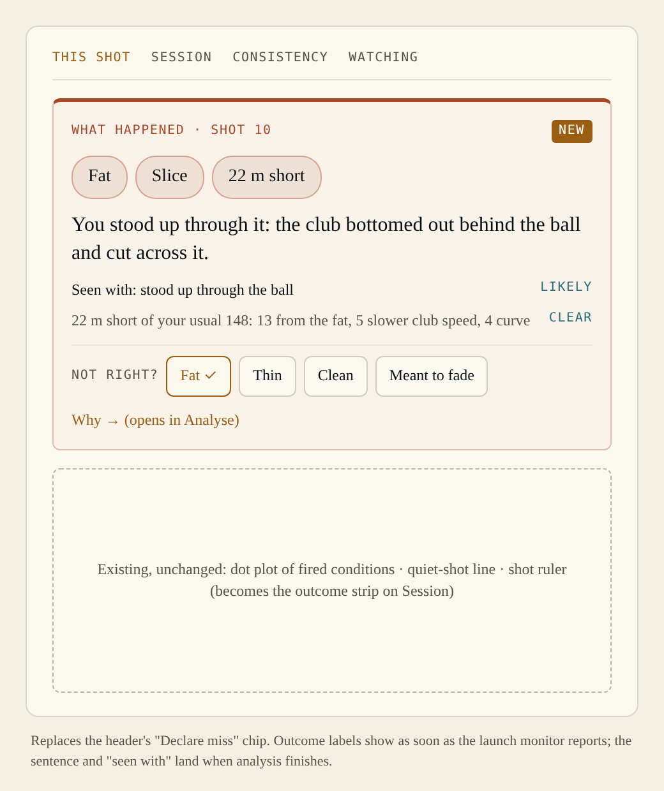
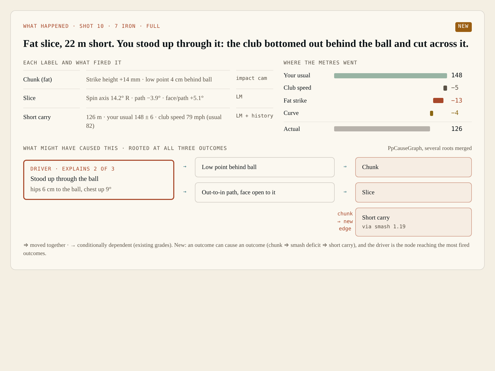
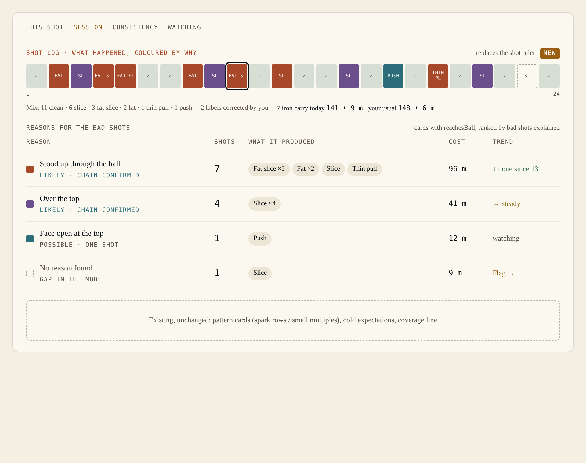
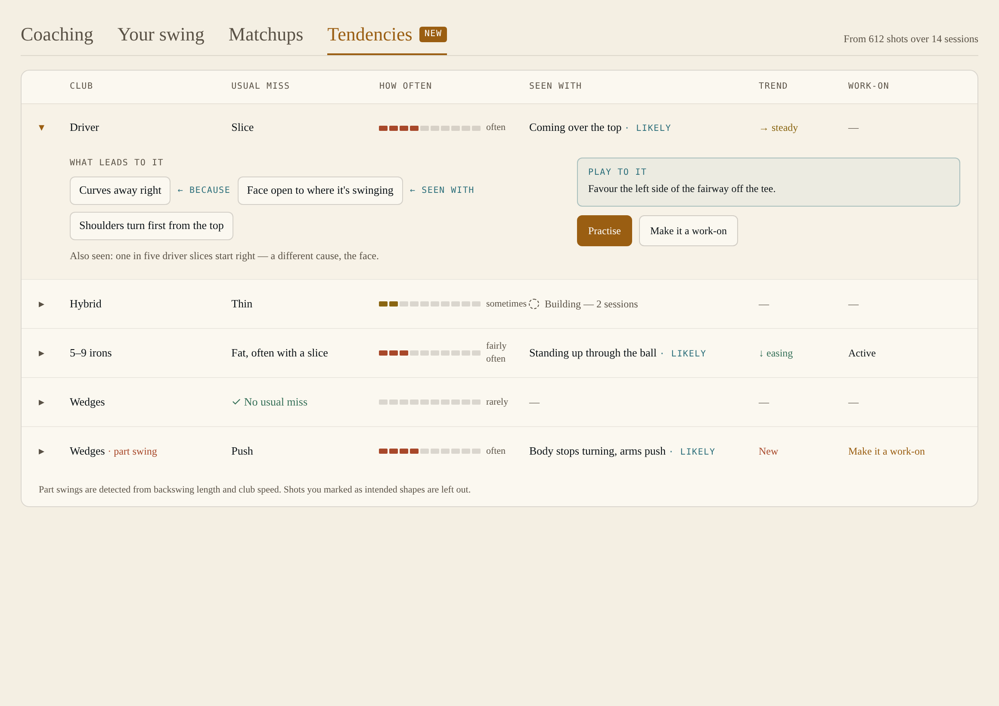
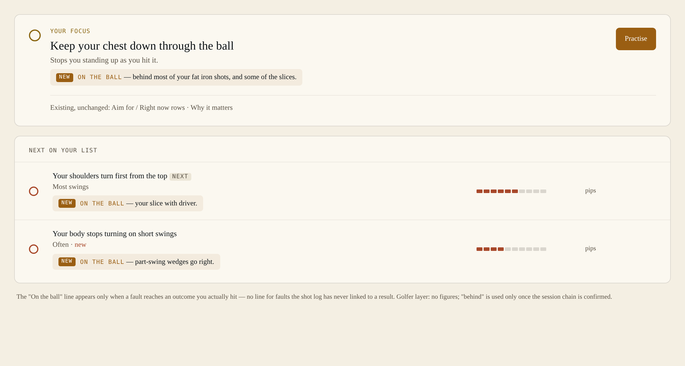
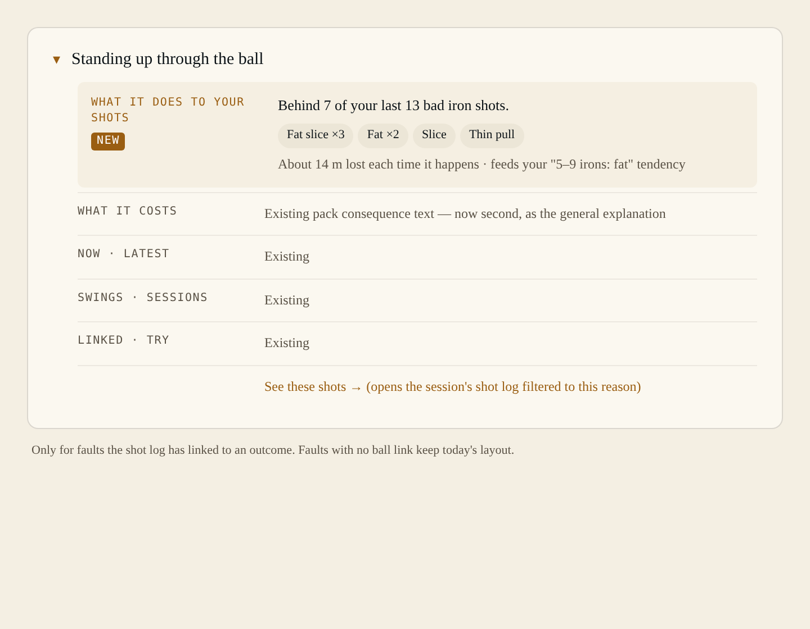
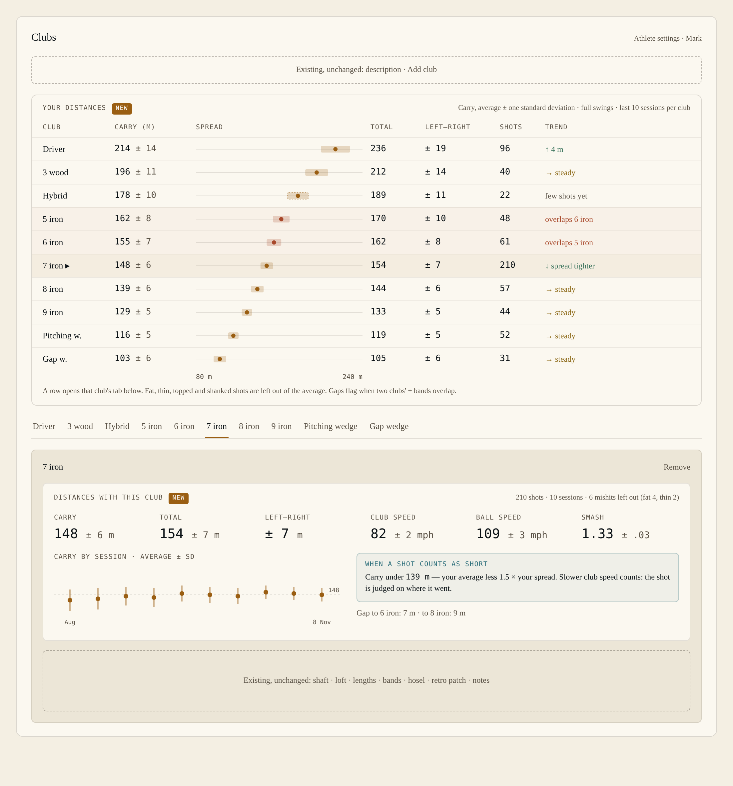

# Shot outcomes — "what happened there?" — Design

*8 November 2026, brought up to as-built 9 November 2026. Status: **built, under review**. Mocks:
`docs/design/shot_outcomes/mocks/` (PNG to look at, HTML for exact copy and spacing). The mocks show
metres, pills and reason colours; the build has yards, typeset words and no reason colours (§12).*

## 0. Summary

The golfer hits a shot and says *"what the hell happened there?"*. This feature answers in two
moves, every shot, with no tagging by the golfer:

1. **Name it.** One label per outcome family, in the golfer's words, possibly a combination:
   *"Fat slice, 24 yd short."*
2. **Untangle it.** One story, not parallel lists: *"You stood up through it: the club bottomed
   out behind the ball and cut across it."* The headline cause is the upstream condition that
   explains the most labels; outcome-to-outcome links (fat → short) are physics, not swing faults.

Every shot keeps its labels and headline reason, so the session builds its own **shot log** and
**reasons table**, and across sessions Home learns **tendencies**: *"with driver your miss is the
slice"*, *"you push wedges when it's not a full swing"*. A tendency is used two ways: **fix it**
(its row shows the work-on and offers Practice) or **play to it** (course management).

Most of the engine existed already. The pack authored 20 `ConditionKind::Outcome` conditions (22 with
fade and draw, §3.4) that fire per shot from launch-monitor and impact-camera measures, the ball ← club
layer (`slice ← out_to_in_path, open_face_to_path`), and the explanation graph with its five link
grades. What was missing: what the panel **leads with**, outcome → outcome links, a "short" baseline
(the golfer's own usual carry with that club), the per-shot story, the session reasons view, and the
cross-session tendency reduction.

What we add, and where:

| Surface | Addition | Mock |
|---|---|---|
| Session diagnostics panel · This shot (Replay glance) | **What happened** head; the "Declare miss" chip is gone | E1 |
| Session diagnostics panel · This shot (Analyse) | Labels with their evidence, carry waterfall, cause graph rooted at the fired outcomes | E2 |
| Session diagnostics panel · Session | **Shot log** (`PpShotRuler` with a line of outcome words, new to this view) and **reasons** table | E3 |
| Home · new 4th tab **Tendencies** | Per club / swing length: usual miss, how often, seen with, trend, fix or play to it | F1 |
| Home · Coaching | One "On the ball" line on the focus and on each *Next on your list* item | F2 |
| Home · fault detail (`HmFaultDetail`) | New first section "What it does to your shots" | F3 |
| Athlete settings · Clubs (`AthleteClubsSection`) | **Your distances** overview (carry per club, average ± SD, total, left–right spread, gapping) and a per-club distances block in each club's tab | G1 |
| Session diagnostics panel · Session | Today's carry vs your usual for the session club | E3 (mix line) |

Concept mocks D1–D3 (full-screen) show the same ideas without the existing chrome; they are
reference for intent, not layout.

---

## 1. Governing rules

Inherited (session_diagnostics_design.md §0, home_themes_design.md), restated because this feature
pushes on each of them:

1. **A shot fires findings; only a session diagnoses.** The per-shot story names a *candidate*
   driver. Its strength word comes from the session's evidence for that link (A3/A4 tiers and link
   grades), never from the single shot. Cold session ⇒ "possible" at most.
2. **Facts, not judgements; never proof of causation.** Wording ladder (§5.1):
   - ball ← club links measured on this shot: say **"because"**;
   - club ← swing and swing ← root links: **"seen with"** plus the strength word;
   - co-movement (Matchups) stays co-movement.
   This **amends** the golfer-layer rule ("no claims about cause") for the physics link only.
   **Decided (Mark, 8 Nov): "because" is fine.** The rule's comment in `HmSwingSummary.qml`,
   home_themes_design.md and the design system's Content section all say so.
3. **Intent shapes attention, never evidence** (A6). An outcome condition still fires on an
   intended fade; intent only removes the shot from *miss* tallies and tendencies.
4. **Distances are shown, everywhere.** **Decided (Mark, 8 Nov).** Measured distances (carry,
   total, offline) and their SDs show in every register and on Home, in **yards**. Modelled distances
   (yards lost per cause) show too, but always carry their provenance ("against your usual 162 ± 7 yd")
   so a modelled number is never mistaken for a measured one. This is an explicit exception to
   session_diagnostics_design.md principle 5 for distances only; tiers, coefficients and composite
   scores stay out of the UI as before.
5. **"Short" is judged against the golfer's own usual carry with that club, and we never second-
   guess intent.** **Decided (Mark, 8 Nov).** A shot that went short because club speed was down is
   short; slower speed becomes one of the reasons, never an excuse. This is a deliberate, **isolated
   exception** to two standing rules — "per-athlete norms out of scope" and A7's "the fault profile
   never reaches firing" — for `carry_deficit` and `ball_speed_deficit` only, whose phrases already say
   "usual for you". It is contained by construction: one baseline provider, two measures
   (`m_carryShortfall`, `m_ballSpeedShortfall`), the baseline frozen per session (§3.3). Every other
   corridor stays population-based.
6. **The pack is a specification.** New outcome edges and phrases are authored even where a
   producer is missing; absent measures degrade honestly (the label is simply not shown).
7. **QML positions and paints; C++ decides numbers and words.** Every reading and sentence below is
   produced by `SessionDiagnosticsModel`, `WorkOnsController` or `AthleteController`. QML adds only
   fixed headings and row titles ("Your usual", "Where the yards went").

---

## 2. What existed before this build (verified in code)

| Piece | Where | Use in this feature |
|---|---|---|
| 20 outcome conditions (`kind: outcome`): pull, push, launch_low, launch_high, ball_speed_deficit, slice, hook, pull_hook, push_slice, chunk, thin, top, sky, shank, strike_toe, strike_heel, smash_deficit, spin_excess, spin_deficit, carry_deficit | `src/Resources/diagnostics/core.json` | The labels. Already fire per shot. |
| Outcome signals read LM / impact measures: `m_spinAxis`, `m_lmLaunchDirection`, `m_lmStrikeHeight`, `m_strikeLocation`, `m_carryDistance`, `m_smashFactor`, `m_lowPointAhead` (prefers `lm.lowPointAhead`, falls back to our own) | core.json measures; `src/Diagnostics/measures/live_measure_source.cpp` (key ladder) | Evidence line per label (E2). |
| Ball ← club edges, e.g. `slice ← out_to_in_path, open_face_to_path`; `chunk ← low_point_behind_ball, attack_too_steep, ball_back, diving, posture_sinks_impact, deceleration`; `shank ← early_extension, ball_too_close, …` | core.json edges | The trace below each label. |
| Outcome ↔ outcome edges: only `excludes` (chunk ⊥ thin/top, sky ⊥ chunk, pull_hook ⊥ push_slice), `strike_heel ⇢ shank` (corroborates), `strike_toe/heel → smash_deficit` (causes) | core.json | Extend (§3.2). |
| Per-shot ledger row: `ShotRecord { shotId, club, contextId, timestampMs, dataWarning, rows, signalRows, clubheadSpeed, peakTimes }` | `src/Coaching/diagnostic_ledger.h` | Already carries every fired outcome row per shot. |
| `diagnostics.json` persists **rows and intent, never verdicts** | `SessionDiagnosticsModel` class comment §2 | Add corrections + shot intent to the envelope (§4.4). |
| Declared miss: `declareMiss()`, `declaredMiss`, `declaredMissName`, `missChain`, `missCandidates()` (every outcome-kind condition) | `src/Gui/diagnostics/session_diagnostics_model.{h,cpp}`; chip text in `PpDiagReplayState.qml` (`missText`, `missInvited`); picker `sdMissPicker` in `PpDiagAnalyse.qml` | Retire as an input; reuse `missCandidates()` for the correction picker (§4.5). |
| Explanation: `chains`, `driver`, `cards` with `reachesBall` / `rootHere`, `conditionDetail()` with `causes` / `effects` paths | session_diagnostics_model | Reasons table filter; cause graph. |
| `PpCauseGraph` (takes a `detail`, merges its paths into one layered diagram, five link grades), `PpPathChains`, `PpLedgerTable` (custom `spec` + `getter`) | `src/Gui/diagnostics/` | Reused, not rewritten. |
| `lmSessionStats()` — per-field session mean and SD over a club's shots, n−1, `kMinShotsForSpread` = 3, absent ≠ zero; `lmMeanText` / `lmSdText` formatting | `src/LaunchMonitor/lm_session_reductions.h` (façade `LmSessionModel`) | Reused for per-club distances (§7.5): same maths, pooled across sessions. |
| LM keys incl. `lm.carryDistance`, `lm.totalDistance`, `lm.offline`, `lm.ballSpeed`, `lm.clubheadSpeed` | `src/LaunchMonitor`, metric catalogue | Distance stats. |
| `PpShotRuler` — the session's one shot axis (counts of conditions outside corridor per shot) | `src/Gui/diagnostics/PpShotRuler.qml` | Lives on This shot. The Session view had no ruler, so the shot log adds one there: this component with one new optional property (§6.3). |
| Panel registers: `PpDiagReplay` (glance; also the cast), `PpDiagAnalyse` (read); tabs This shot · Session · Consistency · Watching | `src/Gui/diagnostics/` | Additions slot into This shot and Session. |
| Contexts tree incl. `full_swing`, `partial` → `pitch`, `chip` | `src/Resources/diagnostics/contexts.json` | Context is **club only** (`contextIdForClub`, `context_tree.h`) and stays that way. Swing length is a separate field on the shot (§3.6). |
| `WorkOnsController` (`workOns`): cross-session catch-up over every session's `diagnostics.json`, writes `<session>/work_ons.json` and `<athlete>/swing_themes.json` (fingerprinted, off GUI thread) | `src/Gui/diagnostics/work_ons_controller.{h,cpp}` | Home's tendency reduction lives here (§7.1). |
| Home tabs `["coaching","swing","matchups"]`, remembered per athlete via `hm_view_store.js` | `src/Gui/home/HmHomeTabs.qml` | Add `"tendencies"`. |
| `HmFaultRow` / `HmFaultDetail` — a fault opens in place, one at a time | `src/Gui/home/` | Pattern for tendency rows; F3 addition. |

Gaps found while reading:

- `carry_deficit`'s only norm is a **40 yd duff guard** (`norms.json`, its own citation says the
  per-club rows are deferred), yet its golfer phrase says *"shorter than usual for you"*.
  `ball_speed_deficit` has the same phrase. §3.3 makes both phrases true.
- `AthleteClubsSection.qml` (athlete settings, edit mode) already lists the bag as tabs with one
  detail card per club — the natural home for per-club distances (§7.5).
- `sig_slice` reads spin axis alone, so slice vs fade is a matter of corridor width, and there is
  no **fade** / **draw** outcome. Needed for intent ("meant to fade") and for the playable-shape
  distinction the `slice` consequence text itself draws.

---

## 3. Pack changes

### 3.1 Outcome families (new condition field)

Add `family` to every outcome-kind condition. Three families, matching Mark's browse axes
(*where it goes · how you strike it · how it flies*):

| Family | Key | Conditions |
|---|---|---|
| Where it goes | `direction` | pull, push, slice, hook, pull_hook, push_slice, (new) fade, draw |
| How you strike it | `strike` | chunk, thin, top, sky, shank, strike_toe, strike_heel, smash_deficit |
| How it flies / how far | `flight` | launch_low, launch_high, spin_excess, spin_deficit, ball_speed_deficit, carry_deficit |

`core_pack_test` asserts: every outcome has exactly one family; no non-outcome has one.

### 3.2 Outcome → outcome `leadsTo` edges

A new edge type, `EdgeType::LeadsTo` (JSON `"leadsTo"`), not `causes`: one outcome producing another in
the shot's physics. Every existing `causes` walk, the ranking and `explain()` stop at an outcome, and
these edges must not reach them. Authored at `provenance.tier: practice`:

| From | To | Note |
|---|---|---|
| chunk | smash_deficit | turf before ball robs energy |
| chunk | carry_deficit | via speed and launch loss |
| thin | launch_low | low on the face, low launch |
| top | carry_deficit | |
| sky | launch_high | |
| sky | carry_deficit | |
| smash_deficit | ball_speed_deficit | |
| ball_speed_deficit | carry_deficit | |
| spin_excess | carry_deficit | (iron/driver context; materiality by context) |
| slice / hook / push_slice / pull_hook | carry_deficit | curvature loss |
| shank | carry_deficit | |

These let one shot's labels form a **single** story and let the carry waterfall (§5.3) attribute
loss to sibling outcomes. The existing `strike_toe/heel → smash_deficit` `causes` edges stay as they
are; the physics graph is `leadsTo` plus those two. A separate check keeps the `leadsTo` edges acyclic
(`core_pack_test`). `conditionDetail()` never shows a physics link; `shotOutcomeDetail()` does ("from
the fat").

### 3.3 Short carry: against the golfer's usual with that club

New measure `m_carryShortfall` (a z-score, the golfer's own SDs, **not** yards; `kind: provided`,
`metricKey: history.carryShortfallZ`), from a new producer in `LiveMeasureSource`:

```
z = (usual.carryMean(club) − lm.carryDistance) / usual.carrySd(club)    // + is short, in the golfer's own SDs
```

- **Baseline** = the club's distance statistics (§7.5): mean and SD of carry over full swings, mishits
  excluded, sessions on **earlier folder days** only (the `yyyy-MM-dd` in the folder name; a same-day
  session is not a predecessor), last 10 sessions or 60 shots.
- **Frozen per session**, in a sidecar: `<session>/club_baseline.json`, written once and never changed.
  `{ schema, frozenAt, clubs: { "<club>": { club, carryMean, carrySd, ballSpeedMean, ballSpeedSd,
  speedMean, smashMean, shaftAngleP4Mean, n } } }`. Frozen means the file exists; "pending" is never
  stored. Review reads the snapshot, never today's baseline. A correction affects only baselines frozen
  later.
- **Who may write it**: `SessionDiagnosticsModel.baselineAuthority`, set before `activateSession`.
  `"always"` is `WorkOnsController`'s private model; an unreadable predecessor just adds no shots.
  `"live"` is a live panel: only when every predecessor's ledger is schema 11, and never while reviewing.
  `"never"` is review panels and `SessionReportModel`. A folder with no date has no predecessors: Live
  never writes for it (the session stays unfrozen), the catch-up still does so that it can finish.
- **While unfrozen**, rows are stamped `<content>|provisional`, so they regrade once when the sidecar
  appears.
- **Catch-up order**: oldest first by folder day while any session lacks a sidecar, so each session's
  predecessors are current; newest first otherwise.
- **Fires** when `z` is over 1.5 (decision D8): `sig_carryShortfall`, `carry_deficit` `detection: first`.
  Club speed is **not** adjusted for: slower speed is reported as a reason (§5.3). Full swings only:
  a part swing (§3.6) never sees the history measures, so only the duff guard can call it short.
- **Not earned yet** (club has < 10 qualifying shots, or no SD): `m_carryShortfall` is NotAssessable
  (gate rule `rule.diag.clubBaselineMinShots`, words "not enough shots with this club yet"), and
  `detection: first` falls through to the existing 40 yd duff guard on `m_carryDistance`.
- `ball_speed_deficit` moves from the held `m_ballSpeed` to its own shortfall, `m_ballSpeedShortfall`,
  off `m_lmBallSpeed` (`usual.ballSpeedMean/Sd`, same threshold), so its phrase is true. It has no duff
  guard, so a club with no history leaves it NotAssessable.
- The provider (`IClubBaselineProvider`, factory `makeClubBaselineProvider`,
  `src/Diagnostics/measures/club_baseline_provider.h`) reads the sidecar's numbers and is the **only**
  path from athlete history to firing. A test asserts no other measure reads it.

### 3.4 Fade and draw

`fade` and `draw` outcomes (family `direction`, no `axis`): spin axis magnitude above 4° and up to
10.000000000000002°, each `detection: all` over two threshold signals. The upper edge is where
`slice`/`hook` begin on the Standard preset (the pass edge of the spin-axis corridor), so those two are
unchanged. Golfer
phrase: *"the ball fades gently right"*.

No `excludes` and no `causes` edges. The composer drops fade and draw when `slice`, `hook`, `push_slice`
or `pull_hook` is active, so a shot is never read as both. The edge is fixed and the corridor moves with
the grading preset, so there are two gaps: on Lenient, 10–12.5° is neither; on Strict, 7.5–10° fires
both rows and the composer shows the slice.

They are **outcomes, not faults**: never a miss (`miss: false`), don't count against the Ball flight
area rating, and are the shape a golfer can declare as intent.

### 3.5 Per-outcome golfer copy (new optional fields)

| Field | Example (slice) | Used by |
|---|---|---|
| `golferShort` | `Slice` | labels, phrase |
| `golferAbbr` | `SL` | shot-log cell |
| `golferStory` | `cut across it` | the story (§5.2) |
| `playTo` | `Favour the left side off the tee.` (direction outcomes only; mirrored for left-handers) | Tendencies "Play to it" |

Combination phrases are **not** authored per pair; the composer builds them (§5.2).

### 3.6 Swing length context (producer, not pack)

`contextId` stays `contextIdForClub(club)` and corridors don't change. The shot gains a separate
`swingLength` field, "full" or "partial":

- inputs: backswing length (shaft angle at P4 from the shaft track) and launch-monitor club speed,
  each against the club's usual in the **frozen baseline** (§3.3);
- partial when the P4 shaft angle is under 80 % of the usual or the speed is under 85 % (D6); a missing
  number leaves that half out, and no history is "full". With neither number (a ball-only monitor and no
  club track), ball speed under 85 % of the usual decides. It's the last rung because a mishit loses ball
  speed too.
- Used only by the distance reduction (partial swings are left out), the "short" judgement (§3.3)
  and the tendency key (§7.1).

### 3.7 A strike read from the flight, and what each monitor can judge

Outcomes are decided shot by shot from what the monitor reported, so no setting says what kind of monitor
it is:

| Data on the shot | Judged | Words |
|---|---|---|
| None | No ball outcomes; swing findings carry on | One line for the session when no shot has a reading; otherwise "No ball reading" on that shot |
| Ball | Direction, curve, launch, spin, short carry, ball speed; bad strikes from the flight | "Good flight · strike not measured" |
| Ball + club | The above plus smash, attack angle, club speed | As above |
| Ball + club + impact | Everything, measured | "Good shot" |

Where the monitor gives no impact location, `strike_from_flight.h` reads a bad strike from the flight. Each
shot is compared with **that club's median in this session** (at least 4 full shots), because club labels
are often wrong and the book's window for the club would misjudge a mislabelled session.

| Label | Rule |
|---|---|
| Shank | Launch under half of usual and starting at least 8° to the hosel side (right for a right-hander, left for a left-hander) |
| Thin | Launch under half of usual, without the sharp start |
| Top | The thin rule, plus smash at least 15 % below usual |
| Fat | Smash at least 9 % below usual, launch normal, attack angle at least 1.5° steeper than usual |
| Sky | Not a strike: the flight rule decides it (§3.8, `flightSaysSky`). A launch at least 1.5 × usual is read as no strike |

- Measured always wins: a label is inferred only where the row that would have measured it is not assessable.
- The label reads "(from the flight)" and carries the readings it came from. "Not right?" removes it like any
  other. An inferred shank or top folds its signature (low launch; for a shank, the direction labels) into one
  line, "From the shank: low launch, push-slice".
- Inferred strikes count in the labels, story, shot log, reasons and tendencies, and leave the usual carry.
  The ledger rows stay "not measured", so detection, corridors, tiers and pattern cards don't change.
- With no strike height, a carry under 70 % of the club's session median also leaves the usual carry, as
  "far short": a fat shot a ball-only monitor can't name would otherwise drag the usual down.
- Only bad strikes show this way: a contact 10 mm low on the face usually flies normally. Toe and heel are
  never inferred. Top and sky had no example in the library when these were set, so they're untested on
  real shots.

#### A measured strike must agree with the flight

A measured strike height becomes a Thin, Top or Fat only when the flight bears it out (Mark, 10 Nov 2026).
The height comes from the club's marker stickers (Foresight's `vertimpact`), and a sticker placed a few
millimetres off shifts every reading of the session. On 4 Aug 2026 every 7-iron strike read low (−2.6 to
−24 mm, median about −12) on a normal flight (launch 17–22°, smash 1.31–1.39, carry 148–167 yd), so 10 of 18
shots read Thin. A real thin looks different: 2 Nov, shot 5 launched at 1.7° against a usual of about 11°.
The usual is the same one as above: the club's median in this session over at least 4 full shots.

| Measured label | Stands only when |
|---|---|
| Thin | Launch at most 0.80 × usual (`kFlightThinLaunchShare`) |
| Top | The same launch rule, on top of its own detection |
| Fat | Smash at most 0.91 × usual (`kFlightFatSmashShare`) **or** carry at most 0.85 × usual (`kFlightFatCarryShare`) |

- No usual to compare with (fewer than 4 full shots of the club this session, a part swing, or the reading
  missing): the measured label stands as before. No evidence against it.
- **Checked once, on the ledger rows** (Mark, 10 Nov 2026: keep every shot, but a bad reading is not a bad
  shot). `checkStrikesAgainstFlight` in `strike_from_flight.h` runs over the whole session each time its rows
  change: a shot arrives, is regraded or leaves, or diagnostics.json is read. A fired thin, top or chunk the
  flight contradicts becomes not assessable, "the strike height disagrees with the ball flight", with its
  value and evidence kept and the row flagged `overruled` (ledger schema 14). A fired sky row stands only
  where the flight rule calls the shot Sky (§3.8); otherwise it is overruled the same way, "Sky is judged
  from the ball flight". No row is ever made where none was detected. Each pass first puts back what the last
  one overruled and judges again against the usuals over all the session's shots as they are now, so a live
  session settles as shots arrive: the first three 7 irons' thins stand, the fourth gives the club a usual.
- **Every surface follows**, because each reads the rows: the composer's labels (so tendencies, the outcome
  filter, the session mix, the phrase and the story), the pattern cards and Watching, This shot's chips and
  its "X of Y fired", the OUT/IN grid and the print appendix, the cause graph, the fault profile, the report,
  Your swing's ball-flight area (work_ons.json), Charts and the tuning log. An overruled thin is not a mishit,
  so its carry counts in the usual carry, "carry today", club_baseline.json and Your distances.
- Nothing is deleted or hidden: the shot stays in every list and the row stays in diagnostics.json, value and
  all. The shot carries a plain note instead of the label, "Low on the face (−12 mm), flight normal" or "High
  on the face (+12 mm), flight normal", the overruled row's own reading to the whole millimetre, shown on the
  This shot head under the story. The OUT/IN grid shows the row as not judged, with that reason.
- An overruled row was read, so it never counts as "the monitor sent no strike height": no strike is then
  read from the flight in its place, and no "far short" is inferred for want of a height.
- A golfer's correction to Thin, Top or Fat is honoured whatever the flight says, and drops the note.
- Strike height and launch aren't mirrored, so a left-hander is judged the same way.
- `measuredStrikeFlightAgrees` and `checkStrikesAgainstFlight` in `strike_from_flight.h`; ledger schema 14,
  work-on rule 6, Tendencies rule 14, outcome scope rule 5, club baseline schema 4.

### 3.8 Three factors per shot: strike, direction and flight

*Decided with Mark, 10 November 2026.* "Tendencies have 3 factors: strike, direction and flight. It's not one
or the other, it is all 3." A shot is no longer summed up as one miss chosen across families; it has a value
for each factor, and none ranks above another (`shot_factors.h`).

| Factor | Values | Faults | Read when |
|---|---|---|---|
| Strike | Solid · Thin · Fat · Top · Shank · Toe · Heel · Weak strike | all but Solid | a strike row was assessable, a smash was read, or a strike label stood |
| Direction | Straight · Fade · Draw · Pull · Push · Slice · Hook · Push slice · Pull hook | Pull … Pull hook | there was a reading and direction was assessed |
| Flight | Low · Mid · High · Sky | Sky only | a method below could classify the shot |

- **Strike** reads the labels the composer kept, so the flight-agreement rule (§3.7) already applies: a
  sticker-offset "thin" on a normal flight is Solid. A shot can carry two strike faults (toe and weak strike).
- **Direction:** a compound miss brings its halves (a push slice is also a slice and a push). Fade and Draw are
  values, not faults, and count whether or not they were intended.
- **Flight** follows Mark's spec, `docs/design/ball-flight-classification.md`: height is relative to ball speed
  and club, never to handicap and never launch angle alone. By club category (driver, fairway/hybrid, long, mid
  and short irons, wedges), the first method the shot can use decides, and the shot keeps the method and the raw
  value:
  1. measured landing (descent) angle;
  2. measured apex / carry, full swings only (apex arrives in feet, carry in yards);
  3. landing angle modelled from the launch conditions with the launch monitor panel's flight model
     (`lmIntegrateFlight`, `lm_flight_path.h`), marked "modelled": a measured value always wins;
  4. absolute apex against the speed-matched driver reference, driver only, when there is no carry;
  5. otherwise not read.
  The bands are in `src/Resources/diagnostics/flight_norms.json` (provisional, to be tuned on PinPoint data).
- **Sky** is the flight fault, for driver, fairway woods and hybrids only: a High flight, the attack at least 2°
  steeper than the golfer's usual with that club in the session, and carry at or under 85 % of the usual
  (`flightSaysSky`, `strike_from_flight.h`). Sky left the strike family; the old measured route (high strike,
  low point, steep attack) no longer makes Sky. The ledger keeps a measured sky row fired only where this rule
  holds and overrules it otherwise (§3.7), so the cards, counts and work-ons agree with the factor. The usual
  carry leaves out a shot this rule calls Sky, with or without a sky row; the old flight-inferred sky (high
  launch, steeper, smash down, any club) is gone.
- Spin, ball speed and short carry are results, not factors: they stay on the shot (labels, the carry
  waterfall) and are not tendencies or filter choices.
- Descent angle, peak height, spin and spin axis join the ledger (schema 13). Re-grading a session reads only
  each swing's stored launch-monitor reading; it never re-runs pose, ball or shaft tracking.

---

## 4. Engine — `SessionDiagnosticsModel`

### 4.1 Per-shot outcome (new invokable)

```cpp
Q_INVOKABLE QVariantMap shotOutcome(int shotId) const;
```

```
{
  ready:      bool,                 // false until analysis has landed; labels, story and reasons land together
  noReading:  bool,                 // no launch monitor reading on this shot
  golferMirrored: bool,             // a left-hander's words
  labels: [ { id /* the golfer's */, rowId, family, short, abbr, golfer, intended: bool, corrected: bool, miss: bool,
              evidence: [ { measureId, label, value, unit, source: "lm"|"impact"|"model", sourceText, text } ] } ],
  phrase:     "Fat slice, 24 yd short",         // §5.2
  story:      "You stood up through it: the club bottomed out behind the ball and cut across it.",
  noReasonText: "No reason found" | "",
  driver:     { id, displayId, name, golfer, strength: "clear"|"likely"|"possible"|"", explains: 2, of: 3 } | {},
  links:      [ { fromId, toId, grade, words: "because"|"seen with"|"maybe"|"from the fat", physics: bool } ],
  carry:      { usual, usualSd, actual, unit, shortBy, provenance, line, scaled,
                parts: [ { id, name, loss, detail, lineWords } ], residual, residualShown } | {},
  clean:      bool                   // no miss label, and the ball's direction was judged; never true without a reading
}
```

Algorithm:

1. `O` = outcome rows **fired** on the shot, then `excludes` (one keep-rule shared with `explain()`, using
   `firedSignalCount`), then fade/draw dropped under a slice or hook (§3.4), then, with no launch-monitor
   reading, everything but strike labels dropped. Then corrections (§4.4): a corrected label replaces
   the detected one for display and tallies; the detected row stays in the ledger untouched. Then
   intent.
2. Drop from the headline any label implied by another through a physics edge (fat slice short:
   `carry_deficit` is explained by `chunk`); it stays a label. A compound miss also implies its halves.
3. Candidates `C` = non-outcome conditions **fired on this shot** that reach a headline miss. The walk
   goes down the swing causes, then the physics edges, only through outcomes that happened on this shot.
4. Driver = the candidate reaching the most headline misses; ties broken by (a) session tier of the
   condition, (b) best link grade on its path, (c) greater depth (more upstream), (d) pack order. Same-family
   alternatives are not merged: "same miss, two reasons" is a session finding, not a shot one.
5. `strength` = the weakest link the session graded on the driver's path, mapped
   moved-together/conditionally-dependent → `likely`, coherent/present-together → `possible`,
   unanchored → not shown. `clear` replaces `likely` only for a direct club → ball link on a label that
   wasn't corrected.
6. If `C` is empty: `driver = {}`, the story is the physics clauses alone ("The face was open to the
   path."), and a miss gets "No reason found".

Threading: computed from the in-memory row vector on demand (cheap: tens of rows); no worker.
`selectedShotId` drives the panel's call, as `shotReadout()` already does.

### 4.2 Session view (new properties)

```
Q_PROPERTY(QVariantList shotLog    READ shotLog    NOTIFY surfaceChanged)
Q_PROPERTY(QVariantMap  shotMix    READ shotMix    NOTIFY surfaceChanged)
Q_PROPERTY(QVariantList reasons    READ reasons    NOTIFY surfaceChanged)
Q_PROPERTY(QVariantList carryToday READ carryToday NOTIFY surfaceChanged)
```

- `shotLog`: `[ { shotId, cell: "FAT SL", lines: ["FAT","SL"], labels:[id], reasonId, reasonIndex, clean,
  intended, corrected, noReading, swingDir } ]` in strike order.
- `shotMix`: `{ line: "11 clean · 6 slice · 3 fat slice · 2 fat · 1 thin pull · 1 push",
  corrections: 2, correctionsLine }` — combinations counted as combinations.
- `reasons`: one row per condition that is the **headline driver of at least one bad shot**:
  `{ id, conditionId, name, golfer, shots, produced:[{ phrase, count }], cost, costText, tier, tierText,
  strength, chainConfirmed, trend: -1|0|1, trendWords, colourIndex, ticks:[{ state, shotId }], flaggable }`,
  plus a final unexplained row (`conditionId: ""`, `flaggable: true`) when any bad shot has no driver.
  - Ordered by `shots` (bad shots explained), then cost; unexplained last.
  - `chainConfirmed` = the session's statistics confirmed the driver's chain to the ball (Fisher / link
    grades as already computed); `tierText` says so, or gives the strength word only.
  - `trend`: share of the last third of shots vs the first two thirds, ±0.15; under two shots it says
    "watching".
  - `cost` is the sum of each bad shot's carry short of the usual, shown in yards (`costText`) in both
    registers (rule 4). No tooltips: they are barred in typeset registers.
  - `colourIndex` is published but not painted: there are no reason colours (§6.3).
- `carryToday`: per club used this session, `{ club, clubId, mean, sd, n, usualMean, usualSd, usualN, line }`
  where `line` = "7 iron carry today 151 ± 9 yd · your usual 162 ± 7 yd". Today's numbers are
  `lmSessionStats()` over this session's qualifying shots with that club (§7.5). "Usual" comes from the
  **frozen sidecar** and is omitted until earned (≥ 10 shots). This line stays in the panel; the full
  per-club table lives in athlete settings (§7.5).

### 4.3 Shot outcome detail for the cause graph

```cpp
Q_INVOKABLE QVariantMap shotOutcomeDetail(int shotId) const;
```

Returns a map shaped like `conditionDetail()` (`id, name, causes, effects, causesCapped, effectsCapped,
rivals, driverId, causeHeadline, outcomeHeadline, noCausesLine, noEffectsLine`) whose paths are the union
of each fired outcome's cause paths **on this shot**, de-duplicated, with the driver marked. A physics
link has grade "physics" and is keyed by its words. `PpCauseGraph` renders it with four new optional
properties (`title`, `rootNote`, `driverId`, `driverSub`); existing uses look the same.

### 4.4 Corrections and shot intent (persisted)

New optional fields in the `diagnostics.json` envelope (not in the ledger rows). The envelope version
stays 1; they are absent when unused.

```json
"shotIntent":  { "<shotId>": "fade" },            // "straight" appears only to override a run set by setIntentFrom
"intentFrom":  { "fromShot": 13, "shape": "fade" },
"corrections": { "<shotId>": [ { "family": "strike", "from": "chunk", "to": "thin" } ] }
```

```cpp
Q_INVOKABLE void correctOutcome(int shotId, const QString &family, const QString &toId); // "" = none in that family
Q_INVOKABLE void setShotIntent(int shotId, const QString &shape);                     // "" = straight
Q_INVOKABLE void setIntentFrom(int fromShot, const QString &shape);                    // "Hitting fades from here on"
Q_INVOKABLE void flagForReview(int shotId);                                            // the unexplained row
```

- Detection, corridors and tiers never read either (A6; assert by test, as the focus contract is).
- They are the golfer's only copy, so every writer that rebuilds the file carries them: the catch-up merges
  them from the file before it writes, `regrade_ledger` copies them across, and an unreadable file is never
  written over: one that does not parse is set aside, one that cannot be opened is left in place and
  blocks the session's writes (session_diagnostics_design.md §A2, audit H-04).
- Corrections feed: displayed labels, `shotLog`, `shotMix`, `reasons`, distances and tendencies. They
  and flags are appended to `<athlete>/outcome_corrections.jsonl` as the tuning log for outcome
  corridors: `kind: "correction"` (shot, family, detected, corrected, measure values) or `kind: "flag"`.
- Intent: a shot whose direction label matches its intent is `intended` (not a miss).

### 4.5 Retiring the declared miss

- The header chip (`missText` / `missInvited`) and both pickers (`sdMissPicker`) are gone from all three
  registers. `declaredMiss` stays readable so old `diagnostics.json` files re-reduce identically.
- Chain pre-arming that `declaredMiss` gave is replaced by **observed** pre-arming: outcomes fired on
  ≥ `kDiagObservedMissMin` (3) shots seed the graph as a declared miss did. They don't set `outcomeId`, so
  the links into them stay on their evidence. Observed outcomes are evidence, so this does not breach
  A6. The test is "ledger rows identical": observed seeds add graph nodes on old sessions by design.
- `missCandidates()` is kept and feeds the correction row, filtered by family.

---

## 5. Words

### 5.1 Strength and link words (both layers)

| Link | Golfer layer (Home) | Technical layer (panel) |
|---|---|---|
| ball ← club, both measured on the shot | "because" | "because" + grade glyph |
| club ← swing | "seen with" + likely/possible | grade glyph + word |
| swing ← root | "maybe" / "underneath · possible" | grade glyph + word |
| outcome ← outcome (fat → short) | "from the fat" | "from the fat" (a physics link has no grade) |

### 5.2 Phrase composer

`phrase` = labels joined in family order **strike, direction, flight**, golfer short forms,
lower-cased after the first, with flight as a quantity where it has one:

- {chunk, slice, carry_deficit} → "Fat slice, 24 yd short" (both registers)
- {thin, pull} → "Thin pull"
- {push_slice} → "Push-slice"
- an intended shape alone → "Fade, as planned"; no label, ball judged → "Good shot"; no label, no reading →
  "No ball reading"

`story` = `<driver golfer phrase as a clause>: <physics clause per family, joined by "and">.`
Physics clauses are authored per outcome (optional `golferStory` field, e.g. chunk: "the club
bottomed out behind the ball", slice: "cut across it"). With no driver, the physics clauses alone,
capitalised.

### 5.3 Carry waterfall

`carry` is present only on a shot labelled `carry_deficit` whose club has an earned usual. `carry.parts`
attributes `usual − actual` (all from the frozen baseline, §3.3). Speed, strike and curve come in causal
order; launch/spin is last. Each part takes at most what is left of the shortfall, so the waterfall
foots: `scaled` says a part was cut, and a part cut to nothing is dropped.

| Part | Loss | Shown as |
|---|---|---|
| Club speed | `usual × (1 − speed / usual.speedMean)` | "Club speed" (79 vs your 82 mph) — never hidden, never excused |
| Strike | `usual × speed/usual.speedMean × (1 − smash / usual.smashMean)` | named after the fired strike outcome ("Fat strike") |
| Curve | `carry × (1 − cos spin axis)` | "Curve" |
| Launch / spin | 0.8 % of the usual per degree outside the launch window, 3 % per 1000 rpm outside the spin window, when those outcomes fired | "Launch / spin (estimate)"; **modelled**, capped at the remainder |
| Residual | what is left | printed when ≥ 1 yd |

The two launch/spin constants have no source. They are provisional and flagged for Mark to confirm or
replace from the corpus.

Shown in Analyse as the waterfall and in the glance and on paper as one line ("24 yd short of your
usual 162: 16 from the fat, 6 slower club speed, 2 curve"). A part whose measure is missing is omitted
and the residual grows.

---

## 6. Panel UI

Typeset register rules apply (stage_typeset_playbook.md, design system §15): roles from
`PpDiagRoles`, size classes from width, no type scaling, the cast zooms the whole surface.

### 6.1 E1 — This shot, Replay glance



New component `PpShotOutcomeHead.qml` (`objectName: sdOutcomeHead`) at the top of This shot in
`PpDiagReplay`, above the existing dot plot (unchanged).

- Kicker: "What happened · shot N".
- Labels: typeset words through `PpStandfirst`, joined with " · ". No pills, no tinted card.
- Story in body text (one sentence, wraps).
- Quiet lines: "Seen with: …" + strength, `carry.line` ("24 yd short of your usual 162: …"), and "No
  reason found" when there is a miss with no driver.
- Correction row (interactive surfaces only; hidden on the auto-closing cast): quiet links, per family:
  the detected label, the alternatives `missCandidates()` gives for that family, and a "none" word
  ("Clean", "Straight"), plus "Meant to fade/draw" when a direction label fired. Pressing one calls
  `correctOutcome` / `setShotIntent`; once a shape is meant, "From here on" calls `setIntentFrom`.
- "Why →" opens This shot in Analyse with the stage still in Replay (body `_openShotWhy`); off on every
  cast.
- **Timing**: nothing is drawn until the shot is analysed; labels, story and "seen with" land together.
- Quiet / clean shot: one calm line, "Good shot" (or "Fade, as planned"), with a "Not right?" link to
  open the correction row.

### 6.2 E2 — This shot, Analyse



- Headline: `phrase` + `story` as one lead sentence (`sdOutcomeLead`).
- "Each label and what fired it": `PpLedgerTable` with a custom `spec`: label · evidence (measure
  readings, units) · source (`impact cam` / `LM` / `LM + history`).
- "Where the yards went": new `PpCarryWaterfall.qml` (bars in the register's inks; provenance line and
  residual). Hidden when `carry` is empty.
- "What might have caused this", rooted at the fired outcomes: `PpCauseGraph` with
  `detail: source.shotOutcomeDetail(shotId)`; the driver node is emphasised and captioned "Driver ·
  explains N of M".
- `PpPathChains` follows, for the per-label numbered chains.
- Print (`PpDiagPrint`) sets the phrase, story, "No reason found", `carry.line`, "Seen with", the evidence
  table and the waterfall open, with no links. The cause graph is screen only.

### 6.3 E3 — Session



All three registers share one fragment, `PpDiagSessionOutcomes.qml` (`sdSessionOutcomes`), built from
existing components and shown once the shot log has shots.

- **Shot log**: `PpShotRuler` (`sdShotLog`) with one new optional property, `outcomeWords`: a line of
  words in place of the counts. An addition to the Session view, which had no ruler. Same contract as
  the ruler: any length, wraps, a click moves the carousel, the picked shot is the pick column. Cell =
  `lines` (`golferAbbr`, up to two lines). ✓ means clean; an intended or playable shape shows its name
  and ✓ ("FD ✓"); a corrected cell ends in `*`. No fills and no reason colours: the words carry it. Below:
  `shotMix.line`, the corrections count, and `carryToday[].line` for each club used.
- **Reasons** table (`sdReasonsTable`): `PpLedgerTable` with a custom `spec` over `reasons`: name with
  `tierText` beneath · `PpShotStrip` of that reason's shots · shots · produced · cost in yards (both
  registers) · trend. A row opens the condition's detail. The unexplained row offers "Flag for review"
  instead (writes to the tuning log). A reason set from Home (`sessionReviewController.reasonFilter`) shows
  by the brush highlight: the other shots recede, with a "Show all shots" link.
- Existing pattern cards, cold expectations and the coverage line follow, unchanged.

### 6.4 Session close

Not built. The frozen panel already is the summary (B7). The two follow-ons in the first design fall
away: `reasons[0]` had no work-on button to offer it from (dropped, §12), and there is no exemplar
retention mechanism to wire "keep the clearest shot" into.

---

## 7. Home

### 7.0 Three factors on Home (supersedes the single usual miss below)

*10 November 2026.* §7.1, §7.2 and §7.6 were written for one usual miss per club. With three factors per shot
(§3.8), where they disagree this section wins:

- **Tendencies** (rule 13): one row per club and swing length, with a Strike, a Direction and a Flight column
  in place of Usual miss and Your shots. Each factor's usual is its most common fault when that fault earns
  (the §7.1 rules, per factor); otherwise its most common value (Solid, Straight, Fade, Mid…), said plainly and
  never in a fault tone. Building is per factor. *Decided with Mark, 10 November 2026:*
  - **Faults weighted, values counted.** Which fault is usual, and whether it earns, is still its
    recency-weighted share: a fault is a habit forming or fading. A value is only what the shots were, so the
    usual value is the one on the most shots by plain count, ties in the value table's order; its share and
    frequency words are that count over the shots read. It always agrees with the factor's bar, which counts
    plainly (a 7 iron whose bar is Mid 58 % · Low 42 % reads Mid, not a recency-weighted Low).
  - **The building floor.** A building factor names its most common fault ("Seen so far", with its chain and
    early note) only when that fault is on at least 25 % of the factor's read shots (`minShare`,
    recency-weighted, as the earn rule measures share). Under it the factor shows its most common value,
    counted as above, still building and not a fault: one fat shot in 29 with a gap wedge is a stray, so that
    wedge reads Solid and Straight (building), not Fat and Pull.

  Seen with, Also seen, the chain, Play to it, trend and work-on
  belong to a factor's fault and show in the open row, one block per factor, each with its own shot bar. The
  row's Work-on column says the status of its factors' work-ons. The report's Your tendencies page has the same
  three columns.
  - **Together (rule 15; Mark, 10 Nov 2026).** Each factor's usual is chosen on its own, so two usual faults
    side by side can read as one shot shape when they were different shots (Mark's 4 hybrid read Toe · Slice;
    its toe strikes went left and its slices came off the middle). The open row ends with a Together block,
    never on the row itself (`TendencyTogether`): for each pair of factors whose usuals are both faults, how
    many of the shots read on both had both, and where each fault's shots went in the other factor, said both
    ways ("Toe and slice came together on 1 of 7 shots. Your toe shots went Pull 2 · Slice 1. Your slice shots
    were struck Solid 2 · Toe 1."); then the three commonest combinations over the shots read on every factor
    the row reads (two at least), each shot under the value its bars count it under, and the rest counted.
    Counts, not percentages: the numbers are small and the golfer checks them against shots they remember.
- **Fault and watch colours on the row** (Mark, 10 Nov 2026). A factor whose usual is a fault is drawn in the
  fault tone (red, `colorWarn`), building or earned. Low flight is a value to watch: "not great but not a
  fault, if we were using RAG ratings it would be Amber", so its usual is drawn in the watch tone (amber,
  `toneColor("watch")`); Mid and High are acceptable and plain. The value table says which value is watched
  (`ShotFactorValueInfo::watch`); a watched value is still a value, never earned, counted or filtered as a fault.
- **Shot bars** draw a non-fault value (Fade, Draw, Low, Mid, High) in the cool "neither praise nor fault"
  tone (`Theme.bandTone("value")`, approved by Mark 10 Nov); Solid and Straight are good; the commonest fault
  is the habit tone, other faults the occasional tone. *Superseded 10 Nov 2026 (Mark: "match the row … we
  need to be consistent"):* on every bar (Tendencies' open row, the session panel, the report's Your
  tendencies page) every fault is the habit tone, red, the commonest or not, and Low is the watch tone, amber
  (its own part kind, `watch`, tendency rule 16); Fade, Draw, Mid and High keep the cool tone. The report's
  cells follow the row's: a fault red, building or earned, and Low amber.
- **One filter line** replaces the club chips and the outcome chips: Club · Strike · Direction · Flight, four
  quiet pickers (`HmShotFilter`), each list with Any first and the count each choice would leave with the other
  choices kept; a line under it says what is shown and on how many of those shots the swing was measured. A shot
  matches when it matches every choice. On Tendencies only the Club picker shows. The contrast line (§7.6) names
  the choice ("On your pulled, thin shots …").
- **Session panel:** each club's mix is three bars, strike, direction and flight, each counting every value a
  shot shows.

### 7.1 Tendencies — data (`WorkOnsController`)

New reduction in the catch-up, after the work-ons are current (same rule as `swing_themes.json`):
`<athlete>/tendencies.json`, stamped with a fingerprint over the rule, schema, content stamp and every
session's (name, work-ons fingerprint, ledger size and mtime), so a correction, which touches only the
ledger, counts. Computed on the themes pool with its own generation, cancelled by the same events. Every
shot is re-composed from its row (`composeShotOutcome`, the panel's composer).

- **Key**: (club, swing length): one row per club, so the rule below is earned club by club. Each row belongs to a club group, which is Tendencies' filter. Club groups: driver · woods and hybrids · long irons (1–4) · mid irons (5–7) · short irons (8 to the pitching wedge) · wedges (gap, sand, lob). Swing
  length: full / partial (§3.6).
- **Shots counted**: a launch-monitor reading, the ball's shape judged,
  straight intent (intended shapes excluded), corrections applied. A shot with a data warning still
  counts unless its rows are NotAssessable.
- **Usual miss**: the miss on the biggest recency-weighted share of the key's shots, whatever its family;
  every miss a shot shows counts, the halves of a combined one among them (a push slice is a slice and a push
  too, so a thin pull counts as a pull as much as a thin). Ties: the most shots, then the id; on an exact tie a
  combined miss stands over its own halves. No miss family ranks above another in anything that counts or
  chooses (Mark, 10 Nov 2026): the strike-first order of a shot's labels is only the order its words are said
  in. An "often with …" suffix names the commonest other miss, any family, on ≥ 50 % of the shots showing the
  usual miss ("Fat, often with a slice"); the usual miss seen another way (its halves, or the combined miss it
  is half of) is not another miss.
- **Earned** when: ≥ 2 sessions with ≥ 8 shots each in the key, ≥ 15 shots total, recency-weighted share
  (0.75 per older session, as home_themes) ≥ 25 %. Below that: **Building — N sessions** (dashed ring),
  never a verdict. Enough shots but no miss at that share: "No usual miss".
- **Seen with**: the reason most often the headline driver for that miss in the key; confirmed in ≥ 2
  sessions ⇒ likely, else possible. A second reason on ≥ 20 % of driven shots (and ≥ 2) is "Also seen".
- **Trend**: last two judged sessions vs earlier, 15-point rule (home_themes). Under three judged
  sessions: "→ steady" if present throughout, "new" if it showed up in the latest, else "↓ easing".
- **How often** words: the one frequency rule for a share (`src/Coaching/frequency_words.h`, Stage 0.13,
  14 Nov 2026), shared with Your swing: "every swing" … "more than half your swings", then "fairly often"
  (≥ 40 %), "sometimes" (≥ 25 %), "rarely". Tendencies stores these words in `tendencies.json`, so a change to
  a band needs `kTendencyRuleVersion` bumped.
- **Work-on**: the work-ons list's status for the seen-with condition.

```
Q_PROPERTY(QVariantList tendencyItems READ tendencyItems NOTIFY tendenciesChanged)
Q_PROPERTY(QString      tendencyNote  READ tendencyNote  NOTIFY tendenciesChanged)  // evidence line or why nothing yet
Q_INVOKABLE QVariantMap tendencyDetail(const QString &key) const;
```

`tendencyItems`: `[ { key, club, clubLine, length, miss, missFamily, share, frequency, building, noUsualMiss,
sessions, shots, seenWith, seenWithId, strength, trend, trendWords, workOn, workOnText } ]`.
`tendencyDetail`: `{ chain: [ { text, words } ], alsoSeen, playTo, practiseConditionId }`.

### 7.2 F1 — Tendencies tab



- `HmHomeTabs.tabKeys` gains `"tendencies"`, label **"Tendencies"**, before Matchups; remembered per
  athlete through `hm_view_store.js` as the others.
- `HmTendencies.qml` (table card, `homeTabTendencies`) + `HmTendencyRow.qml` (a `PpExpandRow` on
  the table's column template, like `HmAreaRow`): chevron · club (with "· part swing") · usual distance · usual miss ·
  your shots (below) · seen with + strength · trend · work-on.
- One row open at a time, held by `HmTendencies` (rows rebuild on publish).
- Open row: "What leads to it" chain in golfer words with the §5.1 link words; "Also seen" line
  (a minority second reason); **Play to it** box (`playTo`, handedness-mirrored); Practice
  (`practiseRequested(conditionId, label)` → wizard, existing path). The row shows work-on status.
- The **Your shots** column replaces the F1 mock's How often meter: a `PpBandBar` over its words ("Good 50% ·
  Thin 25% · Slice 25%"). Every counted shot once, as good or under its most common miss for that club (of the
  misses it shows, the one on the biggest share of the club's shots), by plain count; up to three misses are named and the rest are "Other". Good is the clean tone, the commonest miss the habit tone, the others
  the occasional tone. The Session view has the same bar per club (`clubMix`, `sdClubMix`) in all three registers.
- A **building** row opens too, headed "Seen so far": the reason that has most often come with the miss, every
  link "seen with", and a note that it's early and what would earn it. The Seen with column still says
  Building, and there's no Practice until it's earned: what has shown up so far is shown, never as a verdict.
- The **golfer report** has a Your tendencies page after the order of work (`PpTendenciesPage`, `report_tendencies.h`): the same rows on paper, as of that session. It reads the report's own session and those before it in the athlete's folder (same-day sessions by folder order) and writes nothing, so remaking a report keeps its numbers. A correction made later to one of those sessions does count.
- States: reading / nothing yet (`tendencyNote`) / building rows.
- Evidence line on the tab bar: "From N shots over M sessions" (`tendencyNote`), when there is a table.
- **Usual distance** is the club's full swing carry as average ± spread, from the same figures as Your distances; a part swing row shows a dash.
- Home's **shared club filter** sits above the table (`HmClubScopeFilter`): on this tab its top row only, All and each group, remembered per athlete. A club chosen on another tab shows its group here.
- Golfer layer: the only figures in a row are the usual distances and the shot mix's percentages; counts only in the evidence line.

### 7.3 F2 — Coaching "On the ball"



- `focusItem` and each `nextItems[]` entry gain `onTheBall: string` (empty = no line).
- Shown only when the fault is the confirmed seen-with of at least one earned tendency, or the
  confirmed headline reason for ≥ 25 % of that condition's firings in recent sessions.
- Text from the tendency: "On the ball — your slice with driver." / "behind most of your fat iron
  shots, and some of the slices." "behind" only when confirmed; otherwise no line (golfer layer
  stays clean; the panel carries the detail).
- Painted by `HmFocus` / `HmSwingSummary` as a `PpCaption` line (`homeOnTheBall`), a new row under the headline.

### 7.4 F3 — Fault detail



- `faultDetail(conditionId)` gains `onBall: { conditionId, text, produced:[{ phrase, count }], costWords,
  tendencyKey, tendencyText, onTheBall }` or `{}`.
- `HmFaultDetail` draws it first, titled "What it does to your shots", above the existing "What it
  costs" (the pack consequence, now second as the general explanation).
- "See these shots →" sets `sessionReviewController.reasonFilter` to the condition just before the
  existing `reviewSessionRequested(dir)`, and the Session view applies it (§6.3).

### 7.5 Your distances — carry per club with SD (athlete settings)



**Where:** athlete settings, the Clubs group (`AthleteClubsSection.qml`, shown in edit mode in
`ScreenAthleteForm`). **Not** on Home. Two additions:

1. **Your distances** card above the club tabs: one row per configured club in bag order (columns
   below). A row selects that club's tab (`root.selectedClubId`).
2. **Distances with this club** block at the top of the selected club's detail card: carry, total,
   left–right, club speed, ball speed, smash (each mean ± SD); a carry-by-session chart
   (`PpBoxPlot` with its five numbers collapsed to mean ± SD, last 10 sessions); mishits left out with
   kinds; gaps to the neighbouring clubs; and **"When a shot counts as short"** — the live threshold in the
   golfer's numbers ("Carry under 152 yd — your average less 1.5 × your spread. Slower club speed counts:
   the shot is judged on where it went.").
   The existing spec fields follow unchanged.

**Which athlete.** The form can edit a golfer who is not the current one, so the section does not
read `workOns`. It reads the stored reduction through `athleteController`:

```cpp
Q_INVOKABLE QVariantMap clubDistances(const QString &uuid) const;   // { items: [...], stale: bool, note }
```

reading `<athlete>/tendencies.json` (`clubDistances` block, written by the catch-up). Missing, or older
than the newest ledger ⇒ the card says "Distances are worked out when this golfer's sessions are read"
and shows the last stored numbers if any. The section re-reads on `clubDistancesChanged`.

**Per-shot data.** `WorkOnsController` reduces from each session's `diagnostics.json`, never from
swing documents. So `ShotRecord` gains the readings (ledger schema 11, the `clubheadSpeed` precedent of
schema 5):

```cpp
// Schema 11: the launch monitor's readings the distances are reduced from (NaN = not reported; absent ≠ zero).
double carry        = NaN;   // lm.carryDistance, yd as stored
double total        = NaN;   // lm.totalDistance
double offline      = NaN;   // lm.offline, signed, + right for both hands and never flipped
double ballSpeed    = NaN;   // lm.ballSpeed
double lmClubSpeed  = NaN;   // lm.clubheadSpeed
double smash        = NaN;   // lm.smashFactor
double shaftAngleP4 = NaN;
QString swingLength;         // "", "full", "partial"
QString handedness;          // "", "Left", "Right"
```

Older sessions without them are back-filled by the existing reconcile path (`activateSession()`
regrades stale rows), so schema 11 regrades every session once and the table fills in as the catch-up
runs.

**Reduction** (in `WorkOnsController`'s catch-up, written to `<athlete>/tendencies.json` with the
tendencies, same fingerprint):

- **Key**: the actual club (canonical bag id: `ClubFormat`), not the club group.
- **Shots**: full swing (§3.6), carry reported. `dataWarning` is **not** a
  filter: it also marks a refused club track, and the monitor's reading on those shots stands. Intended
  shapes **included** (a planned fade is a real distance). Strike misses (outcomes `chunk`, `thin`, `top`,
  `sky`, `shank`, corrections applied) **excluded** from mean and SD and counted separately ("6 mishits
  left out").
- **Window**: the club's last 10 sessions or last 60 qualifying shots, whichever is fewer.
- **Statistics**: `lmSessionStats()` over the pooled window: mean, SD (n−1). Floor: below
  `kMinShotsForSpread` the mean shows and the SD is an em dash; below 10 shots the row says "few
  shots yet" and the band is dashed.
- **Columns**: carry mean ± SD · spread band (mean ± SD on a shared yards axis) · total mean ·
  left–right SD of `offline` · shots · trend.
- **Trend**: last 3 sessions vs the rest of the window: "↑ / ↓ N yd" when the mean moves by more than
  one standard error of the difference and at least 3 yd; "spread tighter / wider" when the SD moves
  by 20 % or more; else "steady".
- **Gapping**: flag adjacent clubs (bag order) whose mean ± SD bands overlap ("overlaps 6 iron");
  both rows wear the words, never colour alone.
- **Units**: yards only. There is no setting; the pack stores yd.

```
Q_INVOKABLE QVariantMap clubDistance(const QString &club) const;   // current athlete: { mean, sd, n, total, offlineSd, earned, line }
```

Each item (in `clubDistances(uuid).items` and the file): `{ club, label, carryMean, carrySd,
carryText, band:{lo,hi,mean}, totalMean, totalSd, offlineSd, speedMean, speedSd, ballSpeedMean,
ballSpeedSd, smashMean, smashSd, shots, sessions, mishits:{chunk,thin,top,sky,shank}, fewShots,
trend, trendWords, gapWith, gapPrev, gapNext, shortBelow, perSession:[{date, mean, sd, n}], mishitsText,
fewShotsText, gapsText, shortBelowText }` in bag order, strings final.

**Where else it shows**

- Session panel, Session view: the `carryToday` line (§4.2).
- This shot: the "24 yd short" label's evidence reads "138 yd · your usual 162 ± 7 yd · club speed 79
  mph (usual 84)".

### 7.6 Outcome filter — the swing faults behind a miss

*Decided with Mark, 10 November 2026.* A second filter sits under Home's club filter: **All shots · Good
shots · each miss the golfer has had** within the club choice, most common first (`HmOutcomeScopeFilter`,
`workOns.outcomeScope`, `src/Coaching/outcome_scope.h`). It answers "what am I doing on the shots that
slice?". Coaching, Your swing and Matchups use it. Tendencies does not show it and ignores it, because
Tendencies is already the table of outcomes and stays as it is.

**Which shots.**
- A shot is in a choice when it is *judged* by the Tendencies rule (§7.1), unchanged and shared in code
  (one judging helper in `tendencies.h`): straight intent, a launch-monitor reading, the ball's shape judged,
  corrections applied.
- **Good** is a clean shot.
- A **miss** is any shot carrying that miss. A fat slice is under Fat and under Slice. A miss another label
  implies folds in as `tendencyMissLabels` folds it (a push slice is a slice).
- The key is the label as glossed for the golfer's hand (`displayId`), so a left-hander's "Slice" is the
  slice they see.
- A shot that isn't judged is in no choice but All.

**What the tabs show.**
- The tabs reduce from the chosen shots, as they do under a club choice. The club and outcome choices
  combine.
- A filter alone would make a fault that is on every shot look like a cause. So each fault on Coaching
  (focus and Next on your list) and in Your swing's opened fault detail carries one more line comparing the
  chosen shots with the golfer's other judged shots under the same club choice (it shows once: a fault
  opened from Coaching does not repeat the line its row already carries):
  - *"On your slice shots 34 of 38 · other shots 12 of 61"*: at least 15 points more often (Tendencies'
    15-point rule, `TendencyOptions::trendDelta`);
  - *"… — just as often on your other shots"*: within 15 points;
  - *"… — less often than on your other shots"*: 15 points or more less often;
  - *"… — too few other shots to compare"*: fewer than 8 other shots assessed it.
- The line adds words only. It never re-ranks or hides a fault (show with a warning, never hide). The
  counts are rows that fired of rows that assessed the condition.
- An evidence line under the filter says what the choice covers, and on how many of the chosen shots the
  swing was measured (at least one swing fault assessed): *"Your slice shots with mid irons: 38 shots over 6
  sessions, against 61 other shots. Your swing was measured on 31 of them."* ("… measured on all of them.",
  "… was not measured on any of them."). Many misses come from launch-monitor-only sessions, which judge the
  ball and assess no fault, so an empty page must not read as "no faults" when it means "not measured".
- When fewer than 8 of the chosen shots had the swing measured (`TendencyOptions::minSessionShots`, the
  contrast's own floor), Coaching says *"Too few of these shots had your swing measured to say what comes
  with them yet."* in place of the empty "What you do well" and "Next on your list" words. Only the empty
  words change; a listed item is never hidden. The measured count is stored in the choice's file
  (`kOutcomeScopeRuleVersion` 2).

**What does not follow the filter.** The work-on list, the last session, the report and every Tendencies
figure, including Coaching's "On the ball" line and the report's Your tendencies page, which keep
following the club choice only, as now.

**Storage.**
- Each club × outcome choice is stored as `swing_themes.<club>.<outcome>.json`, with its contrast counts,
  until something moves.
- Its fingerprint adds the outcome key, `kOutcomeScopeRuleVersion` and the tendency fingerprint, so a
  correction or an intent change counts.
- The choices come from the tendency reduction's per-club outcome counts (`TendencySet::clubOutcomes`,
  rule 9).
- All × All is today's `swing_themes.json`, untouched.

---

## 8. Wording checklist (for review of every string)

- Second person, plain words, sentence case; units never capitalised; no emoji.
- Golfer layer (Home): no figures in tendency rows except distances; distances always with units
  and ± SD; "because" only for ball ← club.
- Technical layer (panel): counts and distances allowed; every modelled distance carries its
  provenance ("against your usual 162 ± 7 yd").
- A label always has words; colour is never the only channel (cells carry text; there are no reason
  colours).
- "No reason found" is said plainly; never hidden.
- A distance is always "162 ± 7 yd": mean, ±, SD, unit. Never a bare SD.

---

## 9. Build phasing

Built in four parts (pack and composer; persistence and catch-up; QML; documents). The items below are
the content of those parts, kept for the dependencies between them.

| # | Item | Done when |
|---|---|---|
| 1 | Pack: `family`, fade/draw, outcome→outcome edges, `golferShort/Abbr/Story`, `playTo`; phrase fixes | `core_pack_test` green incl. acyclic + family asserts |
| 2 | Swing-length context inference (§3.6) | partial wedges land in `partial`; corridor resolution test |
| 3 | `ShotRecord` schema 11 distances; club distances reduction into `tendencies.json` (`clubDistances` block) | distance mean/SD matches `lmSessionStats`; mishits excluded; full swings only; gap flag; previous-days-only baseline |
| 4 | `ClubBaselineProvider` + `m_carryShortfall` producer + `sig_carryDeficit` / `sig_ballSpeedDeficit` rewire + per-session baseline snapshot | fires at z ≥ 1.5 incl. a low-speed shot; NotAssessable when unearned; review re-reduces from the snapshot; no other measure reads the provider |
| 5 | Engine: `shotOutcome()`, phrase/story composer, driver selection, carry waterfall | `session_diagnostics_model_test` fixtures: fat slice short (§11), push-slice, clean, intended fade, no driver |
| 6 | Corrections + shot intent: envelope schema bump, invokables, tuning log; A6 invariance test | re-reduction byte-identical rows with/without corrections |
| 7 | Retire declared miss; observed pre-arming | old `diagnostics.json` with a declared miss re-reduces unchanged |
| 8 | Session view data: `shotLog` / `shotMix` / `reasons` / `carryToday` | fixture §11 reproduces the E3 numbers |
| 9 | Panel E1 (`PpShotOutcomeHead`) in `PpDiagReplay` | offscreen fixture probes: analysed, quiet, cast (no correction row) |
| 10 | Panel E2: evidence table, `PpCarryWaterfall`, `shotOutcomeDetail()` into `PpCauseGraph` | probes; print path atoms |
| 11 | Panel E3: `PpShotRuler.outcomeWords`, reasons table, `carryToday` line | probes incl. wrap at narrow width |
| 12 | Tendencies reduction in `WorkOnsController` (needs 5's headline driver per shot) | fixtures over 3 sessions: earned, building, trend; intended shots excluded |
| 13 | Home F1 Tendencies tab | harness probes: `homeTabTendencies`, one-open rule, view store |
| 14 | Athlete settings G1: `athleteController.clubDistances(uuid)`, Your distances card, per-club block | probes: `athleteDistanceCard`, `athleteDistanceRow:<club>` selects the tab, stale note |
| 15 | Home F2/F3 (`onTheBall`, fault detail `onBall`) | probes: line present only when confirmed |

Dependencies: 1 → everything; 2 → 3, 12; 3 → 4, 14; 5 → 8, 12; 8 → 11.

---

## 10. Tests and probes (names to use)

- objectNames: `athleteDistanceCard`, `athleteDistanceRow:<club>`, `athleteClubDistances`, `sdCarryToday`, `sdOutcomeHead`, `sdOutcomeChip:<id>`, `sdOutcomeCorrect:<family>`, `sdCarryWaterfall`,
  `sdSessionOutcomes`, `sdShotLog`, `sdShotLogCell:<shotId>`, `sdShotMix`, `sdReasonsTable`, `homeTabTendencies`,
  `homeTendencyRow:<key>`, `homeOnTheBall`, `homeFaultOnBall`.
- Invariants to assert:
  - corrections and intent never change any row's firing, corridor or tier (A6);
  - `shotOutcome().driver.strength` never exceeds the session's link grade for that path;
  - a missing LM reading ⇒ no direction/flight labels, never "clean";
  - tendencies exclude intended shots; "building" until the earn rule passes;
  - club distances: SD is n−1 and blank below `kMinShotsForSpread`; a club with no carry reported
    has no row (absent ≠ zero); mishits never enter the mean.

---

## 11. Fixture — the session in the mocks

One 7-iron session, 24 full swings, straight intent. Shot → labels (headline reason):

| Shots | Labels | Reason |
|---|---|---|
| 1, 6, 7*, 11, 13, 14, 16, 18, 20, 22, 24 | clean | — |
| 2, 8 | chunk | stood up through the ball (`early_extension`) |
| 4, 5, 10 | chunk + slice (+ carry_deficit on 10) | stood up through the ball |
| 12 | slice | stood up through the ball |
| 19† | thin + pull | stood up through the ball |
| 3, 9, 15, 21 | slice | over the top |
| 17 | push | face open at the top |
| 23 | slice | no reason found |

\* shot 7 corrected: slice → intended fade. † shot 19 corrected: chunk → thin.
Shot 10 LM: carry 138 yd vs usual 162 ± 7 yd (7 iron); phrase "Fat slice, 24 yd short". The mock's sample
readings: club speed 79 mph (usual 84); smash 1.19 (usual 1.33); spin axis 14.2° R; path −3.9°; face to
path +5.1°; impact camera low point 4 cm behind. Golfer note at shot 13 ("pause at the top"); no
early-extension shot after 13 except 19. Stored in yards.

---

## 12. Decisions (defaults in bold)

| # | Decision | Default |
|---|---|---|
| D1 | Golfer layer may say "because" for ball ← club links | **Decided: yes** |
| D2 | Expected-carry table source | **Dropped: short is judged against the golfer's usual (D8)** |
| D3 | Distances in the glance, reasons table and Home | **Decided: shown everywhere, modelled ones with provenance** |
| D4 | Fade/draw playable band width | **Decided in planning: above 4°, up to where slice/hook begin (10° on Standard); one band, not per club group** |
| D5 | Tendency earn rule numbers | **Default built as written: 2 sessions × 8 shots, ≥ 15 shots, share ≥ 25 %** |
| D6 | Partial-swing classifier thresholds | **Decided in planning: P4 shaft angle < 80 % of the club's frozen usual, or speed < 85 %; full when there's no history** |
| D7 | Keep "Declare miss" for a coach as an expectation | **Decided in planning: no; corrections + observed pre-arming replace it** |
| D8 | "Short" baseline and threshold | **Decided: the golfer's usual carry with that club; speed not adjusted for. Default threshold z over 1.5 (1.5 SDs short), corpus-tunable** |
| D9 | Mishits in the distance average | **Decided in planning: excluded, counted separately** |
| D10 | E1 labels | **Decided in planning: typeset words via `PpStandfirst`; no pills, no tinted card; corrections are quiet links** |
| D11 | Shot log | **Decided in planning: `PpShotRuler` + one optional property; no `PpShotLog`, no reason colours, no new token. Reasons table gets a `PpShotStrip` column** |
| D12 | E2 components | **Decided in planning: new `PpCarryWaterfall`; `PpCauseGraph` gains optional title, root note, driver node and sub-line** |
| D13 | G1 band and session chart | **Decided in planning: `PpBoxPlot` collapsed to mean ± SD; no new component** |
| D14 | Units | **Decided in planning: yards only, no setting; the mocks' metres are sample data** |
| D15 | Part swings | **Decided in planning: a separate full/partial field per shot; `contextId` and corridors don't change** |
| D16 | Early labels | **Decided in planning: dropped; labels, story and reasons land together after analysis (no `analysed` field)** |
| D17 | Work-on button | **Decided in planning: dropped; the row shows work-on status and offers Practice. §6.4 not built** |
| D18 | Left-handers | **Decided in planning: labels mirrored so a left-hander's slice is a slice; rows and `offline` aren't mirrored** |
| D19 | E3's ✓ | **Decided in planning: ✓ means clean (mock wins over the first text); an intended shape shows its name and ✓** |
| D20 | Launch/spin loss constants (§5.3) | **Provisional, no source: 0.8 %/°, 3 %/1000 rpm; for Mark** |

---

## Appendix — mocks

| File | What |
|---|---|
| `E1_panel_this_shot_glance` | §6.1 |
| `E2_panel_this_shot_analyse` | §6.2 |
| `E3_panel_session_shot_log` | §6.3 |
| `F1_home_tendencies_tab` | §7.2 |
| `G1_athlete_clubs_distances` | §7.5 |
| `F2_home_coaching_on_the_ball` | §7.3 |
| `F3_home_fault_detail` | §7.4 |
| `D1_concept_what_happened_screen` | concept: full-screen shot answer (intent reference) |
| `D2_concept_session_shot_log` | concept: full-screen session log (intent reference) |
| `D3_concept_home_tendencies` | concept: earlier Home layout; superseded by F1 |

E, F and G mocks are authoritative for layout, except where §12 differs (yards, typeset labels, no reason
colours, no work-on button). D1–D3 predate the decisions in §12 (their numbers and some wording are out
of date) and show intent only.

Mocks are drawn in the Instrument Light theme with sample data; fonts fall back where Gelasio /
DM Mono are not installed. Dashed boxes mark existing, unchanged parts of a surface.

Hovering a box reads out its average ± spread ("188 ± 20 yd"), over the box in the table and beside it in the session chart. There is no median or quartile to show: the box is the average and one standard deviation either side.

