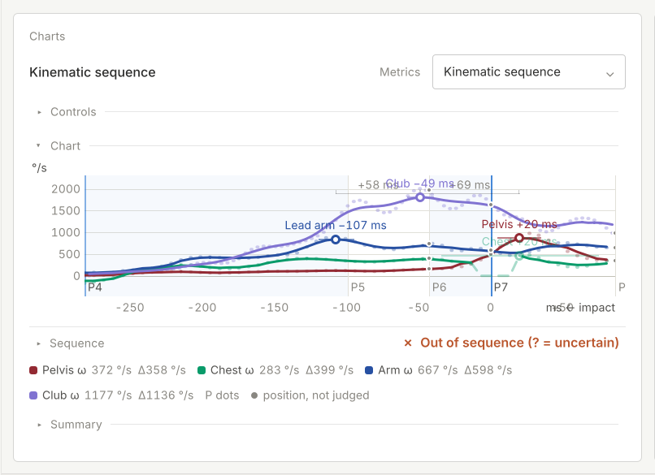
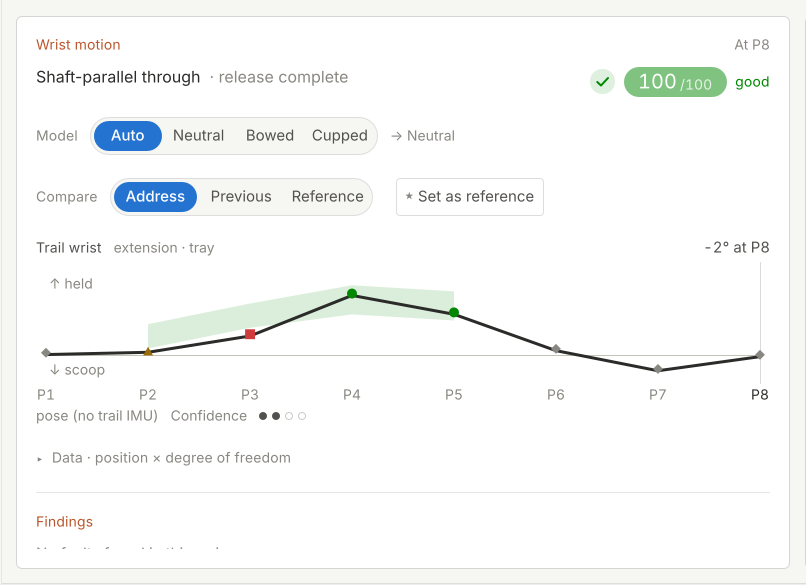
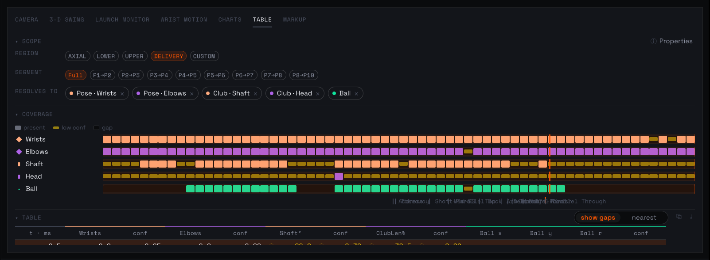
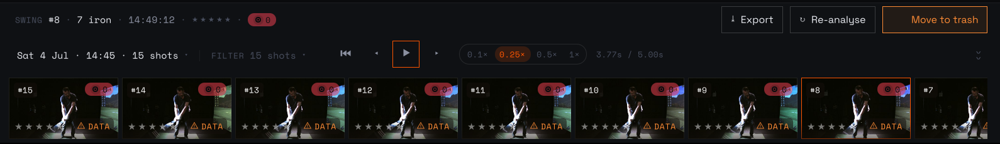
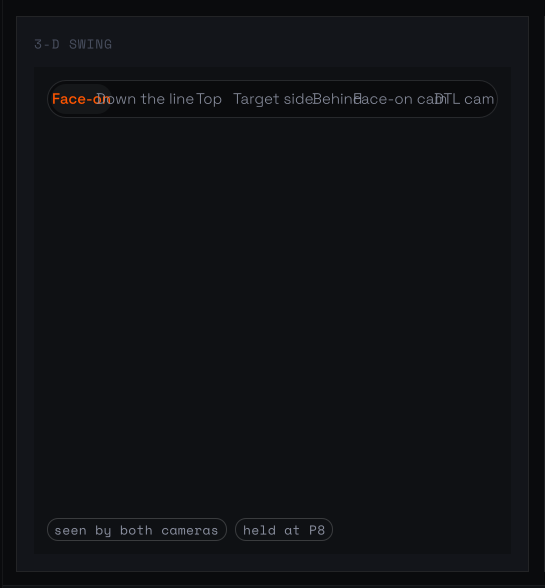
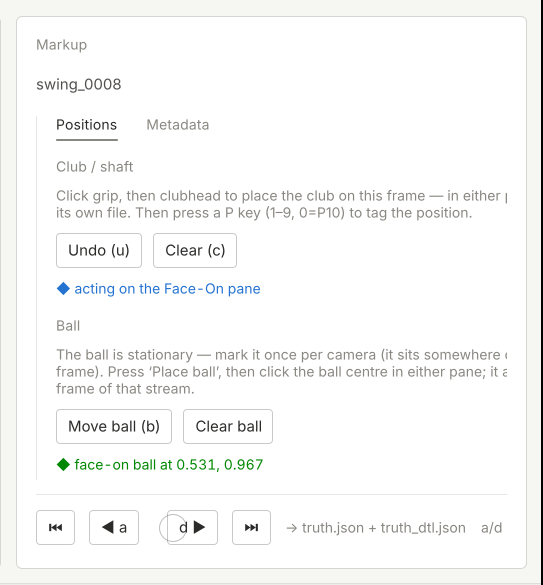

# Stage typeset playbook

How to carry the typeset system to any stage panel: Camera, 3-D swing, Launch monitor, Wrist
motion, Charts, Table and Markup, and later to whole screens.

The normative spec is section 15 of `docs/design/pinpoint_qml_design_system.md`: the house rules,
the roles, the registers, interaction, figures and print. This document is the method. Read section 15 first.

The method was worked out on Session diagnostics over three rounds on 11 October 2026. The panel
is the worked example throughout (section 4).

---

## 1. The method

Seven steps, in order. Don't skip to step 5: a mock made without steps 1–4 is a restyle, not a
redesign, and the old panel's faults come through it intact.

### Step 1. Inventory

Write down every fact the panel shows and every control it has. For each fact, record:

| Fact | Shown how today | How many times | Source (property or model call) | Needed in Replay / Analyse / Print? |
|---|---|---|---|---|

- **Count the encodings.** The old diagnostics panel said "fired here" five ways (pill, meter,
  numeral colour, value colour, tick). Each extra encoding is a candidate to delete.
- **Count the colours**, and what each one means. Anything coloured that is not "outside its
  corridor" or a live control is a candidate to become ink.
- **Mark every truncation** ("…") and every place type scales with the panel.
- **List every control and where it really goes** (rule: every click goes somewhere real). A
  control that goes nowhere is chrome.
- **Read the data the panel already has.** Dump it as JSON (the diagnostics harness dumped
  `readout`, `cards`, `source`, `header`, `detail`). Designs are made from the real shapes, not
  imagined ones.

Output: the inventory table, and a list of model defects you find. Keep those separate and fix
them at the end, not in the panel. For diagnostics the defects went to `MODEL_DEFECTS.md`.

### Step 2. One question per view

For each view, write the one question it answers, as a reader would ask it. Diagnostics:

| View | Question |
|---|---|
| This shot | What went wrong on this swing? |
| Session | What keeps happening? |
| Watching | What is emerging? |
| Detail | How far, how often, and why? |

That question is the above-the-fold test (rule 9). Whatever answers it must be in the first
screen at every width. Everything else is tier 2 or lower.

### Step 3. Choose the voice per register

There are three voices: a **table**, where you look things up (Ledger); **prose**, where you are
told something (Editorial); and a **figure**, where you compare (Figures). For each view and
register, pick the voice that answers the view's question best in that situation:

| | Replay · glance | Analyse · read | Print · report |
|---|---|---|---|
| Situation | on screen for the whole replay, beside video | the reader is studying | stands alone, nothing to click |
| Usual voice | figure, plus one quiet line | table first, sentences for "why", figure to place it | prose, with tables and figures as exhibits |
| Detail | not offered | yes | the feature, from a fresh page |

The encodings never change between registers (spec 15.4 and 15.6). Only the blocks chosen and how
much they say change.

Two decisions now settled in the build (spec 15.4 and 15.6) apply to every panel:
- **The cast is always the Replay register**, whatever the stage's mode, and it honours
  `interactive`. An auto-closing cast takes no clicks and never switches the stage's mode; a
  persistent (coach or kiosk) cast keeps its tabs. Design each panel's cast view as a glance.
- **A not-measured shot is a short stub on the baseline, never a gap.** That gives three marks in
  every strip, barcode, sparkline and run chart: a fired bar, a clean tick and a not-measured stub.
  A gap reads as "nothing there", and an absent measure is "unavailable", never a pass.

### Step 4. Tiers, flows and folds, as data

For each block:
- give every element a **tier** (1 always, 2 compact up, 3 medium up, 4 wide only) and an
  **else** (where it goes when it drops);
- give every multi-column thing a **minimum in em**, and let it count its own columns;
- state each chart's **minimum useful width**, and what it becomes below that;
- decide what **spare height** admits (rule 12).

Write these as tables at the top of the block's file, beside its roles. If you can't name the
"else" for an element, the design is dropping it.

### Step 5. Mock over the live panel, with the harness

Write the register files as QML and render them over the real panel, in the real app, fed the real
data (section 5). One mock file per register (`Replay.qml`, `Analyse.qml`, `Print.qml`), composed
from blocks.

Reuse blocks before you write one:
- **Today** they are the round-3 mock library (`build/run-me/diag-variants/live/lib/`).
- **Once the build lands**, they are the real typeset blocks in `src/Gui`.

A new block follows the library contract:
- it takes `roles`, `brush` and `medium`;
- it lays itself out by the `width` it is given;
- it exposes `atom` and `keyKinds` for the Pager;
- it writes hover to the Brush.

To try more than one direction, run them in parallel. Give each agent its own slot, a brief with
the real sizes, and this playbook. Round 2's agents, working separately, agreeing on the rules is
what made the rules trustworthy.

### Step 6. Judge

Render every combination before anyone looks at it:

- widths: full, stage, half and third, plus cast for Replay, plus print portrait and landscape;
- heights: with the Transit timeline and the carousel on, as Mark uses the stage. The card is then
  only 553 px (about 39 em) tall in both modes, so height decides more than width does;
- themes: at least Vector dark (7) and Folio light (12); and Vector light (6) and Folio dark (13)
  at half, once;
- modes: Replay and Analyse;
- states: each `demoState` (hover a shot, hover a condition, each question);
- data cases: a fault, a low-side fault, a two-sided measure, a clean condition, and an empty
  state;
- Mark's own window: the 2560 × 1560 "At your size" screen, where height is generous.

Look at every render. Use the checklist (section 3). Then assemble a review PDF and give Mark the
live try-out. Mark judges the result before anything is committed.

### Step 7. Build

1. Put any new roles into Theme's `typeset` block (spec 15.3). Never put them in the panel.
2. Move the blocks into `src/Gui`.
3. Replace the panel view by view.
4. After each view, render it with `--probe-qml`, driving every tab, mode and detail page.
   Compare it with the approved mock, and judge it in the app.
5. Commit only after Mark has seen the result.

Keep to the build economy: two or three builds per task.

---

## 2. How the system meets each kind of panel

The stage audit (section 7) confirmed most of the first reading and corrected three parts of it.
- **Corrected: height comes first.** With the timeline and carousel on, every card is 553 px
  tall. The fix for most panels is to move the answer above the controls, not to fit more across.
- **Corrected: the frame breaks the rules, not only the content.** The card tone, Vector's orange
  selection, and pills or capsules as the default control break rule 7 on every panel. Fix them
  once, as foundations, before any panel.
  - **The card tone is decided and done.** Mark (11 October): *"Quiet tone please. The previous
    design system was confused and noisy."* Every stage card takes the quiet tone, implemented in
    this build in `PpModeStage._defs`.
  - A panel's colour comes only from its content, and only for "out".
- **Corrected: type mostly fits already.** Only the launch monitor's tiles board (`k`, 1 to 4×)
  and the camera and Markup palettes (`scale: fit`) scale type. The common faults are colour,
  height, px thresholds and ellipsis.

The kinds of panel:
- **Canvas panels: Camera, 3-D swing, Markup.** Confirmed: the canvas is the voice, and typeset
  governs only what is around and on it.
  - The audit found bugs rather than a missing design:
    - Camera tiles clip at half and third;
    - the telestrator palette scales its type at narrow;
    - the 3-D preset bar overprints at third;
    - Markup's fixed 496-unit rail makes the frames vanish at third.
  - The fixes are folds:
    - tiles fit to width and height;
    - palettes and preset bars wrap to two lines and never scale;
    - Markup's rail goes under the frames below compact;
    - status is a Notes caption, not pills.
  - Marks drawn on footage keep their dark scrim (13.11). Tool inks in a telestrator are not
    verdicts, but keep them out of the row that holds Delete.
  - In print, a canvas becomes a captioned still.
- **Data panels: Wrist motion, Launch monitor.** Confirmed, with Wrist motion as the urgent case.
  It is the worst colour offender on the stage: an orange title, a red square and traffic-light
  marks on a 100/100 swing with "No faults found".
  - Ledger (Findings as fired rows), a standfirst, and one corridor figure per degree of freedom
    with the house wash. The controls fold to a one-line state.
  - The launch monitor drops `k`, keeps only one verdict colour (warn for "out"; there is no amber
    "watch"), and uses KeyFigures in Replay and a session ledger in Analyse.
  - Its bay-TV case is the cast's job: whole-surface zoom, never type growing inside the panel.
  - Glyph systems that already mean something, such as Wrist's ● ▲ ■ positions, must not encode a
    grade a second time beside a colour.
- **Charts.** Confirmed, and it comes first in the programme. It is on by default in both
  registers, and its grammar breaks at every width: peak labels collide, the axis unit overprints
  the last tick, identity hues read as warn, and the phase bands use an accent wash.
  - Analyse: shared-axis small multiples, one warn mark for the out-of-order peak, the sequence as
    a typeset chain, and the Summary as KeyFigures or a ledger.
  - Replay: KeyFigures over one trace.
  - Charts join the Brush.
- **Table.** Confirmed as a ledger, with a correction: today the data is never above the fold, so
  the table must lead, with the scope as one line and coverage as a Barcode with thinned phase
  ticks. It is an Analyse-only panel and is not offered in Replay.
- **The carousel and timeline** were not on the original list. They are on screen in every mode,
  and they are where the shared shot Brush has to live.
  - The carousel's 15 identical "⊙ 0" alarms and "⚠ Data" warnings become one mark per fired shot,
    and data health is said once.
  - The timeline gets a drawn break for the pre-roll, plain P figures on hairline ticks, and an ink
    track.
- **Whole screens, later.**
  - The same classes, measured at the width the screen gives its content column.
  - A masthead and standfirst built from data, sections as crossheads, and blocks that never split.
  - Section 13's cards remain the frame until a screen is redesigned.

---

## 3. The checklist

Ask each question of every render. A "no" is a defect.

**Type and space (rules 1, 2)**
- Is every size from a named role, with at most four sizes and two weights on the view?
- Is the body the same pixel size at full and at third?
- Is anything under 10 px rendered?
- Did spare width become margin or content, never bigger type?
- Is prose no wider than 44 em, and in the text face, never a letter-spaced mono?

**Nothing lost (rules 3, 11)**
- Is there an ellipsis anywhere? (There must be none.)
- For each element that is missing at this width, can you point to where it went?
- At narrow, are Back, the view toggles and the subject's name still there?

**Columns and rails (rules 4, 5)**
- Did each flow choose its own column count from its minimum?
- Does any column fall below its minimum, or any rail leave content with fewer than two columns?

**Blocks and print (rules 6, 10)**
- Is any row, entry, figure or path split, on screen or on paper?
- Does every heading travel with its first block? Do broken lists say "continued" and repeat their
  head?
- In print:
  - Is the palette light, with a running head, a folio and a footer on every page?
  - Are all affordances gone, with links turned into cross-references?
  - Does each page's key show only that page's marks?

**Encodings (rule 7, spec 15.4)**
- Is every fact shown once?
- Does colour appear anywhere it does not mean "outside its corridor" or a live control?
- In Vector, is any link in orange?
- Is the picked shot marked exactly once per block, as a ring for a point or a column for a cell?
- Are missing values "-" and never 0? Is a not-measured shot a stub on the baseline, never a gap?
- Is any selected control, tab or chip orange in Vector, or any card title in warn when nothing is
  out?
- Does each link grade keep its own stroke, with an arrowhead only where the evidence supports a
  direction?
- Does anything assume 15 shots? Try a 23-shot session.

**Charts (rule 8, spec 15.8)**
- Is it one style throughout: one wash on the corridor, a warn fault hairline, a dashed pass edge?
- Do label sizes match the other charts?
- For a fault, is the empty corridor collapsed behind a drawn, labelled break, and is the distance
  to travel shown?
- For a clean condition, is the figure the economical one?

**The question (rule 9)**
- Without scrolling, does each view answer its question at this width and height?

**Height (rule 12)**
- Did a list split into columns while there was room below it?
- Is there a large empty area that the next tier could have used?

**Interaction (spec 15.7)**
- Does anything move or appear without the reader moving?
- Is there a tooltip, pop-up, menu or native dialog? (There must be none.)
- Does hovering a shot light that shot in every block on the panel?
- Does every click reach the real body?
- Does an auto-closing cast refuse every click and leave the stage's mode alone?
- Does a persistent cast keep its tabs?
- Is the only unprompted motion the after-shot pulse, in ink, and absent under reduce-motion?
- Is each question shown only when it has an answer?
- Does every co-occurrence answer say it is not a cause?

---

## 4. Worked example: Session diagnostics

The panel is the Session diagnostics stage card on the Wrist screen. The data is the 4 July 2026
session (7 iron, 15 shots, shot 8 picked): 78 conditions, of which 10 fired, 66 were clean and 2
were not measurable; 8 session patterns; 15 watched conditions.

### Before and after, per view

| View | Before | After (Analyse, with Replay and Print where they differ) |
|---|---|---|
| This shot | 78 equal cells in a 5-column grid, each with an icon, 5-bar meter, IN/OUT, value, truncated corridor and tier tag | Analyse: a one-line standfirst ("Ten of 78 conditions went outside their corridor; five are session patterns."), then a ruled ledger of the 10 fired (value in warn, unit, corridor, out by, strip, fired), notes, up to three questions, then "Every condition on one scale": a dot plot of all 78. Replay: a dot plot of the 10 fired, "66 clean · 2 not measurable", a shot ruler, and then the clean ones in the spare height. Print: the table, with the 66 in an index at the back |
| Session | 8 cards of six lines each, mostly truncated; a link-blue "session bookends" strip; outlined filter chips | Analyse: one ledger (rank, pattern and phase, strip, fired, median, shot 8, unit, typical / worst / best), with the direction sentence as an italic line 2 and folded facts as line 3; the filters are quiet links in the table head; a row opens Detail; a strip cell or a bookend figure moves the carousel. Replay: one sparkline row per pattern, or small multiples once all eight fit. Print: numbered entries with marginal sparklines |
| Watching | a list, "tap one to trace it" | a barcode of conditions by shots, sorted by rate, with this shot's values (or an "On shot 8" ledger below medium) |
| Detail | saturated green, olive and brown zone fills; three charts in three styles; causes as boxed cards with dashed connectors; 7 more paths, each repeating "screened root · needs a physical screen · measured · clean on every measurable shot" | Back, crumb and Focus; a feature head (title, lead, pull figures, fact file); key figures, including the distance to travel ("Shot 8 past the fault line 9.1", "from the pass edge 13.5"); fault-forward figures (spread, run, history on one broken axis); questions; causes as one merged graph from medium up, typeset chains with footnote marks below that |

### What moved where (nothing was dropped)

| Was | Now |
|---|---|
| the 0–5 strength meter | "out by 5.1×" as a figure; the dot's distance in the dot plot |
| the FIRED HERE / CLEAN HERE pills | the value's colour |
| the 15-tick strip with a wide tick for this shot | the one strip (fired bar, clean tick, not-measured stub on the baseline, never a gap) with a pick column |
| the five bookend headings | typical / worst / best columns (folded to line 3 below wide) |
| the corridor text, truncated | in full in the ledger (line 2 below wide) and in Detail's fact file |
| the trend sentence | a word in the table; the full sentence under Detail's figures |
| the repeated path qualifiers | footnote marks and a key, defined once |
| the 66 clean cells | the dot plot (Analyse), a quiet count (Replay), the index (Print) |
| the coverage line and review note | notes at the foot of the view |

### The numbers

- **Type:**
  - Before, sizes were multiplied by a fit factor `k` of up to 2.4, on top of fontScale 1.25, and
    captions sat at 8–9 px.
  - After, the body is 14 px, small 12, label 11 (Vector 10), title 20 and feature 26 at every
    width, and 13 px for the body in print.
- **Colour:**
  - Before: orange, green, olive, brown and link blue.
  - After: warn on out-of-corridor values and marks only, plus quiet links.
- **Print:** 7 A4 portrait pages, or 9–10 landscape, with no split rows and no stranded heads.

### Renders

- **After:** the round-3 review, `build/run-me/diag-variants/session-diagnostics-round3.pdf`, with
  its pages in `pages-r3/` (index in spec 15.12). The print PDFs are in
  `build/run-me/diag-variants/print-r3/`. These are local, because `build/` is not in git.
- **Before:** `out/before_<aesthetic>_<mode>_<view>_{window,panel}.png` in the harness scratch
  directory. The scratchpad is temporary, so copy them to `docs/design/aesthetic/typeset_before_*.png`
  (spec 15.12, TODO).
- **Rounds 1 and 2:** `session-diagnostics-variants.pdf` and `session-diagnostics-round2.pdf`, with
  the variants' QML and notes in `build/run-me/diag-variants/qml/`.

---

## 5. The harness

### What it is

**The typeset harness** renders QML you write over a real panel in the real app, fed the real
data, in the real stage arrangement. Nothing is built: the app's `--probe-qml` loads the render
script, and the render script loads your file.

| File | Does |
|---|---|
| `variant3.sh` | the entry point for one render run (arguments below) |
| `render_variant3.qml` | the probe: switches mode and arrangement, finds the panel body (`objectName: "sdBody"`), makes it transparent, lays your file exactly over it, feeds it the body's data and the body itself, steps themes, views and demo states, grabs `_window.png` and `_panel.png`; in print, sizes your root to the A4 page and grabs each page at 2× |
| `guard.sh` | wraps every app run: at most two app instances across all agents (lock slots), and kills the app if its footprint passes 6 GB |
| `build/render_stage.sh` and `build/render_stage.qml` | the audit probe: no overlay; for each theme, layout (full, half, third) and panel, it sets the real arrangement with the timeline and carousel on, and grabs the window and the panel's stage card. Use it for the "before" renders of step 1. `render_stage.sh <tag> <analyse\|replay> <themes> <layouts> <panels>` |
| `assemble3.py` | builds the review PDF from the renders and the notes (Pillow, with the repo's Inter fonts) |
| `try_registers.qml` and `build/run-me/try-diag-registers.sh` | the live try-out: the real app, windowed, with the new panel laid over every Session diagnostics body; it re-attaches after any rebuild; a watchdog stops it above 8 GB |

**Where its inputs live:**
- **Slots** on the share, `/mnt/swingdata/scratch/diag-beautify/slot-<x>/`, one per agent. Each
  holds its own copy of the session and of the settings (`XDG_CONFIG_HOME`), so parallel runs
  never fight and Mark's settings are never touched.
- **Screen configurations**, `screen*.json`, for the offscreen platform:
  - `screen.json`: 1680 × 1050;
  - `screen_tall.json`: 1680 × 2600, for whole Detail pages;
  - `screen_print.json`: 1680 × 1200 at dpr 2;
  - `screen_mark.json`: 2560 × 1560, Mark's window.
- **The app:** the Debug build,
  `build/Qt_6_11_1_for_macOS_Debug/PinPointStudio.app`.

### Running it

`$D` is the harness directory: today the session scratchpad's `diag/` folder, and after the move
`tools/typeset-harness/`.

```
$D/variant3.sh <slot> <Register.qml> <tag> <layout> [themes=7,12] [views] [detailId=over_the_top] \
               [tall|normal] [mode=analyse|replay] [states=s1,s2]
```

- **slot:** your letter (`a`, `b`, `c` or `base`). Only use your own.
- **layout:** `full`, `stage`, `half`, `third`, `cast`, `print-portrait` or `print-landscape`. The
  probe switches the app's real arrangement first, so the window grab shows your panel with its
  real neighbours.
- **themes:** theme indices: 6 Vector light, 7 Vector dark, 12 Folio light, 13 Folio dark. Print
  takes 6 and 12.
- **states:** sets `demoState` before each grab, and the file name gains `_<state>`.
- **Output:**
  - screen: `<tag>_<layout>_<aesthetic>_<mode>_<view>[_<state>]_{window,panel}.png`;
  - print: `<tag>_print-<orient>_<aesthetic>_<mode>_p<N>.png`.
- **Time:** about 60–90 s per run. Two lanes can run at once, because the guard allows two apps.
  See `final3.sh` for a two-lane full pass.

Examples:

```
$D/variant3.sh a $D/reg/Analyse.qml f3_analyse half 7,12 shot,session,watching,detail over_the_top normal analyse
$D/variant3.sh a $D/reg/Analyse.qml f3_analyse half 12 shot,session over_the_top normal analyse hoverShot12,question-clean
$D/variant3.sh base $D/reg/Replay.qml f3_replay cast 7,12 shot,session,watching over_the_top normal replay
$D/variant3.sh b $D/reg/Print.qml f3_print print-portrait 6,12
SCREEN_JSON=/mnt/swingdata/scratch/diag-beautify/screen_mark.json $D/variant3.sh a $D/reg/Replay.qml big half 7,12 shot,session,watching over_the_top normal replay
```

The live try-out is one line, for Mark: `build/run-me/try-diag-registers.sh`.

**The register file's contract.** The root declares the properties below, and only reads them;
the probe sets them.

```qml
property string view            // "shot" | "session" | "watching" | "detail"
property var readout; property var cards; property var source; property var header; property var detail
property var body               // the live panel body: clicks go through it
property string medium: "screen"   // "screen" | "print"
property string printOrientation: ""
property int printPage: 0
readonly property int printPageCount: …
property string demoState: ""
property string surface: "panel"   // "panel" | "cast"
```

Another panel replaces the first line's data properties with its own, read from its own body.

### Where it should live: `tools/typeset-harness/`

Today the harness is in a session scratchpad
(`/private/tmp/claude-501/…/scratchpad/diag`), which disappears. Only the try-out, and copies of
the round-1/2 harness, are in `build/run-me/diag-variants/`, which is not in git. Move it to
`tools/typeset-harness/` and make it generic. The move needs:

1. **Generic names.**
   - `variant3.sh` becomes `render.sh`.
   - `render_variant3.qml` becomes `render_panel.qml`.
   - `render_stage.sh` and `render_stage.qml` become `audit.sh` and `audit_stage.qml`.
   - `try_registers.qml` becomes `try_panel.qml`, with a `try.sh` beside it.
   - Keep `guard.sh`.
   - `assemble3.py` becomes `assemble.py`, taking a page plan per panel.
2. **No hard-coded paths.**
   - The app path comes from `PPS_APP`, defaulting to the Debug build.
   - The scratch root comes from `TYPESET_SCRATCH`, defaulting to `/mnt/swingdata/scratch/typeset`.
   - The output tree is `$TYPESET_SCRATCH/<panel>/out`. Run trees belong on the share, not in the
     repo or in `/tmp`.
   - The guard's lock directory moves out of a user-specific temp path.
3. **A target argument.** `--probe-target <objectName>` replaces the hard-coded `sdBody`.
   - Each stage panel needs a stable `objectName` on its body, and a body that exposes its data,
     its current view (`_tab` or equivalent) and its actions.
   - Panels without one need a small code change, which costs a build. Batch those changes into
     one build.
4. **A per-panel contract file.** It lists the data properties, the views, the click targets and
   the demo states. The probe's `feed()` reads it, binding the view as well as the data (section 6).
5. **Screens in the repo.** The four `screen*.json` files are tiny: keep them in
   `tools/typeset-harness/screens/`.
6. **A pinned fixture session.** The 4 July session copy is a pinned input, so it belongs in the
   corpus on the share, not in `build/`. The slot directories are copied from it on first use, as
   `try-diag-registers.sh` does today.
7. **A data dumper.** A probe mode that writes the panel's live data as JSON, for agents to read
   before they design (step 1).
8. **Runner scripts for Mark** in `build/run-me/` (for example `try-<panel>-typeset.sh`), each one
   line that calls `tools/typeset-harness/try.sh <panel>`.
9. **Silence.** The app runs muted in every probe. Keep it that way, because no test or probe may
   play sound.
10. **Mocks import real blocks.** Once the typeset blocks are built into `src/Gui`, new mocks import
    them through `import PinPointStudio`. The round-3 mock library stays only as a reference in
    `build/run-me/diag-variants/live/`.

This playbook serves as the harness's documentation. Point to it from the scripts' header
comments; don't add a separate README.

---

## 6. Pitfalls learnt on 11 October

- **A runaway QML mock reached 97 GB and filled swap.** The cause was a binding or layout loop that
  creates objects, for example a Repeater whose model depends on its own laid-out height.
  - The guard now kills any app above 6 GB, and the try-out above 8 GB.
  - In the design, compute sizes from data, never from your own laid-out size. The cast's zoom is an
    em estimate from the row count for this reason.
  - Never run a render without the guard.
- **A theme switch rebuilds panels in split layouts, and a mode switch rebuilds the stage.** The
  body your overlay sat on is destroyed.
  - In round 2 this showed as `'detailOpen' of null`, followed by a 500 s wait for the timeout. The
    workaround was one theme per run.
  - The harness now re-finds the body after every switch and re-attaches.
  - In panel code, never hold a body across a switch. State that must survive the switch lives on
    the controller. That is why Replay's door into depth opens the detail before it switches mode.
- **A try-out wrapper must bind the view, not only the data.** Mark's first try-out showed little
  change, and the design was not the cause. The wrapper had three faults:
  - it fed `readout`, `cards` and the rest, but never told the new panel which tab was selected, so
    only This shot ever showed;
  - Analyse's tab row was not wired;
  - a mode switch rebuilt the panel, and the wrapper then failed every second.

  The fix binds `view` to `body.detailOpen ? "detail" : body._tab`, and makes the tabs write
  `body.tab`.
- **Verify by driving every tab and mode, not by attaching once.** One clean attach proves nothing
  about the second tab, the other mode, or opening and closing a detail.
  - The try-out now runs a self-test of every tab, both modes, and opening and closing a detail.
    It must pass before Mark is asked to look.
  - Reproduce with `--probe-qml` before claiming anything is fixed.
- **Height is a resource too.** The renders at 1680 × 1050 looked right. In Mark's 2560 × 1560
  window, a list split into two columns with 900 px empty below it. That became rule 12.
  - Always render at Mark's window size (`screen_mark.json`) as well as the reference sizes.
  - Ask what spare height should admit.

Smaller ones, each of which cost a render cycle:
- **A QML error can leave the app waiting out its 500 s timeout.** If the first output lines show
  an error, kill that run (`pkill -f "render_variant3.*<your file>"`) and fix the error.
- **The overlay can be created at a pre-settle size** (1534 × 853). Bind to the body's size, never
  copy it once.
- **Shapes ignore their clip** in a paged print window. Set the opacity of an off-page figure to 0.
- **Id shadowing.** In `roles: roles`, the block's property shadows the id. Never use `roles` or
  `brush` as ids, and declare the helper and the Brush last in the file.
- **`<sup>` in rich text renders below 10 px.** Use inline symbols (\* † ‡ §).
- **Round marks at fractional centres render as notched blobs.** Snap the centre and size to half
  pixels.
- **A real layout can straddle a class boundary.** Folio's half is just under 52 em. Check both
  themes at half.
- **Harness file names carry no detail id.** Use a separate tag per detail case (`_ee`, `_clean`).
- **Don't plot what the model can't support.** The opposite-side "excess" values on two-sided
  corridors were drawn at 0 with a key note, not past the fault line. Record the defect for the
  model instead.

---

## 7. Stage panel audit

The seven other stage panels, plus the carousel and timeline, measured against the house rules and
the registers on 11 October 2026. The audit only rendered and read; it changed no code. The full
audit is `AUDIT.md` in the harness `build/` directory.

**How it was rendered.** The audit probe (section 5) used the real app with the 4 July session,
shot 8, on the 1680 × 1050 screen. It rendered:
- Analyse: 7 panels × full, half and third × Folio light and Vector dark;
- Replay: the five panels it offers;
- four crops of the timeline and carousel.

That is 148 PNGs (`out/audit_*`).

What could not be seen offscreen:
- Camera video and the 3-D view draw nothing offscreen, so only their chrome was audited.
- The launch monitor has no readings on 4 July. Its tiles and graphics were audited from source.

### Stage-wide facts (fix once, for every panel)

1. **Height is the scarce resource.** With the timeline and carousel on, the card is 553 px
   (about 39 em) tall in both modes, at every width: full 1562 × 553 (111 em, wide), half
   774 × 553 (55 em, compact) and third 511 × 553 (36 em, narrow).
2. **The card tone spends colour on chrome** (rule 7). `PpModeStage._defs` gives Wrist motion and
   Session diagnostics the warn tone, so the Wrist card's title is orange on a 100/100 swing.
   **Decided (Mark, 11 October) and implemented in this build:** both entries in `_defs` take the
   quiet role, so every card title is `colorText3`, and colour comes only from content.
3. **In Vector, orange is the selection colour everywhere:**
   - selected segments, the playhead and P7 line, the whole Transit track;
   - the play button, the picked carousel tile and the active Markup pane.

   Orange cannot mean "out" while that holds. Selection needs the same fix as links: ink with an
   underline, as the stage tab strip already does.
4. **Pills and segmented capsules are the default control.** Examples are Wrist's Model and
   Compare, the 3-D presets, the Table's 19 chips, the transport speeds, the timeline's ten P pills
   and the carousel badges. One quiet selection control (Tabs: an underline, no capsule) would
   serve all of them.
5. **Collapsible disclosure rows stand in for structure** (rules 6 and 12): Charts' Controls /
   Chart / Sequence / Summary, the Table's Scope / Coverage / Table, and Wrist's Data. Each costs
   30–40 px of a 553 px card and makes the reader manage the page.
6. **Width is decided in px, never em** (rule 1). Examples: Wrist's `sp(640)`, the LM graphics'
   `sp(880)`, Markup's fixed `sp(496)` rail and the chart summary's `sp(190)` cards.
7. **Type mostly fits already** (rule 2). The exceptions:
   - the LM tiles board's `k` (1 to 4×);
   - the camera and Markup palettes' `scale: fit`;
   - in Vector, sentence fragments set in mono caps ("POSE (NO TRAIL IMU) CONFIDENCE").
8. **Ellipsis and clipping** (rule 3). Examples:
   - the Charts title at third;
   - the Markup key hint and DTL HUD;
   - the overprinted 3-D presets;
   - the LM caption, which elides by design;
   - the camera's second tile, cut at half and third.
9. **The answer is below the fold at half and third** (rule 9). Every Analyse panel puts its
   controls first and its answer last.

### The panels

| | |
|---|---|
|  |  |
| **Charts, half, Folio light.** Peak labels collide ("+58 ms Club −49 ms +69 ms"), "Chest +20 ms" prints inside the Pelvis label, "ms ← impact" overprints the last tick, an accent-blue phase wash; the title repeats the picker; Summary is below the fold. | **Wrist motion, half, Folio light.** On a 100/100 swing with no faults: an orange title, "100/100" said four ways, a red square and an amber triangle in a green wash; two rows of capsules before the plot; Findings cut by the card edge. |
|  |  |
| **Table, full, Vector dark.** 19 chips and the coverage block first; only the table's header row is above the fold; phase labels overprint into an illegible run; identity hues next to warn; orange selected chips. | **Carousel, Vector dark.** Fifteen identical "⊙ 0" pills and "⚠ DATA" warnings; five stars on every tile; "Move to trash" in warn; orange play button, speed and picked tile. |
|  |  |
| **3-D swing, third, Vector dark.** The seven-preset capsule overprints itself ("Face-onDown the lineTop…"), with the selected preset in orange; the status is in pills. (The 3-D content does not render offscreen.) | **Markup, third, Folio light.** The fixed rail never folds: the frames vanish entirely, the prose is cut mid-word at the card edge, "d ▶" sits on the scrubber's knob, and state is in green and accent. |

**1. Charts** (`review/PpReplayCharts.qml` → `PpMetricChart.qml`, 1,545 lines). On by default in
both registers.
- **Questions:** Replay, "how fast, and when?"; Analyse, "was the sequence in order, by how much,
  and where?"
- **Breaks:**
  - Rule 8 at every width: colliding peak labels, the axis unit overprinting the last tick, P
    labels jamming at third, and ticks that never thin.
  - Rule 7: four identity hues, with Pelvis a dark red that reads as warn; an accent-blue phase
    wash; an orange playhead in Vector.
  - Rule 3: the title is ellipsised at third, and in Replay it disagrees with the picker.
  - Rule 12: about 130 px of title row and disclosures before the plot; the Summary is a 75 px
    sliver at full.
  - Rule 4: `sp(190)` px summary cards with coloured left rules.
  - "—" where the house writes "-".
- **Fits:** the windowed-mean honesty (raw dots faint behind the line), hairline grids, direct
  labels on peaks (the idea is right; the placement is not), and "position, not judged".
- **Sketch:** voice is figures, with the ledger for numbers.
  - Analyse:
    - shared-axis small multiples, one series per row in ink, labelled at the line end;
    - the out-of-order peak takes the only warn mark;
    - the sequence as one typeset chain ("Pelvis → Chest → Arm → Club · Pelvis late by 20 ms");
    - the Summary as KeyFigures or a LedgerTable;
    - collision-aware peak labels that thin by em.
  - Replay: KeyFigures for the preset's two or three figures over one RunChart-grammar trace, with
    no disclosures.
  - Phase bands become hairline P ticks.
- **Effort L. Priority 1.**

**2. Wrist motion** (`diagnostics/WristDiagnostics.qml`).
- **Questions:** Replay, "at this position, is the wrist where it should be?"; Analyse, "which
  degree of freedom left its band, where, and by how much, against address, the previous swing or
  my reference?"
- **Breaks:**
  - Rule 7, the worst on the stage (see the render).
  - Rules 9 and 12: Model, Compare and "Set as reference" take a row at full and three rows (about
    140 px) at third. Findings are cut at half and below the fold at third.
  - Rules 5 and 11: the controls never fold to a summary line.
  - Rule 8: the RAG marker shapes encode a grade a second time.
  - Rule 1: `_wide` is decided at `sp(640)`.
  - Vector mono caps on a sentence.
- **Fits:** direction words instead of a legend ("↑ held", "↓ scoop"), the "At P8" aside,
  hairline Findings / Working well columns, confidence as ●●○○, and the position name as a natural
  standfirst.
- **Sketch:** voice is the ledger for findings, with a figure and a standfirst.
  - Open with "Shaft-parallel through, release complete. No faults; trail wrist 2° extended at P8."
  - One corridor figure per degree of freedom: the neutral wash, warn only on a position outside
    its band, one Mark for the picked position.
  - Findings as fired ledger rows; Working well folds to an index.
  - Model and Compare fold to one line ("Model Auto → Neutral · vs Address") that opens Tabs in
    place.
  - Replay: a SparkRow per degree of freedom and the score in ink.
- **Effort M** (it reuses the diagnostics blocks). **Priority 2.**

**3. Carousel and Transit timeline.** These are rails, not stage panels, but they are on screen in
every mode.
- **Questions:** "which shot am I on, and which next?" and "where is the playhead in the swing?"
  The carousel is the Brush's `pickedShot` source.
- **Breaks:**
  - Rule 7:
    - 15 identical "⊙ 0" pills and orange "⚠ Data" warnings (data health is not an
      out-of-corridor fault);
    - five stars on every tile;
    - "Move to trash" in warn;
    - an orange pick border and an orange track in Vector;
    - "Impact" and "Finish" in accent as if they were links.
  - Rule 12: the pre-address recording takes about 45 % of the timeline, so P1 to P10 crowd into
    the rest.
  - Ten bordered P pills and a floating "Finish" pill.
- **Fits:** the provenance vocabulary (filled = fitted, hollow = sampled) with its key in words;
  phase names on leader lines; a single border as the pick mark.
- **Sketch:**
  - Carousel:
    - a tile carries its number plus ONE mark, only when that shot fired something;
    - data health is said once on the session line;
    - pick and hover use the library's Mark through the shared Brush;
    - the speed control becomes Tabs.
  - Timeline:
    - a FigureScale break for the pre-roll;
    - P labels as plain figures on hairline ticks;
    - an ink track;
    - phase names as one running line.
- **Effort M. Priority 3.**

**4. Table** (`review/PpDataViewer.qml`). On by default in Analyse; not a glance panel, so not
offered in Replay.
- **Question:** "what was measured, how completely, and what are the numbers at the positions that
  matter?"
- **Breaks:**
  - Rules 9 and 12: the data is never above the fold.
  - Rules 8 and 3: the coverage strip's phase labels overprint at every width.
  - Rule 7: identity hues beside warn, khaki "low conf", a green Ball, coloured table-head rules,
    yellow-orange values and a brown current-row band in Vector.
  - Rule 4: the chip clouds wrap by px.
  - Rule 11: "Properties" and Scope stay while the data goes.
- **Fits:** figures in the data face, right-aligned with `conf` beside each value, hairlines, and
  the "show gaps / nearest" choice.
- **Sketch:** voice is the ledger.
  - The table leads: rows are the P positions by default, with "every sample" as a tier; columns
    fold by tier; low-confidence cells are greyed, not coloured.
  - Coverage becomes a Barcode: one strip per element, a stub for low confidence, phase ticks that
    thin.
  - Scope becomes one Tabs line ("Delivery · Full · 5 elements").
- **Effort M. Priority 4.**

**5. Camera** (`cameras/PpCameraTiles.qml`). Chrome only.
- **Questions:** the swing itself; chrome should disappear.
- **Breaks:**
  - at full the tiles pack left and leave about 45 % of the card empty;
  - at half and third the second tile is clipped (placeholder geometry, so confirm it live);
  - the telestrator palette scales its type at third (rule 2) and overhangs the card;
  - its orange and red inks sit in the row with a warn-tinted Delete.
- **Fits:** the stage frames it, the tiles draw no chrome, the gutter is reserved so the tiles
  don't reflow, and the quiet "P ● fitted ○ sampled" key.
- **Sketch:**
  - centre the row;
  - fit tiles to width and height, never clip;
  - the palette folds to its toggle at narrow and wraps to two rows instead of scaling.
- **Effort S. Priority 5.**

**6. 3-D swing** (`swing3d/SwingViz3DView.qml`). Chrome only.
- **Questions:** Replay, the figure at the playhead; Analyse, orbiting and the camera-match
  presets.
- **Breaks:** the preset capsule overprints at third (rules 3 and 11); the status is in pills; the
  selected preset is orange in Vector.
- **Fits:** it takes the full card height, and its status is in words.
- **Sketch:** presets as Tabs that wrap to two lines below compact, with the two camera presets on
  their own line; status as a Notes caption.
- **Effort S. Priority 5.**

**7. Launch monitor** (`session/PpLaunchMonitorPanel.qml`, `PpLmCard`, `PpLmGraphicsBody`). Off
by default. Audited from source.
- **Questions:** Replay, "what did this shot do?"; Analyse, "how repeatable was I, and is anything
  out of its corridor?"
- **Breaks:**
  - Rule 2: the tiles board multiplies `k` (1 to 4×) into every font. Its bay-TV case is the
    cast's whole-surface zoom.
  - Rule 7: three colour channels, namely band identity hues, amber Watch and warn Action. The
    house wants one.
  - Rule 3: the caption elides by design.
  - Rule 1: the graphics reflow at `sp(880)`.
  - The Tiles | Graphics capsule is solid orange in Vector.
- **Fits:**
  - The Graphics view already keeps type fixed and stacks below a threshold, the house rule
    arrived at independently.
  - A reading inside its corridor is silent.
  - ±1 SD is drawn as geometry, not colour.
  - The empty state is one quiet line.
- **Sketch:**
  - Replay: 4–6 KeyFigures (each at least 10 em), with a SpreadStrip under each.
  - Analyse: a session ledger (reading · this shot · mean ± SD · strip · corridor).
  - Graphics stays as the figure voice.
  - One warn for "out", and no `k`.
- **Effort M. Priority 6.** Render it on a launch-monitor session first.

**8. Markup** (`session/PpMarkupPanel.qml`). A tool, Analyse only.
- **Question:** "what have I marked on this swing, and what do I mark next?"
- **Breaks:**
  - Rule 5: the fixed rail never folds, so the frames shrink to thumbnails at half and vanish at
    third.
  - Rule 3: the key hint is ellipsised and the DTL HUD clipped, even at full.
  - Rule 7: state in green; "acting on the Face-On pane" and the active pane border in accent
    (orange in Vector).
  - Two grey paragraphs of instructions per section.
- **Fits:** the frames render well at full; there is a single mark for the active pane; Positions
  and Metadata are already underline tabs.
- **Sketch:**
  - the frames lead at every width;
  - below compact, the rail goes under them;
  - one Notes line per step;
  - a key legend that wraps;
  - state in ink.
- **Effort S–M. Priority 7.** Even if nothing else changes, fix the fold.

### The programme, in order

| Step | What | Effort | Why this order |
|---|---|---|---|
| 0 | **Foundations**, landing with the diagnostics build: roles into Theme (type roles, em size classes, ink roles); every stage card's tone quiet (**decided by Mark on 11 October, and done in this build**: `sessionDiagnostics` and `wristMotion` become quiet in `PpModeStage._defs`); a Vector selection style that is not orange; one quiet selection control (Tabs) for capsules and chip clouds; `sizeClass(width)` in place of panel px thresholds | S | every later step depends on them, and they alone fix stage-wide facts 2–4 |
| 1 | Charts | L | on by default in both registers; its grammar breaks at every width; its figures are below the fold |
| 2 | Wrist motion | M | the Wrist screen's own read; its colour contradicts its verdict; the diagnostics blocks already exist |
| 3 | Carousel and timeline | M | on screen in every mode; 15 identical alarms; the home of the shared shot Brush |
| 4 | Table | M | a default Analyse panel whose data is never above the fold |
| 5 | Camera and 3-D chrome | S | visible bugs, cheap fixes; verify on live video and View3D |
| 6 | Launch monitor | M | off by default, and it can't be verified on 4 July; needs a launch-monitor session |
| 7 | Markup | S–M | an internal tool, but its third width loses the frames |

Each step follows the method in section 1. Inventory and questions come from this audit, then
the voice per register, then tiers, a mock over the live panel, judging, and building. Judge every
panel at 553 px tall.
