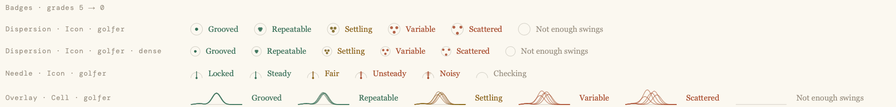
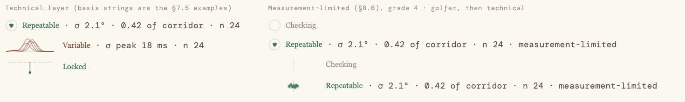
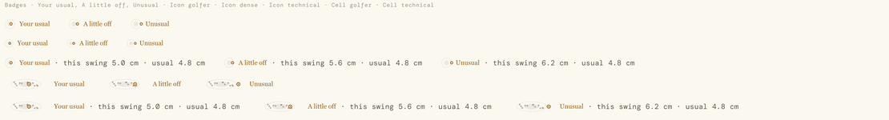

# PpVariabilityBadge

A `PpVariabilityMark` and its word, laid out for its form, so a grade is never colour alone. On the golfer layer its tooltip is the word's line; on the technical layer the grader's basis string follows the word. It is the way to put a variability grade, a measurement grade or a typicality reading on a screen.

Source: `src/Gui/components/PpVariabilityBadge.qml`. Its mark: [PpVariabilityMark](PpVariabilityMark.md).

Graded badges on the golfer layer, grades 5 to 0: Dispersion Icon, Dispersion Icon dense, Needle Icon, Overlay Cell:



Technical layer with basis strings (Dispersion Icon, Overlay Cell timing-limited, Needle Cell with no basis); then measurement-limited at grade 4, golfer layer ("Checking" on the variant's own grade-0 shape) and technical layer (the grade, and "· measurement-limited"), as Icon then Cell:



Typicality badges in every layout: Icon golfer, Icon dense, Icon technical, Cell golfer, Cell technical:



The graded and technical previews are offscreen renders (software painter, dpr 1): fine for the words and layout, not for judging stroke quality.

## When to use
- **Golfer layer** (Home, a work-on, a coaching card): the badge **replaces** a σ, or a box plot that only shows spread. Word and tooltip line only, never a figure.
- **Technical layer** (Swing diagnostics, session screens, a technical catalogue): the badge is **paired** with the σ and any box plot, which stay. It shows the word, then the basis string.
- **Measurement** (a device, rig, calibration or capture-quality surface): a Needle badge, next to the reading's name.
- **Typicality** (a per-swing "vs your usual" or outlier display): a Typicality or TypicalityTrace badge.
- **Launch-monitor ball flight:** keep the existing dispersion plot and add a per-club Dispersion badge as its summary ("7-iron · Settling"), once shots record an intent. Until then ball flight has no badge.

Pick the variant from the grader's basis: `scalar` → Dispersion, `trace` → Overlay, `measurement` → Needle. An `ordinal` result has no named variant in the spec; use the recommended default, Dispersion (an open item in decisions.md).

Pick the form from the place: **Icon** for prose, cards and lists (Dispersion is the default for icons and the golfer layer); **Cell** for a table column (it fits `Theme.rowH` at every density) (Overlay Cell for technical-layer tables of time-series measures).

**Not for:** a multi-session trend (`PpVariabilityFunnel`), the certainty of a finding (`PpStrengthMark`), or a measure the grader left ungraded (no badge at all).

## Consumer supplies
From the presenter's `variabilityResult` (`src/Gui/variability/variability_facade.h`): `grade`, `measurementLimited`, `basisText`, and `graded` for whether to show the badge at all. For typicality, `values` (and `basisText`, the grader's "this swing … · median …" or "peak …" string). Which layer the surface is (`contentLayer`) is the surface's call: the result carries both. How a presenter grades and builds the result: [PpVariabilityMark, Where the numbers come from](PpVariabilityMark.md#consumer-supplies).

## Props
| name | type | default | meaning |
|---|---|---|---|
| grade | int | 0 | The computed grade, 0–5, as the grader gave it: also when `measurementLimited` is set. Ignored by typicality. |
| variant | enum | `PpVariabilityMark.Dispersion` | As the mark: `Dispersion` \| `Overlay` \| `Needle` \| `Typicality` \| `TypicalityTrace`. |
| form | enum | `PpVariabilityMark.Icon` | `Icon` or `Cell`. A TypicalityTrace badge is always laid out as a Cell. |
| dense | bool | false | Icon only: the mark at `sp(16)` rather than `variabilityIconSize` (20), for dense lists. |
| contentLayer | string | `"golfer"` | `"golfer"` or `"technical"`. Not `layer`: that is Item's own. |
| basisText | string | "" | Technical layer: the grader's basis string, shown as given. Empty shows nothing, separator included. |
| measurementLimited | bool | false | The source's Needle grade is 1–2 (§8.6), or the observed spread is no larger than the reading's own propagated σ. See States. |
| values | var | null | The typicality variants only: passed to the mark (`{ z, ghosts, corridor, band }` or `{ mean, sd, swing, corridor, band }`). |
| showCorridor | bool | false | The typicality variants only: passed to the mark. |
| tone | color | the shown grade's tone; `colorAccent` for typicality | The mark's and the word's tone. Overridable, never to change the meaning. |
| roles | var | null | The host's `PpTypeset`, optional. When given, on screen and on paper, its sizes, gaps, type and inks replace Theme's (see Typeset hosts). |
| medium | string | `roles ? roles.medium : "screen"` | `"screen"` or `"print"`; passed to the mark. |
| accessibleIgnored | bool | false | The mark, the badge's one accessible element, is ignored too: for a host whose own accessible name already says the grade, so it is read once (the funnel's too-few label, R25). |

Read-only: `substituted` (the golfer layer is showing "Checking" for a measurement-limited grade), `shownGrade` (0 when substituted, else `grade`), `word` (the word shown), `line` (the golfer-layer line of the word shown).

Method: `snapTone()` — the mark and the word show the current tone at once. A host that reuses delegates calls it from `TableView.onReused` / `ListView.onReused` (see States, Tone changes).

The badge has no `label` or `vocabulary` of its own: the word always comes from the vocabulary its variant speaks.

## Layout
| form | mark | gap | word | technical layer |
|---|---|---|---|---|
| Icon | `sp(variabilityIconSize)` = 20 square (`dense`: `sp(16)`) | `gap(6)` | body face, `fontSzBody2` (12), `fontBodyWeight`, in the tone | `" · "` then `basisText`, data face, `fontSzDataSm` (13), `trackingData`, `colorText2` |
| Cell | `sp(variabilityCellH)` = 24 high, 80 wide | `gap(10)` | as Icon | as Icon |

The row is vertically centred. Gaps are `gap()`, so they follow Density; sizes are `sp()`, so they don't. A Cell badge (24 high) fits `Theme.rowH` at every density. In a table, the mark's column is `Theme.sp(Theme.variabilityCellW)` (80) wide; the word and basis follow it, so give the cell room for them or let the row's own column hold the σ.

With `roles` (a typeset host), the same layout in the host's units: the mark `roles.u(variabilityIconSize)` (`dense`: `roles.u(16)`) or `roles.u(variabilityCellH)` high, the gaps `roles.g(6)` / `roles.g(10)`, the word in `roles.fBody`, the basis in `roles.fFig`. On screen `u()` is `sp()` and `g()` is `gap()`, so the badge still follows Density; only the faces and type sizes become the host's.

The badge takes its implicit size from its content; don't stretch it. Hide it with `visible` (a hidden badge in a Row or Layout takes no room).

## Variants × forms
Every variant and form of the mark (see [PpVariabilityMark](PpVariabilityMark.md#variants--forms)), with the word beside it:
- Dispersion, Overlay: the Consistency word ("Repeatable").
- Needle: the Measurement word ("Steady"). Always name the reading beside it, in the host row: "Pelvis IMU · Steady".
- Typicality, TypicalityTrace: the band's word ("Your usual", "A little off", "Unusual"), always in the accent.

## States
- **Grade 1–5:** mark and word in the grade's tone.
- **Grade 0:** the mark's neutral element only; the word "Not enough swings" (consistency) or "Checking" (measurement) in `colorText3`. Its golfer-layer line still shows as the tooltip ("Hit a few more and we'll show how consistent this is."). There is no basis string at grade 0.
- **Ungraded** (`graded` false): no badge. Hide it or don't create it; never show the raw SD instead. Record the reason (`ungradedReason`) if the display is left as it was.
- **Measurement-limited** (`measurementLimited: true`):
  - Golfer layer: the badge shows the **variant's own grade-0 shape** (a Dispersion badge shows the empty ring, or the bare target line as a Cell; an Overlay the bare baseline; never the Needle's arc) and the measurement word **"Checking"** in `colorText3`, with the line "Not enough data yet to judge this reading." `substituted` is true. The accessible name is "Measurement: Checking".
  - Technical layer: the real grade, mark and word, and the basis string the grader built, which already ends "· measurement-limited".
  - It never applies to typicality.
- **Typicality:** no grade. The word is the band's, always in the accent, never `colorText3`. The golfer-layer tooltip is the band's line.
- **No typicality result:** the host must hide the badge. With `values` null, or `values.band` "", the badge still draws the mark's zones (and ghosts, when given) with no word beside them: a shape without its word, which principle 1 forbids. The presenter signals "no result" by handing `null` for `values` (the grader's `scalarTypicality` / `traceTypicality` returned none: fewer than 8 readings in the window, or no reading for this swing), and the host binds `visible` to it.
- **Technical layer, empty `basisText`:** the word alone, no separator. The Needle's grader basis string is always empty (the spec has no Needle row), so a technical Needle badge is word only.
- **Tone changes** ease over `Theme.durationSlow` (0 under reduced motion), word and mark together, when the grade changes on the same badge (a live session). A reused delegate's badge snaps to its own tone (R25): a host with `reuseItems` calls `snapTone()` from `TableView.onReused` / `ListView.onReused`. A badge that is created, not reused, starts at its tone.

## Tooltip
Golfer layer only, on screen only: the word's line (§7 of the spec; listed in [variability.md, Words](../variability.md#words)) after 400 ms of hover, through the Controls attached `ToolTip`, as `PpButton` and `PpRowAction` do. Never on the technical layer, never on paper.

## Typeset hosts
- **In a typeset panel or page, pass the host's PpTypeset as `roles`** (Mark's ruling R17, 7 Nov 2026). On screen and on paper alike the badge then takes the host's type: sizes are `roles.u()`, gaps `roles.g()`, the word is set in `roles.fBody`, the basis in `roles.fFig`, and the inks are the host's (the tone by grade from `roles.good` / `attention` / `warn`, grade 0 `roles.ink3`, the basis `roles.ink2`). It reads in proportion to the panel's own words and figures.
- Without `roles` the badge reads Theme exactly as before (`sp()`, `gap()`, the body and data tokens above).
- `roles` changes faces, sizes and inks only. What belongs to a medium stays with `medium`: the tooltip is screen-only; the mark's washes take `variabilityWashAlpha` on screen and `variabilityPrintAlphaScale` on paper.

## Print
- `medium` passes to the mark (fills × `variabilityPrintAlphaScale`, clamped to 1; never `variabilityWashAlpha`, which is the mark's screen multiplier on its washes, 1 light and 3 dark).
- With `roles` on paper: as Typeset hosts, with the page's `u()` (print scale) for both sizes and gaps.
- On paper without roles, gaps are `sp()`, never `gap()`, so a printed badge does not follow the screen's Density. Inks are Theme's.
- **On paper, always pass `roles`** (the page's PpTypeset). Without it, print draws from the live screen theme: a dark screen theme puts its dark-theme inks on white paper. This is a known limitation (decisions.md).
- **Layer on paper:** a printed client report is the golfer layer (`contentLayer: "golfer"`); only the technical appendix uses `"technical"`.
- No tooltip on paper.

## Accessibility
The mark is the badge's one accessible element: "Consistency: Repeatable (4 of 5)", "Consistency: Not enough swings" at grade 0, "Measurement: Checking" when substituted, "Typicality: A little off". The drawn word, separator and basis are `Accessible.ignored`, so nothing is read twice. The basis string is not in the accessible name. With `accessibleIgnored` the mark is ignored as well, for a host that says the grade in its own name.

## Tokens
`variabilityIconSize`, `variabilityCellH`, `fontBody`, `fontSzBody2`, `fontBodyWeight`, `fontData`, `fontSzDataSm`, `trackingData`, `colorText2`, `colorText3`, `durationSlow`, `Theme.sp()`, `Theme.gap()`, and the mark's. With roles (screen or paper): `roles.u()`, `roles.g()`, `fBody`, `fFig`, `ink2`, `ink3`.

## objectNames
`variabilityMark` (the mark; its own names are on its page), `variabilityWord`, `variabilityBasisSeparator`, `variabilityBasis`.

## Usage
A Dispersion Cell badge in a technical-layer table row (the row's σ and box plot stay):
```qml
PpVariabilityBadge {
    // r: the row's variabilityResult, from the presenter
    visible: r.graded                          // ungraded: no badge, never a raw σ
    variant: PpVariabilityMark.Dispersion      // r.basis "scalar"
    form: PpVariabilityMark.Cell
    contentLayer: "technical"
    grade: r.grade
    measurementLimited: r.measurementLimited
    basisText: r.basisText                     // "σ 2.1° · 0.42 of corridor · n 24"
}
```
A golfer-layer Icon badge on a work-on (replaces the σ; the line is the tooltip):
```qml
PpVariabilityBadge {
    visible: r.graded
    grade: r.grade
    measurementLimited: r.measurementLimited   // shows "Checking" when the source is Unsteady or Noisy
}
```
A Needle on a device screen, named as the docs say: "Pelvis IMU · Steady". The Needle's golfer layer is allowed here: the golfer can act on a device.
```qml
Row {
    visible: noise.graded                      // noise: the sensor's measurement variabilityResult
    PpCaption {                                // always name the reading
        anchors.verticalCenter: parent.verticalCenter
        text: qsTr("Pelvis IMU") + " · "       // the separator stays outside the translation
    }
    PpVariabilityBadge {
        anchors.verticalCenter: parent.verticalCenter
        variant: PpVariabilityMark.Needle      // noise.basis "measurement"
        grade: noise.grade                     // "Steady"; its line is the tooltip
    }
}
```
In an opened row of facts, a `PpFact` labelled "PELVIS IMU" with the badge as its mark names it the same way.
A typicality Cell in a swing view, with the corridor so "usual" and "good" stay apart:
```qml
PpVariabilityBadge {
    visible: swing.typicality !== null         // null: the grader had no result; never a shape without its word
    variant: PpVariabilityMark.Typicality
    form: PpVariabilityMark.Cell
    values: swing.typicality                   // { z, ghosts: [{ swingId, z }], corridor: { loZ, hiZ }, band }
    showCorridor: true
    contentLayer: "technical"
    basisText: swing.typicalityBasis           // "this swing 5.2 cm · median 4.8 cm"
}
```
Ball flight, per club and per intent, under the existing launch-monitor plot, the club named beside it ("7-iron · Settling"). The grade is graded against per-club offline and carry tolerances (`variabilityScale`), none of which are set yet; how the offline and carry grades combine into the one badge is not built or specified, and no shot records an intent yet, so this badge is not shown anywhere today (decisions.md).
```qml
PpVariabilityBadge {
    visible: club.result.graded
    grade: club.result.grade
    contentLayer: "technical"
    basisText: club.ballFlightBasis            // "offline ±6 yd · carry ±5 yd · 12 shots"
}
```

## Do
- Draw a consistency badge only when **all three** hold: the spread is repeatability (the same measure, across swings, in comparable conditions); the spread isn't expected (not across clubs, shot types or contexts, not movement within a swing); and a grade exists.
- Grade within each intent (shot shape or type). With no intent, outcome measures (ball flight) get no grade; body-movement measures stay eligible. Ball flight is per club and per intent; a pooled view isn't graded.
- On a work-on, show both halves: the mean in the corridor **and** Repeatable or better over at least `Variability.nMin` (8) swings. Only both together mean achieved.
- Pass `measurementLimited` through from the result every time; the badge does the rest.
- Name the reading beside every Needle badge.
- Keep "Consistency" as a heading where it is one; it is the words under it that change.
- Host badges in tables with a real model (`ListModel` or C++), never an integer model.

## Don't
- Don't hand-write a basis string or format ρ in QML. Use the grader's `basisText`.
- Don't show figures on the golfer layer: no σ, ρ, CV or counts. Word and line only.
- Don't put a Needle on Home or diagnosis cards, or use it for golfer variability, detector confidence, dropouts, corrected bias or vendor figures.
- Don't put a Needle badge and a consistency badge on one value without naming which is which.
- Don't use the badge for how sure a finding is: `PpStrengthMark` sits with the finding, this badge with the measure.
- Don't word a typicality badge as praise or fault, or recolour it with a status tone.
- Don't replace a technical-layer box plot: pair it. A golfer-layer box plot that shows position against the corridor stays as it is for now.

## Not repeated here
The geometry tables (spec §4, §6; `src/Gui/variability/variability_geometry.cpp`) and the grade basis (spec §8; `src/Metrics/variability/`). The words, lines and basis strings, and the family rules, are in [variability.md](../variability.md).

## Used by
Session 5's retrofit (7 Nov 2026; `docs/design/variability-mark/decisions.md`, "Session 5: applied"). One line per host: surface · variant and form · layer.

Home
- `src/Gui/home/HmAreaRow.qml` — Your swing table, Consistency column: the Biggest fault's measure over its last 20 readings (R5) · Dispersion Icon · golfer.
- `src/Gui/home/HmAreaRow.qml` — an opened area's fault rows, beside each work-on's status (R5, R10) · Dispersion Icon · golfer.
- `src/Gui/home/HmFaultDetail.qml` — a fault's detail, beside the work-on status (R10) · Dispersion Icon · golfer.

Session diagnostics
- `src/Gui/diagnostics/PpFigureRow.qml` — Analyse figure row (`PpDiagAnalyse`) and the printed appendix (`PpDiagPrint`): the Spread box, one badge per club (R2b) · Dispersion Icon · technical.
- `src/Gui/charts/PpChProfile.qml` in `src/Gui/diagnostics/PpConsistencyView.qml` — Consistency tab: an opened cell's reading rows · Dispersion Cell · technical; the picked shot's "What stood out" club and swing rows (R8) · Typicality Icon · technical.

Charts
- `src/Gui/charts/PpChProfile.qml` in `PpChartsReadingsView.qml` — Readings rows · Typicality Icon · technical.
- `src/Gui/charts/PpChProfile.qml` in `PpChartsShotView.qml` — This shot, Apart from the session rows · Typicality Icon · technical.
- `src/Gui/charts/PpChKeyFigures.qml` — This shot, key figures (KS peak times included) · Typicality Icon · technical where the column holds the basis, else the word with the basis on its own line.
- `src/Gui/charts/PpChTraceFigure.qml` — This shot, Against · TypicalityTrace Cell · technical. Shown for the 24 traces that borrow a norm (R31); the rest stay ungraded (R16).
- `src/Gui/charts/PpChSessionFigure.qml` — Session curves, one per club · Overlay Cell · technical. Shown for the 24 traces that borrow a norm (R31); the rest stay ungraded (R16).
- `src/Gui/charts/PpChSeqSession.qml` — Session, common order, one per club (ordinal: the default Dispersion) · Dispersion Icon · technical.
- `src/Gui/charts/PpChReplaySession.qml` — Session, Replay's lead reading · Typicality Icon · technical.
- `src/Gui/charts/PpChPostureSession.qml`, `PpChWristSession.qml` — Session, Posture and Wrist "Consistency" lines (Most / Least, R7) · Dispersion Icon · technical.
- `src/Gui/charts/PpChPositionProfile.qml` (through `PpChPostureProfile`, `PpChWristProfile`) — Session, Posture and Wrist rows: a line per club under each row, a badge per graded position (R2b, R7) · Dispersion Icon dense · technical (`gradeLayer`).

Launch monitor
- `src/Gui/session/PpLmGraphicsBody.qml` (in `PpLaunchMonitorPanel`, `PpSessionDiagnosticsPanel`) — a named list under the tiles: club delivery spread (R4b) · Dispersion Icon · technical; this shot's club readings (R8) · Typicality Icon · technical. Ledger rows, club readings only · Typicality Icon · technical. Ball flight has none (R4).

Session report (paper)
- `src/Gui/report/PpConsistencyPage.qml` — Consistency page, flagged shots' rows · Typicality Icon · golfer.
- `src/Gui/report/PpPosturePage.qml`, `PpWristPage.qml` — Consistency lines (Most / Least) · Dispersion Icon · golfer.
- `src/Gui/report/PpReportProfile.qml` (on the Posture and Wrist pages) — a line per club under each row · Dispersion Icon dense · golfer.
- `src/Gui/report/PpWorkOnPage.qml` — a work-on's "Consistency", this session's readings (R10, R14) · Dispersion Icon · golfer.
- `src/Gui/report/PpLmAppendix.qml` — Launch monitor appendix, on its own line under each graded row (R19) · Dispersion Icon dense · technical.

Inside the design system: `PpVariabilityFunnel` (its too-few-sessions label). The probe gallery `src/Gui/tests/probes/variability_gallery.qml` draws every badge. No surface hosts a Needle badge yet (decisions.md, "Session 5: applied").
