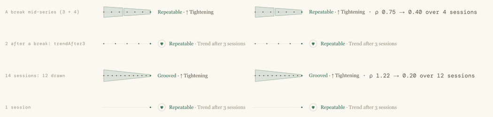
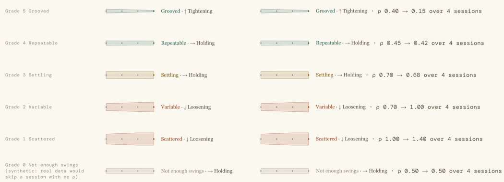
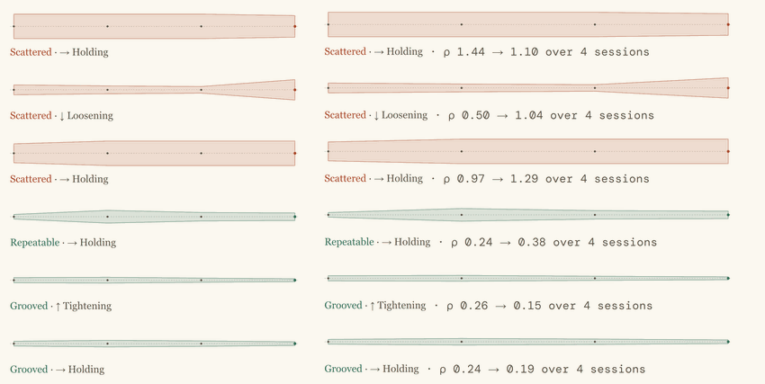

# PpVariabilityFunnel

The spread funnel: a measure's spread drawn as a band along time, one session after another, oldest on the left. It narrows into a funnel as the golfer tightens and opens out as they loosen. The words beside it say the current grade and the trend, "Repeatable · ↑ Tightening", so the band is never colour alone.

Source: `src/Gui/components/PpVariabilityFunnel.qml`. Geometry: `VariabilityGeometry.funnel()` (`src/Gui/variability/variability_geometry.h`).

Compact, golfer and technical layers: a break mid-series (the trend reads the latest run, 4 sessions), too few sessions after a break, 14 sessions with 12 drawn, one session:



Compact, grades 5 to 0, golfer and technical layers (grade 0 is synthetic, since real data skips a session with no ρ):



Wide, golfer and technical layers, on real sessions (Mark's 7-iron; ρ from the observed SD, without the grader's noise subtraction, so not what the grader computes today: decisions.md):



## When to use
- **Is the golfer getting more consistent over time?** Any display of a measure's spread across sessions, or a consistency trend: a trend tab, a progress view, a work-on's history.
- **Compact** (`wide: false`): in a table row or a work-on row, the label beside the graphic.
- **Wide** (`wide: true`): on a trend tab or a page of its own, the graphic across the width and the label beneath.

**Not for:** one session's spread (`PpVariabilityBadge`), the measurement quality of a reading over time (the funnel speaks Consistency words only), or an ordinal measure such as the kinematic-sequence order (the trend is defined on ρ, so an ordinal series has no trend and no funnel).

## Consumer supplies
From the C++ grader, per measure and context:
- `sessions`: `[{ rho, grade, breakBefore }, …]`, oldest first, the current session last. `rho` is the session's `variabilityResult.rho` (ρ, or a trace's max(ρₐ, ρₜ)); `grade` its grade. Each session is graded on its own, as a frozen assessment (plain bands, no hysteresis), within one club and one intent. `breakBefore` true when the context, basis or scale changed since the previous session (another club's corridor, a different scale).
- `trend`: from `variabilityTrend(points)` (`src/Metrics/variability/variability_trend.h`), one `TrendPoint { rho, n, contextKey, basisKind, scaleKey }` per session, oldest first; it finds the breaks itself from those keys, so set `breakBefore` from the same keys. Its `TrendResult` direction goes to the funnel as a token, `"tightening"`, `"loosening"`, `"holding"` or `"insufficient"`. No C++ helper spells the token yet: the presenter writes it exactly so. The trend reads the latest unbroken run, at most the latest 12 sessions, so it describes what the funnel draws.
- `basisText` (technical layer): `TrendResult::basisString()`, "ρ 0.62 → 0.38 over 6 sessions".
- `measureName`: the measure's name, for the accessible name.

QML never computes ρ, a grade or a trend.

## Props
| name | type | default | meaning |
|---|---|---|---|
| sessions | var | [] | `[{ rho, grade, breakBefore }]`, oldest first, current last. |
| trend | string | "" | `"tightening"` \| `"loosening"` \| `"holding"`; `"insufficient"` or "" for none. |
| measureName | string | "" | "Pelvis rotation at top", for the accessible name. Empty: "Consistency". |
| basisText | string | "" | Technical layer: the grader's trend basis, shown as given. |
| contentLayer | string | `"golfer"` | `"golfer"` or `"technical"`. |
| wide | bool | false | false: compact, `sp(120)` wide, label beside. true: fills the item's width, label beneath. |
| variant | enum | `PpVariabilityMark.Dispersion` | The measure's own mark, for the too-few badge: `Dispersion` (scalar) or `Overlay` (time series). Anything else warns and draws Dispersion. |
| roles | var | null | A `PpTypeset`, optional; for paper. |
| medium | string | `roles ? roles.medium : "screen"` | `"screen"` or `"print"`. |

Read-only: `currentGrade` (the last listed session's grade, even when that session has no ρ and is not drawn), `trendAfter3` (true while the latest unbroken run has fewer than 3 sessions), `sessionCount` (sessions in that run), `tone`, `label` (the label as one string, without the basis), `minimumWidth` (96 px).

**Size.** The graphic is `sp(variabilityFunnelH)` (32) high in both forms. Compact: `sp(120)` wide, then `gap(10)`, then the label. Wide: set the item's `width`; the graphic fills it, never narrower than 96 px, and the label sits `gap(6)` beneath. A wide funnel with no width set is only as wide as its label.

## What it draws
- **Centre line:** at mid-height, the full width, 1 px dashed `colorBorderStrong`.
- **Sessions:** evenly spaced, 6 px in from each end, oldest left, at most the latest 12 (older ones roll off). One session sits at the right end. A session with no finite ρ is skipped (a grade-0 session usually has none), and its break carries to the next session.
- **Band:** through each session's half-width, `clamp(ρ / 1.25, 0.08, 1) × (H/2 − 2)`, straight segments. Because it follows ρ, it shows movement within a grade. Fill: the **current** session's grade tone at 16 %, a wash: on screen × `Theme.variabilityWashAlpha`, clamped to 1 (1 in light themes, 3 in dark, so 48 %; Mark, 7 Nov 2026). Edge 1 px, the same tone at 55 %, never multiplied. Every band wears the current tone, older runs included.
- **Breaks:** a change of context, basis or scale stops the band; the next run starts after a 4 px gap marked by a short dashed `colorBorderStrong` tick. Sessions keep their even spacing.
- **Session markers:** dots r 1.6 in `colorText2` on the centre line; the current session r 2.2 in the tone.
- **Label:** the grade word in the tone (body face, `fontSzBody2`), then " · " and the trend label in `colorText2`: "↑ Tightening", "↓ Loosening", "→ Holding". Technical layer: then " · " and `basisText` in the data face, `fontSzDataSm`, `colorText2`.

Everything is in pixels, never scaled: the strokes, padding and marker radii stay put at every width.

## States
- **Trend shown** (3 or more sessions in the latest unbroken run): bands, ticks, markers; "Repeatable · ↑ Tightening".
- **No trend word** (`trend` "insufficient" or "", with 3 or more sessions): the grade word alone.
- **Too few sessions** (`trendAfter3`: under 3 in the latest unbroken run, including just after a break): **no band at all** (older runs' bands are hidden too) and no ticks; the centre line and markers stay. The label is the measure's badge (an Icon `PpVariabilityBadge` of `variant` at the current grade) then " · Trend after 3 sessions" in `colorText3`. On the golfer layer the badge's tooltip is the grade's line.
- **No sessions:** the centre line only, with the too-few label at grade 0.
- **Grade 0** as the current grade: the band and the word in `colorText3`, "Not enough swings".
- **Last session with no ρ:** it is not drawn, but `currentGrade`, and so the tone and the word, still come from it, and a break it carried is dropped (there is no later session to carry it to). Open for Mark (decisions.md). Hand the funnel only sessions with a reading if that is not what you want.
- **Measurement-limited:** the funnel does **not** substitute "Checking"; its word is always the session's consistency grade. Whether it should is open for Mark (decisions.md).
- **More than 12 sessions:** the latest 12 are drawn, and the trend reads the same 12.
- **Changes:** a new session list redraws at once (the geometry never animates); the tone eases over `Theme.durationSlow` (0 under reduced motion).

## Print
- `medium: "print"`: the band's fill multiplies its alpha by `Theme.variabilityPrintAlphaScale` (1.5), clamped to 1, and never by `variabilityWashAlpha`; strokes (the edge, the centre line, ticks) keep theirs.
- With `roles` on paper: the compact width and the height are `roles.u()`, the gaps `roles.g()`, the words `roles.fBody` and the basis `roles.fFig`; tones are `roles.good` / `attention` / `warn` / `ink3`; `colorBorderStrong` → `roles.baseline`, `colorBorderMid` → `roles.grid`, each at its opacity; `colorText2` → `ink2`, `colorText3` → `ink3`.
- On paper without roles, gaps are `sp()`, never `gap()`, so the funnel never follows Density on paper. Inks are Theme's.
- **On paper, always pass `roles`** (the page's PpTypeset). Without it, print draws from the live screen theme: a dark screen theme puts its dark-theme inks on white paper. This is a known limitation (decisions.md).
- **Layer on paper:** a printed client report is the golfer layer (`contentLayer: "golfer"`); only the technical appendix uses `"technical"`.

## Accessibility
- `Accessible.role: Accessible.Graphic`; the drawn words are ignored.
- `Accessible.name`: "Pelvis rotation at top: Repeatable, tightening over 6 sessions" (the trend in lower case, the count from the latest unbroken run). With no trend word: "Pelvis rotation at top: Repeatable". Too few sessions: "Pelvis rotation at top: Repeatable. Trend after 3 sessions". With no `measureName`, "Consistency" stands in.
- Colour is never the only channel: the band's width and the words carry it.

## Tokens
`variabilityFunnelH`, `variabilityWashAlpha` (screen), `variabilityPrintAlphaScale` (print), `colorGood`, `colorAttention`, `colorWarn`, `colorText3`, `colorText2`, `colorBorderStrong`, `fontBody`, `fontSzBody2`, `fontBodyWeight`, `fontData`, `fontSzDataSm`, `trackingData`, `durationSlow`, `Theme.sp()`, `Theme.gap()`, and the badge's. On paper with roles: `roles.u()`, `roles.g()`, `fBody`, `fFig`, `good`, `attention`, `warn`, `ink2`, `ink3`, `baseline`, `grid`.

## objectNames
`funnelGraphic`, `funnelShape` (the centre line's Shape), `funnelCentre`, `funnelBand` (one per run), `funnelTicks`, `funnelMarker`, `funnelCurrentMarker`, `funnelLabel`, `funnelBadge` (too few), `funnelWord`, `funnelTrend`, `funnelTrendAfter3`, `funnelBasis`.

## Usage
Wide, on a trend tab (technical layer):
```qml
PpVariabilityFunnel {
    width: parent.width
    wide: true
    variant: PpVariabilityMark.Overlay           // a time-series measure
    sessions: m.sessions                         // [{ rho, grade, breakBefore }] oldest first, from C++
    trend: m.trend                               // "tightening" | "loosening" | "holding" | "insufficient"
    measureName: m.name                          // "Pelvis rotation at top"
    contentLayer: "technical"
    basisText: m.trendBasis                      // "ρ 0.62 → 0.38 over 6 sessions"
}
```
Compact, on a golfer-layer work-on row:
```qml
PpVariabilityFunnel {
    sessions: workOn.sessions
    trend: workOn.trend
    measureName: workOn.name
}
```

## Do
- Feed it only like-for-like sessions: the same measure, context, basis and scale, with `breakBefore` wherever any of them changed.
- Grade within each intent, as every consistency mark (the sessions' grades already are).
- On a work-on, show the funnel with the mean-in-corridor reading: a work-on is achieved only when the mean is in the corridor **and** consistency is Repeatable or better over at least `Variability.nMin` (8) swings.
- Set `variant` to the measure's own mark, so the too-few badge matches the badges elsewhere.
- Host funnels in tables with a real model (`ListModel` or C++), never an integer model.

## Don't
- Don't feed it spread across clubs, shot types or contexts as one series, or pool a cohort scale with a universal one.
- Don't put a figure (ρ, n) on the golfer layer; the basis is technical only.
- Don't let the trend word replace the grade word: it always follows it.
- Don't use it for a measurement grade over time (Needle words), or for the certainty of a finding (`PpStrengthMark`).
- Don't format ρ or decide the trend in QML.

## Not repeated here
The funnel's geometry is spec §6.1 as built in `src/Gui/variability/variability_geometry.cpp` (`DataVariabilityGeometry::funnel`); the trend rule is spec §8.8 in `src/Metrics/variability/variability_trend.h`. Where the build fills a gap (break placement, dash pattern, the label layout), `docs/design/variability-mark/decisions.md` says so.

## Used by
None yet: Session 5 of the plan retrofits the app's displays. The probe gallery `src/Gui/tests/probes/variability_gallery.qml` draws real and synthetic funnels.
