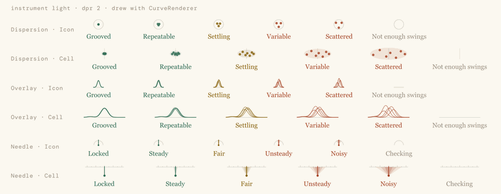
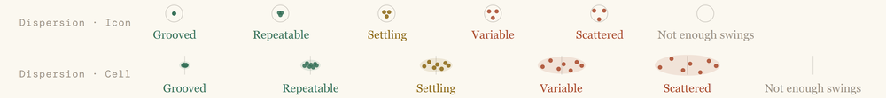
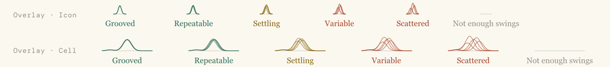
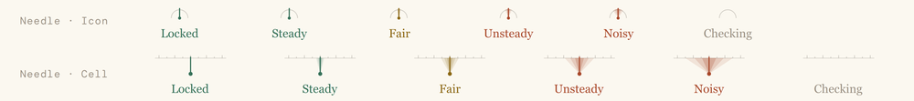
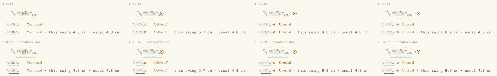
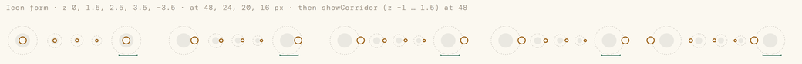
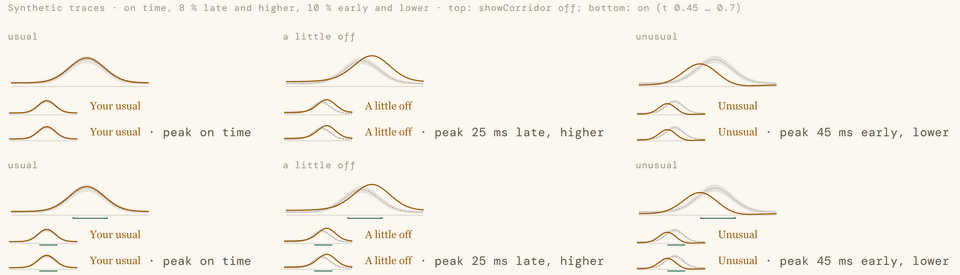
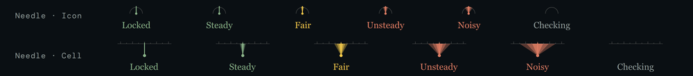

# PpVariabilityMark

How much something varies, or how far a reading can be trusted, as a grade drawn in geometry: 5 the least variable (or the steadiest reading), 1 the most, 0 no grade. The typicality variants draw this swing against the golfer's usual instead, and are never graded. The mark never draws text: its word goes beside it in a `PpVariabilityBadge`, and into its accessible name.

Source: `src/Gui/components/PpVariabilityMark.qml`. Geometry: `src/Gui/variability/variability_geometry.h` (the `VariabilityGeometry` singleton). Words: the four vocabulary singletons (`ConsistencyVocabulary`, `MeasurementVocabulary`, `TrendVocabulary`, `TypicalityVocabulary`), listed in [variability.md, Words](../variability.md#words).



## When to use
- **Almost never on its own.** On a screen, use `PpVariabilityBadge`: it pairs the mark with its word, does the measurement-limited substitution and the golfer-layer tooltip. Use a bare mark only where the word already sits in the same row or cell, or in a key.
- **Dispersion** — does the golfer repeat a **scalar** measure (an angle at P4, a speed, a distance)? Consistency words.
- **Overlay** — does the golfer repeat a **time-series** measure (a rotation curve, top to impact)? Consistency words.
- **Needle** — can we trust this **reading**? Measurement words. For measurement quality only (the Needle rules are under Do and Don't).
- **Typicality** ("your group") — how did **this swing**'s scalar compare with the golfer's usual? Never graded.
- **TypicalityTrace** ("trace on envelope") — the same for a time series. Cell only.

Which variant follows from the grader's basis (`variabilityResult.basis`): `scalar` → Dispersion, `trace` → Overlay, `measurement` → Needle. An `ordinal` result (an order or a checkpoint, such as the kinematic sequence) has no named variant in the spec; use the recommended default, Dispersion (decisions.md lists this for Mark).

Recommended defaults: Dispersion for icons and the golfer layer; Overlay Cell for technical-layer tables of time-series measures; the Needle only for measurement.

**Not for:**
- How sure we are of a finding or a causal link. That is `PpStrengthMark` (CLEAR, LIKELY, POSSIBLE). The variability mark sits with the measure; the strength mark sits with the finding.
- A raw σ, SD or range with no grade. If the grader returns no grade there is no mark (see States).
- Spread across clubs, shot types or contexts, or movement within one swing. That spread is expected, not repetition.
- A multi-session trend: `PpVariabilityFunnel`.

## Consumer supplies
A grade, or for the typicality variants `values`, from C++. QML never grades, never computes ρ or z, and never builds a basis string.
- **Graded variants:** `grade` from a `variabilityResult` (the façade value type, `src/Gui/variability/variability_facade.h`): `grade`, `graded`, `measurementLimited`, `basisText`, `domain`, `n`, `rho`/`hasRho`, `ungradedReason`. A presenter's result map always carries `hasRho`, `rho` (JS `null` when there is none) and `domain`.
- **Typicality:** `values: { z, ghosts: [{ swingId, z }], corridor: { loZ, hiZ } | null, band }`. `z` is this swing's robust z over the window, (x − median)/s with s = IQR/1.349 (R22); `ghosts` are up to 12 recent other swings, oldest first, each with its z on the same scale (only the latest 12 are drawn); `corridor` is the measure's corridor in the same window's z, (lo − median)/s and (hi − median)/s; `band` is `"usual"`, `"aLittleOff"` or `"unusual"` (the grader's `TypicalityBand`, `src/Metrics/variability/variability_typicality.h`).
- **TypicalityTrace:** `values: { mean: [101], sd: [101], swing: [101], corridor: { loT, hiT } | null, band }`. Three curves on the 101-point grid, top to impact, from the grader's window. The keys keep their names, but `mean` carries the per-point median and `sd` the per-point robust spread IQR/1.349 (R22), so the envelope is median ± robust spread; `corridor` is a window in normalised time 0…1 (the spec leaves the trace corridor undefined; this is the build's reading, open for Mark); `band` from the trace's RMS z(t): "usual" up to 1.25 (`kTraceTypicalityUsualZ`, R30), "aLittleOff" up to 2. A host shows a TypicalityTrace badge only for a trace with a scale of its own for the shot's club: its borrowed norm or a `variabilityScale` (R16, R31).
- `typicalityBandToken()` (`src/Gui/variability/variability_facade.h`) spells `TypicalityBand` as these tokens; `typicalityPayload` builds the whole `values` map and basis.

**Where the numbers come from** (C++, in the presenter; `src/Metrics/variability/`):
- A grade: `makeVariabilityGrader(basis)` → `grade(VariabilityInput)` → a `VariabilityResult`. The input carries the window's values (or curves, or categories), the scale (the corridor half-width or `variabilityScale` from `makeVariabilityScaleProvider`, `src/Gui/charts/variability_env.h`), the measure's `scaleType`, and the source's Needle grade when known. A drawn trace (Overlay) takes the corridor it borrows, `traceCorridorHalfWidth(key, club)`: the norm on its descriptor's `traceCorridorMeasure` for that club, (σLo + σHi)/2, never a norm with `source: "measured"` (R31). Without it or a `variabilityScale` the trace is ungraded: no Overlay mark (R16). Set `gradeTiming` from `traceTimingGraded(key)`: only the rate traces grade their peak time; every other curve is graded on its amplitude alone. Grade on the observed spread: a propagated σ is never passed as σnoise, but a spread no larger than it marks the result measurement-limited. The window is the session, or the last `N_WINDOW` (20) swings for Home and trends; outliers and mishits are left out (no general flag exists yet: guarded readings, an untrusted P-ladder, are). Warm-ups stay in (R13): the golfer should be warmed up before PinPoint assesses them. Grade within one club and one intent.
- To QML: `VariabilityResultView::fromResult(result, unit, decimals)` gives the `variabilityResult` value type, basis string included (built with the measure's unit and display decimals).
- Live sessions pass the result through `hysteresisGrade(bandValue, lastShownGrade, bands)`; frozen assessments use the plain grade.
- Typicality: `scalarTypicality(value, window, scaleType)` gives this swing's `z`, `band` and basis string; each ghost's `z` is taken against the same window. `traceTypicality(...)` gives the trace's band and basis; `mean` and `sd` are the window's per-point median and IQR/1.349 on the same grid. An angle that wraps (`ScaleType::Circular`) takes the circular mean and circular SD in their place.

## Props
| name | type | default | meaning |
|---|---|---|---|
| grade | int | 0 | 0–5. Out of range is clamped, with a console warning. Ignored by the typicality variants. |
| variant | enum | `PpVariabilityMark.Dispersion` | `Dispersion` \| `Overlay` \| `Needle` \| `Typicality` \| `TypicalityTrace` |
| form | enum | `PpVariabilityMark.Icon` | `Icon` (square) \| `Cell` (80 : 24). TypicalityTrace is always drawn as a Cell. |
| size | real | `Theme.sp(Theme.variabilityIconSize)` (20); `roles.u(20)` with roles | The Icon's edge, or the Cell's **height**. **A bare Cell needs `size: Theme.sp(Theme.variabilityCellH)`**, or it draws 20 high (67 wide). |
| tone | color | from the grade (below); `colorAccent` for the typicality variants | Overridable, but never to change the meaning. |
| vocabulary | QtObject | `ConsistencyVocabulary` (Dispersion, Overlay), `MeasurementVocabulary` (Needle), `TypicalityVocabulary` (typicality) | Where the word and accessible name come from. |
| label | string | `vocabulary.word(grade)`, or `word(values.band)` | The word. Used for the accessible name only; the mark never draws it. |
| values | var | null | The typicality variants' per-instance data (above). Named `values`, not `data`, which is Item's own child list. |
| showCorridor | bool | false | The typicality variants only: draws the measure's corridor as a 1.5 px `colorGood` bracket under the visual. |
| roles | var | null | The host's `PpTypeset`, optional. When given, on screen and on paper, its inks and sizes replace Theme's (see Typeset hosts). |
| medium | string | `roles ? roles.medium : "screen"` | `"screen"` or `"print"`. |

Implicit size: Icon `size` × `size`; Cell `size × 80 / 24` × `size`. Never scale the item: set `size`, so strokes stay at their pixel widths.

Method: `snapTone()` — show the current tone at once, ending any ease. A host that reuses delegates (`reuseItems`) calls it from `TableView.onReused` / `ListView.onReused` (see States, Grade changes). A badge or funnel forwards it to its mark.

Don't nest children in a PpVariabilityMark: it is a leaf graphic.

## Grades, tone and words
| grade | Consistency (Dispersion, Overlay) | Measurement (Needle) | tone |
|---|---|---|---|
| 5 | Grooved | Locked | `colorGood` |
| 4 | Repeatable | Steady | `colorGood` |
| 3 | Settling | Fair | `colorAttention` |
| 2 | Variable | Unsteady | `colorWarn` |
| 1 | Scattered | Noisy | `colorWarn` |
| 0 | Not enough swings | Checking | `colorText3` |

Grades 5 and 4 share a tone, and so do 2 and 1: the shape and the word tell them apart, so colour is never the only channel. Typicality wears `colorAccent` and has no grade. The lines for each word are in [variability.md, Words](../variability.md#words).

## Variants × forms
| variant | Icon | Cell |
|---|---|---|
| Dispersion | A neutral ring with three tone dots that close into one dot at grade 5. | A neutral target line, a tone wash ellipse and seven dots that close in on the line. |
| Overlay | A neutral baseline with three traces that converge at grade 5. | A baseline with five traces. The tallest stays inside the cell: a trace that would rise past y 0.65 (half its stroke) is scaled down about the baseline, which only grade 1's tallest reaches (R25). |
| Needle | A neutral gauge arc, a needle and pivot, and three stacked translucent wedges that narrow to nothing at grade 5. | A ruler with ticks, a needle and three stacked triangles. |
| Typicality | A dashed circle ("nearly all", \|z\| 2), a faint disc ("most swings", \|z\| 1) and this swing's accent ring. No ghosts, centre dot or chevron. | A dashed ellipse (\|z\| 2), a faint inner ellipse (\|z\| 1), up to 12 grey ghost dots (recent swings), this swing's accent ring with a centre dot. |
| TypicalityTrace | None: drawn as the Cell, with a warning. In an icon context use Typicality with the trace's RMS z. | A baseline, the golfer's envelope (median ± robust spread at t, faint), the dashed median and this swing's trace in the accent. The curve scales to whichever side of its baseline is bigger, so every curve fills its cell (R35; below). |





Your group, Cell, at z 0, +1.5, +2.5 and +3.5, without (top) and with `showCorridor` (bottom), each over its Icon-golfer and Cell-technical badges:



Your group, Icon, at z 0, 1.5, 2.5, 3.5 and −3.5, each at 48, 24, 20 and 16 px, then with `showCorridor`:



Trace on envelope: on time, late and higher, early and lower; bottom row with `showCorridor`:



- **Trace vertical scale (R35).** One linear scale, zero on the baseline, never folded. The curve's bigger side (above or below zero, over the envelope and this swing) spans 17 units, y 4.5 to 21.5; the smaller side may take 2.5 units beyond the baseline. A mostly positive curve keeps §6.2's baseline at y 21.5. A mostly negative curve takes the same layout turned over: the baseline sits at y 4.5 and the deepest value on y 21.5, clear of the `showCorridor` bracket. When the smaller side needs more than 2.5 units, the whole curve spans 19.5 units and the baseline moves in just enough to fit both sides. Before R35 a mostly negative curve drew only 2.5 units tall.
- The ghost dots' vertical position is a deterministic jitter from the swing id. It carries no meaning; never explain it as one.
- The neutral elements are `colorBorderStrong` (ring, arc, baselines, ticks, the dashed outer zone) or `colorBorderMid` (the Dispersion target line, the Needle ruler). The typicality inner zone and envelope are `colorText` at 7 % and 9 %; ghosts `colorText3` at 70 %; the dashed mean `colorText3`; the ring is filled `colorSurface` so it covers what lies under it.
- **Washes.** The translucent washes are the Dispersion Cell's group ellipse (tone at 12 %), the Needle's wedges (tone at 12 / 16 / 24 %, Icon and Cell, and the Icon's small-size alphas), the typicality inner zone and the trace's envelope. On screen each multiplies its alpha by `Theme.variabilityWashAlpha`, clamped to 1: 1 in light themes, 3 in dark, so the dark-theme wedges read apart (Mark, 7 Nov 2026). Where the Needle's three wedges overlap they composite to at most `Theme.variabilityWedgeCompositeMax` (0.8) of the tone, so the full-tone needle reads over them: the mark lowers the innermost wedge's alpha to fit (R25; at ×3 it composited to 91 %). Light themes (44 %) and paper (60 %) never reach it. The dots, ghosts, the dashed outer zone, the needle and every other stroke or line keep their alpha. The percentages on this page are the light-theme (base) values. The Needle in Instrument Dark, with the ×3 wash:

  
- Strokes are constant pixels at every size; positions and radii scale with `size`. At `size` ≤ 16 px the Overlay Icon's traces and the Needle Icon's needle thin, its pivot and wedge alphas grow; at ≤ 12 px the Dispersion Icon's dots grow.
- Dashes are 2 px on, 2 px off.

## States
- **Grade 1–5:** the mark in the grade's tone.
- **Grade 0** (too few swings, n < `Variability.nMin`, 8): the neutral element only — the ring (Dispersion Icon), the target line (Dispersion Cell), the baseline (Overlay), the gauge arc (Needle Icon), or the ruler with its ticks (Needle Cell). The word, in `colorText3`, is "Not enough swings" or "Checking".
- **Ungraded** (`variabilityResult.graded` false: no scale, including a ratio measure with no corridor or `variabilityScale` (no CV fallback, R26), no uncertainty, a malformed input): **no mark at all**. Don't instantiate the mark, or hide it, and never show a raw SD in its place. `ungradedReason` says why (`noScale`, `noUncertainty`, `scaleTypeMismatch`, `malformedInput`); record it if the display is classed **leave**.
- **Measurement-limited** (`variabilityResult.measurementLimited`: the source's Needle grade is 1–2, or the observed spread is no larger than the reading's own propagated σ): the grade is unchanged. The golfer layer shows the **variant's own** grade-0 shape (a Dispersion mark shows the empty ring or target line, an Overlay the bare baseline; never the Needle's arc) with the measurement word "Checking"; the technical layer shows the real grade, and its basis string already ends "· measurement-limited". `PpVariabilityBadge` does this for you (`measurementLimited: true`). A bare mark does not: set `grade: 0` and `vocabulary: MeasurementVocabulary` yourself, keeping the variant.
- **Too few sessions** is the funnel's state, not the mark's (`PpVariabilityFunnel`).
- **Clamped typicality:**
  - Cell: past |z| 2.6 this swing's ring is held at the edge (x 4 or 76 of 80) with an outward chevron (‹ or ›) just inside it. Ghosts past 2.6 are held at the same stops, without a chevron. z = ±∞ (a window with no spread) clamps the same way.
  - Icon: the ring stops where its stroke meets the icon's edge (x 12 ± 8.525: the edge less r 2.6 and half the 1.75 px stroke, at 24 px), reached at |z| ≈ 1.62, and looks the same beyond it, with no chevron (R25: §6.2's stop at |z| 2.2 put it half outside the icon). Pair it with its word: the word tells "A little off" from "Unusual" there.
  - z not a number: no ring, centre or chevron; the zones and ghosts still draw.
- **No typicality result** (fewer than `Variability.nMin`, 8, readings in the window, or no reading for this swing: the grader returns none): the presenter hands `null` for `values`, and the **host must hide the mark**. With `values` null, or `band` "", the mark still draws its zones (and any ghosts) with no word: a shape without its word. Typicality is never shown as grade 0.
- **No band** (`values.band` ""): no word, and the accessible name is just "Typicality".
- **TypicalityTrace, bad input** (not three whole 101-point curves, or a negative SD): the baseline only.
- **TypicalityTrace asked for an Icon:** warns once and draws the Cell, which breaks an icon slot. Use Typicality with the trace's RMS z there.
- **Corridor bracket** (`showCorridor`, and a corridor in `values`): a `colorGood` ⌴ under the visual. An end clamped to the visual's edge has no end tick. No corridor in `values`: no bracket.
- **Grade changes:** the geometry never animates; the colour eases over `Theme.durationSlow` (0 under reduced motion) when the grade changes on the same item, as in a live session. A reused delegate snaps to its own tone instead (R25): a host with `reuseItems` calls `snapTone()` on the row's marks, badges and funnels from `TableView.onReused` / `ListView.onReused` (the views' attached signals reach only a delegate's root, never a mark inside it, so the host has to). Delegates that are created rather than reused (a `Repeater`, a view without `reuseItems`) never fade: a new item starts at its tone.
- **Live sessions:** the grader applies the hysteresis (`variabilityHysteresis`, 0.05) before the grade reaches the mark. Frozen assessments use the plain bands. The mark draws whatever grade it is given.

## Typeset hosts
- **In a typeset panel or page, pass the host's PpTypeset as `roles`** (Mark's ruling R17, 7 Nov 2026). On screen and on paper alike its inks and sizes replace Theme's: the default size is `roles.u(20)`; tones are `roles.good` / `attention` / `warn` / `ink3`, typicality `roles.accent`; `colorBorderStrong` → `roles.baseline` and `colorBorderMid` → `roles.grid`, each at its opacity; `colorText` / `2` / `3` → `ink` / `ink2` / `ink3`; `colorGood` → `good`.
- What belongs to a medium stays with `medium`: on screen the washes take `variabilityWashAlpha` and the typicality ring's knock-out stays `colorSurface`; on paper the fills take `variabilityPrintAlphaScale` and the knock-out is `roles.paper`.
- Without `roles` the mark reads Theme, as before.

## Print
- `medium: "print"`: every translucent **fill** (the Dispersion dots and ellipse, the Needle wedges, the typicality inner zone and ghosts, the envelope) multiplies its alpha by `Theme.variabilityPrintAlphaScale` (1.5), clamped to 1. Strokes keep theirs. It never uses `roles.tintK`, and never `variabilityWashAlpha`: paper is light, whatever the screen's theme.
- With `roles` (a PpTypeset) on paper, the page's inks and sizes (Typeset hosts, above) replace the screen's, and `colorSurface` → `paper`, so a printed page never depends on a screen setting.
- Without `roles`, on paper or screen, the mark reads Theme.
- **On paper, always pass `roles`** (the page's PpTypeset). Without it, print draws from the live screen theme: a dark screen theme puts its dark-theme inks on white paper. This is a known limitation (decisions.md).
- **Layer on paper** (for the badge or funnel the mark sits in): a printed client report is the golfer layer (`contentLayer: "golfer"`); only the technical appendix uses `"technical"`.
- In a typeset block set `roles: ro`; `medium` follows `ro.medium`.
- Greyscale: the shape carries the grade without colour. All five grades stay distinct in greyscale in all 14 themes (docs/design/variability-mark/sheets/). The weakest pair is the Dispersion Icon at grades 1 and 2; the word carries it.

## Accessibility
- `Accessible.role: Accessible.Graphic`.
- `Accessible.name` is "<domain>: <word> (<grade> of 5)": "Consistency: Repeatable (4 of 5)", "Measurement: Steady (4 of 5)". Grade 0 has no grade to count: "Consistency: Not enough swings", "Measurement: Checking" (R25). Typicality has no grade: "Typicality: Your usual".
- In a badge or funnel, the mark (or the funnel) is the one accessible element; the drawn words are ignored, so nothing is read twice.
- Colour is never the only channel: the shape and the word carry every grade.

## Tokens
`variabilityIconSize`, `variabilityCellH` (through the badge), `variabilityWashAlpha` and `variabilityWedgeCompositeMax` (screen), `variabilityPrintAlphaScale` (print), `colorGood`, `colorAttention`, `colorWarn`, `colorText3`, `colorAccent`, `colorBorderStrong`, `colorBorderMid`, `colorText`, `colorText2`, `colorSurface`, `durationSlow`, `Theme.sp()`. With roles (screen or paper): `roles.u()`, `good`, `attention`, `warn`, `ink`, `ink2`, `ink3`, `accent`, `baseline` / `baselineOpacity`, `grid` / `gridOpacity`; on paper also `paper`.

## objectNames
`variabilityShapeLoader`, `variabilityShape` (the one Shape, CurveRenderer), and its paths: `variabilityArc` (ring, gauge), `variabilityLine` (target line, baselines, ruler), `variabilityTicks`, `variabilityEllipse`, `variabilityDot` (group dots), `variabilityTrace`, `variabilityWedge`, `variabilityNeedle`, `variabilityPivot`; typicality `variabilityZoneOuter`, `variabilityZoneInner`, `variabilityGhost`, `variabilityRing`, `variabilityCentre`, `variabilityChevron`, `variabilityCorridor`, `variabilityEnvelope`, `variabilityMean`, `variabilitySwing`.

## Rendering
Qt Quick Shapes with `CurveRenderer`, from the provider's geometry; never Canvas, SVG, QPainter, MSAA or a blur. Smooth at 500 rows with delegate reuse (macOS, Metal: 60 fps, no delegate created mid-scroll; docs/design/variability-mark/spike/README.md). Windows D3D11 is not yet measured.

**Hosting tables need a real model** (a `ListModel` or a C++ model). With an integer model (`model: 500`) the row context hides unqualified names, and `Math` and `qsTr` come out undefined inside the mark.

## Usage
A bare mark beside a word the row already shows (a key, or a table whose column holds the word):
```qml
PpVariabilityMark {
    variant: PpVariabilityMark.Overlay
    form: PpVariabilityMark.Cell
    size: Theme.sp(Theme.variabilityCellH)        // a Cell's height; 80 × 24
    grade: r.grade                                 // r: a variabilityResult
    visible: r.graded                              // ungraded: no mark, never a raw σ
}
```
Your group, in a key at icon size:
```qml
PpVariabilityMark {
    visible: swing.typicality !== null             // null: no result; never a shape without its word
    variant: PpVariabilityMark.Typicality
    values: swing.typicality                       // { z, ghosts, corridor, band }, from C++
}
```
On paper, in a typeset block:
```qml
PpVariabilityMark { roles: ro; variant: PpVariabilityMark.Dispersion; grade: r.grade }
```

## Do
- Draw a consistency mark only when **all three** hold: the spread is repeatability (the same measure, across swings, in comparable conditions); the spread isn't expected; and a grade exists.
- Grade within each intent (shot shape or shot type), never across intents. In varied practice where shots carry no intent, outcome measures get no grade; body-movement measures that should repeat stay eligible.
- Show both halves of a work-on: it is achieved only when its mean is in the corridor **and** its consistency is Repeatable or better over at least `Variability.nMin` (8) swings.
- Name the reading beside every Needle: "Pelvis IMU · Steady".
- Use `showCorridor` wherever the golfer needs to know whether the swing was good: it keeps "usual" and "good" visibly apart.
- Host marks in tables with a real model.
- Give a roster column one scale. Once cohort norms exist, never mix cohort and universal scales in one column without saying so in its header.

## Don't
- Don't draw a mark from raw SD, or put σ in place of a missing grade.
- Don't use the Needle for golfer variability, classifier or detector confidence, dropouts or missing data, bias already corrected (show the residual), or launch-monitor and vendor figures we don't measure.
- Don't put the Needle on Home or diagnosis cards; on the golfer layer it goes only on capture, setup and device surfaces, where the golfer can act. The one exception is the "Checking" substitution.
- Don't put a Needle and a Dispersion or Overlay on one value without naming which is which.
- Don't use the mark for the certainty of a finding: that is `PpStrengthMark`.
- Don't call a typicality reading good or bad, give it a status colour, or call its zones "normal" or "abnormal". An unusual swing may be the best one.
- Don't scale the item, override the tone to a new meaning, or write a grade word in a screen: the words live in the vocabularies.

## Not repeated here
The §4 and §6 geometry tables (coordinates in design units, the per-grade arrays, alphas, small-size variants) live in `docs/design/variability-mark/spec.md` §4 and §6, and are built in `src/Gui/variability/variability_geometry.cpp`. The grade basis and its constants (§8) are in the spec and `src/Metrics/variability/variability_constants.h`. Where the build fills a gap in the spec, `docs/design/variability-mark/decisions.md` says so.

## Used by
No screen hosts a bare mark: every host draws it through `PpVariabilityBadge`, so the hosts are the badge's ([PpVariabilityBadge, Used by](PpVariabilityBadge.md#used-by)). Variants in use after Session 5 (7 Nov 2026):
- **Dispersion** Icon (Home, Session diagnostics' Spread box, Charts' common order and Posture / Wrist lines, the launch monitor's club delivery, the report pages) and Cell (the Consistency tab's opened rows).
- **Typicality** Icon (the Consistency tab's stand-outs, Charts' Readings, Apart, key figures and Replay, the launch monitor's club readings, the report's Consistency page).
- **Overlay** Cell (Charts Session curves) and **TypicalityTrace** Cell (This shot, Against): shown for the traces that borrow a norm of their own (R31); a trace without one shows nothing (R16).
- **Needle**: none. Every remaining Needle surface lacks a computable figure (decisions.md, "Session 5: applied").

Inside the design system: `PpVariabilityBadge` (its mark) and `PpVariabilityFunnel` (through the too-few badge). The probe gallery `src/Gui/tests/probes/variability_gallery.qml` draws every variant.
