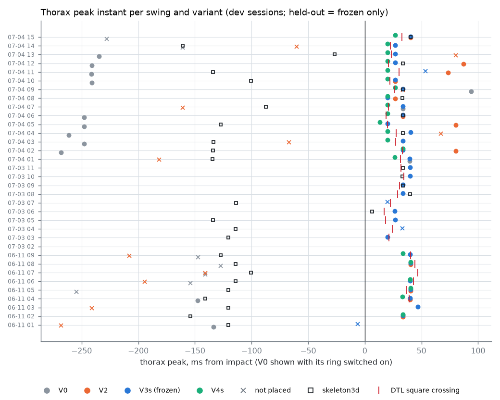
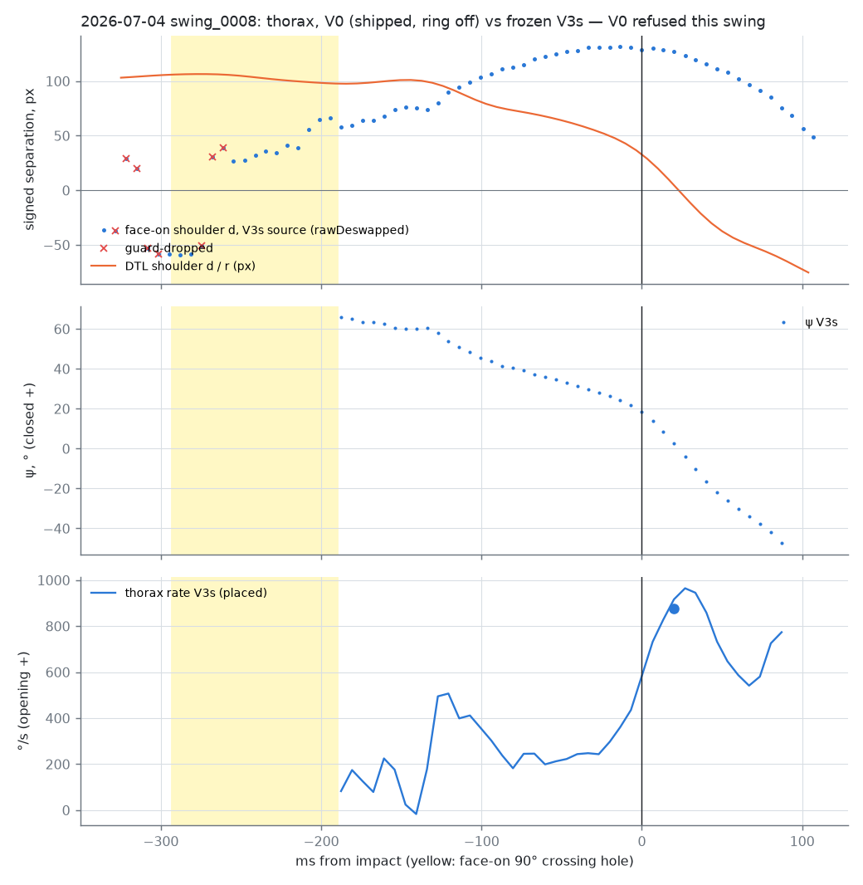
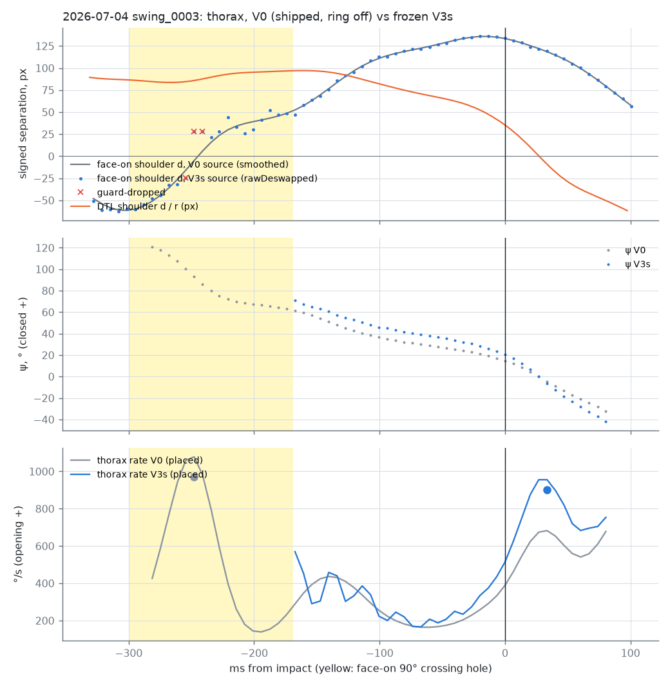
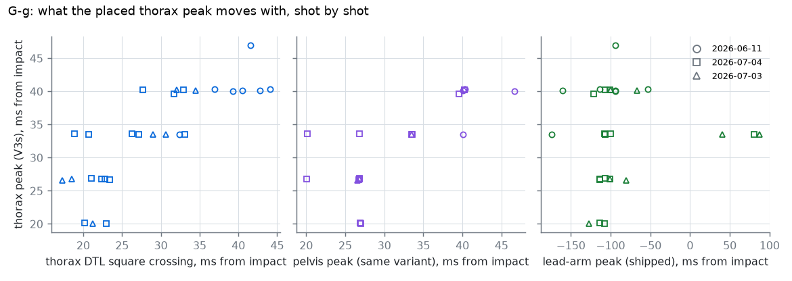

# A camera-only thorax node from the face-on + down-the-line pair

**Written 2026-10-14.** Offline, Python only. No C++ touched, nothing re-analysed, nothing written to
the corpus. Follows the 20 Sept K0 study (`pair_span_turn_20260920.md`) and does not repeat it.

**Rig:** `tools/swinglab/thorax_pair_offline.py`. **Per-swing rows:** `thorax_pair_20261014.csv`
(414 rows: swing × segment × variant). **Figures:** `figures/08_thorax_pair_*.png`. Every number below
comes from this one command, and the tables are printed by its `--report`:

    ~/.swinglab-venv/bin/python tools/swinglab/thorax_pair_offline.py --stage all \
        --csv docs/research/data/kinematic_sequence/thorax_pair_20261014.csv \
        --figdir docs/research/data/kinematic_sequence/figures \
        --summary /tmp/thorax_summary.json --report /tmp/thorax_report.md

**Data:** the 34 two-camera corpus swings, read through `tools/pp_swingdoc.load_swing`. The
development sessions are 2026-06-11 (9 swings) and 2026-07-04 (15). The held-out session is
2026-07-03 (10). Everything is one golfer (Mark), right-handed, about 149 fps in both views. The lead-arm
and club nodes are the ones already in each document.

---

## 0. Verdict

**Do not change the C++. No variant passes G-a to G-f, so the thorax ring stays off.**

The variant frozen on the development sessions is **V3s**: the face-on crossing treated as a hole,
the relabel decision taken from the down-the-line view at a 35° threshold, and ellipse scales. It
fails two gates:

* **G-f (invariance)** fails on every variant that places on 07-04. Changing γ within 75–90° moves
  the thorax peak by 2–4 frames.
* **G-e (held out)** fails on G-c. One of the seven nodes placed on 07-03 reads 1123 °/s, above the
  1100 ceiling.

Then there is G-g. The placed thorax peak follows its own down-the-line square crossing, shot by
shot, at r = 0.81, about 4.5 ms (SD 4.8) later. On 14 of 21 shots it falls on the **same sample**
as the pelvis peak. It follows the arm hardly at all (r = 0.07). **So the pair may be reading the
moment the two shoulders overlap in the down-the-line view, not the trunk. Only an IMU on the
sternum can tell those apart.**

| gate | frozen V3s, dev (06-11 · 07-04) | held out (07-03), run once | |
|---|---|---|---|
| G-a reproduction (V0 pelvis vs shipped) | 9/9 · 15/15, Δt 0.000 ms, Δpeak 0.0000 % | 10/10 | **PASS** |
| G-b no spike / not next to the hole | pass · pass | pass | **PASS** |
| G-c 400–1100 °/s | pass (785 [755, 802]) · pass (885 [813, 930]) | **FAIL**: s8 at 1123 | **FAIL** |
| G-d IQR ≤ 15 ms | 0.2 · 6.8 ms | 10.1 ms | **PASS** |
| places on ≥ half | 7/9 · 14/15 | 7/10 | pass |
| G-e held out (G-b, G-c, G-d, ≥ half) | n/a | fails on G-c | **FAIL** |
| G-f ≤ 1 frame under ±10 % scale, γ 75–90° | 1 fail · **6 fails** (2 scale, 5 γ) | 1 fail (γ) | **FAIL** |
| G-g common mode (judged) | the peak follows the DTL crossing and the pelvis, not the arm | same | **adverse** |

**The three numbers that matter:**

1. **2–4 frames.** That is how far γ alone moves the thorax node. V4s, which carries the fitted γ
   (63–74° for the shoulders on 07-04, 63–76° on 07-03), puts the 07-04 median at **20 ms** after impact.
   V3s, which assumes 90°, puts it at **34 ms**. This is the G-f failure, and it is about geometry,
   not noise.
2. **9 of 24.** The brief's V2 (DTL arbiter at 20°) inverts the face-on shoulder labels at impact on
   9 of 24 development swings. V0's collapse rule inverts 2 of 24, and the 35° rule inverts 0 of 24
   (0 of 9 held out). The DTL view cannot arbitrate a crossing near 90°: sin ψ is flat there.
3. **−13.4 ms for −12 ms.** Moving the DTL timestamps 12 ms earlier moves the placed thorax peak
   2 frames earlier in every session. The node moves one-for-one with the DTL clock. The capture clocks
   were then traced and are sound on device-stamped sessions; the wrist-vertical fit that read +10…+12 ms
   is biased, not the clocks (§9).

**What Mark should decide:**

* **(a)** Keep `sequence.pairTrunk.thoraxPlacement` off. Nothing here justifies switching it on.
* **(b)** The IMU placement on the sternum is the only way to settle G-g. It should come before any
  more camera-only thorax work.
* **(c)** Two defects in the **shipped** pair are real and do not depend on the verdict (§3.1,
  §3.2):
  * The face-on shoulders' smoothed source manufactures motion through the crossing (07-04 s8:
    +168 px against a 130 px line).
  * The collapse rule inverts the shoulder labels on 2 of 24 swings.

  Today both only affect a thorax curve that is drawn and not ringed. Fix them, with tests, before
  any thorax ring is reconsidered. A new design is not needed.
* **(d)** Is G-f's 75–90° the right range for γ? This rig measures the shoulder γ at 63–76°, so
  that range sits outside the measurement (§5).

---

## 1. Reproduction first (G-a)

V0 re-implements the shipped C++ sample for sample:

* `pairScale`, `separations`, `deswapInPlace` (with `pose.dtlLocalGap`) and `rateLimitInPlace`;
* the smoothed-where-clean source choice and the orientation bits;
* the DTL leg resampled onto the face-on instants;
* the `corr` gate;
* `angular_rate.h`'s `fitAt`, `localRates` and `placePeak` over `series_reduce.h`'s widened
  windowed mean;
* `finishChannel`, including the P4 → P8 trim, `validityBand`, the `bandIsHole` edges, the rising
  edge and the reversal spike.

K0's 4 ms-grid `local_fits` / `place_peak` were **not** reused for this. They resample, and they
have no window widening and no linear fallback for windows with only two time instants. G-a asks
for 1 ms against code that runs on native instants.

| session | swings | reproduced | shipped pair nodes | max |Δt| ms | max |Δpeak| % | max |Δrate| over the series, °/s |
|---|---|---|---|---|---|---|
| 2026-06-11 | 9 | 9 | 7 | 0.000 | 0.0000 | 0.000000 |
| 2026-07-03 | 10 | 10 | 5 | 0.000 | 0.0000 | 0.000000 |
| 2026-07-04 | 15 | 15 | 14 | 0.000 | 0.0000 | 0.000000 |

Thorax, ring off as shipped: the pair thorax stands down on 24 of 24 dev swings whose shipped thorax is not the pair.

It is exact. On every swing whose shipped pelvis is the pair, the node time, the peak and the whole
`pelvisAngularSpeed` series match bit for bit. On the other swings (06-11 s3 and s9, 07-04 s2, and
five on 07-03) V0 refuses for the same reason the producer did: the `corr` floor, or the address
extent on 07-03 s2. The thorax reproduces too. With the ring off, as shipped, the pair thorax
neither places nor bounds on every swing, which is why every shipped thorax on the development set
reads `faceOn`.

---

## 2. Every variant, both segments

The switches (`SPECS` in the rig) are cumulative:

* **V0**: as shipped.
* **V1**: adds the face-on 90° crossing (raw |d_fo| < 0.35·W_fo, padded by 25 ms) as an interior
  hole, with a bound at any edge.
* **V2**: adds the DTL relabel arbiter at 20°, as briefed.
* **V3**: adds ellipse scales.
* **V4**: adds γ.

The `s` chain (**V2s, V3s, V4s**) is the same with the arbiter at 35° (§3.2). The thorax ring is
evaluated **switched on** in every variant, since that is the question.

| variant | session | n | placed | bounded | neither | refused | placed peak, ms from impact | peak °/s | σt ms | G-b | G-c | G-d IQR ms | ≥ half | G-f fails (scale/γ) | inverted parity at impact |
|---|---|---|---|---|---|---|---|---|---|---|---|---|---|---|---|
| V0 | 06-11 | 9 | 2 | 0 | 5 | 2 | -141 [-144, -137] | 1831 [1809, 1853] | 10 | FAIL | FAIL (2) | 7.0 FAIL | no | 0 (0/0) | 2 of 9 |
| V0 | 07-04 | 15 | 12 | 0 | 2 | 1 | -241 [-248, -168] | 793 [760, 907] | 14 | FAIL | pass (0) | 80.3 FAIL | yes | 5 (4/4) | 0 of 15 |
| V1 | 06-11 | 9 | 6 | 2 | 1 | 0 | 40 [40, 45] | 687 [674, 707] | 14 | pass | pass (0) | 5.2 pass | yes | 2 (0/2) | 2 of 9 |
| V1 | 07-04 | 15 | 12 | 1 | 2 | 0 | 40 [34, 80] | 650 [641, 697] | 18 | pass | pass (0) | 46.8 FAIL | yes | 10 (5/8) | 0 of 15 |
| V2s | 06-11 | 9 | 7 | 1 | 0 | 1 | 40 [40, 44] | 682 [669, 702] | 15 | pass | pass (0) | 3.6 pass | yes | 2 (0/2) | 0 of 9 |
| V2s | 07-04 | 15 | 12 | 1 | 2 | 0 | 40 [34, 80] | 650 [641, 697] | 18 | pass | pass (0) | 46.8 FAIL | yes | 10 (5/8) | 0 of 15 |
| V2 | 06-11 | 9 | 4 | 3 | 2 | 0 | 40 [38, 40] | 691 [670, 721] | 14 | pass | pass (0) | 1.9 pass | no | 0 (0/0) | 5 of 9 |
| V2 | 07-04 | 15 | 8 | 2 | 5 | 0 | 57 [32, 80] | 666 [643, 707] | 16 | pass | pass (0) | 48.5 FAIL | yes | 7 (3/5) | 4 of 15 |
| V3s | 06-11 | 9 | 7 | 0 | 1 | 1 | 40 [40, 40] | 785 [755, 802] | 14 | pass | pass (0) | 0.2 pass | yes | 1 (0/1) | 0 of 9 |
| V3s | 07-03 | 10 | 7 | 2 | 0 | 1 | 33 [27, 37] | 1041 [847, 1082] | 14 | pass | FAIL (1) | 10.1 pass | yes | 1 (0/1) | 0 of 9 |
| V3s | 07-04 | 15 | 14 | 0 | 1 | 0 | 34 [27, 34] | 885 [813, 930] | 16 | pass | pass (0) | 6.8 pass | yes | 6 (2/5) | 0 of 15 |
| V3 | 06-11 | 9 | 4 | 3 | 2 | 0 | 40 [38, 40] | 781 [757, 787] | 14 | pass | pass (0) | 1.9 pass | no | 0 (0/0) | 5 of 9 |
| V3 | 07-04 | 15 | 10 | 1 | 4 | 0 | 30 [27, 34] | 877 [813, 928] | 16 | pass | pass (0) | 6.8 pass | yes | 4 (2/3) | 4 of 15 |
| V4s | 06-11 | 9 | 6 | 0 | 0 | 3 | 37 [33, 40] | 749 [723, 754] | 14 | pass | pass (0) | 6.8 pass | yes | 0 (0/0) | 0 of 9 |
| V4s | 07-04 | 15 | 15 | 0 | 0 | 0 | 20 [20, 23] | 809 [766, 814] | 16 | pass | pass (0) | 3.2 pass | yes | 7 (0/7) | 0 of 15 |
| V4 | 06-11 | 9 | 4 | 0 | 0 | 5 | 37 [33, 40] | 751 [739, 757] | 13 | pass | pass (0) | 6.9 pass | no | 0 (0/0) | 5 of 9 |
| V4 | 07-04 | 15 | 11 | 0 | 0 | 4 | 20 [20, 24] | 803 [756, 814] | 17 | pass | pass (0) | 3.4 pass | yes | 4 (0/4) | 4 of 15 |

The last column checks physical sanity. At impact the shoulders are near square to the face-on
camera, so the oriented face-on separation must be positive there. A negative value means the
labels ended up the wrong way round.

| variant | session | placed | refused | placed peak, ms | peak °/s | IQR ms | G-f fails | vs V0: median |Δt| ms |
|---|---|---|---|---|---|---|---|---|
| V0 | 06-11 | 7 | 2 | 40 [40, 44] | 838 [810, 907] | 3.4 | 0 | 0.0 |
| V0 | 07-03 | 5 | 5 | 27 [27, 33] | 884 [855, 887] | 6.7 | 1 | 0.0 |
| V0 | 07-04 | 14 | 1 | 27 [27, 38] | 837 [819, 877] | 11.3 | 2 | 0.0 |
| V1 | 06-11 | 7 | 2 | 40 [40, 44] | 838 [810, 907] | 3.4 | 0 | 0.0 |
| V1 | 07-04 | 14 | 1 | 27 [27, 38] | 837 [819, 877] | 11.3 | 2 | 0.0 |
| V2s | 06-11 | 7 | 2 | 40 [40, 44] | 838 [810, 907] | 3.4 | 0 | 0.0 |
| V2s | 07-04 | 14 | 1 | 27 [27, 38] | 837 [819, 877] | 11.3 | 3 | 0.0 |
| V2 | 06-11 | 7 | 2 | 40 [40, 44] | 838 [810, 907] | 3.4 | 0 | 0.0 |
| V2 | 07-04 | 14 | 1 | 27 [27, 38] | 837 [819, 877] | 11.3 | 3 | 0.0 |
| V3s | 06-11 | 7 | 2 | 40 [40, 44] | 986 [963, 1035] | 3.4 | 0 | 0.0 |
| V3s | 07-03 | 5 | 5 | 27 [27, 33] | 868 [859, 893] | 6.7 | 1 | 0.0 |
| V3s | 07-04 | 14 | 1 | 27 [27, 34] | 794 [746, 828] | 6.7 | 3 | 0.0 |
| V3 | 06-11 | 7 | 2 | 40 [40, 44] | 986 [963, 1035] | 3.4 | 0 | 0.0 |
| V3 | 07-04 | 14 | 1 | 27 [27, 34] | 794 [746, 828] | 6.7 | 3 | 0.0 |
| V4s | 06-11 | 5 | 4 | 40 [40, 40] | 806 [796, 813] | 0.2 | 0 | 0.0 |
| V4s | 07-04 | 14 | 1 | 27 [26, 34] | 718 [688, 767] | 7.1 | 3 | 0.0 |
| V4 | 06-11 | 5 | 4 | 40 [40, 40] | 806 [796, 813] | 0.2 | 0 | 0.0 |
| V4 | 07-04 | 14 | 1 | 27 [26, 34] | 718 [688, 767] | 7.1 | 3 | 0.0 |

**No variant changes the pelvis node time.** The median |Δt| against V0 is 0.0 ms everywhere. V4
and V4s lose two 06-11 pelvis nodes to the γ / R² refusal: s1 at γ 54°, and s5 at R² 0.84. V3's ellipse
scales lift the pelvis magnitude on 06-11 from 838 to 986 °/s. The pelvis magnitude stays
unpublishable (K0 G4).

*Figure 1. Thorax peak per swing.*

* **V0 with its ring on** (grey) places near the transition. Its median is 141 ms before impact on
  06-11 and 241 ms before on 07-04. Those are the spikes `kPairTrunkThoraxPlacement` was switched
  off for.
* **Every variant that fixes the crossing** moves most peaks to 20–47 ms **after** impact, next to
  the thorax's DTL square crossing (red tick).
* **The skeleton3d thorax** (open square) peaks **before** impact on 22 of 33 swings (§8).

---

## 3. What the development data changed, before the freeze

Four choices were made on 06-11 and 07-04 after inspecting them, and before 07-03 was opened. Each
is in the rig's docstring.

### 3.1 The crossing has to be read on the raw keypoints, and consumed raw

*Figure 2. 07-04 s8.*

Around the top, the raw face-on shoulder separation sits at 25–60 px with its sign alternating
(red ×: dropped by the guards). The collapse rule calls every one of those sign changes genuine,
because every one collapses. The shipped source choice therefore calls the track clean and consumes
the **smoothed** track. The RTS smoother bridges the flutter into a ramp that peaks at **1.30×
the raw p95** (about +168 px against a 130 px line) in the early downswing. That is wider than the
line itself, i.e. "32° from square" while the DTL sees the line broadside. §3.2's table (last
column) gives the smoothed track's maximum over the domain: 1.02–1.05× the raw p95 on a typical
swing, 1.30× on 07-04 s8, and 1.42× on the worst 06-11 swing. On this swing V0 is refused by `corr` (0.25). On others the
ramp feeds the angle.

So V1+ define the hole on the **raw** |d_fo|, and a face-on leg that crosses is consumed raw
(de-swapped). This is the C++'s own doctrine, "detect where it is still a step", extended to the
choice of source.

### 3.2 The DTL cannot arbitrate a crossing near 90°, and the brief's 20° rule makes it worse

| session | swings | sign changes | collapse rule says relabel | 20° rule disagrees | DTL |d|/p95 at the change, min per swing: median [IQR] (range) | smoothed face-on max |d| / raw p95, thorax: median (max; swings > 1) |
|---|---|---|---|---|---|---|
| 2026-06-11 | 9 | 11 | 2 | 7 | 0.93 [0.93, 0.95] (0.92–1.02) | 1.05 (1.42; 9) |
| 2026-07-03 | 10 | 10 | 4 | 4 | 0.93 [0.91, 0.95] (0.91–0.95) | 1.02 (1.03; 9) |
| 2026-07-04 | 15 | 30 | 0 | 8 | 0.95 [0.93, 0.97] (0.84–1.00) | 1.02 (1.30; 15) |

The table counts every face-on shoulder sign change inside the domain. At those sign changes the
DTL read as little as 0.84–1.02 of its own p95 amplitude (the per-swing minimum). The 20° rule needs
0.94, so it disagrees with the collapse rule 15 times on the development sessions, and 4 more held
out. Judged by the parity check (§2):

* **The 20° rule is wrong on 9 of 24 development swings.** Its "relabels" turn genuine crossings
  into a thorax that is 180° out at impact. Figure 3 shows 07-04 s3, a typical case.
* **The collapse rule is wrong on 2 of 24** (06-11 s5 and s7). There the keypoints jump across zero
  with |d| ≥ 0.35 W.
* **At 35° the arbiter is wrong on none of 24**, and on none of 9 held out.

The reason is structural, not a matter of tuning. A genuine crossing and a relabel near 90° differ
only in whether ψ is 80° or 100°. The DTL reads W′·sin ψ, which is the same for both. The DTL can
veto a "genuine" call far from 90°, but on these 34 swings there was no such case to veto. Every
in-domain face-on sign change was a genuine crossing (parity at impact proves it), so the 35° rule's
power to catch a real relabel is **untested**.

*Figure 3. 07-04 s3 under V0 and V3s.*

* **V0** keeps the smoothed face-on track and places a 1000 °/s "thorax peak" inside the crossing,
  250 ms before impact.
* **V3s** masks the crossing and finds the peak 33 ms after impact.

### 3.3 V4 uses K0 §2.1's own triple

Under γ ≠ 90 the axis-aligned ellipse is the wrong model. Fitted on V3's ellipse W, the 06-11
pelvis read γ 54–65°. With face-on's own W_peak, as K0 §2.1 did, it reads 75° (§4), which matches
K0. So V4 uses (W_peak, W′, γ) from the consistency fit.

### 3.4 Gate arithmetic

* **G-f is counted in frames**, i.e. face-on samples between the two peak instants. One frame here
  is 6.6–6.9 ms, so a literal "≤ 6.7 ms" test would fail genuine one-frame moves.
* **V5's still-hold σ_w** is the lower quartile of 150 ms windows. The minimum would be biased low.

**The freeze rule** (`select_variant`) takes the first variant, in the order V0, V1, V2s, V2, V3s,
V3, V4s, V4, that passes all twelve development checks:

* G-b, G-c, G-d, G-f, and placing on at least half the swings, in each session;
* not breaking the pelvis.

If none passes all twelve, it takes the variant that passes the most, with ties going to the earlier
one in that order. None passed. V3s, V3 and V4s each passed 10 of 12, so **V3s was frozen**. The
held-out session was run once, on V3s only, plus V0's pelvis for G-a.

Three later re-runs only added diagnostic columns and report formatting. They reproduced every
earlier column of the CSV unchanged (checked: 0 of 414 rows differ).

---

## 4. Geometry on the frozen variant

| session | segment | γ fit ° | R² | closure p50 | closure p90 | DTL amplitude / (r·W_fo) | (W'/W)_fit / r |
|---|---|---|---|---|---|---|---|
| 06-11 | pelvis | 75.1 [73.6, 75.4] | 0.894 [0.884, 0.922] | 0.040 [0.039, 0.049] | 0.093 [0.080, 0.104] | 0.82 [0.81, 0.83] | 0.84 [0.80, 0.89] |
| 06-11 | thorax | 83.8 [82.8, 84.6] | 0.886 [0.858, 0.908] | 0.044 [0.027, 0.052] | 0.081 [0.071, 0.101] | 0.77 [0.76, 0.78] | 0.87 [0.83, 0.95] |
| 07-03 | pelvis | 76.1 [74.8, 76.6] | 0.884 [0.872, 0.895] | 0.021 [0.017, 0.025] | 0.042 [0.034, 0.054] | 0.78 [0.77, 0.80] | 1.00 [0.99, 1.02] |
| 07-03 | thorax | 67.7 [64.8, 72.7] | 0.983 [0.982, 0.985] | 0.030 [0.027, 0.040] | 0.083 [0.076, 0.090] | 0.81 [0.80, 0.82] | 0.75 [0.70, 0.83] |
| 07-04 | pelvis | 81.4 [79.1, 82.4] | 0.965 [0.950, 0.980] | 0.037 [0.025, 0.045] | 0.076 [0.067, 0.081] | 0.85 [0.83, 0.86] | 1.06 [1.01, 1.09] |
| 07-04 | thorax | 71.2 [68.7, 71.7] | 0.982 [0.974, 0.987] | 0.019 [0.012, 0.023] | 0.073 [0.060, 0.093] | 0.79 [0.78, 0.80] | 0.72 [0.71, 0.77] |

* **The consistency R² is high once the labels are right.** For the thorax it is 0.98 on 07-04 and
  07-03, and 0.89 on 06-11. The two views do see one shoulder line turning.
* **The shoulder inter-view angle is not the hip's.** The shoulders read γ 67–71° on the 07-0x rigs,
  against 76–81° for the hips. On 06-11 they read 84° against 75°.
* **The DTL shoulder amplitude reaches 0.77–0.81 of r·W_fo**, as the brief said ("~0.78"). The
  shoulders pass 90° all the same, as the face-on crossing proves. The ellipse fit agrees: its
  (W′/W)/r is 0.72–0.87 for the shoulders and 0.84–1.06 for the hips.
* **The ratio r from the address vertical extent is the wrong scale for the shoulders** by 13–28 %.
  This is the scale V3 replaces, and the cause of V3s's higher thorax magnitude (885 against 650
  °/s on 07-04).
* **Closure over the downswing is 2–4 % (p50) and 4–9 % (p90).**

---

## 5. G-f: the thorax instant depends on γ

All counts are of placed nodes that move more than one frame.

| variant | 07-04 scale fails | 07-04 γ fails | median peak on 07-04 |
|---|---|---|---|
| V3s (γ assumed 90°) | 2 / 14 | 5 / 14 | 34 ms |
| V4s (γ fitted, 63–74°) | 0 / 15 | 7 / 15 | 20 ms |

* **Carrying γ fixes the scale sensitivity** (V4s has no scale fails). It does not make the instant
  independent of γ.
* **The shoulders' fitted γ lies outside the gate's 75–90° range.** Forcing γ into that range moves
  the V4s node by 2–4 frames.
* **The pelvis also fails G-f** on 2–3 of 14 swings on 07-04, under every variant including V0. K0's
  claim that the peak time is invariant to ±10 % reference error holds for the scales, but not
  for γ.

The cause is the shape of the curve. The post-impact thorax rate has a hump at +20…+40 ms, a dip at
about +65 ms, and is rising again into P8 (Figures 2 and 3). A 15° change in γ reshapes the angle
by up to 15° near square, which is where that hump is. A fix would need one of two things:

* a measured γ, so that the range is the fit's own uncertainty rather than 75–90°;
* a camera calibration that fixes γ outright (the calibration thread).

---

## 6. The held-out session, as run

| swing | thorax state | peak ms | °/s | σt ms | reversal ms | G-f frames (scale/γ) | γ ° | R² | DTL crossing ms | skeleton ms | pelvis state | pelvis ms |
|---|---|---|---|---|---|---|---|---|---|---|---|---|
| 02 | refused (pair scale refused) | — | — | — | — | —/— | — | — | — | — | refused | — |
| 03 | placed | 20.1 | 797 | 17 | 248 | 0/0 | 67.7 | 0.983 | 21.3 | -120.6 | refused | — |
| 04 | bounded | 33.3 | 750 | 14 | ∞ | 0/2 | 72.7 | 0.982 | 24.4 | -114.1 | placed | 33.3 |
| 05 | placed | 26.8 | 777 | 13 | 192 | 0/2 | 76.0 | 0.969 | 18.5 | -134.0 | placed | 26.8 |
| 06 | placed | 26.6 | 898 | 12 | 100 | 0/0 | 75.3 | 0.981 | 17.3 | 6.4 | placed | 26.6 |
| 07 | bounded | 20.1 | 877 | 15 | 180 | 0/0 | 70.9 | 0.985 | 22.8 | -113.7 | placed | 20.1 |
| 08 | placed | 33.5 | 1123 | 13 | 225 | 1/0 | 64.8 | 0.990 | 29.0 | 40.2 | refused | — |
| 09 | placed | 33.5 | 1094 | 14 | 255 | 0/1 | 65.8 | 0.982 | 30.6 | 33.5 | placed | 33.5 |
| 10 | placed | 40.2 | 1070 | 19 | 233 | 1/1 | 62.8 | 0.984 | 34.5 | 33.4 | refused | — |
| 11 | placed | 40.2 | 1041 | 18 | 216 | 0/1 | 64.7 | 0.985 | 32.0 | 33.6 | refused | — |

* **Seven of ten placed**, so it does place on at least half.
* **G-b and G-d (IQR 10.1 ms) pass.**
* **G-c fails** on s8, at 1123 °/s.
* **The 07-03 thorax magnitudes run high**, at 1041 [847, 1082] °/s. Under V3s the ellipse scale is
  the magnitude: (W′/W)/r is 0.75 there.
* **On s5 and s6 the shipped thorax route is the pair.** It is bounded at about −234 ms, with the
  ring off. Every other shipped thorax is `faceOn`.
* **On s2 the pair scale was refused.** The address extent failed the 100 px floor.

---

## 7. G-g: what the thorax node moves with

dev sessions:

| against | n | r | r within session | lag median ms | lag SD ms | lag IQR ms | same sample | within 1 frame |
|---|---|---|---|---|---|---|---|---|
| dtl_square | 21 | 0.79 | 0.66 | 4.0 | 5.2 | 6.9 | 4 | 15 |
| pelvis | 18 | 0.78 | 0.67 | 0.0 | 5.2 | 0.0 | 11 | 17 |
| arm | 21 | 0.05 | 0.20 | 140.6 | 47.9 | 6.8 | 0 | 0 |
| triangulated | 21 | -0.19 | 0.15 | 154.1 | 78.0 | 160.9 | 3 | 5 |

all three sessions:

| against | n | r | r within session | lag median ms | lag SD ms | lag IQR ms | same sample | within 1 frame |
|---|---|---|---|---|---|---|---|---|
| dtl_square | 28 | 0.81 | 0.73 | 4.5 | 4.8 | 6.9 | 4 | 19 |
| pelvis | 21 | 0.79 | 0.69 | 0.0 | 4.7 | 0.0 | 14 | 20 |
| arm | 28 | 0.07 | 0.24 | 137.3 | 60.3 | 13.5 | 0 | 1 |
| triangulated | 28 | -0.01 | 0.35 | 133.9 | 80.1 | 162.4 | 4 | 9 |

*Figure 4. What the placed thorax peak moves with.*

* **The thorax peak follows its DTL square crossing**: r 0.81, or 0.73 within a session, lagging it
  by 4.5 ms with SD 4.8.
* **It falls on the same sample as the pelvis peak on 14 of 21 shots**, with a lag IQR of 0 ms.
* **It does not follow the shipped lead-arm node** (r 0.07), and it does not follow the skeleton
  thorax.

K0 found the same thing at 4 ms apart, and it is why the pair cannot order the two trunk segments
here. Every V3s order with both trunk nodes is unresolved on 07-04 (§11).

So: **the pair may be reading the DTL overlap rather than the trunk.** Both trunk lines square up to
the DTL camera within a frame of each other, and both rates peak a frame later. A real
pelvis-then-thorax gap would survive that. A shared artefact of the DTL view, such as overlap or
the arms crossing, would not, and neither would a shared clock offset (§9). Only an IMU can
separate those explanations.

---

## 8. The two camera routes disagree about which side of impact the thorax peaks

| session | pair placed | pair peak ms | skeleton peak ms (all swings) | skeleton peaks before impact | skeleton within 1 frame of the pair | DTL crossing ms | pair − crossing ms |
|---|---|---|---|---|---|---|---|
| 2026-06-11 | 7/9 | 40 [40, 40] | -121 [-127, -114] | 9/9 | 0/7 | 41 [38, 42] | 0.7 [-1.5, 2.2] |
| 2026-07-03 | 7/10 | 33 [27, 37] | 6 [-114, 33] | 4/9 | 4/7 | 29 [20, 31] | 5.6 [3.7, 8.2] |
| 2026-07-04 | 14/15 | 34 [27, 34] | -87 [-134, 34] | 9/15 | 5/14 | 23 [21, 28] | 6.1 [3.5, 7.8] |

The skeleton3d shoulder line's rate was placed with the same finisher, at a nominal 0.5° σ.

* **Before impact.** The skeleton peaks before impact on 22 of 33 swings, at about −87…−121 ms,
  where the pair has a secondary hump of 400–500 °/s (Figures 2 and 3).
* **On the pair's sample.** Where the skeleton peaks after impact, it usually lands on the pair's
  own sample: 9 of 28 within a frame, all three sessions together.

The skeleton fits the same two sets of 2-D keypoints, so this is not independent evidence. Both
humps are in the data. The two routes disagree about which hump is the larger, and neither has truth
behind it.

---

## 9. The clock

| session | segment | −4 ms | −12 ms | hard sync check: wrist δ ms | elbow δ ms |
|---|---|---|---|---|---|
| 06-11 | pelvis | 0.0 [0.0, 0.0] | -13.4 [-13.4, -10.0] | 10.3 [10.1, 10.5] | 2.5 [1.8, 3.2] |
| 06-11 | thorax | 0.0 [0.0, 0.0] | -13.4 [-16.8, -13.4] | 10.3 [10.1, 10.5] | 2.5 [1.8, 3.2] |
| 07-03 | pelvis | 0.0 [0.0, 0.0] | -13.4 [-13.4, -13.3] | 10.0 [9.4, 10.1] | 16.3 [15.2, 21.7] |
| 07-03 | thorax | 0.0 [-6.7, 0.0] | -13.4 [-13.4, -13.4] | 10.0 [9.4, 10.1] | 16.3 [15.2, 21.7] |
| 07-04 | pelvis | 0.0 [-6.7, 0.0] | -10.0 [-13.3, -6.7] | 12.0 [9.6, 12.5] | 8.0 [6.9, 12.9] |
| 07-04 | thorax | -6.7 [-6.8, 0.0] | -13.4 [-13.5, -8.4] | 12.0 [9.6, 12.5] | 8.0 [6.9, 12.9] |

* **This rig's sync check disagrees with the earlier figure.** It fits the lead-wrist vertical of
  the two views, y_fo ≈ a + b·y_dtl(t + δ), over Top → Impact + 50 ms. That reads the DTL as late by
  **+12.0 ms** (wrist) and +8.0 ms (elbow) on 07-04. The figure established earlier today was +4 ms
  (elbow −1…−7). That earlier fit's details are not in the brief. This one is in `sync_offset()`.
  The two together say the clocks agree to 0.5–2 frames, not to one frame for certain.
* **The thorax node moves with the DTL clock about one-for-one.** Shifting the DTL timestamps −4 ms
  moves the thorax peak 0 or −1 frame; −12 ms moves it −2 frames (−13.4 ms) in every session.

**Resolved after this pass (14 Oct): the offset is the estimator, not the clocks.** The capture path was
traced: each Spinnaker camera is latched to the host clock before acquisition (`VideoInputSpinnaker`, best of
the latch brackets, about 210–230 µs round trip), and every frame is stamped from the camera's own timestamp moved
to mid-exposure and mapped through `DeviceClockMapper` (`camera_instance.cpp` uses that instant for the buffer).
The October sessions record `timestampSource: device`, method `latch`, residuals p50 0.18–0.19 ms, and the two
cameras' latencies agree (9.6 / 10.0 ms), so a latch error would be common to both and cancel. Pose frame
times equal the stream stamps exactly in both views. Yet the same wrist-vertical fit reads the DTL +9…+12 ms
late on 112 device-stamped October swings too. So the fit is biased by about 10 ms (the vertical's shape differs
between the views: the hands move in depth for the DTL camera and laterally for face-on, and an affine fit
with a shift absorbs that as lag). It is not a sync estimator, and the one-for-one sensitivity above is a
sensitivity, not evidence of an offset. On the Jun/Jul sessions (arrival-stamped, before 16 Sept) sync is
unverified either way.

---

## 10. V5: the σ_w from a still hold

| session | σt median, keypoint σ | σt median, still σ_w | σ_w face-on px | σ_w DTL px | placements changed |
|---|---|---|---|---|---|
| 2026-06-11 | 15.5 [13.5, 18.9] | 9.7 [6.8, 12.2] | 0.30 [0.30, 0.30] | 0.68 [0.54, 0.79] | 1 |
| 2026-07-03 | 13.8 [13.4, 16.9] | 8.1 [6.9, 9.0] | 0.30 [0.30, 0.30] | 0.56 [0.47, 0.78] | 0 |
| 2026-07-04 | 16.4 [15.5, 19.6] | 9.5 [8.7, 11.1] | 0.30 [0.30, 0.30] | 0.75 [0.67, 0.92] | 0 |

* **The still face-on shoulders do not jitter measurably.** Their σ_w sits at the 0.3 px floor; the
  DTL's is 0.6–0.8 px.
* **σ_t would fall from 14–16 ms to 8–10 ms.** That is material, but it changes one placement. The
  thorax was never gated on σ_t: it fails on γ and on what it measures.
* **The keypoint σ the shipped route uses is the conservative one.** The shipped route takes the
  smoother's posterior σ, or 3 px per keypoint on raw input.

---

## 11. Orders with the shipped arm and club

| session | order | n | resolved |
|---|---|---|---|
| 06-11 | leadArm>club>thorax>pelvis | 2 | 0 |
| 06-11 | leadArm>club>thorax | 2 | 2 |
| 06-11 | leadArm>club>pelvis>thorax | 2 | 0 |
| 06-11 | leadArm>club>pelvis | 1 | 0 |
| 06-11 | leadArm>pelvis | 1 | 1 |
| 06-11 | club>leadArm>pelvis>thorax | 1 | 0 |
| 07-03 | leadArm>club>thorax | 3 | 3 |
| 07-03 | leadArm>club>pelvis | 2 | 2 |
| 07-03 | leadArm>club>pelvis>thorax | 2 | 0 |
| 07-03 | leadArm>club | 1 | 1 |
| 07-03 | club>thorax>leadArm | 1 | 1 |
| 07-03 | club>pelvis>thorax>leadArm | 1 | 0 |
| 07-04 | leadArm>club>pelvis>thorax | 11 | 0 |
| 07-04 | leadArm>club>thorax>pelvis | 2 | 0 |
| 07-04 | club>thorax>leadArm | 1 | 1 |
| 07-04 | leadArm>club>pelvis | 1 | 1 |

* **The lead arm comes first** on nearly every shot, and both trunk nodes after the club. This is
  the reversed pattern K0 reported.
* **Every order that holds both trunk nodes is unresolved on 07-04**, because the pelvis and thorax
  share a sample.

---

## 12. What would fix it

A camera-only thorax node needs three things, in this order:

1. **A measured γ or a calibrated rig (fixes G-f).** The thorax instant depends on the inter-view
   angle at the 2–4 frame level, and the shoulders' γ (63–76°) is not the hips'. V4s carries the
   fitted value and loses the scale sensitivity entirely. What it still lacks is a γ uncertainty
   small enough that the instant stops moving.
2. **Sync is not the blocker on device-stamped sessions** (§9, resolved): the capture clocks are latched per
   camera and agree to well under a frame. The arrival-stamped Jun/Jul sessions remain unverified.
3. **IMU truth on the sternum (settles G-g).** The pair cannot tell the trunk peaking from the DTL
   overlap, on a golfer whose pelvis and thorax both peak 20–40 ms after impact.

Independently of a thorax ring, the C++ deserves two small fixes. Both are recommended as tests
first, since today they only affect a curve that is not ringed:

* **(i) The face-on shoulder source choice** should read "raw when the raw track crosses", not
  "smoothed when no flip was detected". Test: 07-04 s8, where the smoothed |d| must not exceed the
  raw p95.
* **(ii) The collapse rule** misfires on keypoint jumps across zero (06-11 s5/s7). Test: those two
  swings, where the oriented face-on separation at impact must be positive.

Neither fix changes the pelvis. Every variant leaves it unchanged (§2).

**Fixed 2026-10-14, test first, in `src/Kinematics/segment_rates.cpp`** (not committed; nothing
re-analysed). The thorax ring stays off.

* **(i)** `pairTurnTrack` now consumes the face-on leg raw (de-swapped) whenever its de-swapped,
  rate-limited raw track changes sign inside the domain (P4 → P8), as well as after a flip or a drop.
  The DTL leg is left alone: it crosses zero near impact on 32 of 33 pelvis swings, but its smoothed
  tier never overshoots (at most 1.016× the raw p95).
* **(ii)** The root cause is in `deswapInPlace`. The collapse rule looks only at the two samples
  either side of a sign change. On 06-11 s5 and s7 the shoulder keypoints hold their value and then
  jump straight across zero (−86 → +100 px, −111 → +79 px), so the crossing never shows the collapse.
  The rigid-body bound cannot help, because it votes relabel as well. The fix makes impact a second
  parity anchor for the face-on view. If the walk contradicts impact and there is exactly one
  ambiguous unit between address and impact (one relabel call, or one flutter cluster), that unit is
  revoked. Any other count refuses the leg.
* **Tests** are in `segment_rates_test` §14. They use the shoulders and hips of 07-04 s8, 06-11 s5
  and 06-11 s7 (`src/Analysis/tests/data/segment_rates/`, written by
  `tools/swinglab/pair_deswap_fixtures.py extract`), plus two synthetic swings. All of them failed
  before the fix and pass after it. On the three swings the pelvis node matches the shipped
  document: the same time, and a peak bit-identical on 07-04 s8 and within 4e-16 of itself on the
  06-11 pair. That last-place difference was there before the fix too.
* **Corpus check** (`pair_deswap_fixtures.py check`, a replica of the fixed C++ on the rig):
  * Pelvis: 34/34 nodes identical.
  * Face-on shoulders: the consumed maximum is at most 1.08× the raw p95 on every swing. It was 1.30
    on 07-04 s8 and 1.32 on 06-11 s3.
  * Parity at impact is positive on 34/34. It was inverted on 06-11 s5, s7 and 07-03 s4–s6.
  * The shipped thorax, ring off, changes on three swings. 07-03 s5 and s6 lose their −234 / −228 ms
    bounds and fall through to the face-on span. **06-11 s1 gains a pair bound, "no later than 127 ms
    before impact".** That bound sits at the edge of the raw crossing hole: it is the "C++ reads only
    the first hole" behaviour that V1 addresses (§2). It is still open.

---

## 13. Open questions

1. **Was G-f's 75–90° meant for γ?** It was framed when γ was assumed 75–84° for both segments. The
   shoulders measure 63–76°. Should the gate be ± the fit's own uncertainty instead?
2. **Sync (answered).** The +4 ms figure used the wrong Top (phase id 8 is P3) and was wrong. With the right
   window the fit reads +10…+12 ms on every session, including device-stamped ones, so the fit is biased and
   the clocks are not off (§9).
3. **Is the 35° arbiter ever needed?** No genuine relabel occurred inside the domain on 34 swings.
   Its power to catch one is unmeasured, and the collapse rule plus the parity-at-impact check may be
   all that is needed.
4. **06-11 s1's ladder puts P8 3.8 ms after impact.** The domain then ends at the ball, and the
   through-P8 rule places whatever sits at the edge (V3s "neither" here, but 276 °/s under V2s). Is
   a P8 that close to impact a ladder defect to chase separately?
5. **The skeleton and the pair disagree about which side of impact the thorax peaks** (§8). The
   IMU capture should log both, so the comparison is made against truth.
