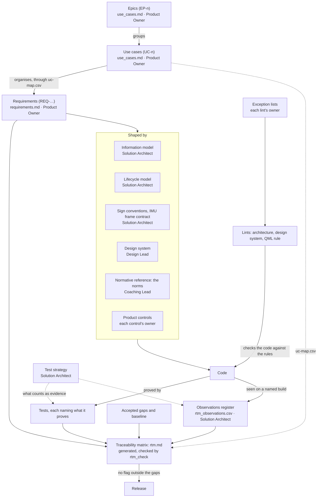
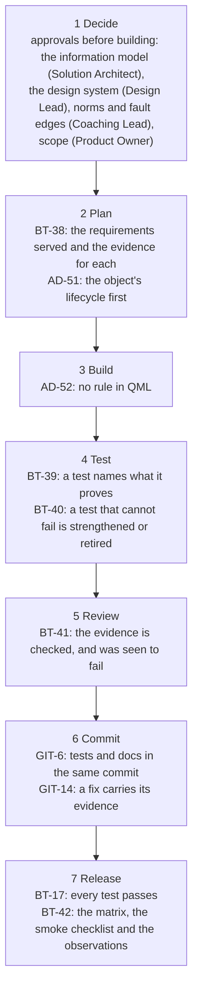

# Governance

This folder is the project's one home for the policies, controls, procedures and guidance that decide whether a change is acceptable, and for the governing documents themselves[^po-195]. People and agents read the same text here; an agent's own instructions file holds no rules of its own and points here[^issue-195].

## The non-negotiables

The ten rules broken most often, listed together. Each line points to the control or rule that holds it, which stays the one copy ([POL-3](policies.md))[^nn].

1. **Nothing is called done, fixed or working without evidence:** a passing test, or an observation against a named build ([POL-9](policies.md); [BT-38](controls/plan.md), [BT-39](controls/test.md), [BT-40](controls/test.md), [BT-41](controls/review.md), [BT-42](controls/release.md); [AG-25](controls/test.md); the test strategy, [`test_strategy.md`](artefacts/test_strategy.md)).
2. **Approval before building:** information-model changes need the Solution Architect, and design-system changes the Design Lead. Before recommending a cut or a change, grep the governed artefacts for what it touches ([POL-4](policies.md); [`information_model.md`](artefacts/information_model.md) §1.2).
3. **No rule in QML;** rules are C++ ([AD-52](controls/build.md)).
4. **An object's files are read and written only by their owner** ([`information_model.md`](artefacts/information_model.md) P11; lint A5).
5. **A fix for a broken rule removes the breach, or it is an honest deferral with the breach named on an issue** ([AG-42](controls/review.md), [AG-9](controls/plan.md)).
6. **Commit messages are plain English, with no programme ids in the title;** tests and docs go in the same commit ([GIT-6](controls/commit.md), [GIT-8](controls/commit.md), [GIT-9](controls/commit.md), [GIT-13](controls/commit.md)).
7. **Decisions are put in plain English with a recommendation;** a question never stops a lane ([AG-1](controls/decide.md), [AG-3](controls/decide.md)).
8. **One heavy job at a time on a shared machine;** tell the owner before heavy work on a machine they use; each machine's own limits and restrictions are in its local agent file ([BT-15](controls/build.md), [BT-44](controls/build.md), [POL-7](policies.md)).
9. **Checks never change another lane's working copy** ([AG-41](controls/build.md)).
10. **Rules live in `governance/`, never in an agent's private notes;** a note is trimmed once its rule is committed ([POL-3](policies.md)).

## Scope

This governance applies to PinPoint Studio only. Its sibling repositories (the phone-link library, the wrist-sensor library, the capture app and the others) set their own rules[^scope]. Hardware limits, such as a machine's build-job limit, are set in each developer's local agent file, not here[^local]; so is how a developer uses their own machines and shares ([POL-7](policies.md)).

## Terms

| Term | Means here | Where |
|---|---|---|
| **Policy** | A short principle that all work follows. It states intent, not steps, and names the controls that carry it out. | [`policies.md`](policies.md) |
| **Control** | A mandatory requirement, worded with "must" or "must not", that a change can be checked against. Each has an id, an owner (a role), the stage where it first applies, its compliance, and its source in a footnote. | [`controls/`](controls/) |
| **Procedure** | The steps for doing a piece of work so that its controls are met. A procedure adds no requirement of its own. | [`procedures/`](procedures/README.md) |
| **Guidance** | Advice ("should") and lessons learned. Following it is good practice; it is not checked. | [`guidance/`](guidance/) |
| **Artefact** | A governing document: a specification that decides whether a change is acceptable (the information model, the design system and others). | [`artefacts/`](artefacts/README.md) |
| **Exception** | An approved departure from a control, recorded in the exceptions register (below), with its reason. | the allowlists |
| **Compliance** | How a control is checked: an automated test or lint, named; a review; a recorded approval (by the role named); a statement in the commit or the plan; or "none yet". | each control |

## How it fits together

The documents here fall into four groups, each named by the question it answers[^groups]:

1. [**Product: what we build and why.**](#1-product-what-we-build-and-why) The requirements, the use cases over them, the norms, and the controls on what the product must do.
2. [**Architecture and platform: how it is shaped.**](#2-architecture-and-platform-how-it-is-shaped) The information model, the lifecycle model, the sign conventions, the IMU frame contract and the design system.
3. [**Assurance: how we know it works.**](#3-assurance-how-we-know-it-works) The test strategy, the observations register, the traceability matrix (planned) and the exception lists the lints read.
4. [**Method and tools: how we work.**](#4-method-and-tools-how-we-work) The policies, the controls by stage, the procedures, the guidance, the roles, and the tools that check them.

The register of artefacts, [`artefacts/README.md`](artefacts/README.md), says what each governing document governs; the tables below link to it and add the owner, the question and what checks each one. Each owner is the one that [`roles.md`](roles.md) ("The documents each role owns") and the register name.

### The trace chain

How a need travels from the golfer's goal to a release, and which document shapes or checks each step. A solid arrow is a step in the chain; a dotted arrow is a document read or applied beside it, not a step. A dashed box is planned: ruled, not built yet.



### The stage gates

Each change passes seven stages. A stage's file holds every control that first applies there; this shows only the controls on the trace chain above, so it is a map, not the list.



## 1. Product: what we build and why

| Document | Owner | The question it answers | What checks it |
|---|---|---|---|
| [`requirements.md`](artefacts/requirements.md) | Product Owner | What must the app do for golfers and coaches, and why? | The owner's approval of each change (its "How a requirement changes"); a plan names the requirements it serves ([BT-38](controls/plan.md), a review of the plan); `rtm_check` |
| [`use_cases.md`](artefacts/use_cases.md) and [`uc-map.csv`](artefacts/uc-map.csv) | Product Owner | What is a golfer, a coach or a studio owner trying to do, and which requirements serve it? | The owner's approval, as for the requirements (its "How it changes"); the matrix's generator reads `uc-map.csv` |
| [`normative_reference.md`](artefacts/normative_reference.md) | Coaching Lead | What do the diagnostics grade a swing against? | The Coaching Lead's recorded approval for a norm becoming proven or a fault edge ([DC-1](controls/decide.md), [DC-2](controls/decide.md)); no automated check |
| [`controls/product/`](controls/product/): [`analysis-and-data.md`](controls/product/analysis-and-data.md), [`diagnostics-and-coaching.md`](controls/product/diagnostics-and-coaching.md), [`ui-behaviour.md`](controls/product/ui-behaviour.md), [`capture-and-session.md`](controls/product/capture-and-session.md) | each control's owner | What must the product do with its data, its faults, its screens and a session? | Each control's own compliance; the build and review stages point to them |

## 2. Architecture and platform: how it is shaped

| Artefact | Owner | The question it answers | What checks it |
|---|---|---|---|
| [`information_model.md`](artefacts/information_model.md) | Solution Architect | What are the domain's objects, who owns each, and where does it live? | The Solution Architect's approval before building (§1.2); `architecture_lint_test` A1–A8 (§1.4), its exceptions in the register below |
| [`lifecycle_model.md`](artefacts/lifecycle_model.md) | Solution Architect | What states can an object be in, and what does each guarantee? | [AD-51](controls/plan.md) (a review of the plan); an information-model change of kind C1 or C3 names its section (`information_model.md` §1.2) |
| [`sign_conventions.md`](artefacts/sign_conventions.md) | Solution Architect | Which way is positive, for every angle and direction? | The owner's approval; no automated check |
| [`imu_frame_contract.md`](artefacts/imu_frame_contract.md) | Solution Architect | Which frames does a motion sensor deliver into? | The owner's approval; no automated check |
| [`design_system/`](artefacts/design_system/README.md) | Design Lead | What does a screen look like, and what is it built from? | The Design Lead's approval before building, or the lighter route ([UI-20](controls/decide.md)); `design_system_lint_test` D1–D5, its exceptions in the register below; `design_system_tokens_check`; review sheets ([UI-17](controls/review.md)) |

## 3. Assurance: how we know it works

| Artefact | Owner | The question it answers | What checks it |
|---|---|---|---|
| [`test_strategy.md`](artefacts/test_strategy.md) | Solution Architect | What counts as evidence that a requirement is met? | The owner's approval; it is applied by [POL-9](policies.md) and [BT-38](controls/plan.md) to [BT-42](controls/release.md) |
| [`rtm_observations.csv`](artefacts/rtm_observations.csv) | Solution Architect | Which runs, probes and visits, on which build, bear on which requirement? | The reviewer reads the recorded observation ([BT-41](controls/review.md)); the release check ([BT-42](controls/release.md)); `rtm_check` |
| [`rtm.md`](artefacts/rtm.md), the traceability matrix (generated by `tools/method/make_rtm.py`, never hand-edited) | not ruled | Which requirements have the evidence they need, and which do not? | `rtm_check`, against its accepted gaps and its baseline, [`rtm_baseline.txt`](artefacts/rtm_baseline.txt); the release check ([BT-42](controls/release.md)). Its design is `test_strategy.md` §8 |
| [`rtm_accepted_gaps.txt`](artefacts/rtm_accepted_gaps.txt) and [`rtm_baseline.txt`](artefacts/rtm_baseline.txt) | the accepted gaps: as the register below; the baseline: not ruled | Which gaps are accepted, and which are today's, to shrink? | `rtm_check` |

The tests that check the rules, and what each checks, are listed in [`controls/test.md`](controls/test.md), "The checks".

### The exceptions register

The lint allowlists are the register of approved exceptions. They stay where the tests read them:

| Register | Lint that reads it | Approved by |
|---|---|---|
| `src/Gui/tests/architecture_allowlist.txt` | `architecture_lint_test` | Solution Architect |
| `src/Gui/tests/design_system_allowlist.txt` | `design_system_lint_test` | Design Lead |
| `src/Gui/tests/qml_rule_allowlist.txt` | `session_setup_lint_test` (W12) | Solution Architect[^sa-w12] |
| `governance/artefacts/rtm_accepted_gaps.txt` | `rtm_check` | Product Owner (the Solution Architect for a gap in a test's or a control's labelling)[^rtm-gaps] |

Each line names the exception and its reason. A line is never added to make a test pass: the code is fixed, or the owning role approves the exception[^allow].

## 4. Method and tools: how we work

| Document | Owner | The question it answers | What checks it |
|---|---|---|---|
| [`policies.md`](policies.md) | each policy's role, in its footnote | What principles does all work follow? | The controls each policy names |
| [`controls/`](controls/), by stage, in order: [`decide.md`](controls/decide.md), [`plan.md`](controls/plan.md), [`build.md`](controls/build.md), [`test.md`](controls/test.md), [`review.md`](controls/review.md), [`commit.md`](controls/commit.md), [`release.md`](controls/release.md); then [`kinds-of-work.md`](controls/kinds-of-work.md), the extras for a feature, a bug fix, a refactor, and data and analysis work | each control's owner | What must a change meet, at each stage? | Each control's own compliance: a named test or lint, a review, a recorded approval, a statement, or "none yet" |
| [`procedures/`](procedures/README.md): the step-by-step procedures, including the release procedures and the capture and corpus collection protocols | not ruled | What are the steps? | The controls each step carries out; a procedure adds no rule of its own |
| [`guidance/`](guidance/): [`advice.md`](guidance/advice.md) and [`lessons.md`](guidance/lessons.md) | not ruled | What has been learned, and what is good practice? | Nothing: guidance is not checked |
| [`roles.md`](roles.md): the four roles that approve changes, the documents each owns, and the agent roles | not ruled (approved 22 Nov 2026) | Who decides what? | None named |
| [`AGENTS.md`](AGENTS.md): what applies only to agents. The repository's root `AGENTS.md` and `CONTRIBUTING.md` point here | not ruled | What binds an agent beyond the rest? | The controls it points to |
| The tools: the lints and checks ([`controls/test.md`](controls/test.md), "The checks") and the method's tools ([`tools/method/`](../tools/method/README.md)) | a lint's rules and exceptions: their owner in the register above | What checks the rules, and what helps work follow them? | ctest runs the lints, and the method tools' self-tests |

Each control is written once, in the first stage where it applies; later stages list it by id with a few plain words and a link, never a copy. Every control id appears in at least one stage or kind of work[^structure].

### A control's format

```
**ID.** The control, worded with "must" or "must not".
Details, where needed.
*Why:* the reason, or the incident behind it.[^source]
*Owner:* the role · *Stage:* where it first applies · *Compliance:* how it is checked
```

Ids are unique across the folder and never reused; the prefixes are `GIT`, `BT`, `CODE`, `AD`, `DC`, `UI`, `AG`, `POL` (policies) and `L` (lessons), and the Product Owner's three rules keep `G1`, `G2` and `G3`[^po-g]; the file names and this scheme are ruled[^d11]. Where a requirement is already stated in an artefact (the information model, the design system, `roles.md`), the control points to it and does not restate it[^trace]. An owner marked "(proposed)" is a role assigned in drafting, for that role to confirm.

## Adding or changing a policy or control

Who decides follows [`roles.md`](roles.md): a decision belongs to the role whose domain it is in, and a decision that spans two domains names the primary one[^roles]. So:

- a new policy or control, or a change to one, is approved by the role whose domain it is in, named in its footnote and as its owner;
- an information-model rule (a principle P1–P11, a rule R-*, a lint rule's scope) is the Solution Architect's, and is changed only as an information-model change (`information_model.md` §1.2)[^imc];
- a design-system rule is the Design Lead's, and is changed only as a design-system change (`governance/artefacts/design_system/README.md`, "The non-negotiables")[^dsc];
- an exception is approved by the role that owns the lint.

How a change is made (proposed, for the Product Owner):

1. Propose it in a pull request or a plan: the id (a new one, or the one it changes), the wording, why, the owner, the stage, the compliance, and the evidence or ruling behind it. An agent's proposal is marked "(proposed, for the *Role*)" until that role decides[^trace].
2. The role decides. An agent's message is never a role's approval[^agents].
3. It lands with its footnote naming the role and the date, in the first stage where it applies, and listed by id in the later stages and kinds where it matters.
4. A retired control keeps its id, marked retired, with the ruling that retired it.
5. A control whose compliance is "none yet" is a candidate for an automated check; the check, when built, is named in its compliance.

Guidance that becomes mandatory moves to the stage where it first applies, as a control (proposed, for the Product Owner).

[^po-195]: Product Owner, 21 Nov 2026 (#195), and 25 Nov 2026 (#195: the first half, docs only).
[^issue-195]: Product Owner, 21 Nov 2026 (#195, "Proposed shape").
[^structure]: Product Owner, 25 Nov 2026: the governing rules themselves are organised by stage, with product controls apart, in formal governance terms (policies, controls, procedures, guidance, artefacts); for people and agents alike.
[^source]: Every control's source is a footnote: the role, the date, and the decision or incident (Product Owner, 22 Nov 2026: provenance as footnotes, never inline).
[^po-g]: Product Owner, 25 Nov 2026 (#195): G1–G3.
[^d11]: Product Owner, 25 Nov 2026 (#195, decision D11).
[^trace]: Solution Architect, 14 Nov 2026, refined 22 Nov 2026: every sentence of a design or reference document traces to a decision or is marked proposed; a governing definition is pointed to, never paraphrased in a second place.
[^allow]: `roles.md`, "The documents each role owns"; `information_model.md` §1.4; `governance/artefacts/design_system/README.md`, "The non-negotiables".
[^roles]: `roles.md`, "The four roles" (approved 22 Nov 2026).
[^imc]: `governance/artefacts/information_model.md` §1.2 and §1.4.
[^dsc]: `governance/artefacts/design_system/README.md`, "The non-negotiables".
[^agents]: `roles.md`, "Agent roles".
[^scope]: Product Owner, 25 Nov 2026 (#195, OM-7).
[^local]: Product Owner, 25 Nov 2026 (#195, OM-1; D5 revised).
[^nn]: Product Owner, 26 Nov 2026: the list is approved, chosen for the misses that have actually happened, not for completeness; line 1's evidence rule was ruled with the test strategy's controls (Product Owner and Solution Architect, 26 Nov 2026).
[^sa-w12]: Product Owner and Solution Architect, 26 Nov 2026: the QML-rule check lands with a shrink-only exception list, each line pointing to an issue, and its owner is the Solution Architect.
[^rtm-gaps]: Product Owner and Solution Architect, 26 Nov 2026, with [BT-42](controls/release.md) and the test strategy.
[^groups]: Product Owner, 26 Nov 2026: "the governance README needs to be updated to show Product and Requirements Management, Architecture and Platform, Methods and Tools sections, or perhaps something better, to show the relationships between all the artefacts and how they govern the project; a diagram might be useful." The four groups, their names and their questions: approved by the Product Owner, 26 Nov 2026 ("yes, that makes sense. go"); the matrix's home and design are ruled (Product Owner, 25 Nov 2026, in `requirements.md`; `test_strategy.md` §8), and it is not built yet.
