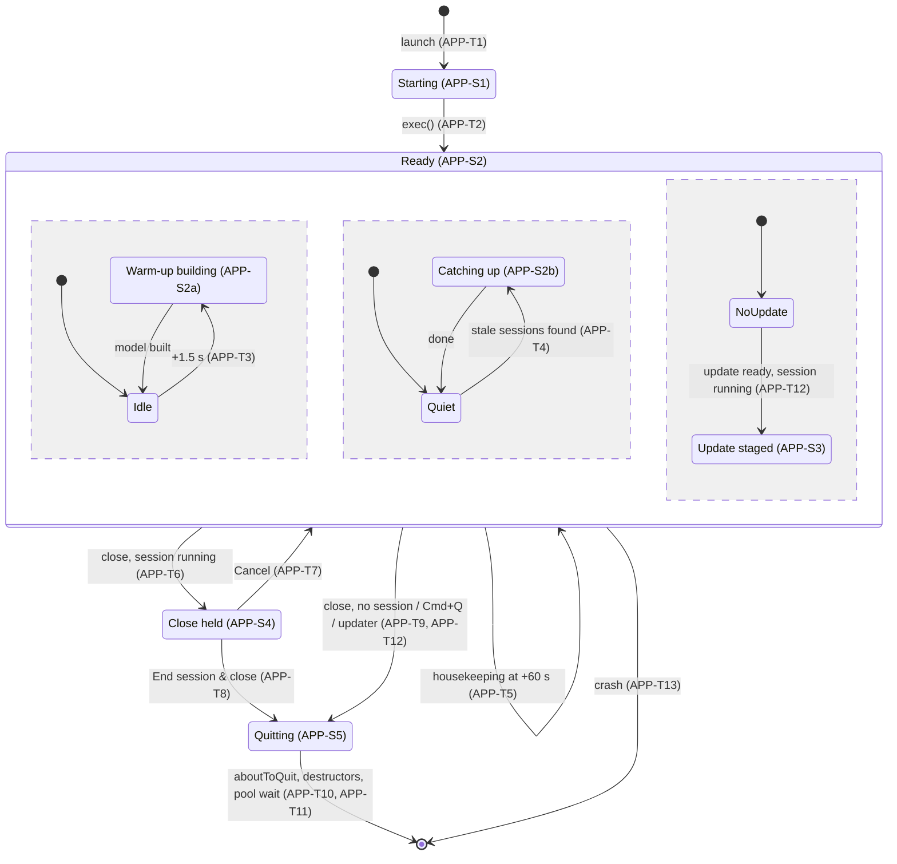
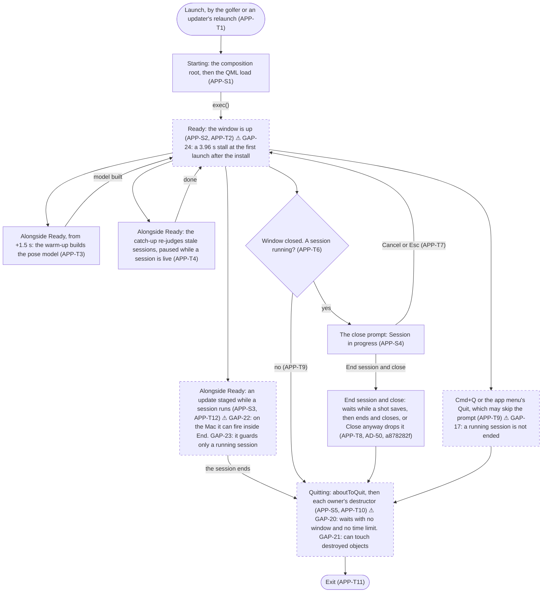
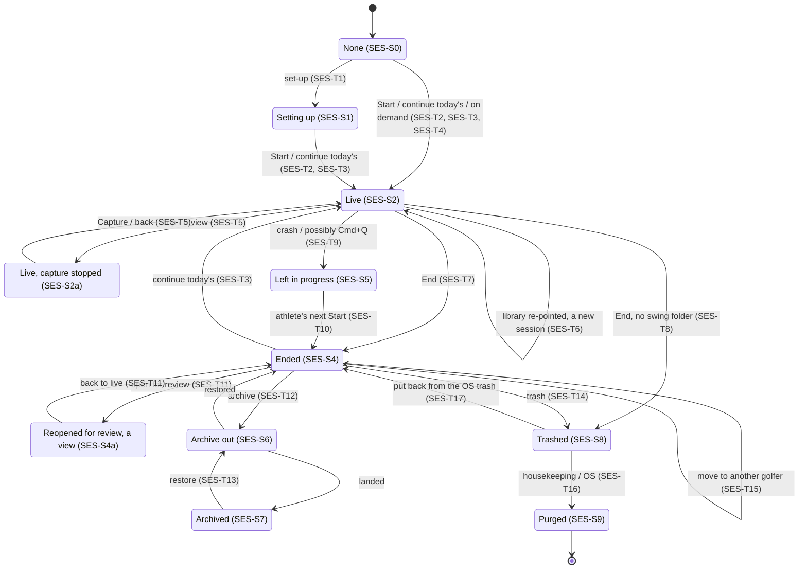
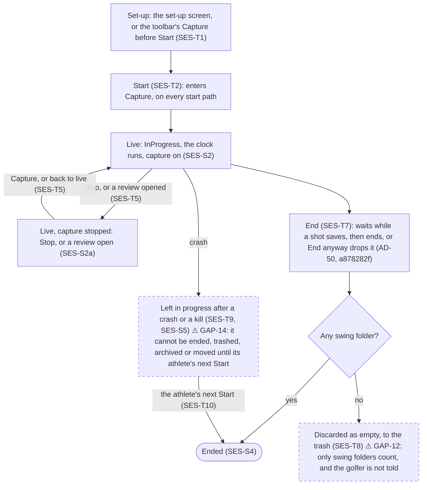
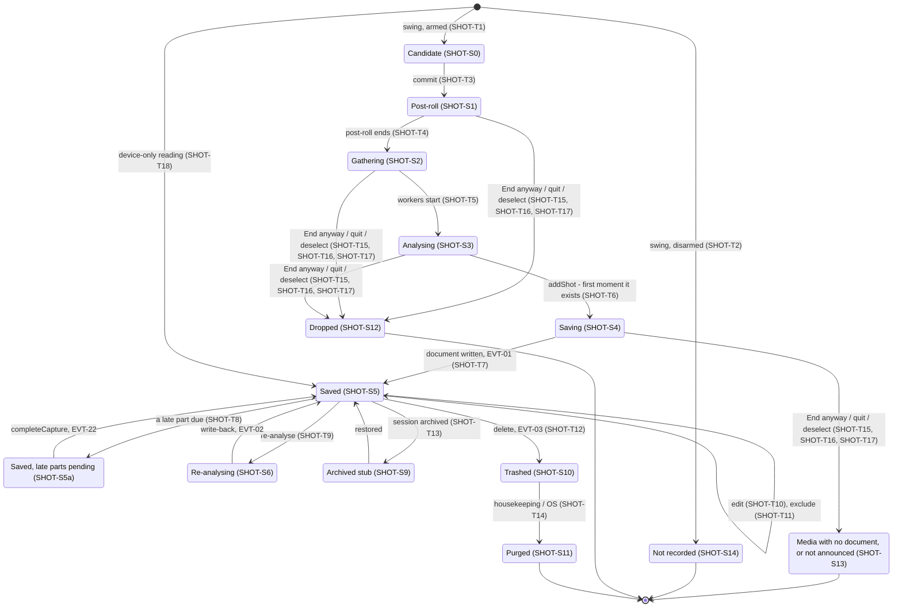
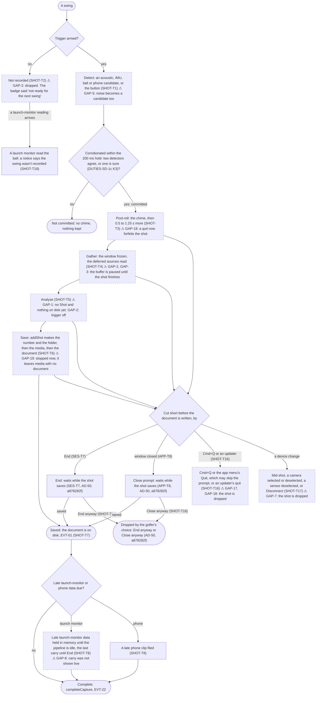
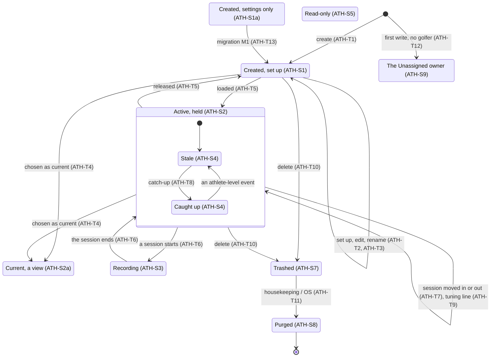
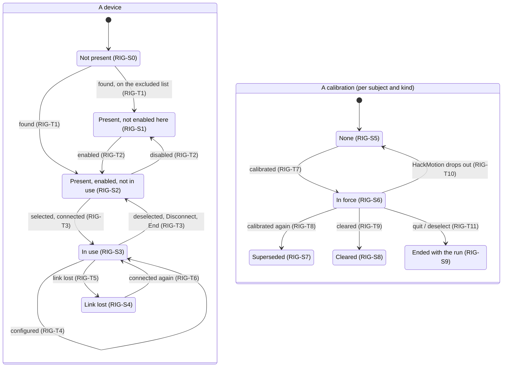

# PinPoint Studio lifecycle model

| Document control | Value |
|---|---|
| **Owner** | Solution Architect[^sa25-life] |
| **Governs** | The lifecycle of every object in scope: its states; the transitions between them, each with its trigger, its owner, its thread and what is on disk afterwards; and what each guarantees |
| **Scope rule** | An object gets a lifecycle here if it is persisted or long-lived, **and** its state changes what is allowed or what is on disk. Today: the application, an athlete, a session, a shot and the Rig. Out of scope: value types; the norm and rule packs, which change by version, a change that version-gated re-analysis governs; and views[^scope] |
| **Applied by** | Control **AD-51** (`governance/controls/plan.md`): a plan for an object in scope states its lifecycle here before it is built. The information model's §1.2: a C1 or C3 change names its section here |
| **Status** | v1.0, 25 Nov 2026. The ruled lifecycles LC-ATHLETE, LC-SESSION, LC-SHOT and LC-RIG moved here from the information model's §5.4, word for word; the information model keeps a pointer for each. Everything else here is either a description of today or a proposal, and says which |
| **Starting audit** | [`lifecycle_audit_25nov`](../../docs/implementation/lifecycle_audit_25nov.md): the gaps (GAP-1 to GAP-30), where the code differs from the ruled rows, and what was not traced |

**How to read it.**
- **Each object's section opens with its ruled row** (§2.0, §3.0, §4.0, §5.0), which is normative. The application has none yet (LC-APP, proposed).
- **The tables after it describe today**, as-is: what the code on `main` at `15d41578` does, with file:line. Where a fix is built but not yet committed, a row says "pending commit". A row updated for a later commit cites that commit, with file:line at `8f33e190`. Where the code has no such state, it says "no state today". The Rig's tables have two columns, today and Stage C ("designed, not built").
- **The guarantees** (§6) are proposals, each naming the role it is proposed to.
- **Evidence labels.** *Observed* (visit 1, §n) · *seam, in a worktree* (a test, not yet on `main`) · *reading* (read in the code, not run). A `GAP-n` is the starting audit's.
- **Ids.** States `APP-S`, `ATH-S`, `SES-S`, `SHOT-S`, `RIG-S`; transitions `APP-T`, `ATH-T`, `SES-T`, `SHOT-T`, `RIG-T`; devices `DEV-`; guarantees `GU-`.

**The diagrams.** Each object has a state diagram drawn from its tables. The application, a session and a shot also have an activity diagram: the steps in order, with their branches (§1.4, §2.4, §3.4). One legend serves them all:
- **A solid box** is what the code on `main` does today.
- **A dashed box** falls short today. Its text names the gap (`⚠ GAP-n`), so the words carry the meaning, not the line.
- **"pending"** means built but not yet committed. A pending fix's box stays dashed, with its gap id, until it is committed, because `main` still falls short.
- **"designed"**, for the Rig, means designed and not built.

**For the Product Owner, first.**
1. §3's "The spine": until its analysis ends, a shot exists nowhere on disk.
2. The audit's observed gaps.
3. §6's rows proposed to you.

---

## 1. The application

**LC-APP (proposed, for the Solution Architect).** The application has no ruled lifecycle. This section describes today's, as a proposal for one, beside OBJ-APPSTATE (the information model's §6).

The application has no lifecycle object. Its states below are what `main()` (`src/Gui/main.cpp`) and the QML window (`src/Gui/shell/Main.qml`) do in order. The warm-up, the catch-up and a staged update run *alongside* Ready, not after it. Each is shown as a region that overlaps Ready, because that is how the code runs them.

### 1.1 States

| Id | State | What is true |
|---|---|---|
| APP-S0 | Not running | No process. |
| APP-S1 | Starting | `main()` builds the composition root, from `QGuiApplication` (`src/Gui/main.cpp:259`) to the QML load (`src/Gui/main.cpp:2078`). No window yet. |
| APP-S2 | Ready | The event loop runs (`src/Gui/main.cpp:2131`). The window is up. A golfer can browse or start a session. |
| APP-S2a | Ready, warm-up building (region) | The pose model loads on its own thread, from 1.5 s after the window loads (`src/Gui/main.cpp:2116-2129`). A shot analysed now waits for it. No state is shown to the golfer. |
| APP-S2b | Ready, catching up (region) | The catch-up re-judges each stale ended session: first the newest ten (the ones the next session's club baseline reads), oldest first among them, then the rest, oldest first (`src/App/athlete_catch_up.cpp:83-101`). It fires again the findings whose stamp is stale and rewrites the session's `diagnostics.json` and `work_ons.json` (FILE-SESS-03, 05). Then it lets the session go (`src/App/athlete_catch_up.cpp:424`). Each session first held also has its older report record split (FILE-SESS-13; `src/DomainModel/athlete.cpp:280`). After an upgrade that changes a rule this is "the first-run re-analysis". It fires findings again; pose is never run again here. |
| APP-S3 | Ready, update staged (region) | An update is downloaded while a session runs and waits for the session to end. Each platform does this its own way (APP-T12). |
| APP-S4 | Close held | A close with a session running is refused, and the "Session in progress" prompt is open (`src/Gui/shell/Main.qml:171-176`). With a shot being saved, the prompt says "Saving the last shot…" and waits for it (APP-T8; a878282f). |
| APP-S5 | Quitting | From `aboutToQuit` to process exit: the handlers, `exec()` returning, then each owner's destructor in reverse order. NOTES-SE-6a §5 lists the order (O1–O11). |

### 1.2 Transitions

| Id | From → to | Trigger | Owner | Thread | On disk afterwards | What it guarantees today |
|---|---|---|---|---|---|---|
| APP-T1 | S0 → S1 | Launch: by the golfer, or by an updater's relaunch | `main()` | GUI | Nothing yet | n/a |
| APP-T2 | S1 → S2 | `exec()` starts | `main()` | GUI | Nothing yet | The window shows the current athlete's latest session (R-APP-3; the launch path was not traced). The UI is not yet smooth: a 3.96 s stall at the first launch after the install (*observed*, visit 1 §2; GAP-24). |
| APP-T3 | S2 → S2a → S2 | A 1.5 s timer starts the warm-up; it ends when the model is built | `main()`; `PoseRunner` | Its own detached thread (`src/Gui/main.cpp:2121-2128`) | Nothing (the model cache is not library data) | A quit during the warm-up is not waited for: `_Exit` while it builds (`src/Gui/main.cpp:185-201`). A quit while a *shot* waits for it is waited for (GAP-20). Pinned (SE-1b's quit pins, `quit_pin.warm-up` and `quit_pin.after-warm-up`): a quit 1 s into the build is abandoned and the process gone in about 0.1 s; a quit once the session is ready stops the idle inference thread and is gone in about 0.1 s; each twice (*observed*, the Mac, headless, 25 Nov 2026). |
| APP-T4 | S2 → S2b → S2 | The work-ons scan finds stale sessions and hands them to the catch-up (`src/Gui/main.cpp:705-748`) | `AthleteCatchUp` | GUI, with the diagnostics pool's lanes | Each stale session's FILE-SESS-03 and FILE-SESS-05 rewritten (their folders take today's time: *observed*, visit 1 §2); FILE-SESS-13 written on first hold | Derived caches only: no source fact is rewritten (*reading*). A live session pauses it (`src/App/athlete_catch_up.h`, "PAUSED AND CANCELLED"). |
| APP-T5 | S2 → S2 | Housekeeping, 60 s after launch (`src/Gui/main.cpp:946`) | `Housekeeping` | The Archiving tab's worker | Old library-trash entries purged (SET-10); sessions archived by age or free space (SET-11…14), each switched off until set | Ends things only through the owners' commands (IM §5.4, "Housekeeping"). |
| APP-T6 | S2 → S4 | Window close (the window's ✕, the header's ✕) while `sessionController.running` | `Main.qml` | GUI | Nothing | The quit is held for a choice. The code's comment says Cmd+Q and the app menu's Quit do not pass through here (`src/Gui/shell/Main.qml:167-169`); see APP-T9 and GAP-17. |
| APP-T7 | S4 → S2 | Cancel or Esc | `Main.qml` | GUI | Nothing | The session runs on. |
| APP-T8 | S4 → S5 | "End session & close" (`src/Gui/shell/Main.qml:171-178`, `:194-225`, at 8f33e190): with no shot being saved, `AppState::endSession(false)`, then close. With one being saved (`app.state.shotSaving`), the prompt says "Saving the last shot… PinPoint Studio closes as soon as it's saved" in the warning tone, and ends the session and closes itself when the fact falls; "Close anyway" does it now | `Main.qml` (the wait); `AppState`, then the destructors | GUI | The session's End (SES-T7 or SES-T8), then whatever the teardown leaves | **A shot still being saved is waited for** (product control AD-50; a878282f; `app_state_test` S10). "Close anyway" drops it, the golfer's choice, and its session too if that was its only shot (SES-T8). Cancel leaves the session running. Before a878282f the shot was lost, and the session with it if that was its only shot (GAP-13, closed; *observed*, visit 1 §6). With "Close anyway", a third outcome, *by reading*: the event loop runs until `exec()` returns. If the analysis lands in that time, `captureSession()` finds no session begun and starts an on-demand session for the swing (`src/Gui/shot/shot_processor.cpp:1371-1393`). |
| APP-T9 | S2 → S5 | Close with no session running; on the Mac, Cmd+Q and the app menu's Quit with or without one, as the comment at `src/Gui/shell/Main.qml:167-169` says. The About menu's own Quit is routed through `close()` (`src/Gui/shell/Main.qml:216-218`), so which route the native Quit takes is unverified on Qt 6.11 | Qt | GUI | As APP-T8's teardown; a running session is not ended (GAP-17) | No prompt. A re-analysis or an export in flight is waited for after the window has gone (GAP-20). For a re-analysis this is *observed* (SE-1b's quit pins, `quit_pin.re-analysis` and `quit_pin.re-analysis-in-warm-up`; #294): the process stayed with no window for about 3.3 s, and about 5–6 s beside the warm-up, while the re-analysis ran to its end, and its result was thrown away (the swing document unchanged). An export was not pinned. |
| APP-T10 | S5 | `aboutToQuit`: each loaded session's diagnostics written (`src/Gui/main.cpp:543-547`); the phone link, the updater and the event buffer stopped (`src/Gui/main.cpp:2057-2069`); after `exec()`, the archive's jobs stopped (`src/Gui/main.cpp:2132`) | `main()` | GUI | Each loaded session's FILE-SESS-03 and FILE-SESS-05 | What the diagnostics owners kept is written before teardown. After `exec()` returns, no queued event runs, so a shot whose document write had not started gets none (GAP-19). |
| APP-T11 | S5 → S0 | The destructors run (`~ShotProcessor` joins its workers: `src/Gui/shot/shot_processor.cpp:234`, which calls `finishNowBlocking`), then `~QGuiApplication` waits for Qt's global pool | each owner | GUI, then the pool's threads | As left by the joins | Every timed close at visit 1 exited within 0.7–1.7 s of the click (*observed*, visit 1 §5). The one close that joined an analysis (§6, attempt 3) had no click time recorded: that process was gone 12.7 s after the close was sent. The waits with no time limit are GAP-20; the touches of destroyed objects are GAP-21. SE-1b's quit pins (7590c7a4; `src/Gui/tests/quit_pins/`; the Mac, headless, 25 Nov 2026) quit at each point of start-up (queued before `exec()`, the event loop's first turn, the window's close, after the 3 s, 3.5 s and 60 s timers), during the warm-up and after it, and with the golfer's session on screen: each exited with code 0 in 0.1–0.3 s with no teardown-fault line, twice (*observed*). A quit during a re-analysis touches the destroyed application (GAP-21, *observed*, #294): in every run of both re-analysis pins the re-analysis ran on into the pool wait after the application object had gone, Qt warned "Please instantiate the QApplication object first" three times (six log lines: each is echoed), and the address-marks stage ran without its model (`[Segmenter] Model not found: "/../Resources/models/u2netp.onnx"`: its path is read from the application). The pins fail on such a line after the quit (the `after-shutdown` check). Headless, no device part runs, so the camera, microphone, speech, sensor and phone threads are never busy in a pin and their quits are by hand at the studio (`docs/developer/testing_developer_guide.md`, "The quit pins"). |
| APP-T12 | S2 → S3 → S5 | An update is ready while a session runs. **Windows** refuses the installer's shutdown while a session runs (`src/Update/win_sparkle_update.cpp:75-78`) and quits when allowed (`:83-87`). **Mac** holds the install and fires it when the session's clock stops (`src/Update/mac_sparkle_update.mm:85-93`, `:181-185`). **Linux**: the controller refuses while a session runs (`src/Update/update_controller.cpp:156-157`), then the backend relaunches and quits (`src/Update/linux_appimage_backend.cpp:311-321`). WinSparkle's and the Linux quit are `QCoreApplication::quit()`, which does not pass through the close prompt | the update controller | GUI | As APP-T9 | Never during a running session. Not guarded against a re-analysis, an export or the catch-up (GAP-23). On the Mac it can fire inside End itself (GAP-22). |
| APP-T13 | any → S0 | A crash, a kill or a power cut | n/a | n/a | Whatever had reached disk; a running session stays InProgress (SES-S5) | Nothing the app does. A session file is written atomically, by the session store's write. |

### 1.3 Diagram

`[*]` is Not running (APP-S0). Idle, Quiet and NoUpdate are Ready itself, drawn once in each of its three regions. A crash (APP-T13) can end any state; it is drawn from Ready only.

### 1.4 Activity: the application, from launch to exit

It shows the application from launch to exit: the warm-up, the catch-up and a staged update run alongside Ready rather than before it, and every way out passes through Quitting, with the close prompt only on the window's close.

---

## 2. A session

The `Session` (`src/DomainModel/session.*`) is made and held by its `Athlete` (`src/DomainModel/athlete.*`), over the record the session store keeps (`src/Export/session_store.cpp`). Capture asks for it through `ShotProcessor` (`src/Gui/shot/shot_processor.cpp:1283-1572`). The session's on-disk status (FILE-SESS-01) is InProgress or Ended. Every other state here is either a marker on disk (archived), a place (the trash), or what the app is doing with the session.

### 2.0 Ruled: LC-SESSION

The ruled lifecycle, moved verbatim from the information model's §5.4[^sa25-life]. It is normative; the tables after it describe today.

| Id | Object | States | Commands between them (event) |
|---|---|---|---|
| LC-SESSION | `Session` | InProgress ⇄ Ended → Archived ⇄ restored; trashed → purged | `Athlete::startSession`, which mints the `SessionId`, writes FILE-SESS-01 and first ends any session of the athlete still InProgress (EVT-17)[^dec-78][^dec-73]; `end` (EVT-09); `Athlete::resumeSession`: an Ended session goes back to InProgress with the same `SessionId`, and `end` ends it again (EVT-23)[^dec-77]; only a session started today may be resumed, and only for the same session type, as today's extend requires; any other InProgress session of the athlete is ended first (the remaining risk: a session that crashed late at night cannot be resumed the next morning, so a new one starts)[^dec-134]; `archive` (EVT-18) and `restore` (EVT-19)[^dec-22][^dec-70]; `Athlete::trashSession` (EVT-20)[^dec-71]; the purge, by housekeeping[^dec-80]. A session left InProgress by a crash stays InProgress until `end` or the athlete's next `startSession`[^dec-73]. Today the commands exist on the `Athlete` and the `Session` (`src/DomainModel/athlete.*`, `session.*`; step 3.4a-i), each `Session` made and held by its `Athlete` over the record `SessionRepository` loads, one per `SessionId`[^dec-190]; from step 3.4a-ii capture starts, resumes and ends through them (`ShotProcessor::beginSessionFolder`, `endSessionFolder`, the capture service holding the `Session` it captures into), and `SessionRepository::end` makes no discard; until step 5, a session no `Athlete` held (no golfer selected, or a library re-pointed mid-session that does not list the golfer) ran through `SessionRepository` directly (N1)[^n1]. From step 5 a session captured with no golfer is a full `Session` of the Unassigned owner, and runs through these commands like any other (§5.11; replacing N1 for that case)[^dec-198]. A library re-pointed mid-session to one that does not list the golfer (D7) starts the new session under that library's Unassigned owner: deleting N1 forced the choice, and it closes the gh issue filed for it (step 5.1; `ShotProcessor::captureAthlete`)[^j-67-2]. The empty-session discard is a rule of this lifecycle[^dec-93]: `Session::end` on an empty session asks `Athlete::trashSession`, and EVT-20 fires[^dec-143]. |

### 2.1 States

| Id | State | What is true | On disk |
|---|---|---|---|
| SES-S0 | None | No session is begun. Capture intent is off at launch (`src/Gui/cameras/camera_manager.h:242`). | n/a |
| SES-S1 | Setting up | The set-up screen or the toolbar's Capture before Start. A trunk ceremony may be recorded and held in memory (`src/Gui/imu/trunk_ceremony_recorder.cpp:392-411`). | Nothing of the session |
| SES-S2 | Live | InProgress, running here: the clock runs (`src/Gui/session/session_controller.cpp:65-121`) and capture is on. | The folder, FILE-SESS-01 (InProgress), FILE-SESS-10 when a swing is allocated, the trunk ceremony (FILE-SESS-11) if one was held |
| SES-S2a | Live, capture stopped | InProgress, but Stop was pressed or another session is open for review: capture pauses and the trigger is disarmed (`src/Gui/main.cpp:984-992`; `src/Gui/shot/shot_controller.cpp:99-102`). | As SES-S2 |
| SES-S3 | Ending | **A wait in the views, not a state of the `Session`.** End itself is still one immediate command (`src/App/app_state.cpp:256-279`, at 8f33e190). With a shot being saved, End's card and the close prompt wait while `app.state.shotSaving` is true, saying "Saving the last shot…", then call End themselves (`src/Gui/session/PpSessionToolbar.qml:396-469`; `src/Gui/shell/Main.qml:195-226`; product control AD-50; a878282f). "End anyway" or "Close anyway" calls it now. Cancel leaves the session Live. | As SES-S2 |
| SES-S4 | Ended (closed) | Status Ended, with its end time. Held by its `Athlete` while something uses it, else released (`src/DomainModel/athlete.cpp:288-309`). | FILE-SESS-01 (Ended); the derived files the session's diagnostics write |
| SES-S4a | Reopened for review (a view) | An ended session loaded on screen (`src/Gui/review/session_review_controller.cpp:308-378`). Not a state of the `Session`: a view over SES-S4. Capture is paused while it is open. | Unchanged; edits to its shots write their documents |
| SES-S5 | Left in progress | Status InProgress on disk, but nothing runs it: a crash, a kill, possibly Cmd+Q (GAP-17, unverified), or a library re-pointed away from the session (`src/Gui/shot/shot_processor.cpp:1419-1440`). | FILE-SESS-01 (InProgress) |
| SES-S6 | Archive out | An archive or a restore is running on the worker; the session's diagnostics read and write nothing (`src/DomainModel/session.cpp:430-453`, `:472-490`). | Part files under the archive root (FILE-LIB-02) |
| SES-S7 | Archived | The marker is written, the streams are copied out and checked, and each shot is reduced to a stub, its video and raw data removed (FILE-SESS-06, FILE-SHOT-10). | FILE-SESS-06; stubs; FILE-LIB-02 |
| SES-S8 | Trashed | The whole folder is in the OS trash, or in the library's own trash where the volume has none (FILE-LIB-01). | Outside the library's list |
| SES-S9 | Purged | Deleted for good by housekeeping, or by the OS emptying its own trash. | Nothing |

### 2.2 Transitions

| Id | From → to | Trigger | Owner | Thread | On disk afterwards | What it guarantees today |
|---|---|---|---|---|---|---|
| SES-T1 | S0 → S1 | Set-up opened | QML set-up screen | GUI | Nothing | n/a |
| SES-T2 | S0/S1 → S2 | Start, new: `AppState::startSession(false)` → `ShotProcessor::beginSessionFolder` → `Athlete::startSession` (`src/DomainModel/athlete.cpp:329-350`) → Capture mode → `SessionController::start` → cameras on (`src/App/app_state.cpp:189-209`) | `Athlete` (the session); `AppState` (the order) | GUI | The folder and FILE-SESS-01 at once (*observed*, visit 1 §6: every session but one had its folder at Start); a held trunk ceremony written on a pool thread (FILE-SESS-11) | One InProgress session per athlete: any other running here is ended first, never discarded (`src/DomainModel/athlete.cpp:321-327`). Any left in progress by a crash is ended with an inferred end (`src/Export/session_store.cpp:579`; FILE-SESS-01's `endInferred`). EVT-17. The app enters Capture, leaving a review and stopping the replay, on every start path: the toolbar's Capture after a Stop (`AppState::rearmCapture`) and Home's Start or Practise while a session runs (`AppState::backToSession`) as well (`src/App/app_state.cpp:189-229`; GAP-15, closed by 8f33e190, #283)[^283]. |
| SES-T3 | S0/S1/S4 → S2 | Start, "continue today's": `Athlete::resumeSession` (`src/DomainModel/athlete.cpp:357-401`) | `Athlete` | GUI | FILE-SESS-01 back to InProgress | Only a session started today, of the same type (DEC-134). EVT-23. A refused resume starts a new session and says why (`src/Gui/shot/shot_processor.cpp:1527-1540`). |
| SES-T4 | S0 → S2 | A swing captured with no session begun: an on-demand session (`src/Gui/shot/shot_processor.cpp:1371-1393`) | `ShotProcessor` | GUI | As SES-T2 | Never discarded as empty (`src/DomainModel/session.cpp:215-218`). When capture runs outside a session was not traced (GAP-16). |
| SES-T5 | S2 ⇄ S2a | Stop on the toolbar (`CameraManager::stopCapture`); Capture on the toolbar after a Stop, `AppState::rearmCapture`, which enters Capture first and then starts the cameras (`src/Gui/session/PpSessionToolbar.qml:291-297`; `src/App/app_state.cpp:211-217`, at 8f33e190); a review opened or closed (`src/Gui/main.cpp:984-992`) | `CameraManager` (Stop, a review); `AppState` (the re-arm) | GUI | Nothing | The session stays InProgress. The re-arm lands in Capture, leaving a review or a replay (GU-12; 8f33e190). |
| SES-T6 | S2 → S2 (new) | The library re-pointed mid-session: this session ends, and a new one of the same type starts there (DEC-154; `src/Gui/shot/shot_processor.cpp:1419-1440`) | `ShotProcessor` | GUI | The old session's FILE-SESS-01 Ended if its library is reachable, else left InProgress (SES-S5) | n/a |
| SES-T7 | S2 → S4 | End on the toolbar (`src/Gui/session/PpSessionToolbar.qml:384-470`, at 8f33e190). With no shot being saved, End calls `AppState::endSession(true)` at once. With one being saved (`app.state.shotSaving`), the card says "Saving the last shot… The session ends as soon as it's saved" in the warning tone, and calls End itself when the fact falls; "End anyway" calls it now (SES-S3). `endSession(true)` stops the cameras, then the clock (End's carry sweep runs here: `src/Gui/launchmonitor/launch_monitor_controller.cpp:78-88`), then `Session::end` (`src/DomainModel/session.cpp:204-241`), then releases the devices, last (`src/App/app_state.cpp:256-279`; `releaseDevices`, `src/Gui/main.cpp:1128-1131`) | `PpSessionToolbar` (the wait); `AppState` (the order); `Session` (the end) | GUI | FILE-SESS-01 Ended; the last shot's late launch-monitor data | EVT-09. **A shot still being saved is waited for** (product control AD-50; a878282f; `app_state_test` S10). "End anyway" drops it, the golfer's choice: the release after `Session::end` drops the shot (SHOT-T15), so if it was the session's only shot the session is empty and discarded (SES-T8). Cancel or Esc registers nothing. Before a878282f End dropped the shot (GAP-6, closed; *observed*, visit 1 §4). |
| SES-T8 | S2 → S8 | End of a session this run started that holds no swing folder: ended, then `Athlete::trashSession` (`src/DomainModel/session.cpp:215-233`) | `Session`, then `Athlete` | GUI | The folder in the OS trash | DEC-93's discard, EVT-20. It counts only swing folders and tells the golfer nothing (GAP-12). End and the close prompt now wait for a shot being saved (a878282f), so a session whose only shot is in flight is discarded only after "End anyway" or "Close anyway": that shot has no folder yet, so the session counts as empty, as AD-50 means (GAP-13, closed). |
| SES-T9 | S2 → S5 | A crash or a kill; possibly Cmd+Q on the Mac (GAP-17, unverified) | n/a | n/a | FILE-SESS-01 still InProgress | n/a |
| SES-T10 | S5 → S4 | The athlete's next Start (`src/Export/session_store.cpp:579`) | the session store | GUI | FILE-SESS-01 Ended, `endInferred: true` | Until then the session cannot be trashed, archived or moved (GAP-14). |
| SES-T11 | S4 ⇄ S4a | Open a session from the list (`src/Gui/review/session_review_controller.cpp:308-378`); back to live (`:403-416`) | `SessionReviewController` | GUI, with a pool for the summary reads | A shot's summary sidecar may be written (FILE-SHOT-09) | Capture is paused while it is open, and resumed if it was on before. |
| SES-T12 | S4 → S6 → S7 | Archive, by the golfer or by housekeeping: `Session::archiveJob`, the job on the worker, `archiveLanded` (`src/DomainModel/session.cpp:430-470`) | `Session`; `Housekeeping` | Job on the Archiving worker; landing on the GUI thread | FILE-LIB-02, FILE-SESS-06, stubs | Refused while in progress (`:438-442`). Each copy is checked byte for byte before a shot is reduced to a stub (IM §5.4; not re-read here). EVT-18 only after it lands. |
| SES-T13 | S7 → S6 → S4 | Restore (`src/DomainModel/session.cpp:472-509`) | `Session` | As SES-T12 | The swings back in the library; FILE-SESS-06 removed | Each shot's review is merged three ways, so an edit made while archived is kept (R-PERS-8; not re-read). EVT-19. |
| SES-T14 | S4 → S8 | Trash from the list: `Athlete::trashSession` (`src/DomainModel/athlete.cpp:403-418`; `src/Gui/review/session_review_controller.cpp:428-462`) | `Athlete` | GUI | The folder in the OS trash, or FILE-LIB-01 | Refused while in progress or locked (`src/Export/session_store.cpp:866-905`). The live session is refused. EVT-20. |
| SES-T15 | S4 → S4 (another athlete) | Move to another golfer: `Athlete::moveSessionTo` (`src/DomainModel/athlete.cpp:420-448`) | `Athlete` | GUI | The folder renamed into the golfer's folder; only `session.json`'s athlete id rewritten (R-UNASSIGNED-4) | Keeps its `SessionId`. Refused while in progress, archived, locked or read-only. The session is released first. Known edge cases: issues #204, #205. |
| SES-T16 | S8 → S9 | Housekeeping's purge after SET-10 days, or "Empty now"; or the OS emptying its own trash | `Housekeeping`; the OS | The Archiving worker | Nothing | Inside the app, only housekeeping deletes for good (IM §5.4). The OS trash is outside it (GAP-10). |
| SES-T17 | S8 → S4 | Put back from the trash | the OS (no app command) | n/a | The folder back | **No app command**: a restore from the OS trash is the golfer's own move, and the app finds the folder again on its next listing (*reading*; not traced). |

### 2.3 Diagram

Ending (SES-S3) is not drawn: it is a wait in the views before End, not a state of the `Session` (a878282f).

### 2.4 Activity: a session, from set-up to ended

It shows a session from set-up to its end: Start, live and capture stopped in turn, then End, which keeps the session or discards it as empty, and the crash that leaves it in progress.

---

## 3. A shot

**The spine.** From the impact until `Session::addShot` (`src/Gui/shot/shot_processor.cpp:1229-1234`), a shot is only `ShotProcessor`'s members. It has no `Shot`, no number, no folder, and nothing on disk. The number and the folder are made only after the analysis, when the media save starts. So a shot lost before then leaves no trace, and a session whose only shot is in flight counts as empty (GAP-1). End and the close prompt now wait for a shot being saved, so they reach a loss only through "End anyway" or "Close anyway" (a878282f). The losses themselves come from `finishNowBlocking` (`src/Gui/shot/shot_processor.cpp:2117-2155`): it joins the workers and then clears the flags their next steps need (GAP-6, GAP-7, GAP-18, GAP-19). From the allocation on, it is a `Shot` in its session's collection (LC-SHOT's "capturing"). From the document write on, it is saved (EVT-01).

### 3.0 Ruled: LC-SHOT

The ruled lifecycle, moved verbatim from the information model's §5.4[^sa25-life]. It is normative; the tables after it describe today.

| Id | Object | States | Commands between them (event) |
|---|---|---|---|
| LC-SHOT | `Shot` | capturing (late parts pending) → complete → archived stub → restored; trashed → purged[^dec-93] | added to its session's collection by `Session::addShot` (EVT-01, emitted when capture's document write lands)[^dec-168]; `Session::addShot` allocates the next swing number (FILE-SESS-10), creates the folder through `RecordingRepository::create` and returns the `Shot`, which capture then writes into: allocate → create → capture writes → late parts[^dec-142]; its late parts by `Shot::completeCapture` (R-REC-2; EVT-22) and its re-analysis by `Shot::applyAnalysis` (EVT-02), both the `Shot`'s[^dec-103]; removed from the collection by `Session::trashShot` (EVT-03), to the OS trash or FILE-LIB-01; the purge, by housekeeping[^dec-80]. A trashed shot's swing number is never reissued[^dec-91]. |

### 3.1 States

| Id | State | Owner | What is true | On disk |
|---|---|---|---|---|
| SHOT-S0 | Candidate | `ShotController` | A detector reported it, and the arbiter holds it for 200 ms to corroborate (DUTIES-SD-1c K2–K7). | Nothing |
| SHOT-S1 | Post-roll | `ShotProcessor` (state PostRoll) | Committed: the chime played, and the ring records 0.5–1.25 s more (`src/Gui/shot/shot_processor.cpp:281-314`). | Nothing |
| SHOT-S2 | Gathering | `ShotProcessor` (Gathering) | The window is frozen and the event buffer paused, and the deferred sources (HackMotion) are being read (`src/Gui/shot/shot_processor.cpp:337-392`). | Nothing |
| SHOT-S3 | Analysing | `ShotProcessor` (Processing) | Segmentation and the analysis run on workers over the frozen window (`src/Gui/shot/shot_processor.cpp:422-558`, `:696`). The trigger is disarmed, and the buffer records nothing (GAP-2). | Nothing |
| SHOT-S4 | Saving | `Shot` (in the collection) and `ShotProcessor` | Allocated by `Session::addShot` (`src/DomainModel/session.cpp:148-170`): the number and folder are made, the media is exported, and then the document is written on a worker (`src/Gui/shot/shot_processor.cpp:1650-1737`). | The swing folder; FILE-SESS-10; then FILE-SHOT-03, 05; then FILE-SHOT-01 |
| SHOT-S5 | Saved | `Shot` | The document has landed and EVT-01 has fired (`src/Gui/shot/shot_processor.cpp:1739-1800`; `src/DomainModel/session.cpp:172-181`). It may still be replayed in the window before the processor goes Idle (`src/Gui/shot/shot_processor.cpp:2091-2103`). | FILE-SHOT-01, 03, 05, 07 |
| SHOT-S5a | Saved, late parts pending | `Shot`; `LaunchMonitorController` holds the data | A launch-monitor update (club data, carry) or a phone clip is still due. The launch monitor's update is held in memory until the pipeline is idle, and the last shot's carry until End's sweep (`src/Gui/launchmonitor/launch_monitor_controller.cpp:78-88`, `:690-714`). | As SHOT-S5 until `Shot::completeCapture` writes it (EVT-22) |
| SHOT-S6 | Re-analysing | `ReanalysisController` | Queued, or running on a worker, one swing at a time. It is held while a live shot processes (`src/Gui/shot/reanalysis_controller.cpp:118-170`). | Unchanged until the write-back |
| SHOT-S7 | Reviewed or edited | `Shot` | **No state today.** These are commands on a saved shot: rate, note, the declared club, a club correction, an intent, a label correction (`src/DomainModel/shot.cpp:146-152`, `:191-302`). | FILE-SHOT-02 (the review block) |
| SHOT-S8 | A reading excluded | `Shot` | **A flag, not a lifecycle state**: `excludeReading` (EVT-05) keeps the shot and takes its reading out of its club's usuals. An automatic exclusion (a data warning, a part swing) is derived, and it is not a state either. | FILE-SHOT-02 |
| SHOT-S9 | Archived stub | `Shot`, with its session | Reduced to a stub, its video and raw data removed; the streams are in the archive mirror. | FILE-SHOT-10; FILE-LIB-02 |
| SHOT-S10 | Trashed | `Session` | The swing folder is in the trash. Its number is recorded so that it is never reissued (DEC-91). | FILE-LIB-01 or the OS trash |
| SHOT-S11 | Purged | `Housekeeping`; the OS | Gone for good. | Nothing |
| SHOT-S12 | Dropped | n/a | **Not in LC-SHOT.** A committed shot lost before it was allocated: in its post-roll, gather or analysis (GAP-7, GAP-18), or dropped by the golfer's "End anyway" or "Close anyway" (AD-50). End and the close prompt otherwise wait for it (GAP-6 and GAP-13, closed by a878282f). | Nothing |
| SHOT-S13 | Media with no document, or written but not announced | the session store lists it | **Not in LC-SHOT.** A shot stopped while saving (SHOT-S4). Either its folder holds the media but no `swing.ppsw`, or the document was written but EVT-01 never fired (GAP-19). At the next load a folder with no document is held as a shot whose findings are "unread" (`src/Export/firing_reader_store.cpp:94-99`). Visit 1's launch log shows such folders exist in the studio's library (*observed*). | The folder; the media; perhaps the document |
| SHOT-S14 | Not recorded | n/a | **Not in LC-SHOT.** A swing hit while the trigger was disarmed: not one frame of it reaches the ring, and no shot exists (GAP-2). | Nothing |

### 3.2 Transitions

| Id | From → to | Trigger | Owner | Thread | On disk afterwards | What it guarantees today |
|---|---|---|---|---|---|---|
| SHOT-T1 | swing → S0 | A detector's candidate (acoustic, IMU, ball, phone), or the manual button | `ShotController` | GUI (the acoustic candidate is queued from the audio thread) | Nothing | Only while armed: capturing, not busy, no review (`src/Gui/shot/shot_controller.cpp:99-102`). Noise also becomes a candidate (GAP-5). |
| SHOT-T2 | swing → S14 | Any candidate while disarmed | `ShotController` | GUI | Nothing | **Dropped**, with a debug-level log line that the default log level leaves out of every build (`src/Gui/shot/shot_controller.cpp:247-250`) (GAP-2; *observed*, visit 1 §4). The golfer is warned before the swing: while the trigger is disarmed, the title bar's badge reads "⊘ Analysing: not ready for the next swing" (`src/Gui/shell/PpAnalysingBadge.qml:51`, bound to `app.shotController.armed`)[^281s]. After it, only a launch monitor's reading tells: SHOT-T18's notice. With no launch monitor, the badge is the only warning. The swing is still not recorded: overlapping capture is parked for Stage D (GAP-2). |
| SHOT-T3 | S0 → S1 | The arbiter commits; `shotDetected` → `ShotProcessor::onShotDetected` | `ShotController` → `ShotProcessor` | GUI | Nothing (a 16-byte marker in the ring only) | The session type is read at this instant (DUTIES-SD-1c C1). |
| SHOT-T4 | S1 → S2 | The post-roll timer (`src/Gui/shot/shot_processor.cpp:316-320`) | `ShotProcessor` | GUI | Nothing | The buffer is paused from here until the shot finishes (GAP-2, GAP-3). |
| SHOT-T5 | S2 → S3 | The gather ends; workers start | `ShotProcessor` | GUI → global pool | Nothing | The window is read without copying, over a paused buffer. |
| SHOT-T6 | S3 → S4 | The analysis finishes (`src/Gui/shot/shot_processor.cpp:1577-1628`) → `startSwingSave` → `Session::addShot` | `ShotProcessor` → `Session` | GUI; the export on the pool | Folder and number (FILE-SESS-10), then the media | **The first moment a live, analysed shot exists anywhere** (GAP-1). The exceptions: a skip-analysis capture allocates when the gather ends (`src/Gui/shot/shot_processor.cpp:604-607`), and a device-only shot at once (`src/Gui/shot/shot_processor.cpp:1396-1407`). For a swing outside a session, the on-demand *session* is also made only here (`src/Gui/shot/shot_processor.cpp:1229-1234`). A failed allocation logs "no swing folder" and the shot is not saved (`src/Gui/shot/shot_processor.cpp:1236-1238`). |
| SHOT-T7 | S4 → S5 | The document write lands → `Session::shotDocumentWritten` → EVT-01 | `ShotProcessor` → `Session` | Write on the pool; the landing on GUI | FILE-SHOT-01 | Nothing is announced before the document is on disk (`src/Gui/shot/shot_processor.h:128-134`). A failed analysis or export still writes what it has (the degraded persist path). |
| SHOT-T8 | S5 → S5a → S5 | A late launch-monitor update or phone clip → `Shot::completeCapture` (EVT-22) | `LaunchMonitorController`, `PpcpClipFiler` → `Shot` | GUI | FILE-SHOT-01 rewritten; FILE-SHOT-06 | *By reading*: a fuller reading is held while any shot is in the pipeline and written when it goes idle. A carry the per-reading lookup missed is written by End's sweep, which runs on the session type's change (`src/Gui/launchmonitor/launch_monitor_controller.cpp:81-87`). *Observed* separately: no card showed carry live (GAP-8). |
| SHOT-T9 | S5 → S6 → S5 | Re-analyse (asked by the golfer, or by the launch monitor's rescue) → worker → `persistReanalysis` (`src/Gui/shot/reanalysis_controller.cpp:172-212`) | `ReanalysisController`; the `Shot`'s write-back | Worker; the write-back on GUI | FILE-SHOT-01's analysis replaced; capture, streams and review kept | One at a time, never beside a live shot. A trashed folder is not overwritten. EVT-02. The queue is in memory only (GAP-11). |
| SHOT-T10 | S5 → S5 | An edit: `rate`, `note`, `setDeclaredClub` (EVT-21), `correctClub` (EVT-04), `setShotIntent` (EVT-07), `correctLabel` (EVT-06) | `Shot` | GUI, or a worker for a label correction, landing on GUI (`src/DomainModel/shot.cpp:154-189`) | FILE-SHOT-02 | The event fires only after the save (`src/DomainModel/shot.cpp:129-144`). A rating and a note send none (DEC-70; GAP-9). |
| SHOT-T11 | S5 → S8 → S5 | `excludeReading(true/false)` (EVT-05) | `Shot` | GUI | FILE-SHOT-02 | As SHOT-T10. |
| SHOT-T12 | S5 → S10 | Delete: `Session::trashShot` (`src/DomainModel/session.cpp:183-197`; `src/Export/session_store.cpp:983-1024`) | `Session` | GUI | The swing folder in the trash; FILE-SESS-10 raised | Its number first, then the move; under the session's lock. EVT-03. The number's write is best effort (GAP-10). |
| SHOT-T13 | S5 → S9 → S5 | Its session is archived, then restored (SES-T12, SES-T13) | `Session` | As SES-T12 | FILE-SHOT-10, then the full document again | As SES-T12, SES-T13. |
| SHOT-T14 | S10 → S11 | Purge (SES-T16) | `Housekeeping`; the OS | The Archiving worker | Nothing | As SES-T16. |
| SHOT-T15 | S1–S3 → S12; S4 → S13 | "End anyway" on the toolbar: End itself waits while a shot is being saved (SES-T7; a878282f), so only "End anyway" reaches here. End's device release, after `Session::end` (`src/App/app_state.cpp:276-278`, at 8f33e190), calls `finishNowBlocking`, which waits for the workers and then clears the flags their handlers need (`src/Gui/shot/shot_processor.cpp:2117-2155`) | `ShotProcessor` | GUI (it blocks for the analysis: a 2.2 s stall at visit 1) | From S1–S3, nothing, and the session is discarded if that was its only shot. From S4, the folder and media, with the document only if its write had started; the session is then kept | **Dropped, by the golfer's choice** (AD-50; GAP-6, closed by a878282f). From S4 it still leaves media with no document (GAP-19). |
| SHOT-T16 | S1–S3 → S12; S4 → S13 | A quit that skips the prompt (APP-T9, an updater's quit), or "Close anyway" (APP-T8; the prompt otherwise waits, a878282f): the post-roll is forfeited (`src/Gui/shot/shot_processor.cpp:2119`); the workers are joined, but a document write not yet started never starts | `ShotProcessor` | GUI | From S1–S3, nothing. From S4, as SHOT-T15 | **Dropped** (GAP-18, GAP-19), silently on a quit that skips the prompt; by the golfer's choice on "Close anyway" (AD-50). |
| SHOT-T17 | S1–S3 → S12; S4 → S13 | Mid-shot: a camera selected or deselected (any change of selection: `src/Gui/cameras/camera_manager.cpp:370`), a sensor deselected (`src/Gui/imu/imu_manager.cpp:467-468`), or Disconnect pressed. Nothing shows that a link *loss* reaches either | `CameraManager`, `ImuManager` | GUI | As SHOT-T15 | **Dropped** (GAP-7, GAP-19). |
| SHOT-T18 | reading → S5 | A launch-monitor reading with no shot waiting becomes a standalone device-only shot (`src/Gui/shot/shot_processor.cpp:1396-1407`; DUTIES-SD-1c T9, T10), or is discarded (`src/Gui/launchmonitor/launch_monitor_controller.cpp:423-427`) | `LaunchMonitorController` → `Session` | GUI | A swing folder with a device-only document, or nothing | A reading that arrives just before its own shot is committed is discarded (GAP-4). A discarded reading for a ball struck while the shot pipeline was busy posts one warning notice, "A swing was hit while the last one was being analysed, and it wasn't recorded" (`lm.swing.missed`; `src/Gui/launchmonitor/missed_swing_notice.cpp:90-116`)[^281s]. "Struck while busy" is its contact time inside one of the last four busy spans, or, for a reading with no contact time, the pipeline busy as it arrives. Once per device shot; never for a parked, claimed or standalone reading; never during session review. It does show during the automatic Replay after a shot, where capture is live. The reading stays discarded. |

### 3.3 Diagram

Reviewed or edited (SHOT-S7) and a reading excluded (SHOT-S8) are not states today: they are drawn as Saved returning to Saved.

### 3.4 Activity: a shot, from impact to saved

It shows one shot from the impact to saved, its late launch-monitor and phone data, and each way it can be cut short on the way. A swing that is not recorded is told after it only when a launch monitor read its ball (SHOT-T18).

---

## 4. An athlete

The `Athlete` (`src/DomainModel/athlete.*`) is an aggregate root (OBJ-ATHLETE). It is loaded by `AthleteStore` (`src/Export/athlete_store.cpp`, the `AthleteRepository` adapter), one instance per `AthleteId`. The golfer reaches it through `AthleteController` (`src/Gui/athlete/athlete_controller.cpp`). LC-ATHLETE rules "active → trashed → purged". The code has more states than that, set out below.

**What it owns on disk** (the athlete's folder, `<library>/<sanitised name>/`):
- `athlete.json`: the record and the bag (FILE-ATH-01). An athlete older than step 2.3 may have no `athlete.json` yet: its record is a settings group until migration M1.
- `tendencies.json` and the `swing_themes*.json` files: derived caches that `AthleteDiagnostics` writes (FILE-ATH-02, FILE-ATH-03).
- `outcome_corrections.jsonl`: the tuning log, append-only, a source fact never deleted with the caches (FILE-ATH-04, OBJ-TUNING-LOG).
- Its session folders (§2).

The session index is not a file: it is built from each session's summary when it is read (OBJ-SESSION-INDEX).

### 4.0 Ruled: LC-ATHLETE

The ruled lifecycle, moved verbatim from the information model's §5.4[^sa25-life]. It is normative; the tables after it describe today.

| Id | Object | States | Commands between them (event) |
|---|---|---|---|
| LC-ATHLETE | `Athlete` | active → trashed → purged | `create` (mints `AthleteId`; no event: OPEN (Q-16)); `editRecord`, `editBag` (EVT-14); `delete`, which moves the whole athlete folder, its sessions included, to the recoverable trash[^dec-79], and is refused while one of its sessions is InProgress[^dec-99] (no event: Q-16); the purge, by housekeeping[^dec-80]. Today `AthleteController::createAthlete` mints the uuid and `deleteAthlete` removes only the settings group, leaving the folder and its sessions behind (today). |

The row's "today" sentence is out of date: delete now moves the whole folder (the starting audit, §2). Correcting it is offered to the Solution Architect with this page's first commit (DEC-204).

### 4.1 States

| Id | State | What is true | On disk |
|---|---|---|---|
| ATH-S0 | Not created | No record. | Nothing |
| ATH-S1 | Created, set up | A record with a name, handedness, height and the rest of OBJ-ATHLETE-RECORD; a bag of clubs (OBJ-BAG). The club set (men, women, junior) is not stored: it is worked out from sex and date of birth on the day (`src/DomainModel/athlete.cpp:209-212`). | FILE-ATH-01 |
| ATH-S1a | Created, settings only | An athlete from before step 2.3, whose record is still a settings group (`src/Export/athlete_store.cpp:154`, `:171`). Its folder is derived from its name until M1 writes `athlete.json` (`tools/migrate/migrate_step2.cpp`). | Its sessions; no `athlete.json` |
| ATH-S2 | Active (held) | Loaded and held in memory; its sessions are held through it, one `Session` per id (`src/DomainModel/athlete.cpp:270-286`). | As ATH-S1 |
| ATH-S2a | Current (a view) | The athlete on screen: application state, the settings' "current athlete" key (R-APP-1). Not a state of the `Athlete`. | The settings key |
| ATH-S3 | Recording | One of its sessions is InProgress (`src/DomainModel/athlete.cpp:184-189`). While it is, the athlete cannot be deleted (`src/DomainModel/athlete.cpp:245-251`), and a session left in progress by a crash counts too (GAP-14). Switching away is refused only while a session is running here (`src/Gui/athlete/athlete_controller.cpp:979`), so a crashed session does not block it. | As ATH-S1, with a session InProgress |
| ATH-S4 | Stale, or caught up (region) | Stale: an event at the athlete level (the information model's §7.4) has marked its derived facts out of date. Caught up: the catch-up has re-judged each stale session and written the athlete's caches (APP-T4). | FILE-ATH-02, FILE-ATH-03, as last written |
| ATH-S5 | Read-only | Its record was saved by a newer build: this build reads it and never writes it (`src/Export/athlete_store.cpp:432-435`). | As saved |
| ATH-S6 | Archived | **No state today.** An athlete is not archived; its sessions are, one by one (SES-T12). | n/a |
| ATH-S7 | Trashed | The whole folder, sessions included, is in the trash (DEC-79). | The OS trash, or FILE-LIB-01 |
| ATH-S8 | Purged | Gone for good: housekeeping's purge of the library's trash, or the OS emptying its own. | Nothing |
| ATH-S9 | The Unassigned owner | The athlete that holds sessions captured with no golfer (§5.11; R-UNASSIGNED-1 to 5). Held in memory until its first write, listed only while it holds a session, never edited and never deleted. | `(unassigned)/athlete.json` after the first write |

### 4.2 Transitions

| Id | From → to | Trigger | Owner | Thread | On disk afterwards | What it guarantees today |
|---|---|---|---|---|---|---|
| ATH-T1 | S0 → S1 | Create (`AthleteController::createAthlete` → `AthleteStore::create`, `src/Export/athlete_store.cpp:393-426`) | `AthleteStore` | GUI | The folder, named once from the sanitised name and numbered if taken; `athlete.json` with a new uuid | A name is required. A folder that cannot be made, or a failed write, makes nothing. No domain event (LC-ATHLETE: Q-16, open). |
| ATH-T2 | S1 → S1 | Set up or edit: the record, the bag, a club removed (`src/DomainModel/athlete.cpp:214-236` → `src/Export/athlete_store.cpp:428-457`) | `Athlete` through `AthleteStore` | GUI | FILE-ATH-01 rewritten | Refused for Unassigned and for a read-only record. `recordChanged`, the interim for EVT-14, fires only after the write (`src/DomainModel/athlete.cpp:161-172`). |
| ATH-T3 | S1 → S1 | Rename: a record edit of the name | `Athlete` | GUI | FILE-ATH-01 | A library athlete's folder never moves: a rename changes the name only (`src/Export/athlete_store.cpp:449-455`). **A settings-only athlete's folder follows its name** (GAP-27). |
| ATH-T4 | S1/S2 → S2a | Chosen as current (`AthleteController::selectAthlete`, `src/Gui/athlete/athlete_controller.cpp:977-989`); then `AppState::refreshAthlete` (`src/App/app_state.cpp:342-353`) | `AthleteController`; `AppState` | GUI | The settings key | Refused while a session is running (R-APP-1). The selection is dropped, and the new athlete's latest session goes on screen. |
| ATH-T5 | S1 ⇄ S2 | Loaded when first asked for (`src/Export/athlete_store.cpp:306-314`); its sessions released when unused (`src/DomainModel/athlete.cpp:288-319`) | `AthleteStore`; `Athlete` | GUI | Nothing | One instance per id. A session in use or being recorded is never released. |
| ATH-T6 | S2 ⇄ S3 | One of its sessions starts, resumes or ends (SES-T2, SES-T3, SES-T7) | `Athlete` | GUI | FILE-SESS-01 | One InProgress session per athlete (DEC-78). |
| ATH-T7 | S2 → S2 | A session moved in or out (`Athlete::moveSessionTo`, `src/DomainModel/athlete.cpp:420-448`; R-UNASSIGNED-4) | `Athlete` (both) | GUI | The session folder renamed into the other athlete's folder; only `session.json`'s athlete id rewritten | Refused while in progress, archived, locked or read-only. `sessionMovedOut` on one athlete, `sessionMovedIn` on the other, and both mark their index stale. When Unassigned's last session leaves while it is on screen, the app goes to the golfer it went to (R-UNASSIGNED-3). |
| ATH-T8 | S4 stale → caught up | The work-ons scan finds stale sessions; the catch-up takes each in hand, the newest ten first and then the rest, oldest first (`src/App/athlete_catch_up.cpp:83-101`): load, settle, write, release; then the athlete's caches (`src/App/athlete_catch_up.cpp:103-153`, `:409-458`) | `AthleteCatchUp`; `AthleteDiagnostics` | GUI, with the diagnostics lanes | Each session's FILE-SESS-03 and FILE-SESS-05 (and a first club baseline freeze, FILE-SESS-04); then FILE-ATH-02, FILE-ATH-03 | Derived files only, except a club baseline's first freeze or its ruled rewrite (EVT-16). Paused while a session is live, and cancelled when the athlete is switched (`src/App/athlete_catch_up.cpp:220-247`). A failed write is reported, not only logged. |
| ATH-T9 | S2 → S2 | A label corrected on one of its shots (EVT-06), or a shot flagged for tuning (`src/DomainModel/athlete.cpp:541-555`) → the tuning log appended (`src/DomainModel/athlete.cpp:513-570`) | `Athlete` | GUI | FILE-ATH-04, one line, under the folder's lock | A failed append is reported (`writeFailed`). |
| ATH-T10 | S1/S2 → S7 | Delete (`AthleteController::deleteAthlete`, `src/Gui/athlete/athlete_controller.cpp:945-975` → `Athlete::remove`, `src/DomainModel/athlete.cpp:238-253` → `AthleteStore::trash`, `src/Export/athlete_store.cpp:490-596`) | `Athlete` through `AthleteStore` | GUI | The whole folder in the OS trash (or the library's own); the settings record removed last | Refused while a session is running for it, or while any of its sessions is InProgress (DEC-99); refused for a read-only record (`src/Export/athlete_store.cpp:503-509`), and for a folder that holds another athlete's record (J-30 (a), `src/Export/athlete_store.cpp:528-541`). A folder shared with another athlete is kept, and the golfer is told (J-30). Unassigned is never deleted. No domain event (Q-16). |
| ATH-T11 | S7 → S8 | Purge (SES-T16) | `Housekeeping`; the OS | The Archiving worker | Nothing | As SES-T16. |
| ATH-T12 | S0 → S9 | The Unassigned owner's first write: a capture's Start with no golfer, or a move (`src/Export/athlete_store.cpp:198-243`) | `AthleteStore` | GUI | `(unassigned)/athlete.json`: its fixed id and the name only | A read never writes it (R-UNASSIGNED-2). |
| ATH-T13 | S1a → S1 | Migration M1 writes `athlete.json` for a settings-only athlete (`tools/migrate/migrate_step2.cpp`) | the migration tool | its own process | FILE-ATH-01 | A one-off migration (R-PERS-7). |

### 4.3 Diagram

`[*]` is Not created (ATH-S0). Read-only (ATH-S5) has no transition: a record is read-only when a newer build saved it. Archived (ATH-S6) is not drawn: it is no state today.

---

## 5. The Rig: devices and calibration records

**What runs today and what is designed.** The Rig is designed and approved (IM §2.3, OBJ-RIG, LC-RIG, R-RIG-1 to 5; `docs/design/rig_design.md` §4.1–§4.8, approved 24 Nov 2026), and Stage C builds it item by item (`docs/design/rig_design.md` §10). On `main` only one piece of it exists: the device key type (`src/Vocabulary/Rig/device_key.h`). There is no `Rig` class, no `RigRepository`, no `rig.json`, no `CalibrationRecord`, no `RigChanged` and no `rig` block in a swing. So every row below has two columns:
- **Today**: what the code does now, with file:line.
- **Stage C**: what the design says, marked *designed, not built*, with the item that builds it.

The Rig itself has no states (LC-RIG): once built, it is made at launch, lives for the app, and starts empty on a machine with nothing stored. Its lifecycles are a device's and a calibration record's.

### 5.0 Ruled: LC-RIG

The ruled lifecycle, moved verbatim from the information model's §5.4[^sa25-life]. It is normative; the tables after it describe today.

| Id | Object | States | Commands between them (event) |
|---|---|---|---|
| LC-RIG | `Rig` | n/a: no states. Created by the composition root at launch, it lives for the application's lifetime; on a machine with nothing stored it starts empty, with a new `RigId`[^sa24-rig] | Its commands (§2.3) change the rig state, each emitting EVT-15 once, after the save, when the digest changes, or the other facts, with no event. The state loaded at launch, which holds no sensor alignment, is the state in force, and no EVT-15 is emitted for it. It keeps two invariants: Impact is exclusive, and one claim per role[^sa24-rig]. Today no class; built by C-4 (creation, load), C-5a.1 (the camera commands, Impact, EVT-15), C-6a.2 (the sensor commands, roles), C-7 (`learnClubLength`) |

### 5.1 States

| Id | State | Today | Stage C (designed, not built) |
|---|---|---|---|
| RIG-S0 | Device not present | Not found by the camera enumeration (`src/Gui/cameras/camera_manager.cpp:523`) or the sensor scan | The same |
| RIG-S1 | Present, not enabled on this machine | On the `camera/excluded` or `imu/excluded` list in settings (SET-09; `src/Gui/cameras/camera_manager.cpp:547`). A machine-wide preference that seeds each session | "Enabled on this machine": one of the Rig's other facts, not versioned, no event (C-6a) |
| RIG-S2 | Present, enabled, not in use | Listed; not selected for the session | The same |
| RIG-S3 | In use | Selected and streaming (a camera), or connected (a sensor) (`src/Gui/cameras/camera_manager.cpp:358`; `src/Gui/imu/imu_manager.cpp:355`, `:441`). Its set-up (a camera's perspective, mirroring, fixed in place and hitting area; a sensor's role) is read from settings (SET-09) | The set-up is the rig state, versioned, keyed by `DeviceKey` or `PlacementKey` (C-5, C-6) |
| RIG-S4 | Link lost | A Witmotion: "Disconnected" or "Error", and no retry after a mid-stream drop (`src/Gui/imu/imu_instance.cpp:1074-1117`). A HackMotion: the library's link-down event (DUTIES-C-6i CL5). A camera: not traced | A HackMotion's link loss clears its `deviceHeld` record (C-6b) |
| RIG-S5 | Calibration: none | Nothing applied on the live object | No record of that subject and kind |
| RIG-S6 | Calibration: in force | Held on the live sensor object (A, M, the trunk solve) or in the HackMotion device; never saved, and never re-applied at launch (`docs/design/rig_design.md` §4.2; LC-RIG: the state loaded at launch holds no sensor alignment) | A `CalibrationRecord` in the rig state (subject, kind, method, parameters, uncertainty, observed time, evidence), committed through the sink; and a projection of it in each shot's `rig` block (C-3, C-6b, C-8) |
| RIG-S7 | Calibration: superseded | **No state today.** A new calibration overwrites the live object's fields; nothing keeps the old one | Replaced by the next record of the same subject and kind; the old one lives on in every shot captured under it (`docs/design/rig_design.md` §7) |
| RIG-S8 | Calibration: cleared | Partly: each clear path clears a different half (DUTIES-C-6i CL1–CL8; GAP-25, GAP-29) | `clearCalibration(subject, kind)`; every clear path calls it (R-RIG-3; C-6b) |
| RIG-S9 | Calibration: ended with the run | A worn sensor's calibration dies with its object, at a deselect or a quit (CL7) | A `sensorAlignment` or `deviceHeld` record is never saved to `rig.json` and never re-applied at launch (`docs/design/rig_design.md` §4.2; LC-RIG) |

### 5.2 Transitions

| Id | From → to | Trigger | Owner | Thread | On disk afterwards | Today | Stage C (designed, not built) |
|---|---|---|---|---|---|---|---|
| RIG-T1 | S0 → S1/S2 | A camera enumerated, or a sensor found by the scan | `CameraManager`; `ImuManager` and the device enumerator | GUI; the scan's own thread (NOTES-SE-6a Q10) | Nothing | The excluded lists mark it (`src/Gui/cameras/camera_manager.cpp:547`) | The same; the device is named by its `DeviceKey` (C-1) |
| RIG-T2 | S1 ⇄ S2 | Enabled or disabled on this machine | Settings → `AppSettings` | GUI | The settings lists | Saved; no event | `setEnabledOnThisMachine`: saved, no new state, no event (C-6a) |
| RIG-T3 | S2 ⇄ S3 | Selected for the session, connected; or deselected, Disconnect, End's release (`src/Gui/cameras/camera_manager.cpp:358-445`; `src/Gui/imu/imu_manager.cpp:441-527`) | `CameraManager`; `ImuManager` | GUI; each device's own thread | Nothing | Any change of camera selection, and a sensor's deselect, drop a shot in flight (GAP-7). A sensor's deselect ends its calibration (CL7) | The same, until Stage D |
| RIG-T4 | S3 → S3 | Configured: a perspective assigned (Impact is exclusive), mirrored, fixed in place, a hitting area; a sensor's role claimed (one claim per role) | `CameraManager`, `CameraInstance`, `ImuManager`, QML through `appSettings` | GUI | Settings (SET-09) | Each writer keeps its invariant itself (DUTIES-C-5i, C-6i) | The Rig's commands, its two invariants, one atomic save, then EVT-15 with the new `RigRef` (C-5a, C-6a). A failed save is logged, and the command still stands |
| RIG-T5 | S3 → S4 | Link lost | the device object | its I/O thread, landing on GUI | Nothing | Witmotion: calibration kept on the object, no retry (GAP-25). HackMotion: calibration invalidated (CL5) | A HackMotion's loss clears its record (C-6b) |
| RIG-T6 | S4 → S3 | Connected again | the device object | as RIG-T5 | Nothing | Witmotion: only by a deselect and a select, which clears its calibration (NC1, CL7). HackMotion: "reconnect is not resume": calibrate again | The same |
| RIG-T7 | S5 → S6 | Calibrated: a trunk or arm routine applies its result to the live sensor (`src/Gui/imu/imu_instance.cpp:720`, `:765`); a HackMotion reports CALIBRATED | the routine (QML) → `ImuInstance`; `HmInstance` | GUI | The trunk ceremony file, written with its session (FILE-SESS-11; GAP-26) | In force on the object | `commitCalibration`: a record in the rig state, EVT-15; the step machine returns the record, and only an adapter calls the sink (R-RIG-4; C-6b, C-11 to C-13) |
| RIG-T8 | S6 → S7 | Calibrated again | as RIG-T7 | GUI | as RIG-T7 | Overwritten in place | The new record replaces the old one in the rig state; the old one stays in each shot captured under it |
| RIG-T9 | S6 → S8 | Cleared: a routine's reset, "Zero orientation", a role released or moved | `ImuInstance`; the routines; `ImuManager` | GUI | Nothing | Each path clears a different half: a zero leaves the alignment applied (GAP-29); a role move keeps it (GAP-25) | `clearCalibration`, called by every clear path, so the record and the sensor never disagree (R-RIG-3; C-6b) |
| RIG-T10 | S6 → S5 | A HackMotion leaves CALIBRATED without its "invalidated" signal (`src/Gui/imu/hm_instance.cpp:400-409`) | `HmInstance` | GUI | Nothing | Only the state changes (GAP-30) | Not placed by the design (DUTIES-C-6i F36) |
| RIG-T11 | S6 → S9 | A quit, or a sensor's deselect | the device object | GUI | Nothing | Gone with the object | The record ends with the run, by design (`docs/design/rig_design.md` §4.2) |
| RIG-T12 | (the Rig) | Launch | the composition root | GUI | Today: nothing (the managers read settings) | n/a | The Rig is built, and loaded from `rig.json` or started empty with a new `RigId`; each settings group is copied once and marked taken (C-4, C-5a, C-6a, C-7) |
| RIG-T13 | (each shot) | A shot is captured | the capture service | GUI, then the document writer | FILE-SHOT-01 | Each stream's set-up (perspective, mirrored, fixed in place) is kept in the Recording (IM §2.3) | The `rig` block: a projection of the rig state (OBJ-RIG), the calibration records included, read from the shot, never from the current Rig (R-RIG-2, R-RIG-5; C-8) |

### 5.3 Diagram

The Rig's own creation at launch (RIG-T12) and each shot's copy of its set-up (RIG-T13) are not drawn: neither changes a device's or a calibration's state.

### 5.4 Devices today, by kind

| Id | Device | Connect | Configure | Calibrate | Link loss | What persists today | Rig design |
|---|---|---|---|---|---|---|---|
| DEV-1 | Cameras | Selected in set-up or Settings; capture starts with the session (`src/App/app_state.cpp:204`) | Perspective, mirrored, fixed in place and the hitting-area box, in settings (DUTIES-C-5i) | None in the app yet: "fixed cameras are square" and the down-the-line yaw σ are assumptions in code | **Not traced** (no loss handler found in `camera_instance.h` by search). Any change of selection mid-shot drops the shot (GAP-7) | Settings (`camera/` keys, SET-09) | §4.1, §4.6, §4.7, §4.10 |
| DEV-2 | Witmotion sensors | BLE scan and connect; a retry timer with backoff for a failed connect (`src/Gui/imu/imu_instance.cpp:275-279`) | Role (pelvis, thorax, forearm) and the output rate; roles in settings | The trunk and arm routines; the result lives on the live sensor object, held for the run of the app and never saved (`docs/design/rig_design.md` §4.2) | **A mid-stream drop starts no retry**; the calibration stays on the object (`src/Gui/imu/imu_instance.cpp:1111-1117`; DUTIES-C-6i NC1). The way back is to deselect and select again, which clears it (CL7) (GAP-25) | Roles and enablement in settings; the trunk ceremony with its session (FILE-SESS-11) | §4.1, §4.8 (R-RIG-3, R-RIG-4) |
| DEV-3 | HackMotion wG3 | BLE through the wrist library | Role (lead forearm) | The device runs it; the app reads its state | Link down → calibration invalidated (DUTIES-C-6i CL5): "reconnect is not resume" | The device's own state; nothing in the app | §4.8 |
| DEV-4 | Launch monitor | Polls a file (Premier, FSX) or listens (GSPro), set in Settings | Kind, path, port | None | Not traced | Each reading in its shot's document; late data held in memory first (GAP-8) | out of Stage C's scope |
| DEV-5 | Phones | Paired over the phone link (PPCP) | n/a | n/a | The phone declares the link lost after 3 missed heartbeats; a GUI stall can cause this (*observed*, visit 1's log: "host tick stalled 1366 ms") | The pairing bytes; clips in the swing folder (FILE-SHOT-06) | Stage F (#272) |
| DEV-6 | Microphone (acoustic trigger) | Opened with the app; a Mac permission prompt the first time | Sensitivity, in settings | None | Not traced | Settings | n/a |

**What persists across a launch, and what does not.**
- A camera's set-up and a sensor's role persist: in settings today, and in FILE-APP-07 once Stage C builds it.
- A worn sensor's calibration does not, by design (`docs/design/rig_design.md` §4.2; LC-RIG).
- A trunk ceremony's file persists with its session. It can be lost before then (GAP-26).

---

## 6. The guarantees (proposed, not yet ruled)

Every row is a proposal, in plain words. Each names the role it is proposed to: the Product Owner for what the golfer sees and does, the Solution Architect for the domain objects, their lifecycles and their rules, and the Coaching Lead as well for GU-21. A row that would change a standing ruling says **"changes DEC-n"** or **"changes LC-SHOT"**: if adopted, it is an information-model change, and it is never stated as fact. "Today" is **holds** (by reading, with the place) or the starting audit's gaps that break it ("gap n" is the audit's GAP-n). A ruled guarantee moves into its object's section, or becomes a product control.

**The rule above the table.** A guarantee that holds today only because a path cannot be reached is still written down (proposed, for the Product Owner, as a review practice for `guidance/lessons.md`, not a guarantee). It is stated explicitly, with the path it depends on. Then a later change that opens the path breaks a written guarantee, which a review can catch, rather than breaking it silently. GU-12 is the case that showed it[^283].

**"Anyway" is a choice, not a loss.** "End anyway" and "Close anyway" are deliberate drops the Product Owner has ruled[^ad50]. In GU-2, GU-3, GU-5, GU-6, GU-7 and GU-10, the promise is that nothing drops a shot that is still being saved *silently*. A drop the golfer chose is not a breach.

| Id | Proposed to | The guarantee | Today |
|---|---|---|---|
| GU-1 | Product Owner | A swing the golfer hits while the app shows it is capturing is recorded in full, or the golfer is told at once that it was not. | gap 2, gap 3 |
| GU-2 | Product Owner | Once the app has accepted a movement as a swing (the chime has played), the shot is saved, or the golfer is told it was not and why. Only the golfer's "End anyway" or "Close anyway" drops it without a save. | holds for End and the close prompt (a878282f; gap 6 closed); gap 7, gap 18, gap 19 |
| GU-3 | Solution Architect (proposed): **changes LC-SHOT** | An accepted shot is never lost without a trace: it is saved, or recorded as lost, with why. Allocating the shot at the trigger is not enough by itself: it is the work for Stage D's SD-8d, beside a teardown that finishes or records the shot (the starting audit, GAP-1). A shot the golfer drops with "End anyway" or "Close anyway" needs no record beyond the prompt they answered. | gap 1 |
| GU-4 | Solution Architect (proposed): **changes DEC-175** | A saved shot is removed only by the golfer's delete (of the shot, its session or its athlete), and a delete can be undone until housekeeping purges it, even if the OS would empty its own trash first. Today's rules stand beside it: the archive with SET-14 off drops raw frames for good, with a warning (DEC-137), and only housekeeping purges (IM §5.4). | holds for the app's own commands (`src/DomainModel/session.cpp:183-197`); gap 10 (DEC-175 keeps the OS trash, so the OS may empty it first) |
| GU-5 | Product Owner | End drops a shot still being saved only when the golfer chooses "End anyway". Otherwise it waits for the shot to be saved, then ends.[^ad50] | holds (a878282f; `src/Gui/session/PpSessionToolbar.qml:396-469`; gap 6 closed) |
| GU-6 | Solution Architect (proposed): **changes DEC-93** | A session is discarded as empty only when nothing was recorded in it (no shot saved, no calibration, no golfer input), and the golfer is told it was discarded. A shot dropped by "End anyway" or "Close anyway" counts as nothing recorded, as AD-50 does (a878282f)[^ad50]. A session started on demand is never discarded (today's rule). | gap 12; gap 13 closed (a878282f) |
| GU-7 | Product Owner | Every way of quitting goes through the same prompt: the window's ✕, the header's ✕, Cmd+Q, the app menu's Quit, and an updater's quit (WinSparkle's, and the Linux relaunch). No quit drops a shot still being saved silently: it waits, or the golfer chooses "Close anyway".[^ad50] A crash, a kill or a forced OS shutdown is outside this. | holds for the window's ✕ and the header's ✕ (a878282f; `src/Gui/shell/Main.qml:171-226`; gap 13 closed): the prompt waits for a shot being saved, its post-roll included, or the golfer chooses "Close anyway"; gap 17 (Cmd+Q and the app menu's Quit, untouched), gap 18 and gap 19 (the quits that skip the prompt: Cmd+Q, an updater's quit) |
| GU-8 | Product Owner | Everything a device reports for a shot (a launch-monitor reading, its later club data and carry, a phone clip) is written to that shot within a few seconds of the report reaching the app (the number is the Product Owner's), whatever the shot's timing, and is never held until End. Premier itself sends club data only with the next shot, which no app can beat. | gap 4, gap 8 |
| GU-9 | Solution Architect | A session left running by a crash can be ended by the golfer, without starting a new one. It is ended only once the app has checked that it is not being recorded on another computer: the app never ends a session that is live elsewhere. Once ended, it can be moved, archived or deleted as any ended session (P3 is unchanged). | gap 14 |
| GU-10 | Product Owner | Once the golfer has made the last choice the quit asks for (GU-7), the app is gone within a few seconds and never leaves a process with no window. If work is in flight (a re-analysis, an export), the quit prompt names it, and work that cannot finish safely is stopped and the golfer told. | gap 20 (*observed* for a re-analysis: the app stays with no window until it ends, #294), gap 21 (*observed* for a re-analysis: it runs on after the application object has gone, without the address-marks stage's model, #294; the device paths cannot be reached headless). Every pinned start-up and warm-up point is gone in 0.1–0.3 s (SE-1b, 7590c7a4); no hang was seen at visit 1 |
| GU-11 | Product Owner | An update installs only when none of these is happening: a live session, a shot being saved, a re-analysis, an export, or the catch-up's writes. It never installs part-way through End. | gap 22, gap 23; holds for a running session (`src/Update/win_sparkle_update.cpp:75-78`; `src/Update/update_controller.cpp:156-157`) |
| GU-12 | Product Owner | Every start path lands in Capture, whatever was on screen before: starting a session (the set-up screen, the toolbar's Capture before Start, continuing today's session), the toolbar's Capture after a Stop, and Home's Start or Practise while a session runs.[^283] | holds (8f33e190, #283; `src/App/app_state.cpp:189-229`; gap 15 closed) |
| GU-13 | Solution Architect | Capture, End, the close prompt and the updaters all use one fact for "a session is live" and one fact for "a shot is being saved".[^saving] The session type (`activeSessionType`) is not that fact: under DEC-202 the type steers nothing. | gap 16 |
| GU-14 | Solution Architect | A trashed shot's number is never given to another shot (DEC-91, as ruled[^dec-91]). The only new part is that the record of the number is not best effort. | gap 10 (its record is best effort); holds otherwise (`src/Export/session_store.cpp:983-1024`) |
| GU-15 | Solution Architect (proposed): **changes DEC-70** | An edit to a saved shot is on disk before the app shows it as made, and every view of that shot then shows it: a rating and a note would gain an event. | holds for the edits that send an event (`src/DomainModel/shot.cpp:129-144`); gap 9 (DEC-70 ruled no event for a rating or a note) |
| GU-16 | Product Owner | A re-analysis the golfer asked for either finishes, or the golfer is told it did not, a quit included (GU-10). | gap 11 |
| GU-17 | Solution Architect (proposed): **changes the Rig design §4.2 (PR-35); a new R-RIG rule (C11)**; with the Product Owner for "the golfer is told" | A sensor's calibration is cleared whenever its link is lost, it is linked again, or it is moved to another body segment, and the golfer is told. | gap 25 |
| GU-18 | Product Owner | A calibration's evidence (the trunk ceremony) is written with its session, or the golfer is told it was not. | gap 26 |
| GU-19 | Product Owner | No step of the lifecycle (launch, Start, saving a shot, End) freezes the screen for longer than the app's own stall warning allows (the `[UiStall]` log's threshold; the number is the Product Owner's). | gap 24 |
| GU-20 | Solution Architect | As ruled (IM §5.4; R-PERS-8): an archive removes a shot's video and raw data only after every copy is checked, and a restore keeps every edit made while the session was archived. | holds by the information model's account; not re-read in code |
| GU-21 | Product Owner and Coaching Lead | A sound or movement the app judges is not a swing does not chime and is not saved. One it is unsure of is saved and marked, never hidden. A detection-quality guarantee rather than a lifecycle one; it fits with GU-2, because the chime is the line. | gap 5 |
| GU-22 | Solution Architect | As ruled (R-UNASSIGNED-4): moving a session to another golfer keeps its id and every fact in it, and is refused while it is in progress. | holds (`src/DomainModel/athlete.cpp:420-448`); known edge cases #204, #205 |
| GU-23 | Solution Architect | Renaming an athlete changes only the name: every session stays with them. | holds for a library athlete (`src/Export/athlete_store.cpp:449-455`); gap 27 |
| GU-24 | Product Owner, and the Solution Architect (proposed): **changes DEC-99 and DEC-175** | Deleting an athlete is refused while any of their sessions is being recorded here; a session left in progress by a crash does not block it once ended (GU-9). Otherwise it takes every session with them to a trash the app can restore from, and tells the golfer what went where. | holds for the refusal while a session runs (`src/DomainModel/athlete.cpp:245-251`) and for a shared folder's notice (`src/Gui/athlete/athlete_controller.cpp:945-975`); gap 28; gap 14 (DEC-99 today also refuses for a crashed session) |
| GU-25 | Product Owner | The athlete on screen changes only when no session is being recorded. | holds (`src/Gui/athlete/athlete_controller.cpp:977-983`; R-APP-1) |
| GU-26 | Solution Architect | The catch-up writes only derived files, and a club baseline only as ruled (a first freeze, or the EVT-16 rewrite). It never writes a golfer's input or a shot's recording, and it gives way to a live session. | holds by reading (`src/App/athlete_catch_up.cpp:220-247`; the header's contract) |
| GU-27 | Solution Architect (proposed): **changes the Rig design §4.2 (PR-35); a new R-RIG rule (C11)**; with the Product Owner for "the golfer is told" | The calibration shown as in force is always the one the sensor applies. Anything that makes a calibration invalid (a zero, the device dropping out of calibrated, a link loss) clears it, and the golfer is told. | gap 29, gap 30 |
| GU-28 | Solution Architect | Every shot records the set-up and the calibration records it was captured with. A past shot's rig is read from the shot, never from the current Rig (R-RIG-2). | designed (Stage C, C-8), not built; today each stream's set-up is kept in the Recording (IM §2.3) |
| GU-29 | Solution Architect | As ruled (LC-RIG, EVT-15): every change to the rig state (the versioned set-up) is saved, and announced once when it changes the digest (EVT-15). The Rig's other facts (an alias, the enabled flag, a learned prior) are saved with no event. A failed save never refuses the golfer's change (IM §2.3, "Thread and failure"). | designed (Stage C, C-4, C-5a), not built |

## 7. Changing this page

- **Who decides.** This page is the Solution Architect's. A change to a ruled lifecycle (§2.0, §3.0, §4.0, §5.0, and LC-APP once it is ruled) is an information-model change (C8, the information model's §1.2), approved before it is built.
- **What makes a change.** A change of the information model of kind C1 (a new object or owner) or C3 (a new persisted file or field family) names the object's section here, or adds one in the same commit (§1.2)[^sa25-life]. Control AD-51 (`governance/controls/plan.md`) applies the same rule to every plan.
- **The "today" tables** describe the code, with file:line. A commit that changes a transition updates its row in the same commit, or says why not (proposed, for the Solution Architect). They are re-checked at each audit.
- **Audits.** The starting audit is [`lifecycle_audit_25nov`](../../docs/implementation/lifecycle_audit_25nov.md) (pinned to `15d41578`). A later audit is a new, dated record; this page links the latest.
- **Compliance.** A review of the plan (AD-51). An automated check, specified but not built: every persisted object of the information model (each OBJ-* whose row names a FILE-* or a SET-*) has a section here, or a written exemption under the scope rule. It is on the compliance gap list, which is not yet tracked in `governance/`; a tracked home for that list is proposed, for the Product Owner.

## 8. Change log

| Version | Date | Change | Approved |
|---|---|---|---|
| 1.0 | 25 Nov 2026 | Created as its own artefact (DEC-204): the owner's front matter and the scope rule; LC-ATHLETE, LC-SESSION, LC-SHOT and LC-RIG moved word for word from the information model's §5.4 (§2.0–§5.0); today's tables for the application, a session, a shot, an athlete and the Rig; LC-APP and the guarantees, proposed; the starting audit linked | Solution Architect, 25 Nov 2026[^sa25-life] |
| 1.1 (proposed) | 25 Nov 2026 | Activity diagrams added for the application, a session and a shot (§1.4, §2.4, §3.4), with one legend for every diagram; the five state diagrams checked against their state and transition tables, each state labelled with its id, and the missing states and transition ids added (SHOT-S5a, ATH-S2a, ATH-S5, ATH-T4; SES-T3 on every edge it covers; SHOT-T16 and SHOT-T17 spelled out), with a line under each saying what is not drawn and why | Proposed, for the Solution Architect |
| 1.2 | 25 Nov 2026 | #283 landed: SES-T2 enters Capture after the open, its row and the session's activity diagram no longer mark GAP-15 pending, and GU-12 covers every start path (the toolbar's re-arm after a Stop and Home's Start or Practise while a session runs, as well as a session's start) | Solution Architect, 25 Nov 2026[^sa25-start-paths] |
| 1.3 | 25 Nov 2026 | The End and quit waits (a878282f, AD-50) and the start paths (8f33e190, #283) landed; facts updated, no ruling changed. APP-S4, APP-T8, SES-S3, SES-T2, SES-T5, SES-T7, SES-T8, §3's spine, SHOT-S12, SHOT-T15, SHOT-T16, the application's, the session's and the shot's diagrams, GU-2, GU-5, GU-6, GU-7, GU-12 and the AD-50 and `shotSaving` notes now say what holds, citing the commit; GAP-6, GAP-13 and GAP-15 are closed. The #281 stopgap (SHOT-T2, GAP-2) is not landed and is unchanged | Proposed, for the Solution Architect |
| 1.4 | 25 Nov 2026 | #281's stopgap landed: SHOT-T2 (the badge says "not ready for the next swing" while the trigger is disarmed), SHOT-T18 (the missed-swing notice on a discarded reading), and the notice in the shot's activity diagram (§3.4). GAP-2 stays open: the swing is still not recorded | §7's update of the "today" rows in the change's own commit; the look and the notice's timing approved by the Design Lead and the Product Owner, 25 Nov 2026[^281s] |
| 1.5 | 25 Nov 2026 | SE-1b's quit pins landed (7590c7a4): APP-T3, APP-T9, APP-T11 and GU-10's "Today" carry what they observed (every start-up and warm-up point exits clean; a quit during a re-analysis waits for it with no window, #294). No ruling changed; GAP-20 and GAP-21 stay open | §7's update of the "today" rows in the change's own commit |
| 1.6 | 26 Nov 2026 | The quit pins catch work that runs on after the application object has gone: APP-T11 and GU-10's "Today" say GAP-21 is *observed* for a re-analysis (#294), and that the pins fail on it. No ruling changed; GAP-21 stays open | §7's update of the "today" rows in the change's own commit |

[^283]: The coordinator's account of #283 (25 Nov 2026): before refactor step 4-a, Start never switched the app to Capture either. It did not matter, because Start could not be reached while a saved session was on screen (the toolbar's review strip replaced the capture cluster). The set-up screen and the one start command made Start reachable from Replay, and the missing switch showed. The Solution Architect approved the two further paths the same day (the toolbar's re-arm after a Stop, and Home's Start or Practise while a session runs).
[^sa25-start-paths]: Solution Architect, 25 Nov 2026 (`build/platform/JUDGEMENT-CALLS.md`, #283's extension): SES-T2 and GU-12 updated to every start path when #283 lands.
[^281s]: #281's stopgap, until overlapping capture (Stage D). The Design Lead approved the badge's ⊘ and its width (about 344 px for the new words) as a changed look, and the Product Owner approved the notice showing during the automatic Replay after a shot, since capture is live then; both 25 Nov 2026 (`build/platform/JUDGEMENT-CALLS.md`, "The #281 stopgap"). The gate, "struck while the pipeline was busy", is the Product Owner's (NOTES-281-stopgap §3).
[^ad50]: The Product Owner ruled on 25 Nov 2026 that losing a shot by quitting mid-session is the golfer's choice, if the prompt says so. The Solution Architect's simpler design and the Design Lead's warn tone followed the same day: End and quit wait for a shot being saved, and "End anyway" and "Close anyway" drop it by choice. Product control AD-50 records this (`governance/controls/product/capture-and-session.md`); built in NOTES-280 §9, §11 and committed in a878282f, 25 Nov 2026.
[^saving]: The Solution Architect, 25 Nov 2026 (NOTES-280 §11): `shotSaving` is one read-only fact, computed by the shot processor and shown on `app.state`. The Session still owns its shots. (The first wording, "owned by the session", was a slip, not a ruling.) Committed in a878282f, 25 Nov 2026.
[^dec-79]: Solution Architect, 14 Nov 2026 (DEC-79).
[^dec-99]: Ratified by the Solution Architect, 14 Nov 2026 (DEC-99).
[^dec-80]: Solution Architect, 14 Nov 2026 (DEC-80).
[^dec-78]: Solution Architect, 14 Nov 2026 (DEC-78).
[^dec-73]: Solution Architect, 14 Nov 2026 (DEC-73).
[^dec-77]: Solution Architect, 14 Nov 2026 (DEC-77).
[^dec-134]: Solution Architect, 15 Nov 2026 (DEC-134).
[^dec-22]: Solution Architect, 14 Nov 2026 (DEC-22).
[^dec-70]: Solution Architect, 14 Nov 2026 (DEC-70).
[^dec-71]: Solution Architect, 14 Nov 2026 (DEC-71).
[^dec-190]: Solution Architect, 15 Nov 2026 (DEC-190).
[^n1]: N1: the Solution Architect's 3.4a-ii answer (`build/refactor/step-3/3.4a/NOTES-3.4a-ii.md`).
[^dec-198]: Solution Architect, 22 Nov 2026 (DEC-198).
[^j-67-2]: The coordinator's ruling J-67, item 2, 22 Nov 2026; the Solution Architect agreed, 22 Nov 2026.
[^dec-93]: Ratified by the Solution Architect, 14 Nov 2026 (DEC-93).
[^dec-143]: Solution Architect, 15 Nov 2026 (DEC-143).
[^dec-168]: Solution Architect, 15 Nov 2026 (DEC-168: IM-S3-12).
[^dec-142]: Solution Architect, 15 Nov 2026 (DEC-142).
[^dec-103]: Solution Architect, 14 Nov 2026 (DEC-103, superseding DEC-62, DEC-94's earlier listing of `applyAnalysis` and `completeCapture` under the `Session`, and DEC-95's "saved, evented … by that `Session`").
[^dec-91]: Ratified by the Solution Architect, 14 Nov 2026 (DEC-91).
[^sa24-rig]: Solution Architect, 24 Nov 2026, "approve as recommended" (`build/platform/JUDGEMENT-CALLS.md`, PR-35): the Rig design (`docs/design/rig_design.md`), its information-model changes (§8: C1–C5, C7–C9, C11) and its answers to §9's nineteen questions, the ceremony file's owner (question 5) among them. SET-09's correction amends DEC-140's list: `imu/placement` is a derived view and `imu/mountOrientation` and `imu/calibration` hold no fact. Each row that states it names the Stage C item that builds it (`build/platform/C/PLAN-C.md`); until that item lands, the code is as "today" says. The command names are the design's.
[^sa25-life]: Solution Architect, 25 Nov 2026 (option (a)): the lifecycle model is its own artefact; the information model's lifecycle rows move into it, and the information model points here. A C1 or C3 change names its section here, or adds one in the same commit; AD-51 cross-refers; a check for persisted objects without a section goes on the compliance gap list (DEC-204).
[^scope]: Solution Architect, 25 Nov 2026: the scope rule, as this page's owner (DEC-204).
